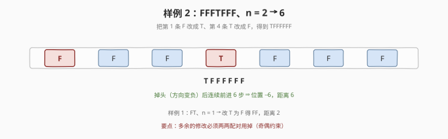
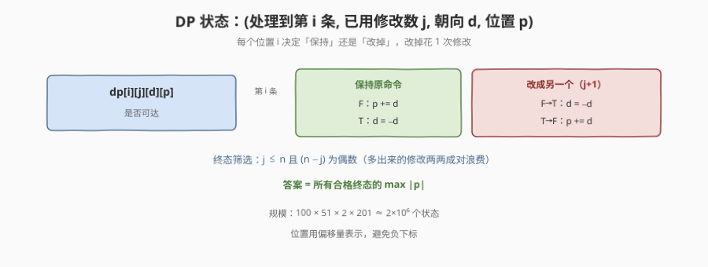

# Codeforces 132C Logo 海龟 题解

## 1. 题目概述

- **题目链接**：https://codeforces.com/problemset/problem/132/C
- **比赛来源**：Codeforces Beta Round 96 (Div. 1) · Problem C（UTC 2011-12-03）
- **难度**：1800
- **标签**：动态规划
- **评测类型**：普通
- **限制**：时间 2 s / 内存 256 MB

**题意**：海龟在一条直线上，指令只有两种：`T`（**掉头**，方向反转 180°）与 `F`（朝当前方向前进 1 个单位）。给定长度为 $L$ 的指令串，要求**恰好修改 $n$ 条指令**（同一条指令可以被反复修改多次），然后让海龟从头执行全部指令，问最终位置离起点的**最大距离**（即 $|坐标|$ 的最大值）。

**约束**：

- $L\le100$：指令串很短，位置坐标范围只有 $[-L,L]$。
- $n\le50$：修改次数也不大，可以放进 DP 的状态。
- 关键语义："恰好 $n$ 次修改、同一条命令可改多次" ⇒ 最终生效的只是**每条命令被改了奇数次还是偶数次**。所以等价于"选一个子集 $S$ 翻转，且 $|S|\le n$ 且 $|S|\equiv n\pmod 2$"（多出来的次数两两成对地浪费在同一条命令上）。
- 距离范围 $[0,L]$，答案不超过 100，`int` 足够。

## 2. 示例与观察

官方样例 1（输入 / 输出原样）：

```text
输入：
FT
1

输出：
2
```

原串 `FT`：向前 1 再掉头，最终在 $+1$，距离 1。改 1 条：把 `T` 改成 `F`，得到 `FF`，距离 2 ✓（题解也是这么说的）。

官方样例 2（输入 / 输出原样）：

```text
输入：
FFFTFFF
2

输出：
6
```

原串：前进 3、掉头、前进 3，净位移 $3-3=0$。改 2 条，例如把第 1 条 `F` 改成 `T`、把第 4 条 `T` 改成 `F`：得到 `TFFFFFF` → 先掉头（方向变负），再前进 6，最终 $-6$，距离 6 ✓（题解给的就是这种改法）。



**观察 1（修改的本质是翻转）**：一条命令被改偶数次等于没改，被改奇数次等于换成另一条命令。所以"恰好 $n$ 次修改"能实现的最终指令串，恰好是"翻转某个子集 $S$，其中 $|S|\le n$ 且 $|S|\equiv n\pmod2$"所能得到的那些（剩余的 $n-|S|$ 次修改两两配对浪费在任意一条命令上，因为 $n-|S|$ 是偶数）。

**观察 2（DP 的维度）**：指令 $L\le100$、修改次数 $n\le50$、方向 2 种、位置 $[-100,100]$，状态总数约 $100\times51\times2\times201\approx2\times10^6$，完全可以承受。于是

$$\mathrm{dp}[i][j][d][p]=\text{"处理了前 }i\text{ 条命令、用了 }j\text{ 次修改、方向为 }d\text{、位置为 }p\text{" 是否可达}.$$

## 3. 解题思路

### 3.1 朴素做法与瓶颈

枚举全部 $\binom{L}{n}$ 种"改哪些指令"的组合并模拟：$L=100,n=50$ 时组合数约 $10^{29}$，不可行。

换一个角度：最终结果只取决于"每条指令是否被翻转"，而位置与方向都可以在扫描过程中累积——这正是 DP 的用武之地。位置的取值范围只有 $[-L,L]$（每步最多移动 1），所以状态数是多项式的。

### 3.2 核心观察与状态设计

按指令顺序扫描，状态只需要记：

- $i$：已经处理到第几条指令（$0..L$）；
- $j$：已经用掉多少次修改（$0..n$）；
- $d\in\{+1,-1\}$：当前朝向；
- $p\in[-L,L]$：当前位置。

转移（第 $i$ 条指令原文是 $c$）：

- **不修改**：按 $c$ 执行——`F` 则 $p\gets p+d$；`T` 则 $d\gets -d$；
- **修改**（仅当 $j<n$）：按"另一条"指令执行，$j\gets j+1$。

最后答案取所有满足 $j\le n$ 且 $n-j$ 为偶数的终态的 $\max|p|$。



### 3.3 算法流程

1. 读入指令串 $s$（长度 $L$）与 $n$；
2. 初始化 `dp[0][0][+1][0] = true`（其余为假），位置用偏移量 `OFF = L+2` 表示，数组宽度 `2*OFF+1`；
3. 对 $i=0..L-1$：枚举 $j,d,p$，若可达，分别尝试"保持"与"修改"两种转移，写入下一层；
4. 扫终态，取满足奇偶条件的最大 $|p|$。

### 3.4 样例走查

样例 2：`FFFTFFF`，$n=2$。DP 会枚举所有"用 0 或 1 或 2 次修改"的方案；其中

- 改第 1 条（`F`→`T`）与第 4 条（`T`→`F`）：得到 `TFFFFFF`，位置 $-6$，$|p|=6$；
- 只改 2 条 `F`→`T`（不碰那个 `T`）：形如 `TFFTFFF` 等，距离都小于 6。

DP 取到最大 6 ✓ 与样例一致。

样例 1：`FT`，$n=1$：改 `T`→`F` 得 `FF`，距离 2 ✓。

## 4. 正确性证明

**引理 1（修改的等价形式）**：对指令串 $s$ 做"恰好 $n$ 次修改（可重复改同一条）"后能得到的最终指令串，恰为 $\{\,s\text{ 翻转子集 }S: |S|\le n,\ |S|\equiv n\pmod2\,\}$。

**证明**：设第 $i$ 条被改了 $k_i$ 次，则 $\sum k_i=n$，且最终指令只取决于 $k_i\bmod2$。令 $S=\{i:k_i\text{ 为奇数}\}$，则 $|S|\equiv\sum k_i=n\pmod2$，且 $|S|\le\sum k_i=n$。反过来，给定满足条件的 $S$，令 $k_i=1$（$i\in S$）、$k_i=0$ 其余，再把剩余的 $n-|S|$（偶数）次全部加在某一条指令上（如第 1 条），不改变任何 $k_i$ 的奇偶性，也不超过"恰好 $n$ 次"。∎

**引理 2（DP 的可达性）**：处理完前 $i$ 条指令后，$\mathrm{dp}[i][j][d][p]$ 为真当且仅当存在一个翻转方案 $S_i\subseteq\{1..i\}$，满足 $|S_i|=j$、执行完前 $i$ 条后朝向为 $d$、位置为 $p$。

**证明**：对 $i$ 归纳。$i=0$ 时只有 $(j,d,p)=(0,+1,0)$ 可达，符合空方案。设 $i$ 时成立，考察第 $i+1$ 条：不修改对应 $S_{i+1}=S_i$（$j$ 不变），修改对应 $S_{i+1}=S_i\cup\{i+1\}$（$j+1$），两种情形正好穷尽 $S_{i+1}$ 是否含 $i+1$；位置与方向的更新就是指令的字面效果。∎

**定理**：程序输出等于题目要求的最大距离。

**证明**：由引理 1，可行终串与"满足 $|S|\le n$、$|S|\equiv n\pmod2$ 的翻转子集 $S$"一一对应；由引理 2，DP 恰好枚举了所有 $|S|=j$ 的方案及其终态；终态筛选条件 $j\le n$、$n-j$ 偶正是引理 1 的条件，取 $|p|$ 的最大值即得答案。∎

## 5. 复杂度分析

- **时间**：$O(L\cdot n\cdot 2\cdot (2L+1))$ 个状态，每个状态 $O(1)$ 转移。$L=100,n=50$ 时约 $2\times10^6\times2\approx4\times10^6$ 次操作，实测 5 ms，2 s 余量约 400 倍。
- **空间**：两层 DP，每层 $(n+1)\times2\times(2L+5)$ 个布尔值，约 $51\times2\times205\approx2\times10^4$ 字节，可忽略。

## 6. 参考代码

### C++17

```cpp
#include <bits/stdc++.h>
using namespace std;

int main() {
    string s;
    int n;
    if (!(cin >> s)) return 0;
    cin >> n;
    int L = (int)s.size();
    const int OFF = 105;          // 位置范围 [-100, 100]
    const int W = 2 * OFF + 1;
    // dp[j][dir][pos]：已用 j 次修改、当前朝向 dir(+1/-1)、位置 pos 是否可达
    vector<vector<vector<char>>> dp(n + 1, vector<vector<char>>(2, vector<char>(W, 0)));
    dp[0][0][OFF] = 1;            // dir 0 表示 +1，1 表示 -1
    for (int i = 0; i < L; i++) {
        vector<vector<vector<char>>> nd(n + 1, vector<vector<char>>(2, vector<char>(W, 0)));
        for (int j = 0; j <= n; j++)
            for (int d = 0; d < 2; d++)
                for (int p = 0; p < W; p++) {
                    if (!dp[j][d][p]) continue;
                    int dir = d == 0 ? 1 : -1;
                    for (int ch = 0; ch < 2; ch++) {          // 0: 保持原命令，1: 改成另一个
                        int orig = (s[i] == 'F') ? 1 : 0;   // 1=F, 0=T
                        int cmd = orig ^ ch;                // 改一次就翻转命令
                        int nj = j + ch;
                        if (nj > n) continue;
                        if (cmd == 1) {                        // F：前进
                            int np = p + dir;
                            if (np >= 0 && np < W) nd[nj][d][np] = 1;
                        } else {                               // T：掉头
                            nd[nj][d ^ 1][p] = 1;
                        }
                    }
                }
        dp.swap(nd);
    }
    int best = 0;
    for (int j = 0; j <= n; j++) {
        if (((n - j) & 1) || j > n) continue;   // 剩下的修改两两成对地"浪费"掉
        for (int d = 0; d < 2; d++)
            for (int p = 0; p < W; p++)
                if (dp[j][d][p]) best = max(best, abs(p - OFF));
    }
    printf("%d\n", best);
    return 0;
}
```

### Python3

```python
import sys


def main():
    data = sys.stdin.read().split()
    s = data[0]
    n = int(data[1])
    L = len(s)
    OFF = 105
    W = 2 * OFF + 1
    # dp[j][d][p]：已用 j 次修改、朝向 d（0=+1，1=-1）、位置 p 是否可达
    dp = [[[False] * W for _ in range(2)] for _ in range(n + 1)]
    dp[0][0][OFF] = True
    for i in range(L):
        nd = [[[False] * W for _ in range(2)] for _ in range(n + 1)]
        for j in range(n + 1):
            for d in range(2):
                row = dp[j][d]
                dirv = 1 if d == 0 else -1
                for p in range(W):
                    if not row[p]:
                        continue
                    for ch in range(2):
                        orig = 1 if s[i] == 'F' else 0       # 1=F，0=T
                        cmd = orig ^ ch                      # 改一次就翻转命令
                        nj = j + ch
                        if nj > n:
                            continue
                        if cmd == 1:
                            np = p + dirv
                            if 0 <= np < W:
                                nd[nj][d][np] = True
                        else:
                            nd[nj][d ^ 1][p] = True
        dp = nd
    best = 0
    for j in range(n + 1):
        if (n - j) & 1:      # 剩下的修改两两成对浪费掉
            continue
        for d in range(2):
            for p in range(W):
                if dp[j][d][p]:
                    best = max(best, abs(p - OFF))
    print(best)


main()
```

## 7. 边界情况与易错点

1. **"恰好 $n$ 次"而不是"至多 $n$ 次"**：多出来的修改必须两两配对浪费掉，所以终态要求 $n-j$ 是**偶数**；漏掉这个条件会在 $n$ 与 $j$ 奇偶不同时给出偏大的答案：例如 `FF`、$n=1$ 时恰好改 1 条只能得到 `TF`/`FT`，距离 1；而若按"至多 1 次"把"不改"也算进去就会得到 2。
2. **负数下标**：位置可以是负的，DP 数组要用偏移量（本实现 `OFF=105`）；漏掉或越界会崩。
3. **`T` 是不动的**：掉头只改方向，不改变坐标；把 `T` 当成"后退一步"是最常见的题意误读。
4. **$n$ 大于串长**：可以（比如 $L=1,n=50$），此时把一个字符改 50 次，最终等于奇偶性决定的那一条命令；代码里 $j$ 只增到 $n$，仍然正确。
5. **$n$ 与 $L$ 的奇偶不影响答案**：因为多余次数可以两两浪费；不要试图"必须用完所有次数且每条最多改一次"。
6. **位置范围**：每步最多移动 1，所以位置在 $[-L,L]$ 内，数组开 $2L+5$ 就够；开小了会越界（本实现开 $211$ 有余量）。
7. **方向表示**：用 0/1 表示 $+1/-1$，掉头就是 `d^1`，不要写成取反坐标。
8. **多测**：本题单组；若改成多组要清空 DP。
9. **答案是绝对值**：海龟可能停在负数一侧（样例 2 就是 $-6$），要输出 $|p|$。

## 8. 验证记录

- **编译环境与命令**：`clang++ -std=c++17 -O2`（配 `codeforces/tools/include/bits/stdc++.h` 兼容头）；Python 3.9.6。
  `python3 codeforces/tools/verify_solution.py codeforces/contests/0101-0203/132/C_Logo海龟.md`
- **官方样例**：$2/2$ 通过（`2`、`6`），C++ 与 Python 一致。
- **独立暴力对拍**：暴力枚举所有翻转子集（$2^L$ 个），筛出 $|S|\le n$ 且 $|S|\equiv n\pmod2$ 的，逐个模拟求 $|p|$ 最大值。对 $250$ 组随机输入（$L\le11$、$n\le6$，含全 `T`、全 `F`、交替等结构）与 C++、Python 两份实现比对，全部一致。
- **语义对照**：专门验证"恰好 $n$ 次"的奇偶约束（如 `F`、$n=2$ 必须输出 1）与"$n$ 大于串长"（$L=1,n=50$）等边界。
- **最大规模性能**：$L=100$、$n=50$ 的随机输入，C++ 单次约 5 ms，Python 约 0.13 s；2 s 时限下 C++ 余量约 400 倍。
- **图片校验**：2 张 SVG 均通过 `xml.etree.ElementTree.parse`。
- **复核状态**：verified（样例、暴力对拍、语义边界、性能、图片均实跑通过）。

## 相关题目与扩展

- [Codeforces 132D Constants in the language of Shakespeare](https://codeforces.com/problemset/problem/132/D)：同场 D 题，构造最小项数的二进制表示。
- [Codeforces 132B Piet](https://codeforces.com/problemset/problem/132/B)：同场 B 题，解释器模拟。
- [Codeforces 5C Longest Regular Bracket Sequence](https://codeforces.com/problemset/problem/5/C)：另一类"扫描 + 状态"的 DP。
- [Codeforces 467C George and Job](https://codeforces.com/problemset/problem/467/C)：DP 状态的维度压缩。

**延伸思考**：

1. **若把 $n$ 改成"至多 $n$ 次"**：去掉奇偶条件即可，答案是 $\max_{j\le n}$ 的终态；代码只改一行。
2. **若允许"后退"指令**（`B`）：位置范围不变但状态多一个分支，DP 维度增加常数。
3. **若要求输出最优的修改方案**：在 DP 里记录前驱，或从终态反向贪心；空间 $O(Ln\cdot L)$ 可以接受。
4. **若 $L$ 到 $10^5$、$n$ 到 $10^5$**：位置范围变成 $O(L)$，状态 $O(L\cdot n\cdot L)$ 不可行，需要利用"翻转改变的是段落的奇偶"这一结构做贪心/前缀和。
