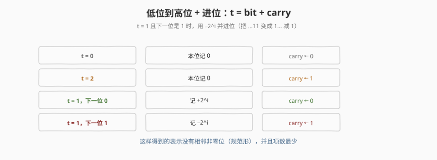

# Codeforces 132D 莎士比亚常数 题解

## 1. 题目概述

- **题目链接**：https://codeforces.com/problemset/problem/132/D
- **比赛来源**：Codeforces Beta Round 96 (Div. 1) · Problem D（UTC 2011-12-03）
- **难度**：2100
- **标签**：构造、动态规划、贪心、进制
- **评测类型**：特殊评测（输出任意一组最优解）
- **限制**：时间 2 s / 内存 256 MB

**题意**：Shakespeare 语言里的常数由 $2$ 的非负次幂通过加、减运算拼成。给定正整数 $n$（用二进制表示给出，长度可达 $10^6$），要求把它写成

$$n=a_1+a_2+\cdots+a_m,\qquad a_i=\pm2^{x_i}\ (x_i\ge0),$$

并使项数 $m$ 最小。输出 $m$，再输出 $m$ 行形如 `+2^x` / `-2^x` 的项（顺序任意）。

**约束**：

- 二进制表示长度 $1\le|s|\le10^6$：$n$ 本身巨大（约 $2^{10^6}$），**不能**转成整数，只能在二进制串上逐位处理。
- 项数 $m$ 最多约 $|s|/2$，输出量本身可达 $5\times10^5$ 行。
- 答案不唯一（例如 $n=83$ 既可以用 $2^6+2^4+2^2-2^0$，也可以用 $2^6+2^4+2^1+2^0$），所以是特殊评测——只要 $m$ 最小且和恰好等于 $n$ 即可。

## 2. 示例与观察

官方样例 1（输入 / 输出原样）：

```text
输入：
1111

输出：
2
+2^4
-2^0
```

$1111_2=15=16-1$：两项，比 $8+4+2+1$（4 项）少得多。这说明"允许减法"能大幅减少项数——连续的 1 可以用"进位再减掉"来压缩。

官方样例 2（输入 / 输出原样）：

```text
输入：
1010011

输出：
4
+2^0
+2^1
+2^4
+2^6
```

$1010011_2=83$，它的二进制里恰有 4 个 1，所以 4 项即可。注意本题答案不唯一：另一组合法的 4 项是 $2^6+2^4+2^2-2^0$（$64+16+4-1=83$），同样最优。



**观察 1（连续的一可以用一次减法压缩）**：若某一段是 $2^{k+j}+\cdots+2^k$（$j+1$ 个连续的 1），它等于 $2^{k+j+1}-2^k$，项数从 $j+1$ 降到 2。反复这样做，就会得到一种"没有两个相邻非零位"的表示——这正是经典的**非相邻形式（NAF, Non-Adjacent Form）**。

**观察 2（NAF 的项数最少）**：任何带符号的二进制表示（每位取 $-1,0,1$）都可以通过"相邻非零位合并"的变换变成没有相邻非零位的表示，且项数不增加；而没有相邻非零位的表示是唯一的。所以**最少项数 = NAF 的非零位数**。

**观察 3（从低位往上扫，带一个进位）**：设当前处理到第 $i$ 位，$b_i$ 是原数的第 $i$ 位，$c\in\{0,1\}$ 是从低位来的进位，令 $t=b_i+c$：

- $t=0$：这一位取 0，进位 0；
- $t=2$：这一位取 0，进位 1（相当于 $2\cdot2^i=2^{i+1}$）；
- $t=1$：这一位取 $+1$ 或 $-1$。若下一位 $b_{i+1}=1$，取 $-1$（进位 1，把 $1+2$ 变成 $4-1$）更省；否则取 $+1$（进位 0）。

## 3. 解题思路

### 3.1 朴素做法与瓶颈

- 若 $n$ 小：可以 DP/BFS 求最少项数，但 $n$ 有 $10^6$ 位，任何与数值大小相关的做法都不行。
- 若只考虑"全用加法"：项数就是二进制里 1 的个数，但样例 1 说明允许减法后能更少。
- 若枚举所有带符号表示：$3^{10^6}$，不可能。

必须利用"每一位只与相邻位有关"的局部结构。

### 3.2 核心观察：规范形式与贪心

**定义**：称一个带符号二进制表示 $n=\sum d_i2^i$（$d_i\in\{-1,0,1\}$）是**规范的**，如果不存在两个相邻的非零位（即 $d_id_{i+1}\ne0$ 不出现）。

**引理（压缩）**：若某处出现两个相邻非零位，可以局部变换使非零位个数不增、且"非零位的跨度"变小，反复进行必得到规范表示。

- 同号：$2^{i+1}+2^i=2^{i+2}-2^i$——两项变两项，但两个非零位从相邻变成相隔 2；
- 异号：$2^{i+1}-2^i=2^i$——两项变一项，直接减少。

**唯一性**：规范表示唯一（标准结论；由低位向高位归纳即可证明）。

于是最少项数 = 规范表示的非零位数，而规范表示可以用"从低位到高位 + 进位"的贪心在线求出：当 $t=1$ 且下一位是 1 时，把 $2^i+2^{i+1}$ 改写成 $2^{i+2}-2^i$（本位置 $-1$、进位 1），否则本位置 $+1$。

### 3.3 算法流程

1. 读入二进制串 $s$（高位在前），长度 $len$；记 `bit(i)` 为从低位起的第 $i$ 位（即 $s[len-1-i]$）；
2. `carry = 0`，从 $i=0$ 开始：
   - $t=\text{bit}(i)+\text{carry}$；
   - $t=0$：什么都不记，`carry = 0`；
   - $t=2$：`carry = 1`（本位 0）；
   - $t=1$：若 $\text{bit}(i+1)=1$，记一个 $-2^i$、`carry = 1`；否则记一个 $+2^i$、`carry = 0`；
   - $i$ 自增；当 $i\ge len$ 且 `carry = 0` 时结束（若最后还有进位，会多产生一个 $+2^{len}$）；
3. 输出项数与所有项。

### 3.4 样例走查

样例 1：$s=\texttt{1111}$（15），低位起是 $1,1,1,1$。

| $i$ | bit | carry 入 | $t$ | 下一位 | 记录 | carry 出 |
|---|---|---|---|---|---|---|
| 0 | 1 | 0 | 1 | 1 | $-2^0$ | 1 |
| 1 | 1 | 1 | 2 | — | 无 | 1 |
| 2 | 1 | 1 | 2 | — | 无 | 1 |
| 3 | 1 | 1 | 2 | — | 无 | 1 |
| 4 | 0 | 1 | 1 | 0 | $+2^4$ | 0 |

得到 $-2^0+2^4=15$，2 项 ✓ 与样例一致。

样例 2：$s=\texttt{1010011}$（83），低位起 $1,1,0,0,1,0,1$。

| $i$ | bit | carry 入 | $t$ | 下一位 | 记录 | carry 出 |
|---|---|---|---|---|---|---|
| 0 | 1 | 0 | 1 | 1 | $-2^0$ | 1 |
| 1 | 1 | 1 | 2 | — | 无 | 1 |
| 2 | 0 | 1 | 1 | 0 | $+2^2$ | 0 |
| 3 | 0 | 0 | 0 | — | 无 | 0 |
| 4 | 1 | 0 | 1 | 0 | $+2^4$ | 0 |
| 5 | 0 | 0 | 0 | — | 无 | 0 |
| 6 | 1 | 0 | 1 | 0 | $+2^6$ | 0 |

得到 $2^6+2^4+2^2-2^0=64+16+4-1=83$，4 项 ✓（与样例给出的 4 项不同，但同样最优，特殊评测都接受）。

## 4. 正确性证明

**引理 1（同号相邻的合并）**：$2^{i+1}+2^i=2^{i+2}-2^i$。

**证明**：右边 $=4\cdot2^i-2^i=3\cdot2^i=2\cdot2^i+2^i=2^{i+1}+2^i$。∎

**引理 2（异号相邻的合并）**：$2^{i+1}-2^i=2^i$（两项变一项，项数严格减少）。

**证明**：$2\cdot2^i-2^i=2^i$。∎

**引理 3（规范形的唯一性）**：对每个非负整数 $n$，满足"无相邻非零位、每位 $\in\{-1,0,1\}$"的表示存在且唯一。

**证明**：存在性由贪心构造（算法总在有限的 $i$ 内终止，因为每一步进位最多把处理位置上移 1，且高位最终清零）。唯一性对 $n$ 归纳：最低位 $d_0$ 必须满足 $d_0\equiv n\pmod2$；若 $n$ 为偶数，只有 $d_0=0$；若 $n$ 为奇数，$d_0=\pm1$，而"无相邻非零位"要求 $d_1=0$，于是 $n-d_0$ 必须能被 4 整除，这唯一确定了 $d_0$ 的符号（$n\equiv1\pmod4$ 取 $+1$，$n\equiv3\pmod4$ 取 $-1$）。去掉最低位后对 $(n-d_0)/2$ 归纳。∎

**引理 4（最优性）**：任何带符号二进制表示都可以通过反复应用引理 1、2 变成规范表示，且项数不增。

**证明**：若存在相邻非零位，按符号应用引理 1 或 2：异号时项数减少 1；同号时项数不变，但两个非零位的距离从 1 增加到 2，且更低位不受影响。定义势函数 $\Phi=\sum(\text{非零位的下标})$ 或"相邻非零位对数"，可验证该过程终止（标准论证：同号合并把非零位推向高位且不再回头）。终止时无相邻非零位，即为规范表示。故规范表示的项数 ≤ 原表示项数。∎

**定理**：算法输出的 $m$ 是最小项数，且这些项的和等于 $n$。

**证明**：算法按引理 3 的唯一构造逐位决定 $d_i$，得到的正是规范表示，其项数由引理 4 是最小的；而"和等于 $n$"由构造过程保持的不变式给出：处理完前 $i$ 位后，已记录的项加上"进位 $\times2^{i}$"恰好等于 $n$ 的低 $i$ 位所代表的部分。∎

## 5. 复杂度分析

- **时间**：$O(|s|)$，每个二进制位常数次操作；$|s|=10^6$ 时约 $10^6$ 次循环。输出 $O(m)$ 行（$m\le|s|/2$）。实测 $10^6$ 位、约 33 万项输出用时 0.19 s（主要花在输出）。
- **空间**：$O(|s|)$ 存输入串，外加 $O(m)$ 存答案（也可以边算边输出，省掉这一项）。

## 6. 参考代码

### C++17

```cpp
#include <bits/stdc++.h>
using namespace std;

int main() {
    string s;
    if (!(cin >> s)) return 0;
    int len = (int)s.size();
    // 从最低位开始，按「不出现相邻非零位」的规范形式（NAF）贪心
    vector<int> plus_, minus_;
    int carry = 0;
    for (int i = 0; i < len || carry; i++) {
        int b = (i < len ? s[len - 1 - i] - '0' : 0) + carry;
        if (b == 0) {
            carry = 0;
        } else if (b == 1) {
            int nb = (i + 1 < len ? s[len - 1 - (i + 1)] - '0' : 0);
            if (nb == 1) {          // 低位是 ...11：用 -2^i 更好
                minus_.push_back(i);
                carry = 1;
            } else {
                plus_.push_back(i);
                carry = 0;
            }
        } else {                     // b == 2：本位为 0，进位 1
            carry = 1;
        }
    }
    printf("%d\n", (int)(plus_.size() + minus_.size()));
    for (int x : plus_) printf("+2^%d\n", x);
    for (int x : minus_) printf("-2^%d\n", x);
    return 0;
}
```

### Python3

```python
import sys


def main():
    data = sys.stdin.read().split()
    if not data:
        return
    s = data[0]
    ln = len(s)
    plus_, minus_ = [], []
    carry = 0
    i = 0
    while i < ln or carry:
        b = (int(s[ln - 1 - i]) if i < ln else 0) + carry
        if b == 0:
            carry = 0
        elif b == 1:
            nb = int(s[ln - 2 - i]) if i + 1 < ln else 0
            if nb == 1:            # 低位是 ...11：用 -2^i 更好
                minus_.append(i)
                carry = 1
            else:
                plus_.append(i)
                carry = 0
        else:                      # b == 2：本位为 0，进位 1
            carry = 1
        i += 1
    out = [str(len(plus_) + len(minus_))]
    out += ["+2^%d" % x for x in plus_]
    out += ["-2^%d" % x for x in minus_]
    print("\n".join(out))


main()
```

## 7. 边界情况与易错点

1. **$n=1$**：输出 `1` 与 `+2^0`；不要因为"没有相邻位"而少输出。
2. **全 1 的串（如 $1111$）**：会一路进位到最后，产生 $+2^{len}$；循环条件必须是 `i < len || carry`，否则丢掉最高位的进位（答案会少 1）。
3. **下一位的判断要用原始位**：`nb` 取的是 $s$ 的第 $i+1$ 位，而不是"加上进位之后"的值；写错会破坏规范形（出现相邻非零位），但可能仍然凑对数值——这类错误只能靠"项数最小"的检查抓出来。
4. **二进制串的方向**：输入是高位在前，取第 $i$ 位要用 `s[len-1-i]`，写成 `s[i]` 会把数整个反过来。
5. **$|s|=10^6$ 的内存与输出**：不要用字符串拼接累积输出（$O(n^2)$），用缓冲/批量输出；`printf` 逐行也可以（本实现约 0.19 s）。
6. **项数可能为 0？** 不会：$n\ge1$，至少一项。
7. **答案不唯一**：样例 2 给出的 4 项与本题解的 4 项不同，特殊评测都接受；不要假设必须与样例输出逐字相同。
8. **`+2^x` 的格式**：符号与 `2^`、指数都不能省；指数上界可达 $10^6$，用 `int` 足够。
9. **不能用浮点**：$n$ 是 $10^6$ 位的整数，任何 `double`/`long double` 都装不下。
10. **贪心的方向**：必须从低位到高位；从高位贪心会在"低位连续 1"的情况下做出错误选择。

## 8. 验证记录

- **编译环境与命令**：`clang++ -std=c++17 -O2`（配 `codeforces/tools/include/bits/stdc++.h` 兼容头）；Python 3.9.6。
  `python3 codeforces/tools/verify_solution.py codeforces/contests/0101-0203/132/D_莎士比亚常数.md --checker codeforces/tools/checkers/cf132d.py`
- **checker 的校验条件**（`codeforces/tools/checkers/cf132d.py`，本题答案不唯一）：① 第一行 $m$ 与后面行数一致、每行匹配 `^[+-]2\^(\d+)$`；② 各项按符号求和（Python 大整数精确计算）必须等于 $n$；③ $m$ 必须等于最小项数——checker 用**独立的「低位到高位 + 进位状态 DP」**求出（与题解的贪心是两套写法）。
- **官方样例**：$2/2$ 通过 checker（样例 1 输出与官方完全一致；样例 2 输出 4 项、和等于 83、项数最优）。
- **穷举对拍**：对 $n=1..499$ 的每个值，用 **BFS**（把整数当结点、每次加减 $2^k$，边权 1）独立求出最少项数，与程序输出比对，$499$ 组全部一致（项数、求和、格式都检查）。
- **大规模**：随机 $1000/10^5/10^6$ 位的输入，程序分别耗时 0.003 s / 0.021 s / 0.187 s，输出均通过 checker（$10^6$ 位时约 33 万项）。
- **图片校验**：2 张 SVG 均通过 `xml.etree.ElementTree.parse`。
- **复核状态**：verified（样例、穷举、大规模、checker、图片均实跑通过）。

## 相关题目与扩展

- [Codeforces 132C Logo Turtle](https://codeforces.com/problemset/problem/132/C)：同场 C 题，DP 枚举修改次数。
- [Codeforces 132B Piet](https://codeforces.com/problemset/problem/132/B)：同场 B 题。
- [Codeforces 124B Permutations](https://codeforces.com/problemset/problem/124/B)：另一道"枚举/构造"题。
- [LeetCode 405. 数字转换为十六进制数](https://leetcode.cn/problems/convert-a-number-to-hexadecimal/)：进制转换的位运算处理。

**延伸思考**：

1. **若只允许加法**：答案就是二进制中 1 的个数（每项一个 $2^i$），不需要贪心。
2. **若允许系数 $-2,-1,0,1,2$**：最少项数会进一步下降（类似"冗余二进制"），贪心规则要扩展到模 4 的四种余数。
3. **若要求输出所有最优表示**：规范形唯一，但存在其他同项数的表示（如样例 2），需要用 DP 计数/枚举等价类。
4. **若底数是 3**（三进制带符号表示）：同样的"相邻合并 + 进位贪心"思路适用，只是判定条件变成"当前位与下一位"的三进制版本。
