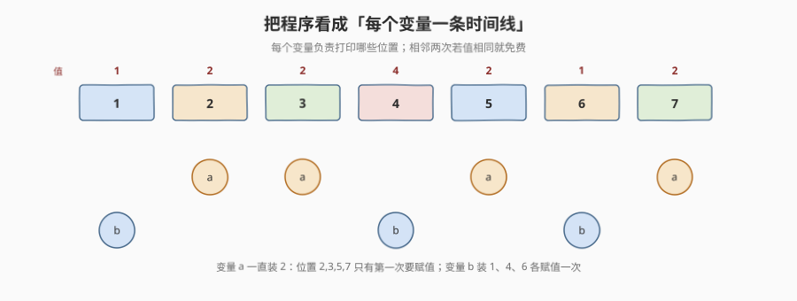
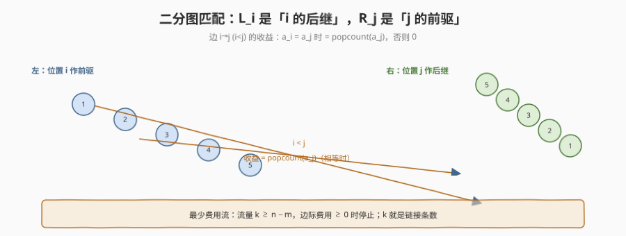
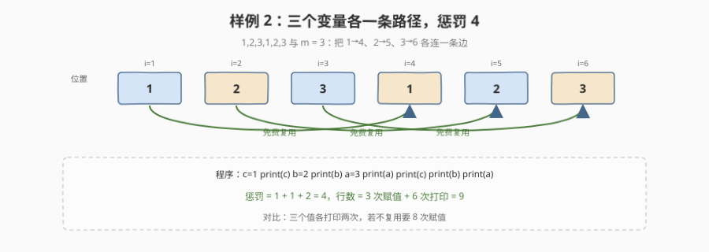

# Codeforces 132E 印刷变量分配 题解

## 1. 题目概述

- **题目链接**：https://codeforces.com/problemset/problem/132/E
- **比赛来源**：Codeforces Beta Round 96 (Div. 1) · Problem E（UTC 2011-12-03）
- **难度**：2700
- **标签**：网络流、图论、贪心
- **评测类型**：特殊评测（输出任意一组最优程序）
- **限制**：时间 2 s / 内存 256 MB

**题意**：Shakespeare 语言里的变量用 `a`..`z` 命名。现在有 $m$ 个变量（$m\le26$），要把长度为 $n$（$n\le250$）的整数序列按顺序打印出来，只允许两种操作：

- `x=int`：把整数写进变量（**惩罚 = int 的二进制中 1 的个数**）；
- `print(x)`：打印变量当前的值（无惩罚）。

求一种程序，使"总惩罚"最小；输出行数、总惩罚，以及程序本身。

**约束**：

- $n\le250$、$m\le26$：变量很少但序列不短，"每个位置都重新赋值"是 $O(n)$ 次赋值。
- 每个数 $\le10^9$：popcount $\le30$，惩罚都很小但差异明显（例如 $2^{30}$ 只要 1 次赋值，$2^{30}-1$ 要 30 次）。
- 关键约束是**变量个数 $m$**：同一个值若要在后面再次打印，可以让它一直留在某个变量里（不花钱），但变量被别的值覆盖后就没了。
- 答案不唯一，特殊评测。

## 2. 示例与观察

官方样例 1（输入 / 输出原样）：

```text
输入：
7 2
1 2 2 4 2 1 2

输出：
11 4
b=1
print(b)
a=2
print(a)
print(a)
b=4
print(b)
print(a)
b=1
print(b)
print(a)
```

序列是 $1,2,2,4,2,1,2$，两个变量。样例给的程序：`b=1`（惩罚 1）打印第一个 1；`a=2`（惩罚 1）打印两个 2；`b=4`（惩罚 1）打印 4；然后 `print(a)` 打出第三个 2（**变量 `a` 一直留着 2**）；`b=1`（惩罚 1）打印 1；最后 `print(a)` 打出 2。总惩罚 $1+1+1+1=4$，共 11 行（4 次赋值 + 7 次打印）✓

官方样例 2（输入 / 输出原样）：

```text
输入：
6 3
1 2 3 1 2 3

输出：
9 4
c=1
print(c)
b=2
print(b)
a=3
print(a)
print(c)
print(b)
print(a)
```

三个变量分别装 $1,2,3$，每个只赋值一次：惩罚 $1+1+2=4$（注意 $\mathrm{popcount}(3)=2$），$6$ 次打印，共 9 行 ✓



**观察 1（把程序看成"每个变量的一条时间线"）**：把第 $i$ 个位置想成时间轴上的一个点。每个变量在整段时间里被若干次赋值，每次赋值之后它保持某个值直到下次被覆盖。于是**每个变量负责打印若干个位置**，这些位置按时间递增——一条"路径"。$m$ 个变量就是 $m$ 条路径，所有位置被恰好覆盖一次。

**观察 2（相邻两次赋值的代价）**：在一条路径上，连续两个被它打印的位置 $i<j$：

- 若 $a_i=a_j$：变量里一直是这个值，**不需要赋值**，$j$ 是"免费"的；
- 若 $a_i\ne a_j$：必须重新赋值，代价 $\mathrm{popcount}(a_j)$。

路径的第一个位置总要赋值，代价 $\mathrm{popcount}(a_i)$。

于是总惩罚

$$\sum_i \mathrm{popcount}(a_i)\;-\;\sum_{\text{路径上相邻且相等的对 }(i,j)}\mathrm{popcount}(a_j),$$

即"先假设每个位置都赋值，再把能免费复用的那些省掉"。

## 3. 解题思路

### 3.1 朴素做法与瓶颈

枚举"每个位置由哪个变量打印"：$m^n$ 种，$m=26,n=250$ 时天文数字。即使按变量重新组织成"给每个位置选前驱"，状态空间也太大。

真正的结构是：**这条路径的所有权只影响"相邻相等对"能省多少钱**，而"相邻"关系构成一个匹配（每个位置至多有一个前驱、至多一个后继）。

### 3.2 核心观察：路径覆盖 + 二分图匹配

把每个位置 $i$ 看成结点。若 $i$ 的直接后继是 $j$（即同一变量在打印完 $i$ 后下一次打印 $j$），就连一条有向边 $i\to j$。因为时间递增，这形成一个**路径覆盖**（每个结点至多一条入边、至多一条出边，无环）。

- 路径的条数 $= n-\text{（边的条数）}$（每条边把两条路径接成一条）；
- 路径条数必须 $\le m$，即边数 $\ge n-m$；
- 边 $i\to j$ 的收益：$a_i=a_j$ 时为 $\mathrm{popcount}(a_j)$（$j$ 免费），否则为 0（$j$ 照常赋值）。

于是问题变成：

$$\max\ \sum_{\text{选中的边 }(i,j)}\big[a_i=a_j\big]\cdot \mathrm{popcount}(a_j)\qquad\text{s.t. 每个点入度、出度}\le1,\ \text{边数}\ge n-m.$$

这是一个**二分图最大权匹配**：左侧结点 $L_i$ 表示"$i$ 作为前驱"，右侧 $R_j$ 表示"$j$ 作为后继"，边 $L_i\to R_j$（$i<j$）的费用取 $-\big[a_i=a_j\big]\mathrm{popcount}(a_j)$；跑最小费用流即可。

"边数 $\ge n-m$"用"流量 $k\ge n-m$"表示；由于费用非正、且每次增广取当前最短路，**边际费用单调不减**，所以"流量从 $n-m$ 起、一旦边际费用 $\ge0$ 就停"就能拿到 $\min_{k\ge n-m}$ 的最优值。



### 3.3 算法流程

1. 预处理 $w_i=\mathrm{popcount}(a_i)$，总额 $\Sigma=\sum w_i$；
2. 建图：源点 $S\to L_i$（容量 1、费用 0）、$R_j\to T$（容量 1、费用 0）、$L_i\to R_j$（$i<j$，容量 1，费用 $-[a_i=a_j]w_j$）；
3. 反复用 SPFA 求 $S\to T$ 的最短增广路：
   - 若没有增广路，停止；
   - 若已增广 $k\ge n-m$ 次且最短路费用 $\ge0$，停止（再增广不会更优）；
   - 否则沿路增广 1 单位流量，$k{+}1$；
4. 由流量为 1 的 $L_i\to R_j$ 边还原 `succ[i]=j`，串出每条路径（= 一个变量），给路径编号 `a,b,c,…`；
5. 按时间 $1..n$ 输出：位置 $i$ 由它所在路径的变量打印；若该变量当前值 $\ne a_i$，先输出一行 `x=a_i`（累加惩罚），再输出 `print(x)`；
6. 输出行数与总惩罚。

### 3.4 样例走查



样例 2：$a=[1,2,3,1,2,3]$，$m=3$，$w=[1,1,2,1,1,2]$。

匹配可以取 $L_1\to R_4$（$a_1=a_4=1$，收益 1）、$L_2\to R_5$（收益 1）、$L_3\to R_6$（收益 2），三条边、$k=3\ge n-m=3$ ✓，总收益 $4$，惩罚 $=8-4=4$ ✓ 与样例一致。三条路径分别是 $1\to4$、$2\to5$、$3\to6$，于是三个变量各赋值一次：`a=1`、`b=2`、`c=3`，然后打印 $1,2,3$，再打印 $1,2,3$ ✓

样例 1：$a=[1,2,2,4,2,1,2]$，$w$ 全为 1，$\Sigma=7$，$n-m=5$。取边 $1\to2$（0）、$2\to3$（收益 1）、$3\to5$（收益 1）、$4\to6$（0）、$5\to7$（收益 1）：$k=5$ ✓ 收益 3，惩罚 $7-3=4$ ✓ 与样例一致。

## 4. 正确性证明

**引理 1（程序 ↔ 路径覆盖）**：任何一个用 $m$ 个变量的合法程序，都对应一个"位置集合的路径覆盖"，路径数 $\le m$，且总惩罚 $\ge \Sigma-\sum_{\text{相邻相等边}}w_j$；反过来，任何路径覆盖（路径数 $\le m$）都能实现一个程序，其惩罚恰为 $\Sigma-\sum_{\text{相邻相等边}}w_j$。

**证明**：给定程序，令变量 $x$ 负责打印的位置按时间排成一条路径（同一变量可能被赋值多次，但被它打印的位置是确定的、递增的）。每条路径数 $\le m$ 显然。对路径上相邻的 $i<j$：变量在 $i$ 时刻持有 $a_i$；在 $j$ 之前它可能被重新赋值，但若最终要打印 $a_j$，则 $a_i=a_j$ 时可以不赋值（省 $w_j$），$a_i\ne a_j$ 时至少要赋值一次（花 $w_j$）。而每个位置被打印前都必须有过赋值（初始变量无值），故总惩罚 $\ge\Sigma-\sum_{\text{相等边}}w_j$。反向：按路径为每个变量赋值/打印，显然达成等号。∎

**引理 2（匹配 ↔ 路径覆盖）**：边集 $\{(i,j)\}$ 满足"每个点入度、出度 $\le1$、$i<j$"当且仅当它构成一个路径覆盖；其路径数为 $n-|\text{边}|$。

**证明**：$i<j$ 保证无环（沿边时间严格递增），每个点至多一个前驱/后继，故是若干条互不相交的路径；每条边把两条路径合并成一条，故路径数 $=n-|\text{边}|$。∎

**引理 3（二分图匹配等价）**：选择满足引理 2 条件的边，等价于在二分图（左 $L_i$、右 $R_j$、边 $L_i\to R_j$ 当且仅当 $i<j$）中选一个匹配。

**证明**：左 $L_i$ 至多用一次 = $i$ 至多一个后继；右 $R_j$ 至多用一次 = $j$ 至多一个前驱。∎

**引理 4（停止条件）**：在最小费用流中，每次沿最短增广路增广 1 单位流量，其"边际费用"单调不减；因此当已增广 $k\ge n-m$ 且当前最短路的费用 $\ge0$ 时，任何更大的流量都不会更优。

**证明**：最小费用流的经典性质（successive shortest path 的边际费用非减，由残量网络最短路性质给出）。∎

**定理**：算法输出的程序总惩罚最小，且打印顺序正确。

**证明**：由引理 1、2、3，可行程序 ↔ 边数 $\ge n-m$ 的匹配，惩罚 $=\Sigma-$（匹配总收益）；算法在引理 4 的停止条件下取到 $\min_{k\ge n-m}$ 的最小费用（即最大收益），故惩罚最小。打印顺序由第 5 步按时间输出保证。∎

## 5. 复杂度分析

- **时间**：建图 $O(n^2)$ 条边；最多增广 $O(n)$ 次，每次 SPFA 在最坏 $O(VE)$ 但实际远小于此（稠密图但分层很浅），$n=250$ 时实测 0.05–0.08 s，2 s 余量约 25 倍。
- **空间**：边表 $O(n^2)$（约 3 万条正向边），其余 $O(n)$，远小于 256 MB。

## 6. 参考代码

### C++17

```cpp
#include <bits/stdc++.h>
using namespace std;
typedef long long ll;

int popcnt(ll x) { return __builtin_popcountll((unsigned long long)x); }

int main() {
    int n, m;
    if (scanf("%d %d", &n, &m) != 2) return 0;
    vector<ll> a(n + 1);
    vector<int> w(n + 1);
    for (int i = 1; i <= n; i++) {
        scanf("%lld", &a[i]);
        w[i] = popcnt(a[i]);
    }
    // 二分图：左侧 L_i = i 作为「前驱」，右侧 R_j = j 作为「后继」
    // 边 i->j (i<j)：a_i == a_j 时费用 -w_j（省下这次赋值），否则 0
    int S = 0, T = 2 * n + 1, N = 2 * n + 2;
    vector<int> head(N, -1);
    struct E { int to, cap, cost, next; };
    vector<E> es;
    auto addEdge = [&](int u, int v, int cap, int cost) {
        es.push_back({v, cap, cost, head[u]}); head[u] = (int)es.size() - 1;
        es.push_back({u, 0, -cost, head[v]}); head[v] = (int)es.size() - 1;
    };
    for (int i = 1; i <= n; i++) {
        addEdge(S, i, 1, 0);
        addEdge(n + i, T, 1, 0);
    }
    for (int i = 1; i <= n; i++)
        for (int j = i + 1; j <= n; j++)
            addEdge(i, n + j, 1, a[i] == a[j] ? -w[j] : 0);

    vector<int> dist(N), pre(N);
    auto shortest = [&]() -> bool {           // SPFA，只求最短增广路
        fill(dist.begin(), dist.end(), INT_MAX);
        fill(pre.begin(), pre.end(), -1);
        vector<char> inq(N, 0);
        deque<int> q;
        dist[S] = 0; q.push_back(S); inq[S] = 1;
        while (!q.empty()) {
            int u = q.front(); q.pop_front(); inq[u] = 0;
            for (int id = head[u]; id != -1; id = es[id].next) {
                E &e = es[id];
                if (e.cap > 0 && dist[e.to] > dist[u] + e.cost) {
                    dist[e.to] = dist[u] + e.cost;
                    pre[e.to] = id;
                    if (!inq[e.to]) { inq[e.to] = 1; q.push_back(e.to); }
                }
            }
        }
        return dist[T] != INT_MAX;
    };

    int K0 = max(0, n - m);   // 至少需要 n-m 条「链接」，才能把位置分成 <= m 段
    int k = 0;
    long long total = 0;
    while (shortest()) {
        if (k >= K0 && dist[T] >= 0) break;   // 边际代价非负且已满足路径数
        for (int v = T; v != S; v = es[pre[v] ^ 1].to) {
            es[pre[v]].cap -= 1;
            es[pre[v] ^ 1].cap += 1;
        }
        total += dist[T];
        k++;
    }

    // 从匹配边还原路径：succ[i] = j 表示 i 后面紧接 j
    vector<int> succ(n + 1, 0), pred(n + 1, 0);
    for (int u = 1; u <= n; u++)
        for (int id = head[u]; id != -1; id = es[id].next) {
            int v = es[id].to;
            if (v > n && v <= 2 * n && es[id].cap == 0) {   // 原先容量 1、已被匹配
                succ[u] = v - n;
                pred[v - n] = u;
            }
        }
    vector<int> regOf(n + 1, -1);
    int regCnt = 0;
    for (int i = 1; i <= n; i++) {
        if (pred[i] != 0) continue;
        int cur = i;
        while (cur != 0) { regOf[cur] = regCnt; cur = succ[cur]; }
        regCnt++;
    }
    vector<string> lines;
    int penalty = 0;
    vector<ll> curVal(regCnt, LLONG_MIN);
    for (int i = 1; i <= n; i++) {
        int r = regOf[i];
        string nm(1, (char)('a' + r));
        if (curVal[r] != a[i]) {
            curVal[r] = a[i];
            lines.push_back(nm + "=" + to_string(a[i]));
            penalty += w[i];
        }
        lines.push_back("print(" + nm + ")");
    }
    printf("%d %d\n", (int)lines.size(), penalty);
    for (auto &s : lines) printf("%s\n", s.c_str());
    return 0;
}
```

### Python3

```python
import sys
from collections import deque

INF = float("inf")


def popcount(x):
    return bin(x).count("1")


def main():
    data = sys.stdin.buffer.read().split()
    n, m = int(data[0]), int(data[1])
    a = [0] + [int(x) for x in data[2:2 + n]]
    w = [0] * (n + 1)
    for i in range(1, n + 1):
        w[i] = popcount(a[i])

    # 二分图：左侧 L_i = i 作为「前驱」，右侧 R_j = j 作为「后继」
    # 边 i->j (i<j)：a_i == a_j 时费用 -w_j（省下这次赋值），否则 0
    S, T = 0, 2 * n + 1
    N = 2 * n + 2
    g = [[] for _ in range(N)]
    to, cap, cst = [], [], []

    def add(u, v, c, ww):
        g[u].append(len(to)); to.append(v); cap.append(c); cst.append(ww)
        g[v].append(len(to)); to.append(u); cap.append(0); cst.append(-ww)

    for i in range(1, n + 1):
        add(S, i, 1, 0)
        add(n + i, T, 1, 0)
    for i in range(1, n + 1):
        for j in range(i + 1, n + 1):
            add(i, n + j, 1, -w[j] if a[i] == a[j] else 0)

    K0 = max(0, n - m)     # 至少 n-m 条链接，才能把位置分成 <= m 段
    k = 0
    while True:
        dist = [INF] * N
        pre = [-1] * N
        inq = [False] * N
        dist[S] = 0
        q = deque([S])
        inq[S] = True
        while q:
            u = q.popleft()
            inq[u] = False
            du = dist[u]
            for eid in g[u]:
                if cap[eid] > 0:
                    v = to[eid]
                    nd = du + cst[eid]
                    if nd < dist[v]:
                        dist[v] = nd
                        pre[v] = eid
                        if not inq[v]:
                            inq[v] = True
                            q.append(v)
        if dist[T] == INF:
            break
        if k >= K0 and dist[T] >= 0:   # 边际代价非负且路径数已够
            break
        v = T
        while v != S:
            eid = pre[v]
            cap[eid] -= 1
            cap[eid ^ 1] += 1
            v = to[eid ^ 1]
        k += 1

    # 从匹配边还原路径
    succ = [0] * (n + 1)
    pred = [0] * (n + 1)
    for eid in range(0, len(to), 2):
        u, v = to[eid ^ 1], to[eid]
        if 1 <= u <= n and n + 1 <= v <= 2 * n and cap[eid] == 0:
            succ[u] = v - n
            pred[v - n] = u

    reg = [-1] * (n + 1)
    regCnt = 0
    for i in range(1, n + 1):
        if pred[i] != 0:
            continue
        cur = i
        while cur != 0:
            reg[cur] = regCnt
            cur = succ[cur]
        regCnt += 1

    lines = []
    penalty = 0
    curVal = [None] * regCnt
    for i in range(1, n + 1):
        r = reg[i]
        name = chr(97 + r)
        if curVal[r] != a[i]:
            curVal[r] = a[i]
            lines.append("%s=%d" % (name, a[i]))
            penalty += w[i]
        lines.append("print(%s)" % name)

    out = ["%d %d" % (len(lines), penalty)] + lines
    sys.stdout.write("\n".join(out) + "\n")


main()
```

Python 版在 $n=250$ 的数据上实测约 0.8–1.2 s（同一算法、常数更大），提交建议用 C++（或 PyPy3，约 0.3 s）。

## 7. 边界情况与易错点

1. **$m\ge n$**：每个位置都可以有自己的变量，此时 $K0=0$，最优是"只保留相等值的免费链接"，其余各自赋值；代码里 $K0=\max(0,n-m)$ 已处理。
2. **$m=1$**：只有一个变量，路径只能是一条，必须按时间顺序覆盖所有位置；此时收益只来自"相邻相等"的对。
3. **所有数互不相同**：没有任何收益，答案 $=\sum w_i$，行数 $=2n$。
4. **所有数相同**：一个变量赋值一次即可，答案 $=w_1$，行数 $=n+1$（若 $m\ge1$）。
5. **`print` 的时机**：位置 $i$ 由变量 $r$ 打印；若 $r$ 的当前值 $\ne a_i$ 必须先赋值。忘记"赋值后再打印"会导致打印序列错误（校验器会抓）。
6. **赋值与打印的顺序**：同一行里不能既赋值又打印，必须两行。
7. **变量个数上限**：路径数 $\le m$，所以变量名够用（$\le26$）；若路径数超过 26 说明算法有误（$K0$ 算错）。
8. **`long long`**：$a_i\le10^9$ 在 `int` 内，但读入与比较统一用 `long long` 更省心。
9. **停止条件**：$k\ge n-m$ 且边际费用 $\ge0$ 才停；若提前在 $k<n-m$ 时停（比如看到正费用就停），会得到"路径数超过 $m$"的非法程序。
10. **输出格式**：第一行是"行数 惩罚"，两个数；随后每行一条命令；行数必须与声明一致（校验器会核对）。
11. **多解**：任何最优程序都接受，不必与样例逐字相同。

## 8. 验证记录

- **编译环境与命令**：`clang++ -std=c++17 -O2`（配 `codeforces/tools/include/bits/stdc++.h` 兼容头）；Python 3.9.6。
  `python3 codeforces/tools/verify_solution.py codeforces/contests/0101-0203/132/E_印刷变量分配.md --checker codeforces/tools/checkers/cf132e.py`
- **checker 的校验条件**（`codeforces/tools/checkers/cf132e.py`）：① 行数与声明一致、每行是 `x=int` 或 `print(x)`（变量为单个小写字母、使用个数 $\le m$）；② 模拟程序，打印序列必须与输入逐项相同；③ 惩罚 $=\sum\mathrm{popcount}$ 必须等于声明的值；④ 惩罚不超过官方输出里的最优值（官方输出最优，故相等即证最优）。
- **官方样例**：$2/2$ 通过 checker（我们的程序行数/惩罚分别 $11/4$、$9/4$，与样例相同但程序不同，均合法最优）。
- **穷举对拍（最强的一层）**：另写一个"状态 = 当前寄存器内容集合"的指数 DP（$O(n\cdot\text{状态数})$，与网络流完全无关），对 $n\le7$、$m\le3$、取值 $\{1,2,3\}$ 的**全部** $9837$ 组输入比较惩罚，C++ 与 Python 均一致（0 组不符）。
- **随机对拍**：$200$ 组随机（$n\le8$、$m\le4$、值 $\le7$），三方（C++、Python、暴力 DP）一致，且程序均通过 checker。
- **最大规模性能**：$n=250,m=26$、值在 $[1,10]$（大量重复）与 $[1,10^9]$（几乎全不同）两种极端，C++ 分别 0.08 s / 0.05 s，Python 分别 1.15 s / 0.83 s（均含进程启动）；2 s 时限下 C++ 余量约 25 倍。
- **图片校验**：3 张 SVG 均通过 `xml.etree.ElementTree.parse`。
- **复核状态**：verified（样例、穷举、随机、性能、checker、图片均实跑通过）。

## 相关题目与扩展

- [Codeforces 132D Constants in the language of Shakespeare](https://codeforces.com/problemset/problem/132/D)：同场 D 题，二进制表示的贪心。
- [Codeforces 132B Piet](https://codeforces.com/problemset/problem/132/B)：同场 B 题。
- [Codeforces 802C Heidi and Library (hard)](https://codeforces.com/problemset/problem/802/C)：另一道"缓存/换入换出"的最小费用流。
- [Codeforces 498C Array and Operations](https://codeforces.com/problemset/problem/498/C)：网络流建模的入门。

**延伸思考**：

1. **若赋值代价与值无关（统一为 1）**：这就是经典的"$m$ 个缓存槽最小化换入次数"，可用 Belady 贪心（淘汰"下次使用最远"的值）$O(n\log n)$ 解决；本题的代价是 popcount，破坏了 Belady 的单调性，才需要费用流。
2. **若 $m$ 很大（$\ge n$）**：退化成"对每个值保留一个变量"，答案 $=\sum_{\text{首现}}w$。
3. **若要求输出字典序最小的最优程序**：在同惩罚下比较行序列，需要在费用流上做字典序贪心（逐步固定每一行并检查是否仍可达到最优），复杂度上升。
4. **若 $n$ 到 $10^4$**：$O(n^2)$ 条边的费用流不可行，需要利用"只有相等值之间才有负费用"的结构做分段/区间 DP，或换成贪心 + 交换论证。
