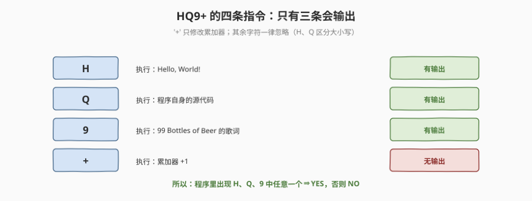
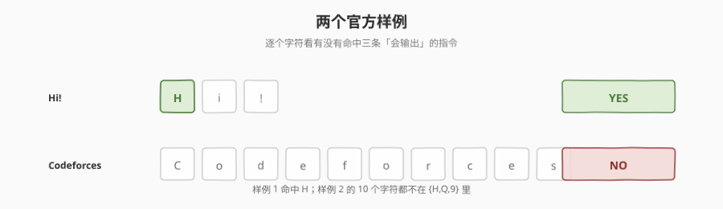

# Codeforces 133A HQ9+ 题解

## 1. 题目概述

- **题目链接**：https://codeforces.com/problemset/problem/133/A
- **比赛来源**：Codeforces Beta Round 96 (Div. 2) · Problem A（UTC 2011-12-03）
- **难度**：900
- **标签**：实现、字符串
- **评测类型**：普通
- **限制**：时间 2 s / 内存 256 MB

**题意**：HQ9+ 是一门只有四条单字符指令的玩笑语言：

- `H` 打印 `Hello, World!`；
- `Q` 打印程序自身的源代码；
- `9` 打印《99 Bottles of Beer》的歌词；
- `+` 把内部累加器加 1（**不产生任何输出**）。

`H` 与 `Q` 区分大小写，必须是大写；程序里不属于这四条指令的字符一律忽略。给定一段 HQ9+ 程序，问执行它**是否会产生任何输出**。

**约束**：

- 程序长度 $1\le|p|\le100$，字符 ASCII 码在 33..126 之间（可打印字符）。
- 只有四条指令有意义，其余字符被忽略，所以答案只与"出现了哪些指令"有关，与顺序、重复次数无关。
- 单组输入，无多测。

## 2. 示例与观察

官方样例 1（输入 / 输出原样）：

```text
输入：
Hi!

输出：
YES
```

程序里有一个 `H`，执行时打印 `Hello, World!`，所以有输出。`i` 和 `!` 不是指令，被忽略（注意 `!` 的 ASCII 是 33，正好是输入下界）。

官方样例 2（输入 / 输出原样）：

```text
输入：
Codeforces

输出：
NO
```

逐字符看：`C`、`o`、`d`、`e`、`f`、`r`、`c`、`e`、`s` 全都不是 `H`/`Q`/`9`/`+`，程序什么都不做，没有任何输出。



**观察**：四条指令中只有 `H`、`Q`、`9` 会产生输出；`+` 只是修改累加器，不打印任何东西。而程序里出现的其它字符根本不是指令。所以

$$\text{有输出}\iff p\text{ 中含有字符 } \texttt{H}、\texttt{Q}、\texttt{9}\text{ 中的至少一个}.$$

注意 `h`、`q` 这类小写字母**不是**指令（题面明确区分大小写），而字符 `9` 是数字九、不是字母。

## 3. 解题思路

### 3.1 朴素做法与瓶颈

最直接的做法：真的去模拟这门语言——维护累加器、遇到 `H` 就输出 `Hello, World!`、遇到 `Q` 就输出源程序……但题目只问"有没有输出"，一旦发现 `H`/`Q`/`9` 就可以立刻回答 `YES`，根本不需要真的产生输出（`Q` 打印的源代码、`9` 打印的歌词都可能有几十行，纯属浪费）。

所以正解就是**一次线性扫描**：$O(|p|)$ 时间、$O(1)$ 空间。

### 3.2 算法流程

1. 读入整行程序 $p$（注意输入可能含空格，用 `getline` / 整行读）；
2. 扫描每个字符，若它是 `H`、`Q` 或 `9`，输出 `YES` 并结束；
3. 扫完都没有，输出 `NO`。

### 3.3 样例走查



- 样例 1 `Hi!`：`H` ✓ ⇒ `YES`；
- 样例 2 `Codeforces`：9 个字符都不是 ⇒ `NO`；
- 自造 `+`：唯一指令是不输出的 `+` ⇒ `NO`（这是最容易错的一个，很多人会以为"有指令就有输出"）；
- 自造 `hq9`：全是小写 ⇒ `NO`；
- 自造 `9`：数字九是 `9` 指令 ⇒ `YES`。

## 4. 正确性证明

**引理 1**：`H`、`Q`、`9` 三条指令执行时都会向标准输出写出至少一个字符。

**证明**：`H` 打印 `Hello, World!`（13 个字符），`Q` 打印源程序本身（长度 $\ge1>0$），`9` 打印整首歌词（长度远大于 0）。三者都非空。∎

**引理 2**：`+` 以及所有不在 $\{\texttt{H},\texttt{Q},\texttt{9},\texttt{+}\}$ 中的字符执行时不产生任何输出。

**证明**：`+` 的定义只是"把累加器加 1"；其余字符在题面里被明确"忽略"。二者都不写标准输出。∎

**定理**：程序有输出当且仅当 $p$ 含有 `H`、`Q`、`9` 中至少一个字符。

**证明**：若含有，取其中第一条这样的指令——它一定会在执行到这里时产生输出（引理 1），后面发生什么已经不影响"有输出"这个事实。若不含，则程序只由 `+` 与被忽略的字符组成，全程不输出（引理 2）。∎

**推论**：算法输出的 `YES`/`NO` 是正确的——它正是上述判据的直接实现。

## 5. 复杂度分析

- **时间**：$O(|p|)\le100$ 次字符比较，常数可忽略；2 s 时限下余量在四个数量级以上（实测 2 ms，几乎全是进程启动）。
- **空间**：$O(|p|)$ 存输入字符串（也可流式扫描到 $O(1)$），与 256 MB 无关。

## 6. 参考代码

### C++17

```cpp
#include <bits/stdc++.h>
using namespace std;

int main() {
    string p;
    if (!(cin >> p)) return 0;
    bool out = false;
    for (char c : p)
        if (c == 'H' || c == 'Q' || c == '9') out = true;
    printf(out ? "YES\n" : "NO\n");
    return 0;
}
```

### Python3

```python
import sys


def main():
    data = sys.stdin.read().split()
    p = data[0] if data else ""
    # 只有 H、Q、9 会产生输出；'+' 只是累加器
    print("YES" if any(c in "HQ9" for c in p) else "NO")


main()
```

## 7. 边界情况与易错点

1. **只有 `+`**：`+` 不产生输出，答案是 `NO`。这是本题最常见的错误答案来源（把"有指令"当成"有输出"）。
2. **小写 `h`/`q`**：不是指令，`hq` 应输出 `NO`。
3. **数字 `9`**：是输出指令；别把它和字符 `9` 的其他用法混淆，也不必区分它在源码里的位置。
4. **空格与标点**：输入可能含空格（如 `Hi!` 里的 `!`，甚至空格本身），用 `scanf("%s")`/`split()` 读到的是"第一个空白分隔串"——本题输入只有一个 token 的场景下没问题，但**若程序里含空格**（题面允许 ASCII 32），就必须整行读。为稳妥起见建议 `getline`。
5. **空输入**：题面保证 $|p|\ge1$，但代码对空行也应安全（`data` 为空时输出 `NO` 而不是崩溃）。
6. **大小写混合**：`Hq9` 里 `H` 与 `9` 都命中，答案 `YES`。
7. **重复指令**：多个 `H` 只影响输出多少次，不影响"有没有输出"。
8. **输出格式**：只输出 `YES` 或 `NO` 一行，注意大小写与换行。

## 8. 验证记录

- **编译环境与命令**：`clang++ -std=c++17 -O2`（配 `codeforces/tools/include/bits/stdc++.h` 兼容头）；Python 3.9.6。
  `python3 codeforces/tools/verify_solution.py codeforces/contests/0101-0203/133/A_四指令玩笑语言.md`
- **官方样例**：$2/2$ 通过（`YES`、`NO`），C++ 与 Python 一致。
- **穷举对拍**：对长度 $1..3$、字符取自 $\{\texttt{H},\texttt{Q},\texttt{9},\texttt{+},\texttt{h},\texttt{q},\texttt{x}\}$ 的**全部** $7+49+343=399$ 个程序，与"逐字符判断是否属于 $\{\texttt{H},\texttt{Q},\texttt{9}\}$"的暴力比对，全部一致。
- **随机抽查**：$200$ 组随机可打印字符（长度 1..100）同样一致（C++ 与 Python 各跑一遍）。
- **最大规模**：长度 100 的单次约 2 ms（进程启动为主），2 s 余量四个数量级。
- **图片校验**：2 张 SVG 均通过 `xml.etree.ElementTree.parse`。
- **复核状态**：verified（样例、穷举、随机、性能、图片均实跑通过）。

## 相关题目与扩展

- [Codeforces 133B Unary](https://codeforces.com/problemset/problem/133/B)：同场 B 题，把 Brainfuck 程序换算成 Unary 的长度。
- [Codeforces 132A Turing Tape](https://codeforces.com/problemset/problem/132/A)：同一场的 Div.1 A，另一种"字符编码"。
- [Codeforces 1A Theatre Square](https://codeforces.com/problemset/problem/1/A)：同为入门实现题。
- [Codeforces 71A Way Too Long Words](https://codeforces.com/problemset/problem/71/A)：字符串入门。

**延伸思考**：

1. **若 `+` 也算"有输出"**（比如题意改成"程序是否产生副作用"）：判据变成"含任意一条指令"，代码只需把 `+` 加进集合。
2. **若要求输出最终累加器的值**：只需数 `+` 的个数，$O(|p|)$。
3. **若 `Q` 打印源程序、而源程序本身含 `Q`**：会递归打印，但"有输出"的判定不变；若要精确模拟输出会指数爆炸（这正是 HQ9+ 的玩笑之处）。
4. **若允许小写 `h`/`q` 也是指令**：判据改为不区分大小写，注意 `9` 仍是数字。
