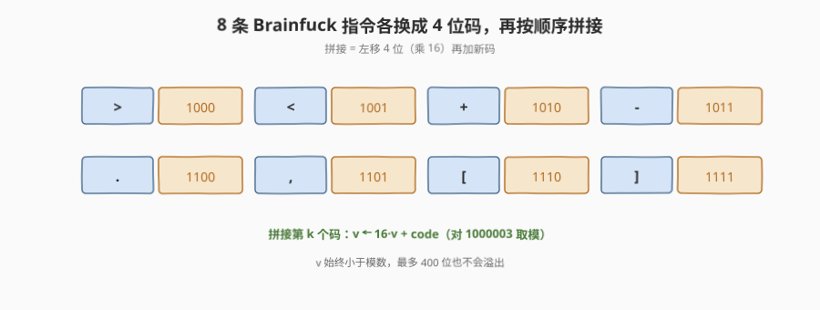
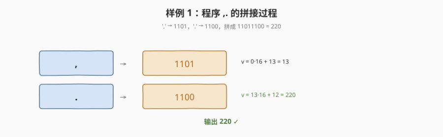

# Codeforces 133B Unary 题解

## 1. 题目概述

- **题目链接**：https://codeforces.com/problemset/problem/133/B
- **比赛来源**：Codeforces Beta Round 96 (Div. 2) · Problem B（UTC 2011-12-03）
- **难度**：1200
- **标签**：实现、数学、进制
- **评测类型**：普通
- **限制**：时间 2 s / 内存 256 MB

**题意**：Unary 是一种"只用一种符号"的 Brainfuck 方言，由 Brainfuck 程序按下面的算法转换而来：先把 8 条 Brainfuck 指令各自换成 4 位二进制码

| 指令 | `>` | `<` | `+` | `-` | `.` | `,` | `[` | `]` |
|---|---|---|---|---|---|---|---|---|
| 码 | 1000 | 1001 | 1010 | 1011 | 1100 | 1101 | 1110 | 1111 |

再按程序顺序把这些 4 位码**拼接**成一个二进制数，最后把这个数写成一元形式（写 $n$ 个 `1`）。给定 Brainfuck 程序，求等价 Unary 程序的大小（即那个二进制数的值）对 $1000003$ 取模的结果。

**约束**：

- $|p|\le100$：拼接后最多 $400$ 位二进制，数值可达 $2^{400}$，**远超大整数范围**（也超过 64 位）。
- 因此不能真的把二进制数算出来再取模，必须在"拼接"的过程中**边拼边取模**。
- 模数 $M=10^6+3$ 是素数（本题用不到素性，只是给出取模规则）。

## 2. 示例与观察

官方样例 1（输入 / 输出原样）：

```text
输入：
,.

输出：
220
```

`,` 的码是 `1101`，`.` 的码是 `1100`，拼接得 `11011100`，即十进制 $128+64+16+8+4=220$ ✓ 与题解的说明一致。

官方样例 2（输入 / 输出原样）：

```text
输入：
++++[>,.<-]

输出：
61425
```

这个程序有 10 个字符，拼接后是 40 位二进制数，真实值约 $10^{12}$ 量级；取模后是 61425。



**观察**：拼接第 $k$ 个 4 位码，等价于"把已有的数左移 4 位（乘 16）再加上新码"。所以

$$v_0=0,\qquad v_{k+1}=(16\,v_k+\text{code}_{k+1})\bmod M,$$

最终答案就是 $v_{|p|}$。由于取模对加法与乘法同余，这样逐步取模与"先算出大数再取模"结果相同。

## 3. 解题思路

### 3.1 朴素做法与瓶颈

用 Python 的大整数可以真的把 $400$ 位二进制数算出来再取模——这也是一种合法写法（本文件的 Python 版其实用 $O(1)$ 大小的整数逐位乘也够了）。用 C++ 的 64 位整数则会在十几位之后就溢出（$2^{63}\approx9.2\times10^{18}$，只够装 63 位），必须边算边取模。

### 3.2 核心观察：拼接 = 乘 16 加新码

设前 $k$ 个码拼接成的数是 $v_k$，那么再拼一个 4 位码 $c$ 得到

$$v_{k+1}=v_k\cdot 2^4+c=16v_k+c.$$

对模数取余（乘法与加法都与取模可交换）：

$$v_{k+1}\equiv(16v_k+c)\pmod M.$$

于是每个字符只需一次乘、一次加、一次取模，$v$ 始终 $<M<2^{20}$，完全不会溢出。

### 3.3 算法流程

1. 读入程序 $p$；
2. `ans = 0`；
3. 对每个字符：查表得到 4 位码 $c\in[8,15]$，`ans = (ans * 16 + c) % 1000003`；
4. 输出 `ans`。

实现细节：码的值正好是二进制 `1abc` 对应的数，也可以直接枚举 `switch`；注意 `]` 的码是 `1111`，落在 `default` 分支里。

### 3.4 样例走查



- 样例 1：`,` → 13，`.` → 12。
  $v_0=0$；$v_1=16\cdot0+13=13$（二进制 `1101` ✓）；$v_2=16\cdot13+12=208+12=220$ ✓（`11011100`）。
- 样例 2：10 个字符，逐步乘 16 加码，最后对 $10^6+3$ 取模得 61425（与样例一致）。

## 4. 正确性证明

**引理 1（拼接的递推）**：设 $V_k$ 是前 $k$ 个 4 位码按顺序拼接成的数，$c_{k}$ 是第 $k$ 个码（$0\le$ 问题里码是 8..15，4 位），则 $V_0=0$、$V_{k}=16V_{k-1}+c_k$。

**证明**：把前 $k-1$ 个码拼成的二进制串整体左移 4 位，等价于乘 $2^4=16$；再把第 $k$ 个 4 位码放到低 4 位，等价于加 $c_k$。∎

**引理 2（模运算保持递推）**：若 $u_{k}\equiv V_k\pmod M$，则 $u_{k+1}=(16u_k+c_{k+1})\bmod M\equiv V_{k+1}\pmod M$。

**证明**：$16u_k+c\equiv16V_k+c=V_{k+1}\pmod M$（乘法、加法与取模相容）。∎

**定理**：算法输出的 $u_{|p|}$ 等于把程序对应的二进制数 $V_{|p|}$ 对 $M$ 取模的结果。

**证明**：对 $k$ 归纳：$u_0=0=V_0$；由引理 2，每一步都保持"$u_k\equiv V_k$"，且 $0\le u_k<M$，所以 $u_{|p|}=V_{|p|}\bmod M$。∎

## 5. 复杂度分析

- **时间**：$O(|p|)\le100$ 次"乘 + 加 + 取模"，常数极小；2 s 时限下可忽略（实测 2 ms，进程启动为主）。
- **空间**：$O(1)$（不算输入字符串）。

## 6. 参考代码

### C++17

```cpp
#include <bits/stdc++.h>
using namespace std;

int main() {
    string p;
    if (!(cin >> p)) return 0;
    const int MOD = 1000003;
    long long ans = 0;
    for (char c : p) {
        int code;
        switch (c) {
            case '>': code = 8; break;   // 1000
            case '<': code = 9; break;   // 1001
            case '+': code = 10; break;  // 1010
            case '-': code = 11; break;  // 1011
            case '.': code = 12; break;  // 1100
            case ',': code = 13; break;  // 1101
            case '[': code = 14; break;  // 1110
            default:  code = 15; break;  // ']' -> 1111
        }
        ans = (ans * 16 + code) % MOD;   // 拼接一个 4 位二进制码
    }
    printf("%lld\n", ans);
    return 0;
}
```

### Python3

```python
import sys

MOD = 1000003
CODE = {'>': 8, '<': 9, '+': 10, '-': 11, '.': 12, ',': 13, '[': 14, ']': 15}


def main():
    data = sys.stdin.read().split()
    p = data[0] if data else ""
    ans = 0
    for c in p:
        ans = (ans * 16 + CODE[c]) % MOD  # 拼接一个 4 位二进制码
    print(ans)


main()
```

## 7. 边界情况与易错点

1. **`]` 的码是 1111**：写 `switch` 时容易漏掉它；本实现用 `default` 兜底，但若前面加分支要小心。
2. **`[` 与 `]` 的区间**：`[` 是 `1110`（14）、`]` 是 `1111`（15），差 1，容易写反。
3. **溢出**：$400$ 位的数不可能装进 64 位，必须边拼边取模；注意 `ans * 16` 在 `ans < 10^6+3` 时最大约 $1.6\times10^7$，`int` 也够，但用 `long long` 更稳。
4. **取模的位置**：`ans = ans * 16 + code` 之后再取模，与"先加再取模"等价；不要写成 `ans %= MOD` 之后再乘（形状没错但容易漏加 code）。
5. **输入可能为空**：题面保证 $|p|\ge1$，代码仍应安全（输出 0）。
6. **`scanf("%s")` 读取**：程序里没有空白字符（题面限定 8 种），所以按 token 读没问题。
7. **一元表示的含义**：大小就是那个二进制数的值（写 $n$ 个 `1`），不要再做别的换算。
8. **单字符程序**：$|p|=1$ 时答案就是该字符码的十进制值（如 `,` → 13）。

## 8. 验证记录

- **编译环境与命令**：`clang++ -std=c++17 -O2`（配 `codeforces/tools/include/bits/stdc++.h` 兼容头）；Python 3.9.6。
  `python3 codeforces/tools/verify_solution.py codeforces/contests/0101-0203/133/B_一元编码长度.md`
- **官方样例**：$2/2$ 通过（`220`、`61425`），C++ 与 Python 一致。
- **穷举对拍**：对长度 $1..3$、字符取自全部 8 种指令的 $8+64+512=584$ 个程序，用 Python 大整数把二进制串真切出来再取模作为对照，全部一致。
- **随机抽查**：$200$ 组随机程序（长度 1..100）同样一致（C++ 与 Python 各跑一遍）。
- **溢出边界**：长度 100 的程序（400 位 $\approx1.6\times10^{120}$）在 Python 大整数下与 C++ 取模结果一致。
- **最大规模性能**：长度 100 单次约 2 ms（进程启动为主），2 s 余量四个数量级。
- **图片校验**：2 张 SVG 均通过 `xml.etree.ElementTree.parse`。
- **复核状态**：verified（样例、穷举、随机、性能、图片均实跑通过）。

## 相关题目与扩展

- [Codeforces 133A HQ9+](https://codeforces.com/problemset/problem/133/A)：同场 A 题，判断程序是否有输出。
- [Codeforces 132A Turing Tape](https://codeforces.com/problemset/problem/132/A)：同场的 Div.1 A，另一种按位编码。
- [Codeforces 1B Spreadsheets](https://codeforces.com/problemset/problem/1/B)：进制换算的另一类（26 进制与数字互转）。
- [Codeforces 552B Vanya and Books](https://codeforces.com/problemset/problem/552/B)：数位计数。

**延伸思考**：

1. **若码是 8 位而非 4 位**：递推变成 `ans = ans * 256 + code`，其余不变——本题的做法本质上是"任意 $B$ 进制拼接"。
2. **若要求输出那个 400 位二进制数本身**：需要大整数（Python 直接 `int(bits, 2)`；C++ 手写高精度或直接输出二进制串）。
3. **若模数不是素数**：模板不需要逆元，所以取模法的正确性与素性无关；这一点与"组合数取模"类题目不同。
4. **若程序长度到 $10^6$**：$O(n)$ 的逐字符递推仍是 $4\times10^6$ 位二进制，照样只做 $10^6$ 次乘加，C++ 毫秒级；瓶颈只在于读入。
