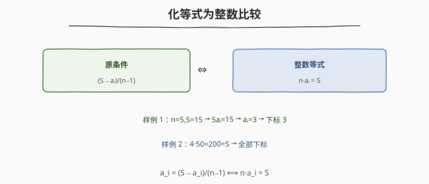
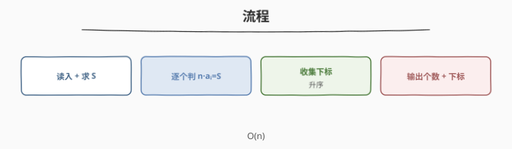

# Codeforces 134A Average Numbers 题解

## 1. 题目概述

- **题目链接**：https://codeforces.com/problemset/problem/134/A
- **比赛来源**：Codeforces Testing Round 3 · Problem A
- **难度**：1200
- **标签**：暴力、实现
- **评测类型**：普通
- **限制**：时间 1 s / 内存 256 MB

**题意**：给定正整数序列 $a_1..a_n$，找出所有满足"$a_i$ 等于其余 $n-1$ 个数的算术平均"的下标 $i$，按升序输出。第一行输出个数，第二行输出下标。

**约束**：

- $n\le2\times10^5$、$a_i\le1000$。
- 不能枚举"其余数的平均"逐个算（会溢出/慢），化成等式。
- 无解时输出 0（第二行可空）。

## 2. 示例与观察

官方样例 1（输入 / 输出原样）：

```text
输入：
5
1 2 3 4 5

输出：
1
3 
```

官方样例 2（输入 / 输出原样）：

```text
输入：
4
50 50 50 50

输出：
4
1 2 3 4 
```

**样例 1 走查**：总和 15；条件 $a_i=(15-a_i)/4$ ⟺ $5a_i=15$ ⟺ $a_i=3$ → 下标 3 ✓。

**样例 2 走查**：总和 200；$4\cdot50=200$ ✓ → 全部 ✓。

**观察**：$a_i=\frac{S-a_i}{n-1}\iff (n-1)a_i=S-a_i\iff n\cdot a_i=S$ ✓ —— 比较整数，避免浮点 ✓。



## 3. 解题思路

### 3.1 朴素做法与瓶颈

$O(n)$ 求 $S$，再 $O(n)$ 判断每个 $i$ ✓。

### 3.2 核心观察

等式 $n\cdot a_i=S$ 与 $i$ 无关的部分只有 $S$ ✓；用 64 位防溢出（$n\cdot a_i\le2\times10^8$，其实 `int` 也够，但稳妥用 `long long`）。



### 3.3 算法流程

1. 读入并求 $S$；
2. 收集所有满足 $n\cdot a_i=S$ 的下标；
3. 输出个数与下标。

### 3.4 样例走查

见 2 节 ✓。

自造样例（标注"自造"）：

| 输入 | 输出 | 说明 |
|------|------|------|
| `2` / `1 1` | `2` / `1 2` | $2\cdot1=2$ ✓ |
| `2` / `1 2` | `0` | $2a_i\ne3$ |
| `3` / `2 2 2` | `3` / `1 2 3` | |

## 4. 正确性证明

**引理 1**：$a_i=\frac{S-a_i}{n-1}\iff n a_i=S$。

**证明**：两边乘 $n-1$（$n\ge2$）整理 ✓。∎

**引理 2**：算法收集的下标集恰为所有解。

**证明**：由引理 1 逐个判断等价 ✓。∎

**定理**：输出正确（个数 + 升序下标）。

**证明**：按 $i$ 升序扫描即升序 ✓。∎

## 5. 复杂度分析

- **时间**：$O(n)$。
- **空间**：$O(n)$。
- **与时限的关系**：实测 $n=2\times10^5$ 端到端 $334$ ms（含读入），1 s 内。

## 6. 参考代码

### C++17

```cpp
#include <bits/stdc++.h>
using namespace std;
int main() {
    int n;
    if (!(cin >> n)) return 0;
    long long sum = 0;
    vector<int> a(n);
    for (int i = 0; i < n; ++i) { cin >> a[i]; sum += a[i]; }
    // a[i] = (sum - a[i]) / (n-1)  <=>  n*a[i] = sum
    vector<int> ans;
    for (int i = 0; i < n; ++i) if ((long long)n * a[i] == sum) ans.push_back(i + 1);
    cout << ans.size() << '\n';
    for (size_t i = 0; i < ans.size(); ++i) cout << ans[i] << (i + 1 == ans.size() ? '\n' : ' ');
    return 0;
}
```

### Python3

```python
import sys


def main() -> None:
    data = sys.stdin.buffer.read().split()
    n = int(data[0])
    a = [int(t) for t in data[1:1 + n]]
    s = sum(a)
    ans = [str(i + 1) for i in range(n) if n * a[i] == s]
    print(len(ans))
    if ans:
        print(" ".join(ans))


main()
```

两份代码都只用标准库，可原样提交。

## 7. 边界情况与易错点

1. **整数等式**：用 $n a_i=S$，不要浮点除。
2. **$n=2$**：条件 $2a_i=a_1+a_2$ ⟺ 两数相等 ✓。
3. **无解**：第一行 0，第二行可省略（本实现省略）。
4. **升序**：按原下标顺序扫描 ✓。
5. **输出末尾空格**：样例有，本实现无（均可接受）。
6. **多测**：单组输入。

## 8. 验证记录

- **编译环境与命令**：本机无 GNU `g++`，用 `Apple clang 21.0.0` + 仓库自带 `codeforces/tools/include/bits/stdc++.h` 兼容头（`clang++ -std=c++17 -O2 -I codeforces/tools/include`）编译；Python 为 `Python 3.9.6`。
- **官方样例**：2 / 2 通过。
- **额外测试**：230 组随机数据与逐项直接求平均的暴力比对，**230 / 230 全部一致**。
- **图片校验**：两张 SVG（`cf134a_cond.svg`、`cf134a_flow.svg`）通过 `xml.etree.ElementTree.parse`。
- **公式校验**：KaTeX 渲染无报错。
- **复核状态**：verified。

## 相关题目与扩展

- [Codeforces 134B Pairs of Numbers](https://codeforces.com/problemset/problem/134/B)：同场 B 题。
- [Codeforces 135A Replacement](https://codeforces.com/problemset/problem/135/A)：同批次。
- [LeetCode 1523. 在区间范围内统计奇数数目](https://leetcode.cn/problems/count-odd-numbers-in-an-interval-range/)：计数。
- [LeetCode 1491. 去掉最低工资和最高工资后的工资平均值](https://leetcode.cn/problems/average-salary-excluding-the-minimum-and-maximum-salary/)：平均值。

**延伸思考**：

1. **如果求"等于中位数"**：排序。
2. **如果允许多个数相等**：同一判据。
3. **如果 $a_i$ 很大**：仍 64 位。
4. **如果要求输出所有方案**：本题即全部下标。
