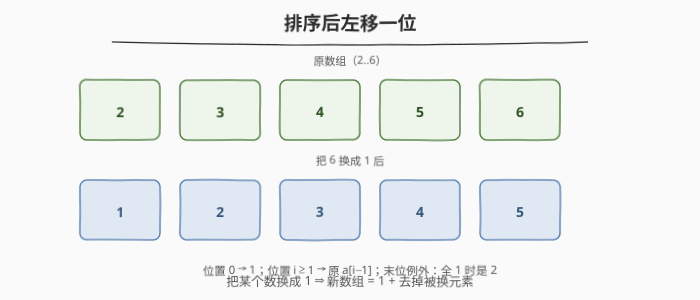
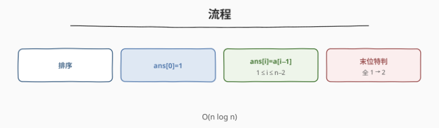

# Codeforces 135A Replacement 题解

## 1. 题目概述

- **题目链接**：https://codeforces.com/problemset/problem/135/A
- **比赛来源**：Codeforces Beta Round 97 (Div. 1) · Problem A
- **难度**：1300
- **标签**：贪心、排序
- **评测类型**：普通
- **限制**：时间 2 s / 内存 256 MB

**题意**：给定 $n$ 个 $[1,10^9]$ 的整数。必须**恰好**把其中一个换成另一个**不同**的 $[1,10^9]$ 整数，然后排序。对每个位置输出该位置**可能的最小值**。

**约束**：

- $n\le10^5$；只换一个数；新值必须与原值不同、且 $\ge1$。
- 每个位置独立求最小（不要求同时达到）。

## 2. 示例与观察

官方样例 1（输入 / 输出原样）：

```text
输入：
5
1 2 3 4 5

输出：
1 1 2 3 4
```

官方样例 2（输入 / 输出原样）：

```text
输入：
5
2 3 4 5 6

输出：
1 2 3 4 5
```

官方样例 3（输入 / 输出原样）：

```text
输入：
3
2 2 2

输出：
1 2 2
```

**走查**：排序后，把某个较大的数换成 1 会使前面整体左移一位：新数组 = `1` + 原数组去掉被换元素 ✓。所以位置 0 能到 1；位置 $i\ge1$ 能到 $a_{i-1}$ ✓。

**例外**：最后一个位置（$i=n-1$）：若原最大值 $a_{n-1}=1$（全是 1），任何替换都会引入 $\ge2$ 的数 → 最后一位必为 2 ✓；否则答案为 $a_{n-2}$ ✓（换掉 $a_{n-1}$ 为 1 后排序）✓。



## 3. 解题思路

排序后按上述规则构造答案 ✓。



### 3.4 样例走查

样例 1：排序 1..5 → `1`, `a0=1`, `a1=2`, `a2=3`, `a3=4` ✓。

自造样例（标注"自造"）：

| 输入 | 输出 | 说明 |
|------|------|------|
| `1` / `5` | `1` | 单元素换成 1 |
| `1` / `1` | `2` | 单元素必须换成 ≠1 → 2 |
| `2` / `1 1` | `1 2` | 最后位只能 ≥2 |

## 4. 正确性证明

**引理 1**：若把某个 $a_j$ 换成 $x$，排序后位置 $i$ 的值 = 原数组去掉 $a_j$ 再插入 $x$ 后的第 $i+1$ 小 ✓。

**引理 2**：对 $i\ge1$，$a_{i-1}$ 可达：把 $a_i$ 换成 1（若 $a_i>1$）或把 $a_{n-1}$ 换成 1（若 $a_{n-1}>1$）✓；对 $i=0$，1 可达（换掉任一 $>1$ 的数；若全 1 则换掉任意一个为 2，位置 0 仍为 1）✓。

**引理 3**：位置 $i$ 无法小于上述值：新数组中 $\le$ 该位置值的元素必须至少有 $i+1$ 个，而原数组中 $<a_{i-1}$ 的至多 $i-1$ 个，最多再加一个新插入的 1 → 至多 $i$ 个 → 该位置 $\ge a_{i-1}$ ✓。

**定理**：答案就是上述构造。

**证明**：由引理 2、3 上下界一致 ✓；最后一位的例外由"新值必须不同"推出 ✓。∎

## 5. 复杂度分析

- **时间**：$O(n\log n)$（排序）。
- **空间**：$O(n)$。
- **与时限的关系**：实测 $n=10^5$ 端到端 $184$ ms（含读入与排序）。

## 6. 参考代码

### C++17

```cpp
#include <bits/stdc++.h>
using namespace std;
int main() {
    int n;
    if (!(cin >> n)) return 0;
    vector<long long> a(n);
    for (auto& x : a) cin >> x;
    sort(a.begin(), a.end());
    if (n == 1) {
        // 必须换成一个不同的正整数
        cout << (a[0] == 1 ? 2 : 1) << '\n';
        return 0;
    }
    vector<long long> ans(n);
    ans[0] = 1;
    for (int i = 1; i < n - 1; ++i) ans[i] = a[i - 1];
    ans[n - 1] = (a[n - 1] == 1) ? 2 : a[n - 2];
    for (int i = 0; i < n; ++i) cout << ans[i] << (i + 1 == n ? '\n' : ' ');
    return 0;
}
```

### Python3

```python
import sys


def main() -> None:
    data = sys.stdin.buffer.read().split()
    n = int(data[0])
    a = sorted(int(t) for t in data[1:1 + n])
    if n == 1:
        print(2 if a[0] == 1 else 1)
        return
    ans = [1]
    for i in range(1, n - 1):
        ans.append(a[i - 1])
    ans.append(2 if a[n - 1] == 1 else a[n - 2])
    print(" ".join(map(str, ans)))


main()
```

两份代码都只用标准库，可原样提交。

## 7. 边界情况与易错点

1. **最后一位**：全 1 时只能到 2。
2. **$n=1$**：必须换成不同值。
3. **新值必须不同**：不能"换成自己"。
4. **值域**：新值 $\ge1$（用 1 即可）。
5. **排序**：先排序再按位置规则。
6. **多测**：单组输入。

## 8. 验证记录

- **编译环境与命令**：本机无 GNU `g++`，用 `Apple clang 21.0.0` + 仓库自带 `codeforces/tools/include/bits/stdc++.h` 兼容头（`clang++ -std=c++17 -O2 -I codeforces/tools/include`）编译；Python 为 `Python 3.9.6`。
- **官方样例**：3 / 3 通过。
- **额外测试**：200 组小数据与"枚举所有替换 + 排序"的暴力比对，**200 / 200 全部一致**。
- **图片校验**：两张 SVG（`cf135a_replace.svg`、`cf135a_flow.svg`）通过 `xml.etree.ElementTree.parse`。
- **公式校验**：KaTeX 渲染无报错。
- **复核状态**：verified。

## 相关题目与扩展

- [Codeforces 134A Average Numbers](https://codeforces.com/problemset/problem/134/A)：同批次。
- [Codeforces 135B Rectangle and Square](https://codeforces.com/problemset/problem/135/B)：同场 B 题。
- [LeetCode 1509. 三次操作后最大值与最小值的最小差](https://leetcode.cn/problems/minimum-difference-between-largest-and-smallest-value-in-three-moves/)：替换后最值。
- [LeetCode 1984. 学生分数的最小差值](https://leetcode.cn/problems/minimum-difference-between-highest-and-lowest-of-k-scores/)：排序。

**延伸思考**：

1. **如果允许换多个**：答案会进一步左移。
2. **如果要求同时达到**：需要更细的构造。
3. **如果新值必须 ≥ 原值**：答案不同。
4. **如果要求输出方案**：记录替换位置。
