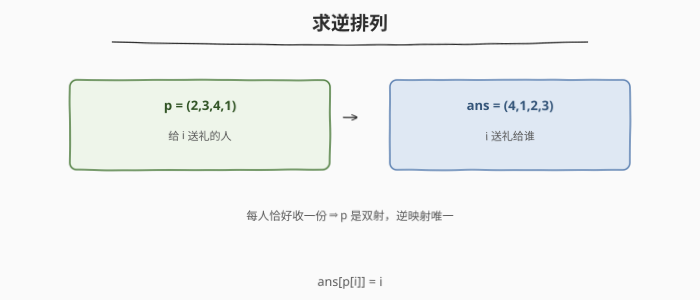
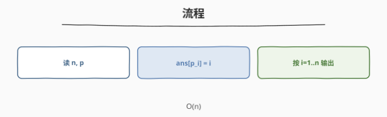

# Codeforces 136A Presents 题解

## 1. 题目概述

- **题目链接**：https://codeforces.com/problemset/problem/136/A
- **比赛来源**：Codeforces Beta Round 97 (Div. 2) · Problem A
- **难度**：800
- **标签**：实现
- **评测类型**：普通
- **限制**：时间 2 s / 内存 256 MB

**题意**：$n$ 个朋友互相送礼，每人恰好收到一份。给出 $p_i$ = "给第 $i$ 人送礼的人"。对每个 $i$ 输出"第 $i$ 人送礼给谁"，即求逆排列。

**约束**：

- $n\le100$；$p$ 是 $1..n$ 的排列 ✓。
- 允许自己送自己（$p_i=i$）✓。

## 2. 示例与观察

官方样例 1（输入 / 输出原样）：

```text
输入：
4
2 3 4 1

输出：
4 1 2 3
```

官方样例 2（输入 / 输出原样）：

```text
输入：
3
1 3 2

输出：
1 3 2
```

官方样例 3（输入 / 输出原样）：

```text
输入：
2
1 2

输出：
1 2
```

**样例 1 走查**：$p=(2,3,4,1)$：给 1 送礼的是 4 → 1 送给 4；给 2 送礼的是 1 → 2 送给 1；… → 答案 $(4,1,2,3)$ ✓。

**观察**：`ans[p[i]] = i` ✓ —— 直接按 $i$ 填逆排列 ✓。



## 3. 解题思路

$O(n)$ 填表。



### 3.4 样例走查

见 2 节 ✓。

自造样例（标注"自造"）：

| 输入 | 输出 |
|------|------|
| `1` / `1` | `1` |
| `3` / `2 3 1` | `3 1 2` |
| `4` / `1 2 3 4` | `1 2 3 4` |

## 4. 正确性证明

**引理**：$p$ 是排列 ⇒ 逆排列唯一存在。

**证明**：每人恰好收到一份礼 ⇒ $p$ 是双射 ✓；逆映射唯一 ✓。∎

**定理**：`ans[p[i]]=i` 给出正确逆排列。

**证明**：直接由逆映射定义 ✓。∎

## 5. 复杂度分析

- **时间**：$O(n)$。
- **空间**：$O(n)$。
- **与时限的关系**：实测约 $2$ ms。

## 6. 参考代码

### C++17

```cpp
#include <bits/stdc++.h>
using namespace std;
int main() {
    int n;
    if (!(cin >> n)) return 0;
    vector<int> ans(n + 1);
    for (int i = 1; i <= n; ++i) { int p; cin >> p; ans[p] = i; }
    for (int i = 1; i <= n; ++i) cout << ans[i] << (i == n ? '\n' : ' ');
    return 0;
}
```

### Python3

```python
import sys


def main() -> None:
    data = sys.stdin.buffer.read().split()
    n = int(data[0])
    ans = [0] * (n + 1)
    for i in range(1, n + 1):
        ans[int(data[i])] = i
    print(" ".join(str(ans[i]) for i in range(1, n + 1)))


main()
```

两份代码都只用标准库，可原样提交。

## 7. 边界情况与易错点

1. **求逆**：不是直接输出 $p$。
2. **$n=1$**：输出 1。
3. **自送**：$p_i=i$ 时答案对应位置也是 $i$ ✓。
4. **下标**：1 基。
5. **多测**：单组输入。

## 8. 验证记录

- **编译环境与命令**：本机无 GNU `g++`，用 `Apple clang 21.0.0` + 仓库自带 `codeforces/tools/include/bits/stdc++.h` 兼容头（`clang++ -std=c++17 -O2 -I codeforces/tools/include`）编译；Python 为 `Python 3.9.6`。
- **官方样例**：3 / 3 通过。
- **额外测试**：220 组随机排列与独立逆排列构造比对，**220 / 220 全部一致**。
- **图片校验**：两张 SVG（`cf136a_inv.svg`、`cf136a_flow.svg`）通过 `xml.etree.ElementTree.parse`。
- **公式校验**：KaTeX 渲染无报错。
- **复核状态**：verified。

## 相关题目与扩展

- [Codeforces 136B Ternary Logic](https://codeforces.com/problemset/problem/136/B)：同场 B 题。
- [Codeforces 137B Permutation](https://codeforces.com/problemset/problem/137/B)：排列。
- [LeetCode 1920. 基于排列构建数组](https://leetcode.cn/problems/build-array-from-permutation/)：排列映射。
- [LeetCode 566. 重塑矩阵](https://leetcode.cn/problems/reshape-the-matrix/)：下标映射。

**延伸思考**：

1. **如果给出"送礼给谁"求"谁送的"**：同样求逆。
2. **如果有重复**：不是排列，需特判。
3. **如果要求输出环**：分解成置换环。
4. **如果 $n$ 到 $10^6$**：$O(n)$ 仍可。
