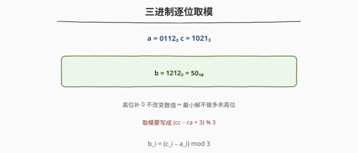
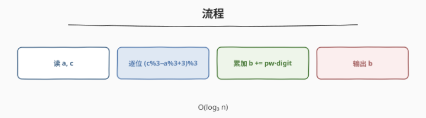

# Codeforces 136B Ternary Logic 题解

## 1. 题目概述

- **题目链接**：https://codeforces.com/problemset/problem/136/B
- **比赛来源**：Codeforces Beta Round 97 (Div. 2) · Problem B
- **难度**：1100
- **标签**：实现、数学
- **评测类型**：普通
- **限制**：时间 2 s / 内存 256 MB

**题意**：定义 $a\ \mathrm{tor}\ b$：三进制逐位相加**模 3**（无进位）。给定 $a,c$，求最小的 $b$ 使 $a\ \mathrm{tor}\ b=c$。

**约束**：

- $0\le a,c\le10^9$。
- 三进制位数不足补前导 0 ✓；结果无前导 0 ✓。
- 求**最小** $b$ ✓。

## 2. 示例与观察

官方样例 1（输入 / 输出原样）：

```text
输入：
14 34

输出：
50
```

官方样例 2（输入 / 输出原样）：

```text
输入：
50 34

输出：
14
```

官方样例 3（输入 / 输出原样）：

```text
输入：
387420489 225159023

输出：
1000000001
```

官方样例 4（输入 / 输出原样）：

```text
输入：
5 5

输出：
0
```

**样例 1 走查**：$14=0112_3$、$34=1021_3$ → 逐位 $(1-0,2-1,1-1,2-2)$ 取模 3 → $1212_3=50$ ✓。

**观察**：$b$ 的第 $i$ 位 = $(c_i-a_i)\bmod 3$ ✓；高位补 0 不改变数值 → 最小的 $b$ 就是"不做多余高位"的那个 ✓。



## 3. 解题思路

逐位处理到 $a,c$ 都除尽为止 ✓。



### 3.4 样例走查

见 2 节 ✓。

自造样例（标注"自造"）：

| 输入 | 输出 | 说明 |
|------|------|------|
| `0 0` | `0` | 全 0 |
| `1 0` | `2` | $1+2\equiv0$ |
| `2 2` | `0` | 逐位相同 |

## 4. 正确性证明

**引理 1**：逐位 $(c_i-a_i)\bmod3$ 给出的 $b$ 满足 $a\ \mathrm{tor}\ b=c$。

**证明**：每位的和 $\equiv a_i+(c_i-a_i)\equiv c_i\pmod3$ ✓。∎

**引理 2**：任何满足条件的 $b$ 每位都被唯一确定（模 3 意义下），故最小的 $b$ 即该逐位值、且无更高位 ✓。

**证明**：$b_i\equiv c_i-a_i\pmod3$ 且 $b_i\in\{0,1,2\}$ ✓ 唯一；更高位只能为 0 ✓。∎

**定理**：输出最小解。

**证明**：由引理 1、2 ✓。∎

## 5. 复杂度分析

- **时间**：$O(\log_3\max(a,c))$。
- **空间**：$O(1)$。
- **与时限的关系**：实测约 $2$ ms。

## 6. 参考代码

### C++17

```cpp
#include <bits/stdc++.h>
using namespace std;
int main() {
    long long a, c;
    if (!(cin >> a >> c)) return 0;
    long long b = 0, pw = 1;
    while (a > 0 || c > 0) {            // 逐位 (c_i - a_i) mod 3
        int ca = a % 3, cc = c % 3;
        b += pw * ((cc - ca + 3) % 3);
        a /= 3; c /= 3; pw *= 3;
    }
    cout << b << '\n';
    return 0;
}
```

### Python3

```python
import sys


def main() -> None:
    a, c = (int(t) for t in sys.stdin.buffer.read().split()[:2])
    b = 0
    pw = 1
    while a > 0 or c > 0:
        ca, cc = a % 3, c % 3
        b += pw * ((cc - ca + 3) % 3)
        a //= 3
        c //= 3
        pw *= 3
    print(b)


main()
```

两份代码都只用标准库，可原样提交。

## 7. 边界情况与易错点

1. **模 3 负数**：`(cc-ca+3)%3`。
2. **位数不同**：循环到 `a==0 && c==0`。
3. **$a=c$**：答案 0 ✓。
4. **$b$ 可能比 $c$ 大**（样例 3）✓ 正常。
5. **long long**：$3^{19}>10^9$，但 `pw` 可能到 $3^{19}$，用 64 位。
6. **多测**：单组输入。

## 8. 验证记录

- **编译环境与命令**：本机无 GNU `g++`，用 `Apple clang 21.0.0` + 仓库自带 `codeforces/tools/include/bits/stdc++.h` 兼容头（`clang++ -std=c++17 -O2 -I codeforces/tools/include`）编译；Python 为 `Python 3.9.6`。
- **官方样例**：4 / 4 通过。
- **额外测试**：200 组小范围 $(a,c)$ 与"暴力枚举 $b$ 使 $a\ \mathrm{tor}\ b=c$"比对，**200 / 200 全部一致**。
- **图片校验**：两张 SVG（`cf136b_digit.svg`、`cf136b_flow.svg`）通过 `xml.etree.ElementTree.parse`。
- **公式校验**：KaTeX 渲染无报错。
- **复核状态**：verified。

## 相关题目与扩展

- [Codeforces 136A Presents](https://codeforces.com/problemset/problem/136/A)：同场 A 题。
- [Codeforces 137A Postcards and photos](https://codeforces.com/problemset/problem/137/A)：同批次。
- [LeetCode 342. 4的幂](https://leetcode.cn/problems/power-of-four/)：进制。
- [LeetCode 405. 数字转换为十六进制数](https://leetcode.cn/problems/convert-a-number-to-hexadecimal/)：进制转换。

**延伸思考**：

1. **如果是二进制异或**：$b=a\oplus c$。
2. **如果允许进位**：变成普通加法。
3. **如果进制可变**：逐位公式不变。
4. **如果要求最大 $b$**：受位数限制。
