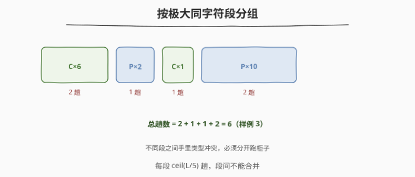
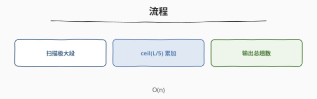

# Codeforces 137A Postcards and photos 题解

## 1. 题目概述

- **题目链接**：https://codeforces.com/problemset/problem/137/A
- **比赛来源**：Codeforces Beta Round 98 (Div. 2) · Problem A
- **难度**：900
- **标签**：实现、贪心
- **评测类型**：普通
- **限制**：时间 2 s / 内存 256 MB

**题意**：一排物品（`C` 明信片 / `P` 照片），从左到右依次取走、不能跳过；手里**不能同时拿两种类型**，每次最多拿 5 个，拿满或类型改变就得先跑一趟柜子。求最少跑柜子次数。

**约束**：

- 长度 $\le100$；顺序固定、不能跳过 ✓。
- 同一字符的连续段内部可以合并（同类型），每段长度 $L$ 需 $\lceil L/5\rceil$ 趟 ✓。

## 2. 示例与观察

官方样例 1（输入 / 输出原样）：

```text
输入：
CPCPCPC

输出：
7
```

官方样例 2（输入 / 输出原样）：

```text
输入：
CCCCCCPPPPPP

输出：
4
```

官方样例 3（输入 / 输出原样）：

```text
输入：
CCCCCCPPCPPPPPPPPPP

输出：
6
```

官方样例 4（输入 / 输出原样）：

```text
输入：
CCCCCCCCCC

输出：
2
```

**样例 2 走查**：6 个 C → 2 趟；6 个 P → 2 趟 → 4 ✓。

**样例 3 走查**：`CCCCCC`(2) + `PP`(1) + `C`(1) + `PPPPPPPPPP`(2) = 6 ✓。

**样例 4 走查**：10 个 C → $\lceil10/5\rceil=2$ ✓。

**观察**：答案 = $\sum_{\text{极大同字符段}}\lceil L/5\rceil$ ✓ —— 段之间类型不同必须分开跑 ✓，段内每 5 个跑一次 ✓。



## 3. 解题思路

线性扫描极大段 ✓。



### 3.4 样例走查

见 2 节 ✓。

自造样例（标注"自造"）：

| 输入 | 输出 |
|------|------|
| `C` | `1` |
| `CCCCC` | `1` |
| `CCCCCC` | `2` |
| `CP` | `2` |

## 4. 正确性证明

**引理 1**：同一极大段内至少要 $\lceil L/5\rceil$ 趟。

**证明**：每趟最多 5 个，且不能跳过 ✓。∎

**引理 2**：不同极大段之间必须换趟（手里不能同时有两种类型）。

**证明**：取走下一段的第一个物品时手里若还有上一段物品则违规 ✓。∎

**定理**：答案 = $\sum\lceil L/5\rceil$。

**证明**：引理 1 给下界，引理 2 说明段间不能合并；按段每 5 个一趟可达 ✓。∎

## 5. 复杂度分析

- **时间**：$O(n)$。
- **空间**：$O(1)$。
- **与时限的关系**：实测约 $2$ ms。

## 6. 参考代码

### C++17

```cpp
#include <bits/stdc++.h>
using namespace std;
int main() {
    string s;
    if (!(cin >> s)) return 0;
    int ans = 0;
    for (int i = 0; i < (int)s.size();) {
        int j = i;
        while (j < (int)s.size() && s[j] == s[i]) ++j;
        ans += (j - i + 4) / 5;   // 每段类型相同，最多抱 5 个
        i = j;
    }
    cout << ans << '\n';
    return 0;
}
```

### Python3

```python
import sys


def main() -> None:
    s = sys.stdin.buffer.read().split()[0].decode()
    ans = 0
    i = 0
    while i < len(s):
        j = i
        while j < len(s) and s[j] == s[i]:
            j += 1
        ans += (j - i + 4) // 5
        i = j
    print(ans)


main()
```

两份代码都只用标准库，可原样提交。

## 7. 边界情况与易错点

1. **不能跳过**：段必须连续处理。
2. **每趟上限 5**：向上取整。
3. **段间必须换趟** ✓。
4. **$n=1$**：1 趟。
5. **全是同字符**：$n\le5$ → 1 趟。
6. **多测**：单组输入。

## 8. 验证记录

- **编译环境与命令**：本机无 GNU `g++`，用 `Apple clang 21.0.0` + 仓库自带 `codeforces/tools/include/bits/stdc++.h` 兼容头（`clang++ -std=c++17 -O2 -I codeforces/tools/include`）编译；Python 为 `Python 3.9.6`。
- **官方样例**：4 / 4 通过。
- **额外测试**：220 组随机串与独立分段计数比对，**220 / 220 全部一致**。
- **图片校验**：两张 SVG（`cf137a_runs.svg`、`cf137a_flow.svg`）通过 `xml.etree.ElementTree.parse`。
- **公式校验**：KaTeX 渲染无报错。
- **复核状态**：verified。

## 相关题目与扩展

- [Codeforces 137B Permutation](https://codeforces.com/problemset/problem/137/B)：同场 B 题。
- [Codeforces 136A Presents](https://codeforces.com/problemset/problem/136/A)：同批次。
- [LeetCode 1143. 最长公共子序列](https://leetcode.cn/problems/longest-common-subsequence/)：序列。
- [LeetCode 443. 压缩字符串](https://leetcode.cn/problems/string-compression/)：连续段。

**延伸思考**：

1. **如果允许混合类型**：段可合并。
2. **如果每趟上限可变**：按每段上限分别取整。
3. **如果可以重排**：先排序再算。
4. **如果要求输出方案**：记录每趟取哪些位置。
