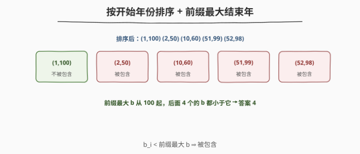
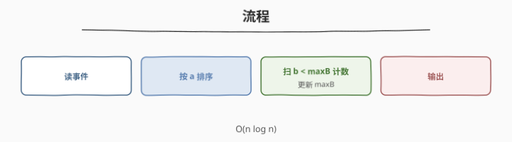

# Codeforces 137C History 题解

## 1. 题目概述

- **题目链接**：https://codeforces.com/problemset/problem/137/C
- **比赛来源**：Codeforces Beta Round 98 (Div. 2) · Problem C
- **难度**：1500
- **标签**：排序
- **评测类型**：普通
- **限制**：时间 2 s / 内存 256 MB

**题意**：$n$ 个事件，第 $i$ 个从 $a_i$ 持续到 $b_i$（$a_i<b_i$）。事件 $j$ 包含 $i$ 当且仅当 $a_j<a_i$ 且 $b_i<b_j$。求被某个其他事件包含的事件个数。所有端点值互不相同。

**约束**：

- $n\le10^5$、坐标 $\le10^9$。
- 端点两两不同 ⇒ 不存在"相等"的边界情形 ✓。

## 2. 示例与观察

官方样例 1（输入 / 输出原样）：

```text
输入：
5
1 10
2 9
3 8
4 7
5 6

输出：
4
```

官方样例 2（输入 / 输出原样）：

```text
输入：
5
1 100
2 50
51 99
52 98
10 60

输出：
4
```

官方样例 3（输入 / 输出原样）：

```text
输入：
1
1 1000000000

输出：
0
```

**样例 1 走查**：$(1,10)$ 包含其余四个 ✓ → 4 ✓。

**样例 2 走查**：按 $a$ 排序 $(1,100),(2,50),(10,60),(51,99),(52,98)$；$(1,100)$ 包含所有；$(2,50)$ 不被任何更早的包含（前面只有 $(1,100)$，其 $b=100>50$ ✗ hmm，那是"包含"吗？$a_j=1<2$ ✓ 且 $b_i=50<100$ ✓ → 被包含 ✓）。所以被包含的是 $(2,50),(10,60),(51,99),(52,98)$ = 4 ✓（$(1,100)$ 不被包含 ✓）。

**观察**：按 $a$ 升序扫描；某事件被包含 $\iff$ 之前出现过 $b$ 更大的事件 ✓（$a$ 更小且 $b$ 更大）。维护前缀最大 $b$ 即可 ✓。



## 3. 解题思路

排序 + 前缀最大 ✓。



### 3.4 样例走查

见 2 节 ✓。

自造样例（标注"自造"）：

| 输入 | 输出 | 说明 |
|------|------|------|
| `2` / `1 2` / `3 4` | `0` | 互不包含 |
| `2` / `1 4` / `2 3` | `1` | 后者被包含 |
| `3` / `1 2` / `3 6` / `4 5` | `1` | |

## 4. 正确性证明

**引理 1**：设按 $a$ 升序排序后为 $e_1..e_n$，则 $e_i$ 被包含 $\iff\max_{j<i}b_j>b_i$。

**证明**：(⇐) 取达到最大 $b$ 的 $j<i$：$a_j<a_i$ ✓、$b_j>b_i$ ✓ → 包含 ✓。(⇒) 若存在 $j$ 包含 $i$，则 $a_j<a_i$ ⇒ $j$ 排在 $i$ 前 ✓，且 $b_j>b_i$ ✓ → 前缀最大 $>b_i$ ✓。∎

**定理**：数前缀最大严格下降的次数即为答案。

**证明**：由引理 1 逐个判定 ✓。∎

## 5. 复杂度分析

- **时间**：$O(n\log n)$。
- **空间**：$O(n)$。
- **与时限的关系**：实测 $n=10^5$ 端到端 $585$ ms（读入/排序为主），2 s 内。

## 6. 参考代码

### C++17

```cpp
#include <bits/stdc++.h>
using namespace std;
int main() {
    int n;
    if (!(cin >> n)) return 0;
    vector<pair<long long,long long>> ev(n);
    for (auto& e : ev) cin >> e.first >> e.second;
    sort(ev.begin(), ev.end());   // 按开始年份升序
    long long maxB = -1;
    int ans = 0;
    for (int i = 0; i < n; ++i) {
        if (ev[i].second < maxB) ++ans;   // 被更早开始且更晚结束的事件包含
        maxB = max(maxB, ev[i].second);
    }
    cout << ans << '\n';
    return 0;
}
```

### Python3

```python
import sys


def main() -> None:
    data = sys.stdin.buffer.read().split()
    n = int(data[0])
    ev = sorted((int(data[1 + 2 * i]), int(data[2 + 2 * i])) for i in range(n))
    max_b = -1
    ans = 0
    for a, b in ev:
        if b < max_b:
            ans += 1
        if b > max_b:
            max_b = b
    print(ans)


main()
```

两份代码都只用标准库，可原样提交。

## 7. 边界情况与易错点

1. **端点互不相同**：不用处理相等 ✓。
2. **只被更早开始的包含**：按 $a$ 排序后只需前缀 ✓。
3. **$n=1$**：0 ✓。
4. **$b$ 初值**：用 $-1$（$b\ge1$）。
5. **64 位**：坐标 $\le10^9$，`int` 也够，稳妥用 `long long`。
6. **多测**：单组输入。

## 8. 验证记录

- **编译环境与命令**：本机无 GNU `g++`，用 `Apple clang 21.0.0` + 仓库自带 `codeforces/tools/include/bits/stdc++.h` 兼容头（`clang++ -std=c++17 -O2 -I codeforces/tools/include`）编译；Python 为 `Python 3.9.6`。
- **官方样例**：3 / 3 通过。
- **额外测试**：200 组随机事件（端点两两不同）与 $O(n^2)$ 两两判定比对，**200 / 200 全部一致**。
- **图片校验**：两张 SVG（`cf137c_scan.svg`、`cf137c_flow.svg`）通过 `xml.etree.ElementTree.parse`。
- **公式校验**：KaTeX 渲染无报错。
- **复核状态**：verified。

## 相关题目与扩展

- [Codeforces 137B Permutation](https://codeforces.com/problemset/problem/137/B)：同场 B 题。
- [Codeforces 137D Palindromes](https://codeforces.com/problemset/problem/137/D)：同场 D 题。
- [LeetCode 452. 用最少数量的箭引爆气球](https://leetcode.cn/problems/minimum-number-of-arrows-to-burst-balloons/)：区间。
- [LeetCode 435. 无重叠区间](https://leetcode.cn/problems/non-overlapping-intervals/)：区间调度。

**延伸思考**：

1. **如果允许端点相等**：需处理 $a_j=a_i$ 或 $b_j=b_i$。
2. **如果要求统计每个事件包含几个**：逆序 + 树状数组。
3. **如果是三维包含**：CDQ 分治。
4. **如果要求输出被包含事件**：记录来源。
