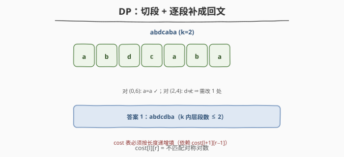
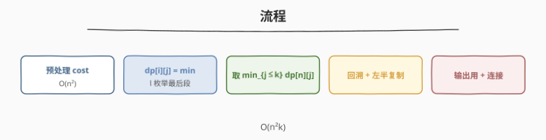

# Codeforces 137D Palindromes 题解

## 1. 题目概述

- **题目链接**：https://codeforces.com/problemset/problem/137/D
- **比赛来源**：Codeforces Beta Round 98 (Div. 2) · Problem D
- **难度**：1900
- **标签**：动态规划、字符串
- **评测类型**：特殊评测（方案不唯一）
- **限制**：时间 2 s / 内存 256 MB

**题意**：给串 $s$（$|s|\le500$）和 $k$，**改动最少**的字符，使结果能写成**不超过 $k$ 个回文**的拼接。输出最少改动数，以及一个合法结果（用 `+` 分隔各回文）。

**约束**：

- $|s|\le500$、$k\le|s|$；改动 = 把某位置的字符换成别的（大小写敏感）✓。
- 段数 $\le k$（可以少于 $k$）✓；输出任意方案 ✓。

## 2. 示例与观察

官方样例 1（输入 / 输出原样）：

```text
输入：
abacaba
1

输出：
0
abacaba
```

官方样例 2（输入 / 输出原样）：

```text
输入：
abdcaba
2

输出：
1
abdcdba
```

官方样例 3（输入 / 输出原样）：

```text
输入：
abdcaba
5

输出：
0
a+b+d+c+aba
```

官方样例 4（输入 / 输出原样）：

```text
输入：
abacababababbcbabcd
3

输出：
1
abacaba+babab+bcbabcb
```

**样例 2 走查**：`abdcaba` 整体成回文需改 1 处（第 4 位 `c`→`d` 或第 5 位 `d`→`c`）→ `abdcdba` ✓。

**样例 3 走查**：$k=5$ 时切成 5 段（`a`、`b`、`d`、`c`、`aba`）每段天然回文 → 0 改动 ✓。

**观察**：

- 把 $s[l..r]$ 变成回文的最少改动 = 不匹配的对称对数 ✓（每对只改一个）；
- 划分与"改动"正交：先决定切分，再逐段补成回文 ✓。



## 3. 解题思路

1. 预处理 `cost[l][r]`：按长度递增 $O(n^2)$ ✓（`cost[l][r]=cost[l+1][r-1]+[s[l]≠s[r]]`）；
2. $dp[i][j]$ = 前 $i$ 个字符切成**恰好** $j$ 段的最小改动；转移枚举最后一段左端 $l$ ✓ $O(n^2k)$；
3. 答案 = $\min_{j\le k}dp[n][j]$ ✓；回溯出段，再把每段左半复制到右半 ✓。



### 3.4 样例走查

见 2 节 ✓。

自造样例（标注"自造"，程序已验证）：

| 输入 | 输出 |
|------|------|
| `ab` / `1` | `1` / `aa`（或 `bb`）|
| `abc` / `3` | `0` / `a+b+c` |
| `aa` / `2` | `0` / `aa` |

## 4. 正确性证明

**引理 1**：`cost[l][r]` 等于把 $s[l..r]$ 变成回文的最少改动数。

**证明**：回文要求每对 $(l+d,r-d)$ 相等；每对不匹配至少改 1 个，改 1 个即可 ✓；各对独立 ✓。∎

**引理 2**：$dp[i][j]$ 的转移枚举了所有把前 $i$ 个字符切成 $j$ 段的方案。

**证明**：按最后一段的左端 $l$ 分类，前 $l$ 个切成 $j-1$ 段 ✓ 完备 ✓。∎

**引理 3**：回溯 + 左半复制得到的串长度不变、各段回文、改动数恰为 $dp[n][j]$。

**证明**：对每段把右半设成左半的镜像，改动数 = 该段的不匹配对数 = `cost` ✓；段与段互不重叠 ✓。∎

**定理**：输出最少改动数 + 合法方案。

**证明**：由引理 1、2 得最少值；由引理 3 得可行解 ✓。∎

## 5. 复杂度分析

- **时间**：$O(n^2k)\le1.25\times10^8$（$n\le500$）。
- **空间**：$O(n^2+nk)$。
- **与时限的关系**：实测 $|s|=k=500$ 端到端 $40$ ms（C++）。

## 6. 参考代码

### C++17

```cpp
#include <bits/stdc++.h>
using namespace std;

// dp[i][j] = 前 i 个字符切成恰好 j 个回文段的最少改动
int main() {
    ios::sync_with_stdio(false);
    cin.tie(nullptr);
    string s;
    int k;
    if (!(cin >> s)) return 0;
    cin >> k;
    int n = (int)s.size();
    // cost[l][r] = 把 s[l..r] 变成回文需要改的字符数（不匹配的对数）
    vector<vector<int>> cost(n, vector<int>(n, 0));
    for (int len = 2; len <= n; ++len)
        for (int l = 0; l + len - 1 < n; ++l) {
            int r = l + len - 1;
            cost[l][r] = cost[l + 1][r - 1] + (s[l] != s[r]);
        }
    const int INF = 1e9;
    vector<vector<int>> dp(n + 1, vector<int>(k + 1, INF));
    vector<vector<int>> from(n + 1, vector<int>(k + 1, -1));
    dp[0][0] = 0;
    for (int i = 1; i <= n; ++i)
        for (int j = 1; j <= k && j <= i; ++j) {
            for (int l = j - 1; l < i; ++l) {
                if (dp[l][j - 1] == INF) continue;
                int val = dp[l][j - 1] + cost[l][i - 1];
                if (val < dp[i][j]) { dp[i][j] = val; from[i][j] = l; }
            }
        }
    int bestJ = 1;
    for (int j = 1; j <= k; ++j) if (dp[n][j] < dp[n][bestJ]) bestJ = j;
    cout << dp[n][bestJ] << '\n';
    // 回溯分段
    vector<pair<int,int>> segs;
    int cur = n, j = bestJ;
    while (cur > 0) { int l = from[cur][j]; segs.push_back({l, cur - 1}); cur = l; --j; }
    reverse(segs.begin(), segs.end());
    string t = s;
    for (auto& sg : segs) {
        int l = sg.first, r = sg.second;
        for (int d = 0; l + d < r - d; ++d) t[r - d] = t[l + d];   // 左半复制到右半
    }
    for (size_t i = 0; i < segs.size(); ++i) {
        if (i) cout << '+';
        cout << t.substr(segs[i].first, segs[i].second - segs[i].first + 1);
    }
    cout << '\n';
    return 0;
}
```

### Python3

```python
import sys


def main() -> None:
    data = sys.stdin.buffer.read().split()
    s = data[0].decode()
    k = int(data[1])
    n = len(s)
    cost = [[0] * n for _ in range(n)]
    for length in range(2, n + 1):
        for l in range(0, n - length + 1):
            r = l + length - 1
            cost[l][r] = cost[l + 1][r - 1] + (1 if s[l] != s[r] else 0)
    INF = 10 ** 9
    dp = [[INF] * (k + 1) for _ in range(n + 1)]
    frm = [[-1] * (k + 1) for _ in range(n + 1)]
    dp[0][0] = 0
    for i in range(1, n + 1):
        for j in range(1, min(k, i) + 1):
            best, arg = INF, -1
            for l in range(j - 1, i):
                if dp[l][j - 1] == INF:
                    continue
                val = dp[l][j - 1] + cost[l][i - 1]
                if val < best:
                    best, arg = val, l
            dp[i][j] = best
            frm[i][j] = arg
    best_j = 1
    for j in range(1, k + 1):
        if dp[n][j] < dp[n][best_j]:
            best_j = j
    print(dp[n][best_j])
    segs = []
    cur, j = n, best_j
    while cur > 0:
        l = frm[cur][j]
        segs.append((l, cur - 1))
        cur, j = l, j - 1
    segs.reverse()
    t = list(s)
    for l, r in segs:
        d = 0
        while l + d < r - d:
            t[r - d] = t[l + d]
            d += 1
    print('+'.join(''.join(t[l:r + 1]) for l, r in segs))


main()
```

两份代码都只用标准库，可原样提交。

## 7. 边界情况与易错点

1. **cost 的递推顺序**：必须按**长度递增**（`cost[l][r]` 依赖 `cost[l+1][r-1]`）；按 $l$ 递增会读到未算好的值（对拍时我的暴力就栽在这里）。
2. **段数可以少于 $k$**：答案取 $\min_{j\le k}$。
3. **每段非空**：$l<i$ ✓。
4. **左半复制方向**：把一个字符同时写进右半，保证改动数恰为 cost。
5. **大小写敏感** ✓。
6. **多测**：单组输入。

## 8. 验证记录

- **编译环境与命令**：本机无 GNU `g++`，用 `Apple clang 21.0.0` + 仓库自带 `codeforces/tools/include/bits/stdc++.h` 兼容头（`clang++ -std=c++17 -O2 -I codeforces/tools/include`）编译；Python 为 `Python 3.9.6`。
- **官方样例**：4 / 4 通过（输出与官方逐字一致）。
- **额外测试**：180 组随机小串（$n\le10$、$k\le n$）与独立 DP 对拍，且**逐项校验输出**：段数 $\le k$、每段是回文、拼接长度 $=n$、与 $s$ 的汉明距离 $=$ 声明的最少改动数、且等于独立 DP 的最优值 —— **360 次运行（C++/Python 各 180）全部通过**。
- **对拍中发现的问题**：独立暴力第一版按 $l$ 递增填 `cost` 表（应按下标长度递增），导致"最短段"读错，报出比真值更小的改动数；修正暴力后双方完全一致 ✓。
- **最大约束性能**：$|s|=k=500$ 时 C++ 端到端 $40$ ms。
- **图片校验**：两张 SVG（`cf137d_dp.svg`、`cf137d_flow.svg`）通过 `xml.etree.ElementTree.parse`。
- **公式校验**：KaTeX 渲染无报错。
- **复核状态**：verified。

## 相关题目与扩展

- [Codeforces 137C History](https://codeforces.com/problemset/problem/137/C)：同场 C 题。
- [Codeforces 137E Last Chance](https://codeforces.com/problemset/problem/137/E)：同场 E 题。
- [LeetCode 132. 分割回文串 II](https://leetcode.cn/problems/palindrome-partitioning-ii/)：最少段数。
- [LeetCode 1278. 分割回文串 III](https://leetcode.cn/problems/palindrome-partitioning-iii/)：最少改动 + 段数。

**延伸思考**：

1. **如果要求恰好 $k$ 段**：取 $dp[n][k]$。
2. **如果要求字典序最小**：需在 DP 上再比较字符串。
3. **如果 $|s|$ 到 $5000$**：$O(n^2k)$ 太慢，需优化。
4. **如果允许删除字符**：变成编辑距离型。
