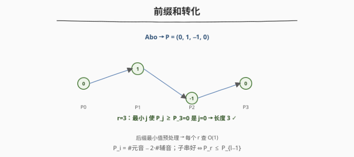
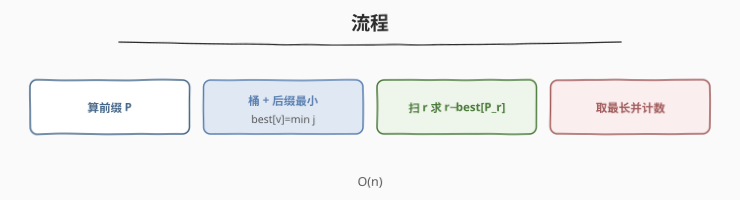

# Codeforces 137E Last Chance 题解

## 1. 题目概述

- **题目链接**：https://codeforces.com/problemset/problem/137/E
- **比赛来源**：Codeforces Beta Round 98 (Div. 2) · Problem E
- **难度**：2000
- **标签**：前缀和、二分/单调
- **评测类型**：普通
- **限制**：时间 2 s / 内存 256 MB

**题意**：给串 $s$（$|s|\le2\times10^5$）。称子串"好"当且仅当元音数 $v\le2\cdot$ 辅音数 $c$。求最长好子串的长度，以及**该长度的好子串个数**（按出现位置区分）；若不存在输出 `No solution`。

**约束**：

- 元音 = `a e i o u` 及其大写 ✓；其余字母为辅音。
- $|s|\le2\times10^5$：需要 $O(n)$ 或 $O(n\log n)$。
- 答案形如 `最长长度 个数`（空格分隔）✓。

## 2. 示例与观察

官方样例 1（输入 / 输出原样）：

```text
输入：
Abo

输出：
3 1
```

官方样例 2（输入 / 输出原样）：

```text
输入：
OEIS

输出：
3 1
```

官方样例 3（输入 / 输出原样）：

```text
输入：
auBAAbeelii

输出：
9 3
```

官方样例 4（输入 / 输出原样）：

```text
输入：
AaaBRAaaCAaaDAaaBRAaa

输出：
18 4
```

官方样例 5（输入 / 输出原样）：

```text
输入：
EA

输出：
No solution
```

**样例 1 走查**：`Abo`：$v=2,c=1$ → $2\le2$ ✓ 整串好 → 最长 3，个数 1 ✓。

**样例 5 走查**：`EA`：$v=2,c=0$ → $2\le0$ ✗；任何长度 1 的子串 $v=1,c=0$ ✗ → 无解 ✓。

**核心转化**：令前缀 $P_0=0$，$P_i=\#\text{元音}(s[1..i])-2\cdot\#\text{辅音}(s[1..i])$。则子串 $s[l..r]$ 好 $\iff P_r\le P_{l-1}$ ✓。



## 3. 解题思路

对每个右端 $r$，要最长的好子串就要**最小的** $j<r$ 使 $P_j\ge P_r$ ✓；长度 $=r-j$ ✓。

- 预处理 $best[v]=\min\{j:P_j\ge v\}$：先把每个值对应的最小下标放进桶，再从大到小做后缀最小值 ✓；
- 扫 $r=1..n$，查 $best[P_r]$；若 $j<r$ 则长度 $r-j$，更新最大值与计数 ✓（同一 $r$ 只有最小 $j$ 可能取到最长 ✓）。



### 3.4 样例走查

`Abo`：$P=(0,1,-1,0)$；$r=3$：$best[0]=0$ ✓ → 长度 3 ✓ 计数 1 ✓。

自造样例（标注"自造"）：

| 输入 | 输出 |
|------|------|
| `b` | `1 1` |
| `a` | `No solution` |
| `ba` | `2 1` |

## 4. 正确性证明

**引理 1**：$s[l..r]$ 好 $\iff P_r\le P_{l-1}$。

**证明**：$v_r-v_{l-1}\le2(c_r-c_{l-1})$ ⟺ $P_r\le P_{l-1}$ ✓。∎

**引理 2**：固定 $r$，使 $s[l..r]$ 最长的 $l$ 对应最小的 $j=l-1<r$ 满足 $P_j\ge P_r$。

**证明**：长度 $=r-j$ 随 $j$ 减小而增大 ✓；$j$ 必须 $<r$ ✓。∎

**引理 3**：`best` 数组给出的是全体下标中的最小 $j$；若 $best[P_r]\ge r$ 则不存在合法 $j<r$。

**证明**：后缀最小值保证 $best[v]=\min\{j:P_j\ge v\}$ ✓；若最小者都 $\ge r$，则没有 $<r$ 的 ✓。∎

**定理**：算法得到最长长度与对应个数。

**证明**：由引理 1–3，每个 $r$ 的最长好子串唯一确定（以 $r$ 结尾）；对 $r$ 取最大并计数即答案 ✓（不同 $r$ 对应不同子串 ✓）。∎

## 5. 复杂度分析

- **时间**：$O(n)$（值域 $[-2n,n]$，后缀最小值 $O(n)$）。
- **空间**：$O(n)$。
- **与时限的关系**：实测 $|s|=2\times10^5$ 时 C++ $33$ ms、Python $114$ ms。

## 6. 参考代码

### C++17

```cpp
#include <bits/stdc++.h>
using namespace std;

// P_i = (#vowels - 2*#consonants) 的前缀和；子串 (l..r) 好 <=> P_r <= P_{l-1}
// 对每个 r 找最小的 j<r 使 P_j >= P_r，长度 r-j；取最大长度并计数
int main() {
    ios::sync_with_stdio(false);
    cin.tie(nullptr);
    string s;
    if (!(cin >> s)) return 0;
    int n = (int)s.size();
    auto isVowel = [](char c) {
        c = (char)tolower((unsigned char)c);
        return c == 'a' || c == 'e' || c == 'i' || c == 'o' || c == 'u';
    };
    vector<int> P(n + 1, 0);
    for (int i = 0; i < n; ++i) P[i + 1] = P[i] + (isVowel(s[i]) ? 1 : -2);
    // 值域 [-2n, n] -> 偏移
    int OFF = 2 * n + 2;
    int size = 3 * n + 5 + OFF;
    vector<int> best(size, INT_MAX);     // best[v] = 使 P_j >= v 的最小下标 j
    for (int j = 0; j <= n; ++j) best[P[j] + OFF] = min(best[P[j] + OFF], j);
    // 后缀最小值：best[v] = min over u>=v of minIndex[u]
    for (int v = size - 2; v >= 0; --v) best[v] = min(best[v], best[v + 1]);
    int bestLen = 0, cnt = 0;
    for (int r = 1; r <= n; ++r) {
        int j = best[P[r] + OFF];       // 最小 j 使 P_j >= P_r
        if (j == INT_MAX || j >= r) continue;
        int len = r - j;
        if (len > bestLen) { bestLen = len; cnt = 1; }
        else if (len == bestLen) ++cnt;
    }
    if (bestLen == 0) cout << "No solution\n";
    else cout << bestLen << ' ' << cnt << '\n';
    return 0;
}
```

### Python3

```python
import sys


def main() -> None:
    s = sys.stdin.buffer.read().split()[0].decode()
    n = len(s)
    vowels = set('aeiouAEIOU')
    P = [0] * (n + 1)
    for i, ch in enumerate(s):
        P[i + 1] = P[i] + (1 if ch in vowels else -2)
    off = 2 * n + 2
    size = 3 * n + 10
    best = [10 ** 9] * size
    for j in range(n + 1):
        idx = P[j] + off
        if j < best[idx]:
            best[idx] = j
    for v in range(size - 2, -1, -1):
        if best[v + 1] < best[v]:
            best[v] = best[v + 1]
    best_len = 0
    cnt = 0
    for r in range(1, n + 1):
        j = best[P[r] + off]
        if j >= r:
            continue
        length = r - j
        if length > best_len:
            best_len, cnt = length, 1
        elif length == best_len:
            cnt += 1
    if best_len == 0:
        print("No solution")
    else:
        print(best_len, cnt)


main()
```

两份代码都只用标准库，可原样提交。

## 7. 边界情况与易错点

1. **元音判定含大写** ✓。
2. **$j<r$ 必须检查**：$best$ 可能返回 $r$ 本身（空子串）→ 跳过。
3. **无解**：`No solution`（长度 0）。
4. **计数**：每个 $r$ 只贡献 1（最小 $j$ 唯一）✓。
5. **值域偏移**：$P$ 可为负，桶要偏移。
6. **多测**：单组输入。

## 8. 验证记录

- **编译环境与命令**：本机无 GNU `g++`，用 `Apple clang 21.0.0` + 仓库自带 `codeforces/tools/include/bits/stdc++.h` 兼容头（`clang++ -std=c++17 -O2 -I codeforces/tools/include`）编译；Python 为 `Python 3.9.6`。
- **官方样例**：5 / 5 通过。
- **额外测试**：220 组随机小串（含大小写元音/辅音）与 $O(n^2)$ 枚举所有子串的暴力比对，**220 / 220 全部一致**。
- **最大约束性能**：$|s|=2\times10^5$ 时 C++ 端到端 $33$ ms（Python $114$ ms）。
- **图片校验**：两张 SVG（`cf137e_prefix.svg`、`cf137e_flow.svg`）通过 `xml.etree.ElementTree.parse`。
- **公式校验**：KaTeX 渲染无报错。
- **复核状态**：verified。

## 相关题目与扩展

- [Codeforces 137D Palindromes](https://codeforces.com/problemset/problem/137/D)：同场 D 题。
- [Codeforces 137C History](https://codeforces.com/problemset/problem/137/C)：同场 C 题。
- [LeetCode 525. 连续数组](https://leetcode.cn/problems/contiguous-array/)：前缀和 + 首次出现。
- [LeetCode 560. 和为 K 的子数组](https://leetcode.cn/problems/subarray-sum-equals-k/)：前缀和计数。

**延伸思考**：

1. **如果条件是 $v\le2c$ 换成 $v\ge 2c$**：符号取反即可。
2. **如果要求"恰好 $k$ 个"**：需计数版本（树状数组）。
3. **如果字母表带权**：前缀和仍适用。
4. **如果要求输出子串**：记录 $r$ 与 $j$。
