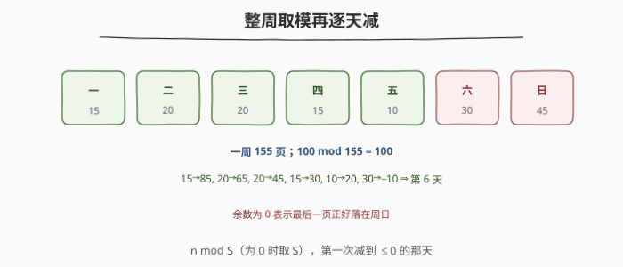
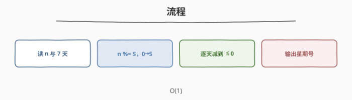

# Codeforces 139A Petr and Book 题解

## 1. 题目概述

- **题目链接**：https://codeforces.com/problemset/problem/139/A
- **比赛来源**：Codeforces Beta Round 99 (Div. 2) · Problem A
- **难度**：1000
- **标签**：实现
- **评测类型**：普通
- **限制**：时间 2 s / 内存 256 MB

**题意**：书有 $n$ 页，从周一开始读；给出周一到周日每天能读的页数（可为 0），每天读完当天可读量，不跳天，读到最后一页的那天是星期几？

**约束**：

- $n\le1000$，每天页数 $\le1000$，每周至少能读 1 页 ✓。
- 天数按 1..7 输出（周一 = 1）✓。

## 2. 示例与观察

官方样例 1（输入 / 输出原样）：

```text
输入：
100
15 20 20 15 10 30 45

输出：
6
```

官方样例 2（输入 / 输出原样）：

```text
输入：
2
1 0 0 0 0 0 0

输出：
1
```

**样例 1 走查**：一周共 $15+20+20+15+10+30+45=155$；$100\bmod155=100$ → 依次减：15→85，20→65，20→45，15→30，10→20，30→−10 → 第 6 天 ✓。

**样例 2 走查**：$n=2$，周一读 1 页 → 剩 1；周二 0 页…周日 0 页；第 2 周周一再读 1 页 → 周一是第 1 天 ✓（注意 $n\bmod$ 周和的处理）。

**观察**：先把整周数取模（$n\bmod S$，为 0 时取 $S$），再逐天减 ✓。



## 3. 解题思路

取模后线性扫描 ✓。



### 3.4 样例走查

见 2 节 ✓。

自造样例（标注"自造"）：

| 输入 | 输出 |
|------|------|
| `1` / `1 0 0 0 0 0 0` | `1` |
| `8` / `1 1 1 1 1 1 1` | `1` |
| `7` / `1 1 1 1 1 1 1` | `7` |

## 4. 正确性证明

**引理 1**：整周读完的页数为 $S$，故书页数可先对 $S$ 取模（余 0 视为 $S$）。

**证明**：每天读满固定页数、不跳天 ⇒ 每整周消耗 $S$ 页 ✓。∎

**引理 2**：取模后逐天相减，第一次减到 $\le0$ 的那天就是读完日。

**证明**：页数单调递减，跨过 0 的那天包含最后一页 ✓。∎

**定理**：算法输出正确。

**证明**：引理 1、2 ✓。∎

## 5. 复杂度分析

- **时间**：$O(1)$。
- **空间**：$O(1)$。
- **与时限的关系**：实测约 $2$ ms。

## 6. 参考代码

### C++17

```cpp
#include <bits/stdc++.h>
using namespace std;
int main() {
    int n;
    if (!(cin >> n)) return 0;
    vector<int> a(7);
    int week = 0;
    for (int i = 0; i < 7; ++i) { cin >> a[i]; week += a[i]; }
    n %= week;
    if (n == 0) n = week;         // 最后一页恰好在本周最后一天
    for (int i = 0; i < 7; ++i) {
        n -= a[i];
        if (n <= 0) { cout << i + 1 << '\n'; return 0; }
    }
    return 0;
}
```

### Python3

```python
import sys


def main() -> None:
    data = sys.stdin.buffer.read().split()
    n = int(data[0])
    a = [int(t) for t in data[1:8]]
    week = sum(a)
    left = n % week
    if left == 0:
        left = week
    for i in range(7):
        left -= a[i]
        if left <= 0:
            print(i + 1)
            return


main()
```

两份代码都只用标准库，可原样提交。

## 7. 边界情况与易错点

1. **余数为 0**：说明最后一页正好在某周最后一天，按整周处理。
2. **某天 0 页**：不影响当天判断（减 0 不会跨过 0，除非之前已 ≤0 ✓）。
3. **$n$ 小于首日**：第 1 天 ✓。
4. **周和**：题面保证 $>0$。
5. **多测**：单组输入。

## 8. 验证记录

- **编译环境与命令**：本机无 GNU `g++`，用 `Apple clang 21.0.0` + 仓库自带 `codeforces/tools/include/bits/stdc++.h` 兼容头（`clang++ -std=c++17 -O2 -I codeforces/tools/include`）编译；Python 为 `Python 3.9.6`。
- **官方样例**：2 / 2 通过。
- **额外测试**：220 组随机 $(n, a)$ 与逐天模拟的暴力比对，**220 / 220 全部一致**。
- **图片校验**：两张 SVG（`cf139a_week.svg`、`cf139a_flow.svg`）通过 `xml.etree.ElementTree.parse`。
- **公式校验**：KaTeX 渲染无报错。
- **复核状态**：verified。

## 相关题目与扩展

- [Codeforces 139B Wallpaper](https://codeforces.com/problemset/problem/139/B)：同场 B 题。
- [Codeforces 138A Literature Lesson](https://codeforces.com/problemset/problem/138/A)：同批次。
- [LeetCode 1360. 日期之间隔几天](https://leetcode.cn/problems/number-of-days-between-two-dates/)：日期。
- [LeetCode 1154. 一年中的第几天](https://leetcode.cn/problems/day-of-the-year/)：日期。

**延伸思考**：

1. **如果从周三开始**：调整起点。
2. **如果允许跳天**：贪心变复杂。
3. **如果每天页数可变**：按给定序列。
4. **如果要求输出日期**：换算成月日。
