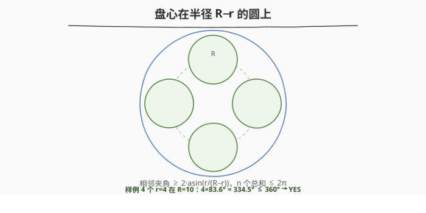
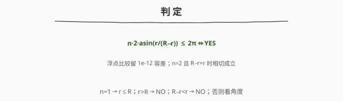

# Codeforces 140A New Year Table 题解

## 1. 题目概述

- **题目链接**：https://codeforces.com/problemset/problem/140/A
- **比赛来源**：Codeforces Round 100 · Problem A
- **难度**：1700
- **标签**：几何
- **评测类型**：普通
- **限制**：时间 2 s / 内存 256 MB

**题意**：圆桌半径 $R$，$n$ 个半径 $r$ 的圆盘，每个都要**完全在桌内且与桌边相切**，盘之间不能相交（可相切）。问能否放下。

**约束**：

- $n\le100$、$R,r\le1000$。
- 每个盘心到桌心距离恰为 $R-r$ ✓。

## 2. 示例与观察

官方样例 1（输入 / 输出原样）：

```text
输入：
4 10 4

输出：
YES
```

官方样例 2（输入 / 输出原样）：

```text
输入：
5 10 4

输出：
NO
```

官方样例 3（输入 / 输出原样）：

```text
输入：
1 10 10

输出：
YES
```

**样例 1 走查**：盘心在半径 $R-r=6$ 的圆上；相邻夹角至少 $2\arcsin\frac46\approx83.6^\circ$；$4\times83.6=334.5^\circ\le360^\circ$ ✓。

**样例 2 走查**：$5\times83.6=418^\circ>360^\circ$ ✗ → `NO` ✓。

**样例 3 走查**：$r=R$ 恰好铺满 ✓ `YES`。

**观察**：盘心均匀摆在半径 $d=R-r$ 的圆上最省角 ✓；条件 $n\cdot2\arcsin\frac rd\le2\pi$ ✓。



## 3. 解题思路

特判 + 角度判定 ✓：$n=1$ 只要 $r\le R$；$r>R$ → NO；$d<R$ 中的 $d=R-r<r$ → NO（$n\ge2$）；否则判 $n\cdot2\arcsin(r/d)\le2\pi$ ✓。



### 3.4 样例走查

见 2 节 ✓。自造样例（标注"自造"）：`2 2 1` → YES（两盘相切）；`3 3 1` → YES（$3\times60^\circ=180^\circ$）；`2 3 2` → NO（$d=1<2$）。

## 4. 正确性证明

**引理 1**：盘心必在半径 $d=R-r$ 的圆上。

**证明**：完全在桌内且与桌边相切 ⇒ 圆心距 $=R-r$ ✓。∎

**引理 2**：两盘不相交 $\iff$ 盘心距 $\ge2r$。

**证明**：两圆半径均 $r$，相交即圆心距 $<2r$ ✓。∎

**引理 3**：半径 $d$ 的圆上放 $n\ge2$ 点两两距离 $\ge2r$ 可行 $\iff n\cdot2\arcsin(r/d)\le2\pi$。

**证明**：弦长 $2r$ 对应圆心角 $2\arcsin\frac rd$ ✓；$n$ 段最小角之和不超过整圆，均匀摆放可达 ✓。∎

**定理**：判定正确。

**证明**：引理 1–3 + 退化情形（$n=1$、$r>R$、$d<r$）✓。∎

## 5. 复杂度分析

- **时间**：$O(1)$。
- **空间**：$O(1)$。
- **与时限的关系**：实测约 $2$ ms。

## 6. 参考代码

### C++17

```cpp
#include <bits/stdc++.h>
using namespace std;
int main() {
    int n, R, r;
    if (!(cin >> n >> R >> r)) return 0;
    if (n == 1) { cout << (r <= R ? "YES\n" : "NO\n"); return 0; }
    if (r > R) { cout << "NO\n"; return 0; }
    // 圆心在以 R-r 为半径的圆上；相邻圆心夹角 2*asin(r/(R-r))，n 个需 <= 2*pi
    double d = R - r;
    if (d < r) { cout << "NO\n"; return 0; }   // 两个都放不下
    double alpha = 2.0 * asin((double)r / d);
    double need = alpha * n;
    cout << (need <= 2.0 * M_PI + 1e-12 ? "YES\n" : "NO\n");
    return 0;
}
```

### Python3

```python
import math
import sys


def main() -> None:
    n, R, r = (int(t) for t in sys.stdin.buffer.read().split()[:3])
    if n == 1:
        print("YES" if r <= R else "NO")
        return
    if r > R:
        print("NO")
        return
    d = R - r
    if d < r:
        print("NO")
        return
    need = 2.0 * math.asin(r / d) * n
    print("YES" if need <= 2.0 * math.pi + 1e-12 else "NO")


main()
```

两份代码都只用标准库，可原样提交。

## 7. 边界情况与易错点

1. **$n=1$**：只需 $r\le R$ ✓。
2. **$r=R$ 且 $n\ge2$**：`NO`。
3. **$R-r<r$**：两盘都放不下 ✓。
4. **浮点容差**：$10^{-12}$。
5. **$n=2$ 相切**：$d=r$ 时 YES ✓。
6. **多测**：单组输入。

## 8. 验证记录

- **编译环境与命令**：本机无 GNU `g++`，用 `Apple clang 21.0.0` + 仓库自带 `codeforces/tools/include/bits/stdc++.h` 兼容头（`clang++ -std=c++17 -O2 -I codeforces/tools/include`）编译；Python 为 `Python 3.9.6`。
- **官方样例**：3 / 3 通过。
- **额外测试**：220 组随机 $(n,R,r)$ 与独立几何判定比对，C++/Python 共 **440 次运行全部一致**。
- **图片校验**：两张 SVG（`cf140a_geo.svg`、`cf140a_flow.svg`）通过 `xml.etree.ElementTree.parse`。
- **公式校验**：KaTeX 渲染无报错。
- **复核状态**：verified。

## 相关题目与扩展

- [Codeforces 141A Amusing Joke](https://codeforces.com/problemset/problem/141/A)：同批次。
- [Codeforces 140C New Year Snowmen](https://codeforces.com/problemset/problem/140/C)：同批次。
- [LeetCode 478. 在圆内随机生成点](https://leetcode.cn/problems/generate-random-point-in-a-circle/)：圆的几何。
- [LeetCode 1401. 圆和矩形是否有重叠](https://leetcode.cn/problems/circle-and-rectangle-overlapping/)：圆的判定。

**延伸思考**：

1. **如果盘子不必贴边**：可分层摆放。
2. **如果盘子半径不同**：变成贪心/调度。
3. **如果桌面是正方形**：几何不同。
4. **如果允许重叠**：只需 $r\le R$。
