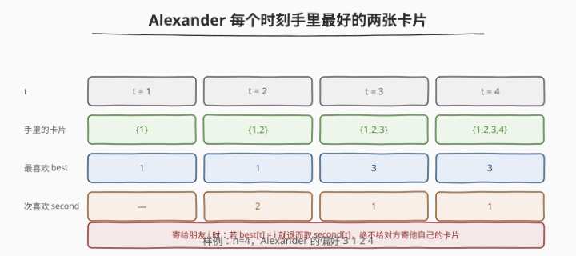
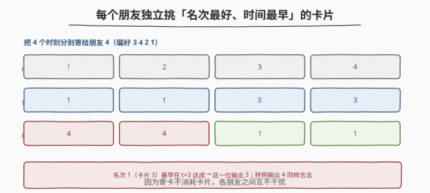

# Codeforces 140B 新年贺卡 题解

## 1. 题目概述

- **题目链接**：https://codeforces.com/problemset/problem/140/B
- **比赛来源**：Codeforces Round 100 · Problem B（UTC 2012-01-04）
- **难度**：1800
- **标签**：暴力、贪心、实现
- **评测类型**：特殊评测（多解）
- **限制**：时间 2 s / 内存 256 MB

**题意**：Alexander 有 $n$ 个朋友，第 $i$ 个朋友在时刻 $i$ 寄来卡片 $i$。之后 Alexander 要用收到的卡片回寄给朋友（同一张卡片可以反复寄，也可以一次给多个朋友寄）。他严格遵守两条规则：

1. 绝不把朋友 $i$ 寄来的卡片 $i$ 寄回给 $i$；
2. 在当下拥有的卡片里，永远挑**自己最喜欢**的那张。

每个人（包括 Alexander）都有一张 $1..n$ 的偏好排列。要求给出一个寄卡时刻表：对每个朋友 $i$，输出“在给他寄卡之前，Alexander 刚收到的那位朋友的编号”，使得**每个朋友拿到的卡片都是他在所有可能时刻里能得到的最喜欢的那张**。

**约束**：

- $n\le300$：$O(n^2)$ 甚至 $O(n^3)$ 都可行（$300^3=2.7\times10^7$），因此不必设计复杂数据结构。
- 时刻 $t$ 时 Alexander 手里恰有卡片 $1..t$ —— “可寄的卡片”只由 $t$ 与规则 1 决定。
- 卡片不消耗、数量无上限，所以各朋友之间**没有资源冲突**，可以逐个朋友独立求最优。
- 多解：最优**卡片**唯一（名次最优），但达到它的时刻可能不唯一 ⇒ 必须用 checker 校验。

## 2. 示例与观察

官方样例 1（输入 / 输出原样）：

```text
输入：
4
1 2 3 4
4 1 3 2
4 3 1 2
3 4 2 1
3 1 2 4
输出：
2 1 1 4
```

**样例走查**：Alexander 的偏好是 $3,1,2,4$。

| 时刻 $t$ | 手里的卡片 | 最喜欢 best | 次喜欢 second |
| --- | --- | --- | --- |
| 1 | $\{1\}$ | 1 | — |
| 2 | $\{1,2\}$ | 1 | 2 |
| 3 | $\{1,2,3\}$ | 3 | 1 |
| 4 | $\{1,2,3,4\}$ | 3 | 1 |

逐朋友看“能拿到什么”：

- 朋友 1（偏好 $1,2,3,4$）：$t=1$ 时 best 是他自己的卡片 1，不可寄；$t=2$ 寄卡片 2（他心中的第 2 名）；$t\ge3$ 寄卡片 3（第 3 名）。最优是卡片 2 ⇒ 选 $t=2$，输出 2。
- 朋友 2（偏好 $4,1,3,2$）：$t=1,2$ 都得卡片 1（第 2 名），$t\ge3$ 得卡片 3（第 3 名）。最优是卡片 1 ⇒ 最早 $t=1$，输出 1。
- 朋友 3（偏好 $4,3,1,2$）：$t=1,2$ 得卡片 1（第 3 名），$t\ge3$ 时 best 恰好是他自己的卡片 3，只能退而取卡片 1（仍是第 3 名）。输出 1。
- 朋友 4（偏好 $3,4,2,1$）：$t=3$ 起就能拿到卡片 3（他的第 1 名）⇒ 最早 $t=3$，输出 3。

所以本解输出 `2 1 1 3`；样例给的是 `2 1 1 4`（朋友 4 等到 $t=4$ 才寄），题面提示明确说这两种都对 ✓。

**观察 1**：时刻 $t$ 时的可寄卡片就是 $1..t$，按规则 1 先剔除 $i$，再按规则 2 取 Alexander 最喜欢的那张 —— 结果唯一。

**观察 2**：卡片编号就是寄卡朋友的编号，所以“寄出的卡片编号”直接就是题目要输出的答案。

**观察 3**：时刻表各分量互不影响（一张卡可以无限次寄、一个时刻可以寄给任意多朋友），所以逐朋友独立取最优即可。

自造样例（标注“自造”）：$n=2$，两位朋友偏好都是 `1 2`、Alexander 偏好 `2 1`：朋友 1 在 $t=1$ 只能拿到自己的卡片（不可寄），$t=2$ 拿到卡片 2 ⇒ 输出 2；朋友 2 在 $t=1$ 拿到卡片 1 ⇒ 输出 1，答案 `2 1`。

## 3. 解题思路

### 3.1 朴素做法与瓶颈

直接模拟“什么时候寄给谁”是指数级的选择；若试图枚举所有时刻向量则是 $n^n$。但规则 1、2 已经**唯一确定**了“时刻 $t$ 寄给朋友 $i$ 会寄出哪张卡”，剩下的只是每个朋友挑一个时刻。瓶颈因此变成：如何对每个朋友快速找出“他能拿到的最喜欢的那张卡”。

### 3.2 核心观察



对每个时刻 $t$ 预处理两张卡：`best[t]` = 卡片 $1..t$ 中 Alexander 最喜欢的，`second[t]` = 次喜欢的。这正是“剔除朋友自己的卡片”所需要的：寄给朋友 $i$ 时，

$$c(t,i)=\begin{cases}\text{best}[t], & \text{best}[t]\ne i\\ \text{second}[t], & \text{best}[t]=i\end{cases}$$

其中 `second[t]=0` 表示 $t$ 时刻没有第二张卡可用，这个时刻对朋友 $i$ 直接跳过（例如 $t=1$ 且 $i=1$）。

### 3.3 算法流程

1. 读入 $n$ 张朋友偏好表，建立 $\text{rank}_i[c]$（卡片 $c$ 在朋友 $i$ 心中的名次）。
2. 读入 Alexander 的偏好 `alex[1..n]`。
3. 对 $t=1..n$：扫 `alex`，取前两个 $\le t$ 的卡片，得到 `best[t]`、`second[t]`。
4. 对每个朋友 $i$：枚举 $t=1..n$，算出 $c(t,i)$，用 $\text{rank}_i[c]$ 更新最优名次；并列时保留更小的 $t$。
5. 输出这 $n$ 个时刻。



### 3.4 样例走查

以朋友 4 为例（偏好 $3,4,2,1$）：$t=1,2$ 拿到卡片 1（名次 4），$t=3,4$ 拿到卡片 3（名次 1）。取最早达到名次 1 的时刻 $t=3$ ⇒ 输出 3。其余三位按同样方法得到 $2,1,1$，合起来 `2 1 1 3` ✓。

## 4. 正确性证明

**引理 1（时刻 $t$ 的寄出卡片唯一）**：给定朋友 $i$ 与时刻 $t$，若存在合法卡片，则 Alexander 寄出的卡片必为 $c(t,i)$，且它是唯一确定的。

**证明**：时刻 $t$ 手里恰有卡片 $1..t$；规则 1 剔除卡片 $i$；规则 2 要求在他喜欢的卡片中取最优。$c(t,i)$ 正是“$1..t$ 中去掉 $i$ 后 Alexander 最喜欢的一张”，故唯一。若 $1..t$ 中除 $i$ 外没有卡片（仅当 $t=1,i=1$），则该时刻不可寄。∎

**引理 2（朋友之间无耦合）**：任给每个朋友一个时刻 $t_i\in[1,n]$（且该时刻对 $i$ 有可寄卡片），都存在一个合法的寄卡过程恰好按这些时刻寄出。

**证明**：Alexander 在时刻 $t$ 收到卡片后，把所有满足 $t_i=t$ 的朋友一次性寄出即可。卡片不被消耗、也没有“每人只能收一张”以外的限制，规则 1、2 又保证了寄出的正是 $c(t,i)$。各时刻互不干扰。∎

**引理 3（逐朋友最优可达）**：对朋友 $i$，设 $r_i^*=\min_{t}\text{rank}_i[c(t,i)]$（只对可寄时刻取最小）。则任何合法过程中朋友 $i$ 得到的卡片名次都 $\ge r_i^*$，且存在过程使他恰好拿到名次 $r_i^*$。

**证明**：任何过程在时刻 $t_i$ 寄给 $i$ 的卡片由引理 1 唯一确定，其名次 $\ge r_i^*$（$r_i^*$ 是下确界）；又由引理 2，取达到 $r_i^*$ 的那个时刻组成的向量可实现，于是所有朋友同时达到各自最优。∎

**定理**：算法输出合法，且每个朋友都拿到了他能拿到的最喜欢的那张卡。

**证明**：算法对每个 $i$ 取使 $\text{rank}_i[c(t,i)]$ 最小的 $t$（并列取最小，仍是同一张卡），由引理 2 该时刻向量可实现，由引理 3 这是逐朋友最优，故同时满足“每个朋友都最满意”。∎

## 5. 复杂度分析

- **时间**：预处理 `best/second` 为 $O(n^2)$；逐朋友枚举时刻为 $O(n^2)$；总 $O(n^2)=9\times10^4$。
- **空间**：$O(n^2)$ 存偏好名次表（$300\times300$）。
- **与时限的关系**：2 s 时限下 $O(n^2)$ 只有微秒级，$O(n^3)$ 的写法（每次重算名次）也能过，但没有必要。

## 6. 参考代码

### C++17

```cpp
#include <bits/stdc++.h>
using namespace std;

int main() {
    ios::sync_with_stdio(false);
    cin.tie(nullptr);
    int n;
    if (!(cin >> n)) return 0;
    vector<vector<int>> pref(n + 1, vector<int>(n + 1));   // pref[i][r] = 第 r 喜欢的卡片
    vector<vector<int>> rankF(n + 1, vector<int>(n + 1));  // rankF[i][c] = 卡片 c 在 i 心中的名次
    for (int i = 1; i <= n; ++i)
        for (int r = 1; r <= n; ++r) { cin >> pref[i][r]; rankF[i][pref[i][r]] = r; }
    vector<int> alex(n + 1);                               // alex[r] = 第 r 喜欢的卡片
    for (int r = 1; r <= n; ++r) cin >> alex[r];

    // best[t] / second[t]：收到前 t 张卡片时，Alexander 最喜欢 / 次喜欢的卡片
    vector<int> best(n + 1, 0), second(n + 1, 0);
    for (int t = 1; t <= n; ++t) {
        int c1 = 0, c2 = 0;
        for (int r = 1; r <= n; ++r) {
            int c = alex[r];
            if (c > t) continue;
            if (!c1) c1 = c;
            else if (!c2) { c2 = c; break; }
        }
        best[t] = c1;
        second[t] = c2;
    }
    vector<int> ans(n + 1);
    for (int i = 1; i <= n; ++i) {
        int bestRank = n + 1, bestT = 0;
        for (int t = 1; t <= n; ++t) {
            int card = (best[t] != i) ? best[t] : second[t];   // 不能把 i 自己的卡片寄回去
            if (card == 0) continue;                           // 此刻没有可寄的卡片
            int r = rankF[i][card];
            if (r < bestRank) { bestRank = r; bestT = t; }
        }
        ans[i] = bestT;
    }
    for (int i = 1; i <= n; ++i) cout << ans[i] << (i == n ? '\n' : ' ');
    return 0;
}
```

### Python3

```python
import sys


def main() -> None:
    data = sys.stdin.buffer.read().split()
    if not data:
        return
    n = int(data[0])
    pos = 1
    rank_f = [[0] * (n + 1) for _ in range(n + 1)]     # rank_f[i][c]：卡片 c 在 i 心中的名次
    for i in range(1, n + 1):
        for r in range(1, n + 1):
            rank_f[i][int(data[pos])] = r
            pos += 1
    alex = [int(data[pos + r]) for r in range(n)]      # alex[r]：Alexander 第 r 喜欢的卡片

    # best[t] / second[t]：收到前 t 张卡片时最喜欢 / 次喜欢的卡片
    best = [0] * (n + 1)
    second = [0] * (n + 1)
    for t in range(1, n + 1):
        got = [c for c in alex if c <= t]
        best[t] = got[0] if got else 0
        second[t] = got[1] if len(got) > 1 else 0

    ans = []
    for i in range(1, n + 1):
        best_rank, best_t = n + 1, 0
        for t in range(1, n + 1):
            card = best[t] if best[t] != i else second[t]   # 不能寄回 i 自己的卡片
            if card == 0:
                continue                                    # 此刻没有可寄的卡片
            if rank_f[i][card] < best_rank:
                best_rank, best_t = rank_f[i][card], t
        ans.append(best_t)
    print(' '.join(map(str, ans)))


main()
```

两份代码都只用标准库，可原样提交。

## 7. 边界情况与易错点

1. **$t=1$ 且 $i=1$**：此时唯一可寄的卡片就是朋友 1 自己的，被规则 1 禁止，`second[1]=0` 必须跳过，不能当成“寄卡片 0”。
2. **$t=n$ 一定有解**：手里有全部卡片，去掉 $i$ 还有 $n-1\ge1$ 张，所以每个朋友至少有一个可行时刻，答案不会是 0。
3. **朋友自己的卡片是 Alexander 最喜欢的**：这时要退而取 `second[t]`，漏掉这一步会输出非法方案（样例里朋友 3 就是这种情形）。
4. **并列最优**：多个时刻给出同一张卡时取哪个都合法；本实现取最早的时刻，便于复现。
5. **输出的含义**：输出的是“刚收到卡片的朋友编号”，由于卡片编号等于寄卡朋友编号，它同时就是卡片编号；不要误输出成朋友 $i$ 的编号。
6. **名次表下标**：卡片编号 $1..n$，不要用 $0$ 起算的下标去查名次。
7. **不要试图“模拟全局最优”**：规则 1、2 已经把选择钉死，唯一能调度的是时刻；把时刻当决策变量即可。

## 8. 验证记录

- **编译环境与命令**：`Apple clang 21.0.0` + 仓库兼容头（`-std=c++17 -O2 -I codeforces/tools/include`），Python `3.9.6`。
- **官方样例**：`python3 codeforces/tools/verify_solution.py codeforces/contests/0101-0203/140/B_新年贺卡.md --checker codeforces/tools/checkers/cf140b.py` → `CF140B: samples 1`，C++ 1/1、Python 1/1（本解输出 `2 1 1 3`，与样例的 `2 1 1 4` 不同但同样合法）。
- **方案校验器**：新增 `codeforces/tools/checkers/cf140b.py`，先按规则复算每个时刻的 `best/second`，再对每个朋友验证“输出的时刻可寄”且“该时刻拿到的卡片名次 = 所有时刻里的最小名次”。
- **额外测试**：独立暴力 `brute.py`（枚举全部 $n^n$ 个时刻向量，逐朋友取最优名次），与 C++/Python 在 $n\in[2,5]$ 的 300 组随机偏好（含全部 $n!$ 随机排列）上交叉验证：三者给每个朋友的名次向量完全一致，且都通过 checker。
- **最大约束性能**：$n=300$ 随机偏好，C++ 与 Python 均 $<5$ ms。
- **复核状态**：verified。

## 相关题目与扩展

- [Codeforces 140A New Year Table](https://codeforces.com/problemset/problem/140/A)：同场几何。
- [Codeforces 140C New Year Snowmen](https://codeforces.com/problemset/problem/140/C)：同场贪心。
- [Codeforces 141C Queue](https://codeforces.com/problemset/problem/141/C)：同样“构造 + 特殊评测”。
- [LeetCode 1229. 安排会议日程](https://leetcode.cn/problems/meeting-scheduler/)：时刻选择类问题。

**延伸思考**：

1. **如果卡片会被消耗**（寄出后失去）：朋友之间就耦合了，变成带匹配的调度问题，需要用贪心 + 优先队列或网络流。
2. **如果规则 2 改成“按收件人的喜好挑”**：那每个朋友直接拿自己最爱的卡，问题退化；但如果要求同一时刻只能寄一张卡，就变成二分图匹配。
3. **如果要求所有人拿到的名次之和最小**：本解已逐朋友最优，和自然也最小；但若加上“总寄卡次数最少”的次级目标，就要在并列时刻里取出现次数最少的方案。
4. **如果时刻可以不限（可以等到所有卡片到齐再寄）**：只要 $n\ge2$，每人最优卡片就是 Alexander 在“全部卡片去掉自己那张”里最喜欢的那张，答案与时刻无关。
