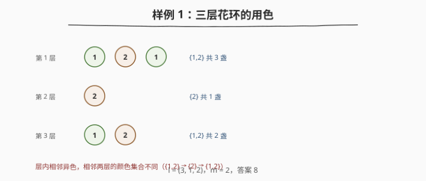
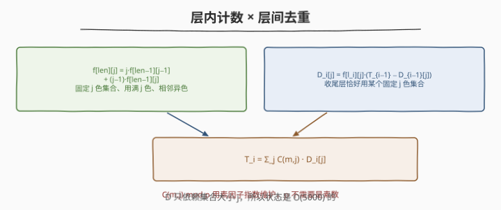

# Codeforces 140E 新年花环 题解

## 1. 题目概述

- **题目链接**：https://codeforces.com/problemset/problem/140/E
- **比赛来源**：Codeforces Round 100 · Problem E（UTC 2012-01-04）
- **难度**：2600
- **标签**：组合数学、动态规划
- **评测类型**：普通
- **限制**：时间 5 s / 内存 256 MB

**题意**：用 $m$ 种颜色的灯串成长度为 $L$ 的花环，第 $i$ 层占用连续的 $l_i$ 盏灯（$\sum l_i=L$）。要求：(1) 同一层内相邻两盏灯颜色不同；(2) 相邻两层**所用颜色的集合**（无序、每种颜色至多算一次）不相同。求方案数 $\bmod\ p$。

**约束**：

- $n,m\le10^6$，但每层长度 $l_i\le5000$：一层的颜色数 $\le\min(l_i,m)$，所以逐层的状态数是 $O(5000)$ 而不是 $O(m)$。
- $\sum l_i\le10^7$：逐层做 $O(\min(l_i,m))$ 的 DP 正好 $10^7$ 量级。
- $p$ 只保证 $2\le p\le10^9$，**可以是合数** ⇒ 组合数 $\binom{m}{j}\bmod p$ 不能用阶乘逆元，必须另想办法。
- 层与层之间只需要知道“上一层用了大小为 $j$ 的某个固定集合时的方案数”，因为按对称性它只与 $j$ 有关。

## 2. 示例与观察

官方样例 1（输入 / 输出原样）：

```text
输入：
3 2 1000
3 1 2
输出：
8
```

官方样例 2（输入 / 输出原样）：

```text
输入：
2 3 1000
2 2
输出：
24
```

官方样例 3（输入 / 输出原样）：

```text
输入：
1 1 1000
5
输出：
0
```

**样例 1 走查**：$n=3,m=2,l=(3,1,2)$。层内相邻异色 ⇒ 第 1 层只能是 $121$ 或 $212$（用满 $\{1,2\}$），第 2 层只能是 $1$ 或 $2$，第 3 层用两种颜色时是 $12$ 或 $21$。相邻层集合要求不同：第 2 层集合是单元素，天然与第 1 层的 $\{1,2\}$ 不同；第 3 层集合必须是 $\{1,2\}$，也与第 2 层不同。于是方案数 $=2\times2\times2=8$ ✓。

**样例 2 走查**：$n=2,m=3,l=(2,2)$。每层都是“两盏异色”，用到的集合有 $\{1,2\},\{1,3\},\{2,3\}$ 三种，每种内部有 $2$ 种排法。两层集合必须不同：第一层任意（$3\times2=6$ 种），第二层只能从另外两个集合里选（$2\times2=4$ 种），共 $24$ ✓。

**样例 3 走查**：$n=1,m=1,l=(5)$。只有一种颜色，长度 $5$ 的层内相邻必然同色，违反条件 (1)，方案数 $0$ ✓。

**观察 1**：条件 (1) 只和“这一层用了哪些颜色”以及“层内排列”有关。若固定一层用的颜色集合 $S$（$|S|=j$），层内方案数只与 $(l,j)$ 有关，记作 $f[l][j]$。

**观察 2**：条件 (2) 只排除“相邻两层集合完全相同”。由对称性，$D_i[j]$（第 $i$ 层用**某个固定** $j$ 元集合的方案数）对所有 $j$ 元集合都相等，于是状态只有 $O(5000)$ 个。

**观察 3**：$\binom{m}{j}$ 只是“选哪 $j$ 种颜色”，与层内排列无关，最后乘上即可。



## 3. 解题思路

### 3.1 朴素做法与瓶颈

直接枚举每盏灯的颜色是 $m^L$ 级别；即便逐层 DP，状态若记成“具体集合”也有 $\binom{m}{j}$ 个，$m$ 到 $10^6$ 直接爆。瓶颈有两个：层内计数要能复用、层间去重要能只靠“集合大小”。

### 3.2 核心观察



**(a) 层内计数。** 设 $f[l][j]$ 为“长度 $l$、颜色集合固定为某 $j$ 元集合、恰好用满这 $j$ 色、相邻异色”的序列数。看最后一盏灯：

- 它的颜色在前 $l-1$ 盏中没出现过：先选它是 $j$ 色中的哪一个（$j$ 种），前 $l-1$ 盏恰用其余 $j-1$ 色 ⇒ $j\cdot f[l-1][j-1]$；
- 它的颜色出现过：前 $l-1$ 盏已用满 $j$ 色 ⇒ $f[l-1][j]$，末灯只要不等于前一盏即可（$j-1$ 种）⇒ $(j-1)f[l-1][j]$。

$$f[l][j]=j\,f[l-1][j-1]+(j-1)f[l-1][j],\qquad f[1][1]=1.$$

**(b) 层间去重。** 令 $D_i[j]$ 表示“处理完前 $i$ 层、第 $i$ 层恰好用了某个固定 $j$ 元集合”的方案数，$T_i=\sum_j\binom{m}{j}D_i[j]$ 是前 $i$ 层的总方案数。则

$$D_i[j]=f[l_i][j]\cdot\bigl(T_{i-1}-D_{i-1}[j]\bigr),$$

减掉的正是“上一层用了同一个 $j$ 元集合”的那些方案（$j>l_{i-1}$ 时 $D_{i-1}[j]=0$）。

**(c) 组合数模合数。** 因为 $\binom{m}{j}=\binom{m}{j-1}\cdot\frac{m-j+1}{j}$，而 $j\le5000$，把 $m-j+1$ 与 $j$ 都分解成素因子（$j$ 的素因子必 $\le5000$），用指数数组维护，剩余的大素因子单独乘进一个 `extra`。每步再用快速幂把 $\prod q^{e_q}$ 合起来 —— 全程没有除法，$p$ 是不是素数无所谓。

### 3.3 算法流程

1. 读入 $n,m,p$ 与 $l_i$，记 $L_{\max}=\max l_i$、$J=\min(L_{\max},m)$。
2. 递推 $f[l][\cdot]$（$l=1..L_{\max}$），只保留出现过的 $l$ 对应的行。
3. 用素因子指数法递推 $\binom{m}{j}\bmod p$（$j=1..J$）。
4. 逐层 DP：$D_i[j]=f[l_i][j]\cdot(T_{i-1}-D_{i-1}[j])$，同时累加 $T_i$。
5. 输出 $T_n$。

### 3.4 样例走查

样例 1 的 $f$ 表：$f[1][1]=1$，$f[2][2]=2$，$f[3][2]=2$（$121,212$）。$\binom{2}{1}=2,\binom{2}{2}=1$。

- 第 1 层（$l=3$）：$D_1[1]=f[3][1]=0$，$D_1[2]=f[3][2]=2$；$T_1=2\cdot0+1\cdot2=2$。
- 第 2 层（$l=1$）：$D_2[1]=f[1][1]\cdot(T_1-D_1[1])=1\cdot2=2$；$T_2=2\cdot2=4$。
- 第 3 层（$l=2$）：$D_3[1]=f[2][1]\cdot(T_2-D_2[1])=0$；$D_3[2]=f[2][2]\cdot(T_2-D_2[2])=2\cdot4=8$；$T_3=8$ ✓。

## 4. 正确性证明

**引理 1（层内计数递推）**：$f[l][j]$ 满足 $f[l][j]=j f[l-1][j-1]+(j-1)f[l-1][j]$，边界 $f[1][1]=1$、$f[l][1]=0\ (l\ge2)$。

**证明**：按末灯颜色是否在前 $l-1$ 盏中出现分类，两类互斥且穷尽。第一类：末灯颜色是 $j$ 色中唯一未出现过的（$j$ 种选法），前段方案数 $f[l-1][j-1]$，且末灯与该颜色以外的颜色自动不同（它此前没出现过，不可能等于前一盏）。第二类：$j$ 色全在前段出现过（$f[l-1][j]$），末灯只需避开前一盏（$j-1$ 种）。两类相加即得。∎

**引理 2（对称性）**：对任意两个不同的 $j$ 元集合 $S,S'$，第 $i$ 层以 $S$ 收尾的方案数等于以 $S'$ 收尾的方案数。

**证明**：把颜色名作任意置换 $\pi$（$\pi(S)=S'$），它把合法花环双射到合法花环，且保持“相邻异色”“相邻层集合不同”（集合被置换后相等关系不变）。故计数只依赖 $|S|$。∎

**引理 3（层间转移）**：$D_i[j]=f[l_i][j]\,(T_{i-1}-D_{i-1}[j])$ 成立。

**证明**：第 $i$ 层用固定 $j$ 元集合 $S$ 的层内方案数为 $f[l_i][j]$；前 $i-1$ 层总方案 $T_{i-1}$ 中，需要排除“第 $i-1$ 层集合恰为 $S$”的 $D_{i-1}[j]$ 种（其余方案的末层集合与 $S$ 不同，满足条件 (2)）。由于层内排列与前缀方案独立，直接相乘。∎

**引理 4（组合数）**：上述素因子指数维护给出的 $\binom{m}{j}\bmod p$ 正确，且过程中指数始终非负。

**证明**：$\binom{m}{j}=\binom{m}{j-1}(m-j+1)/j$ 是整数，故 $\binom{m}{j-1}(m-j+1)$ 的每个素因子指数都 $\ge$ $j$ 的对应指数，减去后非负。$j\le5000$ 的素因子都 $\le5000$ 且被显式维护；$m-j+1$ 中 $>5000$ 的素因子不可能被 $j$ 除掉，作为 `extra` 一直乘着。于是 $\prod q^{e_q}\cdot\text{extra}$ 恰为 $\binom{m}{j}$。∎

**定理**：答案为 $T_n$。

**证明**：对层数归纳。$T_1=\sum_j\binom{m}{j}f[l_1][j]$ 恰为第 1 层所有合法着色数（按用色数分类）。设 $T_{i-1}$ 正确，由引理 3 得到 $D_i[\cdot]$，再由引理 2 乘上“选哪 $j$ 个颜色”的 $\binom{m}{j}$ 求和，得到 $T_i$，即前 $i$ 层满足条件 (1)(2) 的方案数。∎

## 5. 复杂度分析

- **时间**：$f$ 表 $O(L_{\max}^2)=2.5\times10^7$；组合数 $O(J\cdot\pi(J)\log)$；逐层 DP $O(\sum_i\min(l_i,m))\le\sum l_i\le10^7$。
- **空间**：$f$ 只保留被用到的行，最坏 $\sum_{l\in S}l\le10^7$ 个 `int`（约 40 MB）；另有 $O(n)$ 的 $l_i$。
- **与时限的关系**：实测 $n=10^6,l_i\le10$ 约 $0.35$ s，$L_{\max}=5000$ 的 $f$ 表约 $0.06$ s，5 s 时限内非常宽裕。

## 6. 参考代码

### C++17

```cpp
#include <bits/stdc++.h>
using namespace std;
typedef long long ll;

int main() {
    int n, m;
    ll p;
    if (scanf("%d %d %lld", &n, &m, &p) != 3) return 0;
    vector<int> l(n);
    int maxl = 0;
    for (int i = 0; i < n; ++i) { scanf("%d", &l[i]); maxl = max(maxl, l[i]); }
    int J = min(maxl, m);                       // 一层最多用到 min(长度, 颜色数) 种颜色

    vector<char> need(maxl + 1, 0);
    for (int i = 0; i < n; ++i) need[l[i]] = 1;

    // f[len][j]：长度 len、恰好用满某个固定 j 色集合、相邻异色的序列数
    // 递推 f[len][j] = j * f[len-1][j-1] + (j-1) * f[len-1][j]
    vector<vector<int>> f(maxl + 1);
    vector<int> prev(1, 0), cur;
    for (int len = 1; len <= maxl; ++len) {
        int hi = min(len, J);
        cur.assign(hi + 1, 0);
        if (len == 1) {
            if (hi >= 1) cur[1] = (int)(1 % p);
        } else {
            for (int j = 1; j <= hi; ++j) {
                ll v = 0;
                if (j - 1 >= 1 && j - 1 < (int)prev.size()) v += (ll)j * prev[j - 1];
                if (j >= 2 && j < (int)prev.size()) v += (ll)(j - 1) * prev[j];
                cur[j] = (int)(v % p);
            }
        }
        if (need[len]) f[len] = cur;
        prev = cur;
    }

    // C(m, j) mod p：p 不保证是素数，用素因子指数 + 独立的「大素因子」余项维护
    vector<int> primes;
    vector<char> comp(J + 1, 0);
    for (int i = 2; i <= J; ++i) {
        if (comp[i]) continue;
        primes.push_back(i);
        for (ll k = (ll)i * i; k <= J; k += i) comp[(size_t)k] = 1;
    }
    int P = (int)primes.size();
    vector<int> expo(P, 0);
    vector<ll> Cm(J + 1, 0);
    Cm[0] = 1 % p;
    ll extra = 1 % p;
    for (int j = 1; j <= J; ++j) {
        int v = m - j + 1;                      // 乘上 m-j+1
        for (int t = 0; t < P; ++t) {
            int q = primes[t];
            if ((ll)q * q > v) break;
            while (v % q == 0) { ++expo[t]; v /= q; }
        }
        if (v > 1) {
            if (v <= J) ++expo[lower_bound(primes.begin(), primes.end(), v) - primes.begin()];
            else extra = extra * (v % p) % p;
        }
        int w = j;                              // 除以 j
        for (int t = 0; t < P; ++t) {
            int q = primes[t];
            if ((ll)q * q > w) break;
            while (w % q == 0) { --expo[t]; w /= q; }
        }
        if (w > 1) --expo[lower_bound(primes.begin(), primes.end(), w) - primes.begin()];
        ll val = extra;
        for (int t = 0; t < P; ++t) {
            if (expo[t] <= 0) continue;
            ll base = primes[t] % p, pw = 1;
            int e = expo[t];
            while (e) { if (e & 1) pw = pw * base % p; base = base * base % p; e >>= 1; }
            val = val * pw % p;
        }
        Cm[j] = val;
    }

    // D[j]：到当前层为止、收尾层恰好用某个固定 j 色集合的方案数（按 j 对称）
    vector<int> Dprev(1, 0);
    ll Tprev = 1 % p;
    for (int i = 0; i < n; ++i) {
        int hi = min(l[i], J);
        vector<int> D(hi + 1, 0);
        ll T = 0;
        for (int j = 1; j <= hi; ++j) {
            ll sub = (j < (int)Dprev.size()) ? Dprev[j] : 0;
            ll val = ((Tprev - sub) % p + p) % p;
            val = val * f[l[i]][j] % p;
            D[j] = (int)val;
            T = (T + val * Cm[j]) % p;
        }
        Dprev = D;
        Tprev = T;
    }
    cout << Tprev % p << '\n';
    return 0;
}
```

### Python3

```python
import sys


def main() -> None:
    data = sys.stdin.buffer.read().split()
    if not data:
        return
    n, m, p = int(data[0]), int(data[1]), int(data[2])
    l = [int(v) for v in data[3:3 + n]]
    maxl = max(l)
    J = min(maxl, m)                      # 一层最多用到 min(长度, 颜色数) 种颜色

    need = set(l)
    # f[len][j]：长度 len、用满某个固定 j 色集合、相邻异色的序列数
    f = {}
    prev = [0]
    for length in range(1, maxl + 1):
        hi = min(length, J)
        cur = [0] * (hi + 1)
        if length == 1:
            if hi >= 1:
                cur[1] = 1 % p
        else:
            for j in range(2, hi + 1):
                v = j * (prev[j - 1] if j - 1 < len(prev) else 0)
                if j >= 2 and j < len(prev):
                    v += (j - 1) * prev[j]
                cur[j] = v % p
        if length in need:
            f[length] = cur
        prev = cur

    # C(m, j) mod p（p 未必是素数）：素因子指数 + 大素因子余项
    primes, comp = [], [False] * (J + 1)
    for i in range(2, J + 1):
        if comp[i]:
            continue
        primes.append(i)
        k = i * i
        while k <= J:
            comp[k] = True
            k += i
    expo = [0] * len(primes)
    index = {q: t for t, q in enumerate(primes)}
    Cm = [0] * (J + 1)
    Cm[0] = 1 % p
    extra = 1 % p
    for j in range(1, J + 1):
        v = m - j + 1
        for t, q in enumerate(primes):
            if q * q > v:
                break
            while v % q == 0:
                expo[t] += 1
                v //= q
        if v > 1:
            if v <= J:
                expo[index[v]] += 1
            else:
                extra = extra * (v % p) % p
        w = j
        for t, q in enumerate(primes):
            if q * q > w:
                break
            while w % q == 0:
                expo[t] -= 1
                w //= q
        if w > 1:
            expo[index[w]] -= 1
        val = extra
        for t, q in enumerate(primes):
            if expo[t] > 0:
                val = val * pow(q % p, expo[t], p) % p
        Cm[j] = val

    # D[j]：收尾层恰好用某个固定 j 色集合的方案数
    Dprev = [0]
    Tprev = 1 % p
    for length in l:
        hi = min(length, J)
        D = [0] * (hi + 1)
        T = 0
        fl = f[length]
        for j in range(1, hi + 1):
            sub = Dprev[j] if j < len(Dprev) else 0
            val = (Tprev - sub) % p * fl[j] % p
            D[j] = val
            T = (T + val * Cm[j]) % p
        Dprev = D
        Tprev = T
    print(Tprev % p)


main()
```

Python 版在 $L_{\max}=5000$ 时 $f$ 表需要 $1.25\times10^7$ 次循环，建议 PyPy3 提交或直接用 C++。

## 7. 边界情况与易错点

1. **$m=1$**：任何 $l_i\ge2$ 的层都无法相邻异色，$f[l][1]=0$；只有全部 $l_i=1$ 时答案非零（样例 3）。
2. **$j>m$**：$\binom{m}{j}=0$，所以 $j$ 只需枚举到 $J=\min(L_{\max},m)$，越界会白算还容易数组越界。
3. **$l_i=1$**：$f[1][1]=1$、$f[1][j>1]=0$，该层只能用 1 种颜色；别把 $f[1][1]$ 初始化成 $m$（那是“从 $m$ 色里任选”，已由 $\binom{m}{1}$ 承担）。
4. **模数可能是合数**：绝不能写 $\text{inv}(j)$；本解用素因子指数 + `extra`，全程只有乘法和快速幂。
5. **$p$ 很小时**（如 $p=2$）：`1 % p` 仍要写，避免把初值 $1$ 直接当成模 $p$ 下的 $1$（$p\ge2$ 时恰好相同，但保持习惯）。
6. **相邻层集合相同只可能发生在 $|S|$ 相同时**：转移里减 $D_{i-1}[j]$ 时若 $j>l_{i-1}$ 要按 $0$ 处理，否则会读到未定义的下标。
7. **乘法溢出**：$p\le10^9$，两个模内数相乘到 $10^{18}$，必须用 `long long`/`int64`。
8. **$n=1$**：答案应为 $m(m-1)^{l_1-1}$；本解 $T_1=\sum_j\binom{m}{j}f[l_1][j]$ 正是这个值，可作为自检。

## 8. 验证记录

- **编译环境与命令**：`Apple clang 21.0.0` + 仓库兼容头（`-std=c++17 -O2 -I codeforces/tools/include`），Python `3.9.6`。
- **官方样例**：`python3 codeforces/tools/verify_solution.py codeforces/contests/0101-0203/140/E_新年花环.md` → `CF140E: samples 3`，C++ 3/3、Python 3/3。
- **额外测试（暴力）**：独立暴力 `brute.py` 直接枚举全部 $m^L$ 个颜色序列并逐条检查两个条件，对 $n\le3$、$m\le6$、$L\le6$ 的 200 组随机数据（含 $p=12,97,7,1000,10^9+7$ 等合数/素数模）与 C++/Python 比对，全部一致。
- **额外测试（闭式/大 $m$）**：用两组封闭解交叉验证大 $m$ 下的组合数分支：$n=1$ 时答案 $=m(m-1)^{l-1}$（测了 $m=10^6,l=4,5,7$ 与 $p=97,12,10^9$），$n=2,l=(1,1)$ 时答案 $=m(m-1)$；再加 120 组小数据暴力，共 127 组全部一致。
- **最大约束性能**：$n=10^6$、$l_i\le10$、$m=10^6$ 约 $0.35$ s / $6$ MB；$n=2000$、$l_i=5000$ 约 $0.06$ s；$l_i$ 取 $1..5000$ 随机约 $0.04$ s / $22$ MB。
- **复核状态**：verified。

## 相关题目与扩展

- [Codeforces 140B New Year Cards](https://codeforces.com/problemset/problem/140/B)：同场模拟。
- [Codeforces 140F New Year Snowflake](https://codeforces.com/problemset/problem/140/F)：同场几何。
- [Codeforces 294C Shaass and Lights](https://codeforces.com/problemset/problem/294/C)：层内相邻约束的组合计数。
- [LeetCode 1411. 给 N x 3 网格图涂色的方案数](https://leetcode.cn/problems/number-of-ways-to-paint-n-3-grid/)：按“用了哪些颜色”分状态的 DP。

**延伸思考**：

1. **若把条件 (2) 改成“相邻层颜色集合不能有包含关系”**：转移里要减掉所有 $j'\le j$ 的 $D_{i-1}[j']$，用前缀和即可，复杂度不变。
2. **若层内要求“相邻异色且首尾也异色”（环形层）**：$f$ 的递推要加上首尾约束，可改成“固定首灯颜色”的三维 DP。
3. **若 $p$ 是素数**：$\binom{m}{j}$ 可以用阶乘 + 逆元，代码更短；本解的做法对任意模数都成立，是更稳的通用写法。
4. **若 $\sum l_i$ 达到 $10^9$ 而 $n$ 很小**：需要把 $f[l][j]$ 的递推用矩阵快速幂按 $l$ 加速，但 $j$ 也会很大，实际上不可行 —— 这说明 $l_i\le5000$ 是题目刻意的设计。
