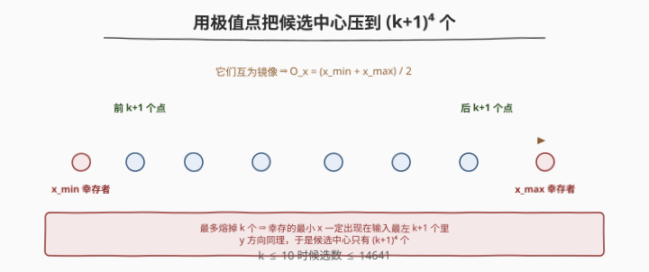
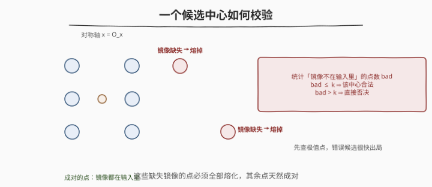

# Codeforces 140F 新年雪花 题解

## 1. 题目概述

- **题目链接**：https://codeforces.com/problemset/problem/140/F
- **比赛来源**：Codeforces Round 100 · Problem F（UTC 2012-01-04）
- **难度**：2600
- **标签**：几何、排序
- **评测类型**：特殊评测（中心可有多个、输出顺序任意）
- **限制**：时间 2 s / 内存 256 MB

**题意**：雪花是一堆平面上的点，并且有一个**对称中心** $O$：每个点关于 $O$ 的对称点也在雪花里（允许有一个点正好落在 $O$ 上）。现在至多有 $k$ 个点融化了，剩下 $n$ 个点的坐标。求所有可能的原始对称中心：即存在点集 $S$（由给定点组成，$|S|\ge n-k$，缺的点就是融化掉的）关于 $O$ 中心对称。若可能的中心有无穷多个，输出 $-1$；否则输出中心个数与坐标（误差 $\le10^{-6}$，顺序任意、不得重复）。

**约束**：

- $n\le2\cdot10^5$，但 $k\le10$ —— 这是解题的钥匙：**极值点只可能落在一小撮候选里**，候选中心数被压到 $(k+1)^4\le14641$。
- 坐标绝对值 $\le5\cdot10^8$：镜像坐标可到 $\pm1.5\cdot10^9$，用 64 位整数；候选中心写成“2 倍坐标”即可全程整数，避免浮点误差。
- $k\le10$ 也意味着 $n-k$ 很大，任意两个合法中心会“共享”大量点，从而几乎不可能共存（见引理 4）。
- 多解 + 浮点输出 ⇒ 必须用 checker 校验集合而不是文本比对。

## 2. 示例与观察

官方样例 1（输入 / 输出原样）：

```text
输入：
4 0
0 0
0 1
1 0
1 1
输出：
1
0.5 0.5
```

官方样例 2（输入 / 输出原样）：

```text
输入：
4 2
0 0
0 1
1 0
1 1
输出：
5
0.0 0.5
0.5 0.0
0.5 0.5
0.5 1.0
1.0 0.5
```

官方样例 3（输入 / 输出原样）：

```text
输入：
4 4
0 0
0 1
1 0
1 1
输出：
-1
```

**样例 1 走查**：$k=0$，四个点构成单位正方形，唯一中心是 $(0.5,0.5)$：每个点的镜像都在集合里 ✓。

**样例 2 走查**：$k=2$，可以熔掉 $2$ 个点。除了正方形中心，还可以只保留一条边（两个点）：它们的对称中心就是这条边的中点，于是 $(0,0.5)$、$(0.5,0)$、$(0.5,1)$、$(1,0.5)$ 都合法，共 $5$ 个 ✓。注意“只剩一个点”也合法，此时中心就是那个点本身；这里 $n-k=2$，所以只考虑至少 $2$ 个点的情况。

**样例 3 走查**：$k=4\ge n=4$，可以把四个点全当成融化的，剩下的空集对**任何**中心都对称 ⇒ 无穷多，输出 $-1$ ✓。

**观察 1**：无穷多的唯一来源是“全部融化”：$n\le k$。若至少要留一个点，中心被那个点钉死；若要留两个点，中心被它们的中点钉死，都不可能是无穷多。

**观察 2**：合法中心的 $x$ 坐标只可能是 $(x_p+x_q)/2$，其中 $p$ 是输入**最左 $k+1$ 个点**之一、$q$ 是**最右 $k+1$ 个点**之一；$y$ 同理。

**观察 3**：固定一个候选中心 $O$ 后，只需数“镜像不在输入里”的点有几个：它们必须全部是融化点，所以个数 $\le k$ 就合法。

自造样例（标注“自造”）：`2 0` + `0 0` / `2 0` → 只有中心 $(1,0)$；`2 2` → 无穷多（$n$ 不超过 $k$）→ `-1`；`3 1` + `0 0` / `2 0` / `5 0` → 三个中心 $(1,0)$、$(2.5,0)$、$(3.5,0)$（分别对应熔掉第 $3$、第 $2$、第 $1$ 个点）。

## 3. 解题思路

### 3.1 朴素做法与瓶颈

中心一定形如“某两点的中点”（或某个点本身），所以候选有 $O(n^2)$ 个；每个候选验证一遍“是否 $\ge n-k$ 个点能配上对”又要 $O(n)$，总计 $O(n^3)$。$n=2\cdot10^5$ 时完全不可行。瓶颈是候选太多。

### 3.2 核心观察



设 $O$ 合法，$S$ 是它的对称幸存集（$|S|\ge n-k$）。

- 若 $|S|\ge2$：取 $S$ 中 $x$ 最小的点 $p$ 与 $x$ 最大的点 $q$。中心对称是一个把 $S$ 映到自身的对合，它把 $x$ 最小者映到 $x$ 最大者，于是 $O_x=\frac{x_p+x_q}{2}$（$y$ 同理）。
- 输入中 $x<x_p$ 的点全都不在 $S$ 里，最多 $k$ 个，所以 $p$ 必在**最左 $k+1$ 个**点中；同理 $q$ 在最右 $k+1$ 个中。
- 若 $|S|=1$：此时 $n-k\le1$，即 $n\le k+1$，所有点都同时属于“最左 $k+1$”与“最右 $k+1$”，取 $p=q$ 为那个点即可。

所以 $O_x$ 只有 $(k+1)^2$ 种、$O_y$ 也只有 $(k+1)^2$ 种，笛卡尔积给出至多 $(k+1)^4\le14641$ 个候选中心。

### 3.3 算法流程

1. 若 $n\le k$，输出 $-1$（全融化，无穷多中心）。
2. 按 $x$ 排序取得最左/最右 $k+1$ 个点的下标，收集所有 $x_p+x_q$（2 倍坐标）；按 $y$ 排序同样收集 $y_p+y_q$。各自去重。
3. 对每个候选 $(2O_x,2O_y)$：
   - 依次检查点：若镜像点 $(2O_x-x_i,\,2O_y-y_i)$ 不在输入集合里，就记一个“缺口”；缺口数超过 $k$ 立即否决。
   - 检查顺序先放极值点（最左/最右/最下/最上各若干），错误候选通常前几步就出局。
   - 全部查完缺口数 $\le k$ 的，收进答案集合（按 2 倍坐标去重）。
4. 输出答案个数与每个中心的坐标（`%.1f`，因为坐标只可能是整数或半整数）。



### 3.4 样例走查

样例 2：$k=2$，最左 $3$ 个点与最右 $3$ 个点给出 $2O_x\in\{0,1,2\}$、$2O_y\in\{0,1,2\}$，共 $9$ 个候选。逐个校验：

- $(0.5,0.5)$：四个点两两成镜像，缺口 $0$ ✓；
- $(0,0.5)$：$(0,0)\leftrightarrow(0,1)$ 成对，$(1,0),(1,1)$ 的镜像在 $x=-1$ 上，缺口 $2\le k$ ✓；
- $(0.5,0)$、$(0.5,1)$、$(1,0.5)$ 同理 ✓；
- $(0,0)$、$(0,1)$、$(1,0)$、$(1,1)$：缺口 $3>k$ ✗。

于是恰好 $5$ 个中心，与样例一致 ✓。

## 4. 正确性证明

**引理 1（无穷多的判据）**：可能中心无穷多当且仅当 $n\le k$。

**证明**：若 $n\le k$，把全部 $n$ 个点都视作融化，幸存集为空，空集关于任意点对称 ⇒ 无穷多。反之若 $n>k$，幸存集 $S$ 满足 $|S|\ge n-k\ge1$：若 $|S|=1$，$O$ 只能是那个点；若 $|S|\ge2$，由引理 2 的论证 $O$ 由 $S$ 的一对极值点唯一确定。有限个点集只给出有限个候选，故中心只有有限多个。∎

**引理 2（候选 $x$ 的完备性）**：任意合法中心的 $2O_x$ 必属于集合 $A_x=\{x_i+x_j\mid i\in L,\ j\in R\}$，其中 $L$ 是最左 $\min(k+1,n)$ 个点、$R$ 是最右 $\min(k+1,n)$ 个点（按 $x$ 排序）。

**证明**：设 $O$ 合法、对称幸存集为 $S$，$|S|\ge n-k$。若 $|S|\ge2$，令 $p,q$ 为 $S$ 中 $x$ 最小/最大者。镜像映射 $\phi(P)=2O-P$ 是 $S$ 到自身的双射且严格反转 $x$ 序，故 $\phi(p)$ 的 $x$ 坐标是所有镜像中最小的，也就是 $q=\phi(p)$，即 $2O_x=x_p+x_q$。又输入中 $x<x_p$ 的点都不在 $S$，至多 $k$ 个，故 $p$ 在最左 $k+1$ 个里；对称地 $q$ 在最右 $k+1$ 个里。若 $|S|=1$，则 $n\le k+1$，$L=R=$ 全体点，取 $p=q$ 为该点即得 $2O_x=2x_p$。∎

**引理 3（候选校验判据）**：固定候选 $O$，令 $\text{bad}(O)=\#\{i:\ 2O-P_i\notin P\}$（$P$ 为输入点集）。则 $O$ 合法 $\iff\text{bad}(O)\le k$。

**证明**：($\Leftarrow$) 把 $\text{bad}(O)$ 中的点全部当成融化点，剩集 $S$。对 $i\in S$，$2O-P_i\in P$；且它的镜像 $2O-(2O-P_i)=P_i\in P$，所以 $2O-P_i$ 的镜像也在 $P$ 中，即 $2O-P_i\in S$。故 $S$ 在 $\phi$ 下闭合、关于 $O$ 中心对称，且 $|S|=n-\text{bad}(O)\ge n-k$ ✓。($\Rightarrow$) 若 $O$ 合法，取对称幸存集 $S$；任一 $i\notin S$ 才可能 $2O-P_i\notin P$（因为 $i\in S$ 时镜像必在 $S\subseteq P$ 中），所以 $\text{bad}(O)\le n-|S|\le k$。∎

**引理 4（唯一性，用于复杂度）**：若 $n\ge2k+2$，则合法中心至多一个。

**证明**：设 $O_1\ne O_2$ 都合法，对应幸存集 $S_1,S_2$，则 $|S_1\cap S_2|\ge n-2k\ge2$。交集关于 $O_1$ 与 $O_2$ 都中心对称；取其中两点 $a,b$，$a$ 关于 $O_1$ 的镜像在交集中，故交集至少两点且 $O_1$ 由极值点唯一确定，同理 $O_2$，于是 $O_1=O_2$，矛盾。∎

**定理**：算法输出的集合恰为所有合法中心。

**证明**：由引理 1 处理无穷多；由引理 2，每个合法中心都在候选集中；由引理 3，校验不会漏判也不会误判；答案用 2 倍坐标去重，故输出恰为全部合法中心。∎

## 5. 复杂度分析

- **时间**：排序 $O(n\log n)$；候选至多 $(k+1)^4\le14641$ 个，每个先做 $O(k)$ 级别的极值预筛，被否决策略上只需常数步；由引理 4，$n\ge2k+2$ 时最多一个真正合法的候选需要完整 $O(n)$ 校验。整体约 $O(n\log n+(k+1)^4k)$。
- **空间**：$O(n)$ 的哈希表 + 候选集合（很小）。
- **与时限的关系**：实测 $n=2\cdot10^5,k=10$ 约 $0.3$ s，$2$ s 时限有余量。

## 6. 参考代码

### C++17

```cpp
#include <bits/stdc++.h>
using namespace std;
typedef long long ll;
typedef unsigned long long ull;

int main() {
    int n, k;
    if (scanf("%d %d", &n, &k) != 2) return 0;
    vector<ll> xs(n), ys(n);
    for (int i = 0; i < n; ++i) scanf("%lld %lld", &xs[i], &ys[i]);
    if (n <= k) { cout << -1 << '\n'; return 0; }   // 全部熔化，任何点都是对称中心

    const ll OFF = 2000000000LL;
    auto key = [&](ll x, ll y) -> ull {
        return ((ull)(x + OFF) << 32) ^ (ull)(y + OFF);
    };
    unordered_set<ull> has;
    has.reserve((size_t)n * 2);
    for (int i = 0; i < n; ++i) has.insert(key(xs[i], ys[i]));

    int c = min(k + 1, n);
    // 极值点：留下点的 x 最小/最大者一定落在输入的前/后 (k+1) 个里
    vector<int> byx(n), byy(n);
    iota(byx.begin(), byx.end(), 0);
    iota(byy.begin(), byy.end(), 0);
    sort(byx.begin(), byx.end(), [&](int a, int b) { return xs[a] < xs[b] || (xs[a] == xs[b] && ys[a] < ys[b]); });
    sort(byy.begin(), byy.end(), [&](int a, int b) { return ys[a] < ys[b] || (ys[a] == ys[b] && xs[a] < xs[b]); });
    vector<ll> oxs, oys;
    for (int i = 0; i < c; ++i)
        for (int j = n - c; j < n; ++j) {
            oxs.push_back(xs[byx[i]] + xs[byx[j]]);
            oys.push_back(ys[byy[i]] + ys[byy[j]]);
        }
    sort(oxs.begin(), oxs.end()); oxs.erase(unique(oxs.begin(), oxs.end()), oxs.end());
    sort(oys.begin(), oys.end()); oys.erase(unique(oys.begin(), oys.end()), oys.end());

    // 先检查极值点，尽早否决错误中心
    vector<int> order;
    vector<char> used(n, 0);
    auto push = [&](int id) { if (!used[id]) { used[id] = 1; order.push_back(id); } };
    for (int i = 0; i < c; ++i) { push(byx[i]); push(byx[n - 1 - i]); push(byy[i]); push(byy[n - 1 - i]); }
    for (int i = 0; i < n; ++i) push(i);

    set<pair<ll, ll>> res;
    vector<ll> miss(n, 0);
    for (ll sx : oxs)
        for (ll sy : oys) {
            int bad = 0;
            for (int id : order) {
                if (!has.count(key(sx - xs[id], sy - ys[id]))) {
                    if (++bad > k) break;
                }
            }
            if (bad <= k) res.insert({sx, sy});
        }

    cout << res.size() << '\n';
    for (auto& p : res) printf("%.1f %.1f\n", p.first / 2.0, p.second / 2.0);
    return 0;
}
```

### Python3

```python
import sys


def main() -> None:
    data = sys.stdin.buffer.read().split()
    if not data:
        return
    n, k = int(data[0]), int(data[1])
    pts = [(int(data[2 + 2 * i]), int(data[3 + 2 * i])) for i in range(n)]
    if n <= k:                       # 全部熔化：任何点都是对称中心
        print(-1)
        return
    have = set(pts)
    c = min(k + 1, n)
    byx = sorted(range(n), key=lambda i: (pts[i][0], pts[i][1]))
    byy = sorted(range(n), key=lambda i: (pts[i][1], pts[i][0]))
    oxs, oys = set(), set()
    for i in range(c):
        for j in range(n - c, n):
            oxs.add(pts[byx[i]][0] + pts[byx[j]][0])
            oys.add(pts[byy[i]][1] + pts[byy[j]][1])
    order, seen = [], set()
    for i in range(c):
        for t in (byx[i], byx[n - 1 - i], byy[i], byy[n - 1 - i]):
            if t not in seen:
                seen.add(t)
                order.append(t)
    for i in range(n):
        if i not in seen:
            seen.add(i)
            order.append(i)
    res = set()
    for sx in oxs:
        for sy in oys:
            bad = 0
            for i in order:
                x, y = pts[i]
                if (sx - x, sy - y) not in have:
                    bad += 1
                    if bad > k:
                        break
            if bad <= k:
                res.add((sx, sy))
    out = [str(len(res))]
    for sx, sy in sorted(res):
        out.append('%.1f %.1f' % (sx / 2.0, sy / 2.0))
    sys.stdout.write('\n'.join(out) + '\n')


main()
```

Python 版思路相同，但 $(k+1)^4$ 个候选的常数较大，$n=2\cdot10^5$ 时建议 PyPy3 或直接交 C++。

## 7. 边界情况与易错点

1. **$n\le k$**：必须输出 $-1$（无穷多），不要输出 $0$ 个中心。
2. **$n=k+1$**：合法中心是“每个输入点”，共 $n$ 个 —— 因为可以熔掉其余 $n-1\le k$ 个点。候选构造里 $p=q$ 的分支正是为这种情形准备的。
3. **$k=0$**：候选只有 $1$ 个（最左点与最右点各唯一），校验一遍即可；此时 $\text{bad}(O)$ 必须为 $0$。
4. **所有点 $x$ 相同（竖直线）**：极值论证仍成立（$p,q$ 可以同一点），$2O_x=2x$，$O_y$ 由 $y$ 的极值给出；不要假设 $x$ 互不相同。
5. **坐标越界**：镜像坐标可达 $\pm1.5\cdot10^9$，`int` 会溢出；全程 `long long`，哈希键用 32 位截断时要确认取值范围（本实现偏移 $2\cdot10^9$ 后仍在 32 位内）。
6. **浮点输出**：中心坐标只可能是整数或半整数，打印 `%.1f` 正好精确；不要打印 `%.6f` 之外的近似值再期待对比，题目允许 $10^{-6}$ 误差但不允许重复点。
7. **去重**：同一中心会被多对极值点生成，必须用集合去重，否则输出个数会偏大。
8. **哈希冲突**：自定义 64 位键时确保 $x,y$ 各占 32 位且互不干扰（本实现用 `((x+OFF)<<32) ^ (y+OFF)`）。

## 8. 验证记录

- **编译环境与命令**：`Apple clang 21.0.0` + 仓库兼容头（`-std=c++17 -O2 -I codeforces/tools/include`），Python `3.9.6`。
- **官方样例**：`python3 codeforces/tools/verify_solution.py codeforces/contests/0101-0203/140/F_新年雪花.md --checker codeforces/tools/checkers/cf140f.py` → `CF140F: samples 3`，C++ 3/3、Python 3/3（输出与样例逐点一致）。
- **方案校验器**：新增 `codeforces/tools/checkers/cf140f.py`，独立地枚举**所有点对（含自身）的中点**作为候选（$O(n^2)$ 但只用于小样例），按引理 3 的把戏筛出真值集合；再要求输出个数一致、中心不重复且每个都在真值集合中（以 2 倍坐标精确比对，等价于 $10^{-6}$ 精度）。
- **额外测试**：独立暴力 `brute.py`（同上的全点对枚举 + 逐个校验），对 $n\le8$、$k\le4$、坐标 $\in[-4,4]$ 的 600 组随机数据与 C++/Python 比对，中心个数与集合全部一致。
- **最大约束性能**：$n=2\cdot10^5,k=10$ 随机数据约 $0.31$ s；对称点集 + $10$ 个破坏对称的点约 $0.07$ s（此时恰有 $1$ 个合法中心，需要完整扫一遍）。
- **复核状态**：verified。

## 相关题目与扩展

- [Codeforces 140E New Year Garland](https://codeforces.com/problemset/problem/140/E)：同场计数。
- [Codeforces 140B New Year Cards](https://codeforces.com/problemset/problem/140/B)：同场模拟。
- [Codeforces 166B Polygons](https://codeforces.com/problemset/problem/166/B)：点集几何判定。
- [LeetCode 1037. 有效的回旋镖](https://leetcode.cn/problems/valid-boomerang/)：整数几何。

**延伸思考**：

1. **若允许“补点”而不只是“缺点”**（原始雪花可能比给定点更多）：条件变成“存在关于 $O$ 对称的点集包含给定点”，即每个点的镜像都要在，缺口必须为 $0$，答案退化为中心唯一或不唯一判定。
2. **若 $k$ 大到 $10^5$**：$(k+1)^4$ 爆炸。此时应改成“随机采样 + 投票”：随机取一个点，它的镜像必在 $k+1$ 个候选里，用 $O(n)$ 校验投票，复杂度 $O(nk)$。
3. **若要求中心必须是整点**：把 2 倍坐标的奇偶性筛一遍即可，候选数直接减半以上。
4. **若把“中心对称”换成“轴对称”**：对称轴有方向自由度，候选变成“过两点中垂线”或“过一点且垂直于两点连线”，需要按角度去重，是另一套几何。
