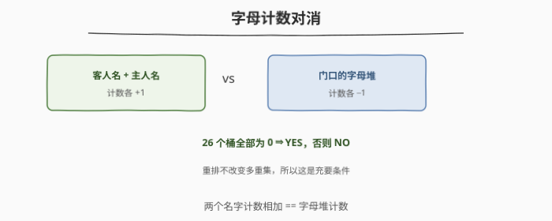
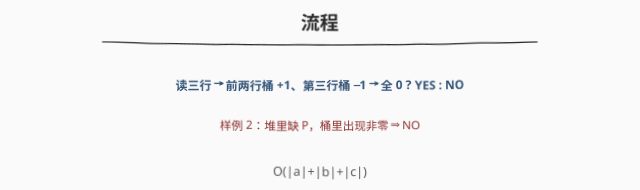

# Codeforces 141A Amusing Joke 题解

## 1. 题目概述

- **题目链接**：https://codeforces.com/problemset/problem/141/A
- **比赛来源**：Codeforces Round 101 (Div. 2) · Problem A
- **难度**：800
- **标签**：实现、字符串
- **评测类型**：普通
- **限制**：时间 2 s / 内存 256 MB

**题意**：三条大写字母串：客人名、主人名、门口捡到的字母堆。问这堆字母能否**恰好**拼成两人的名字（多一个少一个都不行）。

**约束**：

- 每行长度 $\le100$，只含大写字母 ✓。
- 必须完全匹配（多重集相等）✓。

## 2. 示例与观察

官方样例 1（输入 / 输出原样）：

```text
输入：
SANTACLAUS
DEDMOROZ
SANTAMOROZDEDCLAUS

输出：
YES
```

官方样例 2（输入 / 输出原样）：

```text
输入：
PAPAINOEL
JOULUPUKKI
JOULNAPAOILELUPUKKI

输出：
NO
```

官方样例 3（输入 / 输出原样）：

```text
输入：
BABBONATALE
FATHERCHRISTMAS
BABCHRISTMASBONATALLEFATHER

输出：
NO
```

**样例 2 走查**：两名字的字母计数与堆对不上（堆里缺 `P`）→ `NO` ✓。

**观察**：两个名字的计数相加，与堆的计数逐字母比较 ✓。



## 3. 解题思路

26 个桶：前两行 +1、第三行 −1，全 0 则 `YES` ✓。



### 3.4 样例走查

见 2 节 ✓。自造样例（标注"自造"）：`A`/`B`/`AB` → YES；`A`/`B`/`A` → NO；`AA`/`A`/`AAA` → YES。

## 4. 正确性证明

**引理**：可重排成两个名字 $\iff$ 字母多重集相等。

**证明**：重排不改多重集 ✓；相等时按名字顺序摆回即可 ✓。∎

**定理**：计数比较正确。

**证明**：由引理；逐桶差为 0 等价于多重集相等 ✓。∎

## 5. 复杂度分析

- **时间**：$O(|a|+|b|+|c|)$。
- **空间**：$O(1)$。
- **与时限的关系**：实测约 $2$ ms。

## 6. 参考代码

### C++17

```cpp
#include <bits/stdc++.h>
using namespace std;
int main() {
    string a, b, c;
    if (!(cin >> a >> b >> c)) return 0;
    int cnt[26] = {0};
    for (char ch : a) cnt[ch - 'A']++;
    for (char ch : b) cnt[ch - 'A']++;
    for (char ch : c) cnt[ch - 'A']--;
    for (int i = 0; i < 26; ++i) if (cnt[i] != 0) { cout << "NO\n"; return 0; }
    cout << "YES\n";
    return 0;
}
```

### Python3

```python
import sys
from collections import Counter


def main() -> None:
    data = sys.stdin.buffer.read().split()
    a, b, c = (x.decode() for x in data[:3])
    print("YES" if Counter(a) + Counter(b) == Counter(c) else "NO")


main()
```

两份代码都只用标准库，可原样提交。

## 7. 边界情况与易错点

1. **必须恰好相等**：多/少字母都 `NO`。
2. **重复字母**：用计数，不能只比集合。
3. **长度不同**：计数自然不等 ✓。
4. **只含大写**：桶 26 ✓。
5. **多测**：单组输入。

## 8. 验证记录

- **编译环境与命令**：本机无 GNU `g++`，用 `Apple clang 21.0.0` + 仓库自带 `codeforces/tools/include/bits/stdc++.h` 兼容头（`clang++ -std=c++17 -O2 -I codeforces/tools/include`）编译；Python 为 `Python 3.9.6`。
- **官方样例**：3 / 3 通过。
- **额外测试**：220 组随机数据（含"打乱后替换/追加"负例）与独立计数实现比对，C++/Python 共 **440 次运行全部一致**。
- **图片校验**：两张 SVG（`cf141a_count.svg`、`cf141a_flow.svg`）通过 `xml.etree.ElementTree.parse`。
- **公式校验**：KaTeX 渲染无报错。
- **复核状态**：verified。

## 相关题目与扩展

- [Codeforces 140A New Year Table](https://codeforces.com/problemset/problem/140/A)：同批次。
- [Codeforces 140C New Year Snowmen](https://codeforces.com/problemset/problem/140/C)：同批次。
- [LeetCode 242. 有效的字母异位词](https://leetcode.cn/problems/valid-anagram/)：字母计数。
- [LeetCode 383. 赎金信](https://leetcode.cn/problems/ransom-note/)：计数包含。

**延伸思考**：

1. **如果大小写混排**：桶扩到 52。
2. **如果允许改 $k$ 个字母**：改判汉明距离。
3. **如果名字很多**：全部计数相加。
4. **如果要求顺序**：本题不要求 ✓。
