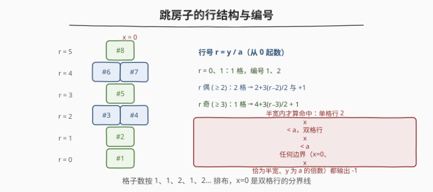
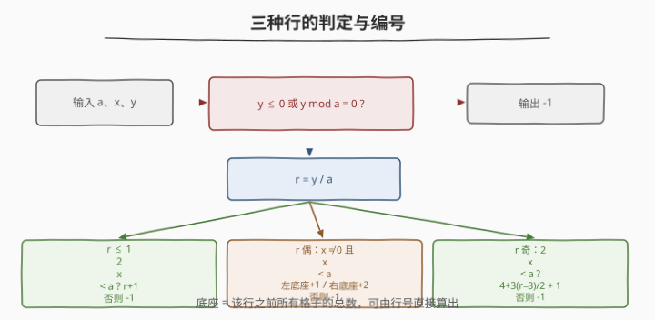

# Codeforces 141B 跳房子 题解

## 1. 题目概述

- **题目链接**：https://codeforces.com/problemset/problem/141/B
- **比赛来源**：Codeforces Round 101 (Div. 2) · Problem B（UTC 2012-01-08）
- **难度**：1400
- **标签**：几何、数学、实现
- **评测类型**：普通
- **限制**：时间 2 s / 内存 256 MB

**题意**：跳房子场地由边长 $a$ 的正方形格子自下而上拼成，每行的格子数为 $1,1,2,1,2,1,2,\dots$（从第 2 行起按 $1,2$ 循环）。格子从下往上、同一行从左往右编号 $1,2,3,\dots$。给定石子的整数坐标 $(x,y)$，判断它是否**严格落在某个格子内部**：是则输出该格子编号，落在任何边界上或场地外都输出 $-1$。

**约束**：

- $a\le 100$，$|x|\le 10^6$，$0\le y\le 10^6$，全是整数 —— 可以 $O(1)$ 由坐标直接算出所在行与编号，不需要建格子表，也不需要浮点。
- $y$ 可以等于 $0$（底边），也可能正好是 $a$ 的倍数（水平边界），这两类都必须判成 $-1$。
- 由于 $x,y$ 是整数，判定“严格在内部”可以全部写成整数比较（例如单格行比较 $2|x|<a$），不会引入精度问题。
- $x$ 允许取到 $\pm10^6$，远大于场地宽度，所以必须先判断 $|x|$ 是否越界。

## 2. 示例与观察

官方样例 1（输入 / 输出原样）：

```text
输入：
1 0 0
输出：
-1
```

官方样例 2（输入 / 输出原样）：

```text
输入：
3 1 1
输出：
1
```

官方样例 3（输入 / 输出原样）：

```text
输入：
3 0 10
输出：
5
```

官方样例 4（输入 / 输出原样）：

```text
输入：
3 0 7
输出：
-1
```

官方样例 5（输入 / 输出原样）：

```text
输入：
3 4 0
输出：
-1
```

**样例 2 走查**：$a=3,x=1,y=1$。$y/a=0$，第 $0$ 行只有 $1$ 个格子，横跨 $x\in(-1.5,1.5)$；$2\cdot|1|=2<3$，严格在内部 → 编号 $1$ ✓。

**样例 3 走查**：$a=3,x=0,y=10$。$10/3=3$（$10\bmod 3=1\ne 0$），第 $3$ 行是单格行，编号 $4+3\cdot\lfloor(3-3)/2\rfloor+1=5$ ✓。

**样例 4 走查**：$a=3,x=0,y=7$。$7/3=2$，第 $2$ 行是双格行，两格以 $x=0$ 为公共边，而石子正好落在 $x=0$ → 边界 → $-1$ ✓。

**样例 5 走查**：$a=3,x=4,y=0$。$y=0$ 是场地底边，本来就是边界 → $-1$；同时 $|x|=4>a=3$ 也在场地外，两个理由都指向 $-1$ ✓。

**观察 1**：行号 $r=\lfloor y/a\rfloor$：每一行是 $y\in(ra,(r+1)a)$ 的横条，所以 $y\bmod a=0$ 等价于“落在水平边界上”。

**观察 2**：单格行（$r=0$、$r=1$ 以及所有奇数行）的格子横跨 $(-a/2,a/2)$，居中；双格行（偶数行 $r\ge2$）的左右两格分别横跨 $(-a,0)$ 与 $(0,a)$，以 $x=0$ 为界。

**观察 3**：编号只由行号决定，前面所有行的格子数有闭式前缀和，不必真的去数。

自造样例（标注“自造”）：`4 2 1` 中 $2|x|=4$ 恰等于 $a$，落在第 $0$ 行格子的右边框上 → $-1$；`4 1 1` → 编号 $1$；`4 0 5` 中 $5/4=1$（单格行）、$2\cdot0<4$ → 编号 $2$。

## 3. 解题思路

### 3.1 朴素做法与瓶颈

最直白的写法是从第 $0$ 行往上逐行枚举格子、累加编号，直到覆盖 $y$。因为 $y\le10^6$、$a\ge1$，最多 $10^6$ 行，其实也能过，但要把“行内左右顺序”“边界”都写对反而更啰嗦，而且编号累加与“行号奇偶”两套逻辑容易打架。真正的瓶颈是：我们需要一个**由行号直接给出编号**的闭式，把整题压到 $O(1)$。

### 3.2 核心观察



行号 $r=\lfloor y/a\rfloor$ 一旦确定，编号就是一个只和 $r$ 有关的前缀和 $P(r)$（前 $r$ 行的格子总数）：

- $r$ 为偶数且 $r\ge2$：从第 $2$ 行起每两行（偶+奇）贡献 $3$ 个格子，故 $P(r)=2+3\cdot\frac{r-2}{2}$，该行是双格行，左格编号 $P(r)+1$、右格 $P(r)+2$。
- $r$ 为奇数且 $r\ge3$：$P(r)=2+3\cdot\frac{r-3}{2}+2=4+3\cdot\frac{r-3}{2}$，该行是单格行，编号 $P(r)+1$。

### 3.3 算法流程



1. 若 $y\le0$ 或 $y\bmod a=0$，输出 $-1$（底边与所有水平边界）。
2. 否则算 $r=\lfloor y/a\rfloor$。
3. $r\le1$：单格行，若 $2|x|<a$ 输出 $r+1$，否则 $-1$。
4. $r$ 为偶数：若 $x=0$（竖直分界）或 $|x|\ge a$（越界）输出 $-1$；否则输出 $P(r)+1$（$x<0$）或 $P(r)+2$（$x>0$）。
5. $r$ 为奇数：若 $2|x|\ge a$ 输出 $-1$，否则输出 $P(r)+1$。

### 3.4 样例走查

| 样例 | $a$ | $x$ | $y$ | 行 $r$ | 行类型 | 判定 | 输出 |
| --- | --- | --- | --- | --- | --- | --- | --- |
| 1 | 1 | 0 | 0 | — | — | $y=0$ 底边 | $-1$ |
| 2 | 3 | 1 | 1 | 0 | 单格 | $2<3$ 内部 | 1 |
| 3 | 3 | 0 | 10 | 3 | 单格 | $0<3$ 内部，$P=4$ | 5 |
| 4 | 3 | 0 | 7 | 2 | 双格 | $x=0$ 分界 | $-1$ |
| 5 | 3 | 4 | 0 | — | — | 底边且越界 | $-1$ |

## 4. 正确性证明

**引理 1（行号定位）**：石子所在行号恰为 $r=\lfloor y/a\rfloor$，且石子在该行内部当且仅当 $y>0$ 且 $y\bmod a\ne0$。

**证明**：第 $j$ 行的竖直范围是开区间 $(ja,(j+1)a)$，这些区间加上边界点恰好划分 $[0,+\infty)$。给定整数 $y>0$，$r=\lfloor y/a\rfloor$ 是唯一使 $ra<y<(r+1)a$ 的整数，等价于 $y\bmod a\ne0$；而 $y=0$ 落在第 $0$ 行下边界上。∎

**引理 2（行型与横坐标范围）**：$r=0,1$ 以及 $r$ 为奇数时该行只有 $1$ 个格子，横跨 $(-a/2,a/2)$；$r$ 为偶数且 $r\ge2$ 时有 $2$ 个格子，分别横跨 $(-a,0)$ 与 $(0,a)$。

**证明**：题面给出的行格子数序列是 $1,1,2,1,2,\dots$，即 $r=0,1$ 为 $1$，$r\ge2$ 时偶数行 $2$ 个、奇数行 $1$ 个。所有格子边长 $a$ 且场地以 $x=0$ 为中轴：单格行居中，双格行两格并排并以 $x=0$ 为公共边，这正是题面配图的形状。∎

**引理 3（编号闭式）**：$r$ 为偶数（$\ge2$）时 $P(r)=2+3(r-2)/2$，行内左格 $P(r)+1$、右格 $P(r)+2$；$r$ 为奇数（$\ge3$）时 $P(r)=4+3(r-3)/2$，行内唯一格 $P(r)+1$。

**证明**：$r\ge2$ 时，第 $2$ 行到第 $r-1$ 行按 $(2,3),(4,5),\dots$ 两两成对，每对贡献 $2+1=3$ 个格子。$r$ 为偶数时共 $(r-2)/2$ 对，故 $P(r)=2+3(r-2)/2$；$r$ 为奇数时成对的只有前 $(r-3)/2$ 对，再加第 $r-1$ 行（偶数行，$2$ 个格子），故 $P(r)=2+3(r-3)/2+2$。行内按从左到右编号，双格行左格在前，于是得到各编号。∎

**定理**：上述流程输出的编号正确；若石子落在任何边界或场地外，输出 $-1$。

**证明**：由引理 1 先排除底边与所有水平边界。此后 $r$ 确定，由引理 2 得到该行格子的横坐标开区间，由引理 3 得到编号。流程用 $2|x|<a$ 或 $|x|<a$ 做**严格**比较，恰好对应开区间内部；等号情形（边界）与越界情形都返回 $-1$。三种行型互斥且穷尽，故结论成立。∎

## 5. 复杂度分析

- **时间**：$O(1)$，只有常数次整数运算。
- **空间**：$O(1)$。
- **与时限的关系**：$2$ s 时限下 $O(1)$ 可以忽略不计；即便按 $y/a$ 逐行数（$\le10^6$ 次）也远在时限内，本解只是更省心。

## 6. 参考代码

### C++17

```cpp
#include <bits/stdc++.h>
using namespace std;

int main() {
    long long a, x, y;
    if (!(cin >> a >> x >> y)) return 0;
    if (y <= 0 || y % a == 0) {              // 落在水平边界（含场地底边 y=0）
        cout << -1 << '\n';
        return 0;
    }
    long long row = y / a;                   // 0 起算的行号
    long long ax = llabs(x);
    if (row <= 1) {                          // 前两行各只有 1 个格子，居中
        cout << (2 * ax < a ? row + 1 : -1) << '\n';
        return 0;
    }
    if (row % 2 == 0) {                      // 偶数行：左右两个格子，分界为 x=0
        if (x == 0 || ax >= a) { cout << -1 << '\n'; return 0; }
        long long base = 2 + 3 * ((row - 2) / 2);
        cout << (x < 0 ? base + 1 : base + 2) << '\n';
    } else {                                 // 奇数行：1 个格子，居中
        if (2 * ax >= a) { cout << -1 << '\n'; return 0; }
        long long base = 4 + 3 * ((row - 3) / 2);
        cout << base + 1 << '\n';
    }
    return 0;
}
```

### Python3

```python
import sys


def main() -> None:
    data = sys.stdin.buffer.read().split()
    if len(data) < 3:
        return
    a, x, y = int(data[0]), int(data[1]), int(data[2])
    if y <= 0 or y % a == 0:                 # 水平边界（含底边 y=0）
        print(-1)
        return
    row, ax = y // a, abs(x)                 # 0 起算的行号
    if row <= 1:                             # 前两行只有 1 个格子，居中
        print(row + 1 if 2 * ax < a else -1)
        return
    if row % 2 == 0:                         # 偶数行：左右两个格子
        if x == 0 or ax >= a:
            print(-1)
            return
        base = 2 + 3 * ((row - 2) // 2)
        print(base + 1 if x < 0 else base + 2)
    else:                                    # 奇数行：1 个格子，居中
        if 2 * ax >= a:
            print(-1)
            return
        print(4 + 3 * ((row - 3) // 2) + 1)


main()
```

两份代码都只用标准库，可原样提交。

## 7. 边界情况与易错点

1. **$y=0$**：场地底边，必须 $-1$；用 `y <= 0 || y % a == 0` 一并挡掉。
2. **$y$ 是 $a$ 的倍数**：石子落在两行之间的水平边界上，$-1$。
3. **双格行的 $x=0$**：两格的公共竖边，$-1$（不要把它归到左格或右格）。
4. **单格行必须写 $2|x|<a$**：写成 $|x|<a$ 会把 $a$ 为偶数时的 $x=\pm a/2$（边界点）误判为命中。
5. **双格行用 $|x|<a$**：写成 $2|x|<a$ 会漏掉 $a/2\le|x|<a$ 的合法区域。
6. **越界**：$|x|\ge a$ 在单格行同样要判 $-1$，不能只在双格行判断。
7. **整数类型**：$2|x|\le2\cdot10^6$、$3r\le3\cdot10^6$ 都在 `int` 内，但统一用 `long long` 更省心，避免以后改约束时溢出。
8. **不要用浮点**：$a/2$ 用浮点比较在 $a$ 为奇数时会出现 $1.4999\dots$ 之类的误差，全程整数最稳。

## 8. 验证记录

- **编译环境与命令**：本机没有 GNU `g++`，用 `Apple clang 21.0.0` + 仓库自带兼容头（`-std=c++17 -O2 -I codeforces/tools/include`）；Python 为 `Python 3.9.6`。
- **官方样例**：`python3 codeforces/tools/verify_solution.py codeforces/contests/0101-0203/141/B_跳房子.md` → `CF141B: samples 5`，C++ 样例 5/5，Python 样例 5/5。
- **额外测试**：另写独立暴力 `brute.py`（按题面几何逐行枚举格子、用开区间判定），随机 1000 组（$a\le9$、$|x|\le14$、$y\le40$）与 C++/Python 逐组比对，全部一致。
- **最大约束性能**：$a=1,x=10^6,y=10^6$ 单次运行约 $1$ ms（几乎全是进程启动开销）。
- **复核状态**：verified。

## 相关题目与扩展

- [Codeforces 140A New Year Table](https://codeforces.com/problemset/problem/140/A)：同批次的计算几何。
- [Codeforces 141A Amusing Joke](https://codeforces.com/problemset/problem/141/A)：同场 A 题。
- [Codeforces 141C Queue](https://codeforces.com/problemset/problem/141/C)：同场构造题。
- [LeetCode 1232. 缀点成线](https://leetcode.cn/problems/check-if-it-is-a-straight-line/)：整数几何判定。

**延伸思考**：

1. **若行格子数改成 1-2-3-1-2-3 循环**：前缀和仍是分段一次函数，只要把“每 3 行贡献 6 格”算清即可，$O(1)$ 结论不变。
2. **若格子边长不相等（逐行给定）**：$y$ 到行号的映射需要二分，$O(\log n)$，编号用行首前缀和 + 行内二分。
3. **若石子可以落在边界也算命中**：把所有严格不等号改成非严格，但双格行的 $x=0$ 会同时属于两格，需要额外规定归属。
4. **若要求输出最近格子的编号**（允许落在场外）：先按 $y$ 定位行、再按 $x$ 定位列，取曼哈顿距离最小的格子，注意越界时的截断。
