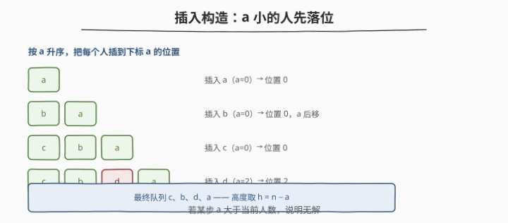
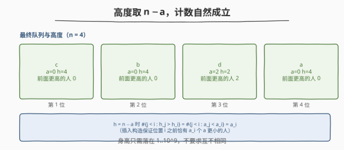

# Codeforces 141C 排队 题解

## 1. 题目概述

- **题目链接**：https://codeforces.com/problemset/problem/141/C
- **比赛来源**：Codeforces Round 101 (Div. 2) · Problem C（UTC 2012-01-08）
- **难度**：1800
- **标签**：构造、贪心、排序
- **评测类型**：特殊评测（多解）
- **限制**：时间 2 s / 内存 256 MB

**题意**：$n$ 个人各记得一个数 $a_i$：原队列里**站在自己前面且比自己高**的人数。给出每个人的名字与 $a_i$，要求复原一个合法的队列顺序，并给每个人一个身高 $h_i\in[1,10^9]$，使所有人的 $a_i$ 都成立；无解输出 $-1$。身高不要求互不相同，顺序若有多种输出任意一种。

**约束**：

- $n\le3000$：$O(n^2)$ 完全够用，$O(n^3)$ 会被卡；插入构造正好是 $O(n^2)$。
- $0\le a_i\le n-1$：$a_i$ 超过当前已排人数就意味着无解，这是唯一的不可行来源。
- 身高只需落在 $[1,10^9]$ 且可以重复 —— 于是我们可以自由地把“高度”当成“优先级标签”来设计，不必模拟真实身高。
- 名字互不相同（可作唯一键），长度 $\le10$。
- 多解 ⇒ 必须用 checker 校验，不能文本比对。

## 2. 示例与观察

官方样例 1（输入 / 输出原样）：

```text
输入：
4
a 0
b 2
c 0
d 0
输出：
a 150
c 170
d 180
b 160
```

官方样例 2（输入 / 输出原样）：

```text
输入：
4
vasya 0
petya 1
manya 3
dunay 3
输出：
-1
```

**样例 1 走查**：$a$ 值为 $0,2,0,0$。按 $a$ 升序（$a,c,d,b$）依次插到下标 $a_i$：`[a]` → `[c,a]` → `[d,c,a]` → `[d,c,b,a]`。取 $h=n-a$ 得 $4,4,2,4$：$d$ 前面没人 → $0$；$c$ 前面 $d$ 的身高 $4$ 不大于 $4$ → $0$；$b$ 前面两人身高 $4,4$ 都大于 $2$ → $2$；$a$ 前面最高只有 $4$，不大于 $4$ → $0$。全部吻合 ✓。（样例给的 `a c d b` 与 $150,170,180,160$ 同样合法，只是另一种方案。）

**样例 2 走查**：$a$ 值排序后为 $0,1,3,3$。插入到第 3 个人（$a=3$）时，当前队列只有 $2$ 个人，$3>2$，无处可插 → 无解 ✓。

**观察 1**：队列里第 $i$ 位（$0$ 起）的人，前面只有 $i$ 个人，所以必须有 $a_i\le i$。把 $a$ 升序排好后的第 $k$ 个人（$1$ 起）必须满足 $a\le k-1$。

**观察 2**：把人们按 $a$ 升序依次“插入到下标 $a_i$”恰好能满足这个条件：只要某一步 $a_i$ 大于当前人数就无解。

**观察 3**：插入完成后，位置 $i$ 之前恰有 $a_i$ 个 $a$ 值更小的人。于是取 $h_i=n-a_i$，则 $h_j>h_i\iff a_j<a_i$，前面比他高的人数正好是 $a_i$。

自造样例（标注“自造”）：$n=1$，`x 0` → `x 1`；$n=3$，三人 $a=0,0,0$ → 任意顺序、身高全取 $3$；$n=2$，`p 1 / q 0` → 先插 $q$（$a=0$）再插 $p$（$a=1$）得 `q p`，身高 $2,1$（$p$ 前面 $q$ 更高，$a_p=1$ ✓）。

## 3. 解题思路

### 3.1 朴素做法与瓶颈

想直接搜索队列顺序是 $n!$ 级别；即便按 $a$ 分组也有大量组合。注意到**可行性与顺序无关**：只要 $a$ 升序后第 $k$ 个不超过 $k-1$ 就可行（见引理 1），所以问题退化成“构造”。瓶颈是：给定队列位置，如何保证“前面比他高的人数”恰好等于 $a_i$ —— 这正是插入构造要解决的问题。

### 3.2 核心观察



因为 $a$ 是“前面比他高的人数”，$a$ 越小的人越矮、越该靠前。于是按 $a$ 升序处理：把当前这个人插到当前队列的**下标 $a_i$** 处。插入位置之前的人都是 $a$ 值更小的（更矮），恰好 $a_i$ 个；之后插入的人 $a$ 值只会更大，插进来也不会减少这个计数。

### 3.3 算法流程

1. 读入 $(name_i,a_i)$，按 $a$ 升序排序。
2. 维护一个列表 `q`（初始为空）。对每个人：若 $a_i>|q|$，输出 $-1$ 结束；否则把 $(a_i,name_i)$ 插到 `q` 的下标 $a_i$。
3. 输出 `q` 中每个人的名字与身高 $h=n-a_i$（顺序即队首到队尾）。



### 3.4 样例走查

样例 1 的插入过程就是上面图中的四步：`[a] → [c,a] → [d,c,a] → [d,c,b,a]`。最终队列 $c,b,d,a$ 对应的 $a$ 值为 $0,0,2,0$，身高 $4,4,2,4$：第 3 位的 $b$ 前面两人身高 $4>2$，贡献 $2=a_b$；其余三位前面都没有比他们更高的，贡献 $0$ ✓。

## 4. 正确性证明

**引理 1（可行性判据）**：设 $a$ 升序为 $a_{(1)}\le\cdots\le a_{(n)}$（$1$ 起）。存在合法方案当且仅当 $a_{(k)}\le k-1$ 对所有 $k$ 成立。

**证明**：必要性：合法队列里第 $i$ 位（$0$ 起）前面只有 $i$ 人，故 $a_i\le i$；于是前 $k$ 个位置上的 $k$ 个人都满足 $a\le k-1$，即至少有 $k$ 个人 $a\le k-1$，故 $a_{(k)}\le k-1$。充分性：下面引理 2 的构造在该条件下不会失败（第 $k$ 步要插入的下标 $a_{(k)}\le k-1=|q|$），并给出合法方案。∎

**引理 2（插入不变式）**：按 $a$ 升序把第 $k$ 个人插到下标 $a_{(k)}$（$a_{(k)}\le k-1$）。则全部插完后，对任意一个人 $p$，队列中位于 $p$ 之前且 $a$ 值**严格小于** $a_p$ 的人数恰为 $a_p$。

**证明**：对插入时刻做归纳。插入 $p$（$a_p=v$）时，队列里已有的人都满足 $a\le v$；而所有 $a=v$ 的人都是插到下标 $v$ 的，之后只会被后来的插入推到下标 $\ge v$，所以此刻下标 $<v$ 的人 $a$ 值都严格小于 $v$，且共有 $v$ 个 —— 于是 $p$ 前面恰有 $v$ 个更小的 $a$。此后的插入者 $q$ 满足 $a_q\ge v$ 且插在下标 $a_q\ge v$：若 $a_q>v$ 或 $a_q=v$，都不满足“严格小于 $v$”，故不会改变 $p$ 的计数，也不会改变已有元素的相对顺序。∎

**引理 3（身高赋值）**：在引理 2 的队列上取 $h_p=n-a_p$，则位置 $i$ 之前比 $h_i$ 高的人数等于 $a_i$。

**证明**：$h_j>h_i\iff n-a_j>n-a_i\iff a_j<a_i$，所以“前面更高的人数” $=\#\{j<i:a_j<a_i\}=a_i$（引理 2）。且 $a_i\in[0,n-1]$ 保证 $h_i\in[1,n]\subseteq[1,10^9]$。∎

**定理**：算法要么输出一个合法方案，要么在无解时输出 $-1$。

**证明**：若算法未输出 $-1$，由引理 2、3 方案合法；若某步 $a_i>|q|$，则排序后第 $k$ 个 $a_{(k)}>k-1$，由引理 1 无解，输出 $-1$ 正确。∎

## 5. 复杂度分析

- **时间**：排序 $O(n\log n)$，$n$ 次列表插入最坏 $O(n^2)$，总计 $O(n^2)$，$n=3000$ 时约 $9\times10^6$ 次元素搬移。
- **空间**：$O(n)$。
- **与时限的关系**：$O(n^2)$ 在 $2$ s 内绰绰有余（实测 $n=3000$ 只需几毫秒），远优于指数搜索。

## 6. 参考代码

### C++17

```cpp
#include <bits/stdc++.h>
using namespace std;

int main() {
    ios::sync_with_stdio(false);
    cin.tie(nullptr);
    int n;
    if (!(cin >> n)) return 0;
    vector<pair<int, string>> people(n);
    for (int i = 0; i < n; ++i) cin >> people[i].second >> people[i].first;
    // 按 a 从小到大处理：a 小的人更矮，先落位
    sort(people.begin(), people.end(),
         [](const pair<int, string>& A, const pair<int, string>& B) { return A.first < B.first; });
    vector<pair<int, string>> q;
    q.reserve(n);
    for (int i = 0; i < n; ++i) {
        if (people[i].first > (int)q.size()) {   // 前面没有足够的人可以比他高
            cout << -1 << '\n';
            return 0;
        }
        q.insert(q.begin() + people[i].first, people[i]);
    }
    // 令 h = n - a：最终队列里位置 i 之前恰有 a_i 个人比它高
    for (int i = 0; i < n; ++i) cout << q[i].second << ' ' << n - q[i].first << '\n';
    return 0;
}
```

### Python3

```python
import sys


def main() -> None:
    data = sys.stdin.buffer.read().split()
    if not data:
        return
    n = int(data[0])
    people = []
    pos = 1
    for _ in range(n):
        name = data[pos].decode()
        a = int(data[pos + 1])
        pos += 2
        people.append((a, name))
    people.sort()                      # 按 a 升序：a 小的更矮，先落位
    q = []
    for a, name in people:
        if a > len(q):                 # 前面没有足够的人可以比他高
            print(-1)
            return
        q.insert(a, (a, name))
    # 取 h = n - a：位置 i 之前恰有 a_i 个人比他高
    sys.stdout.write("".join(f"{name} {n - a}\n" for a, name in q))


main()
```

两份代码都只用标准库。Python 的 `list.insert` 是 C 层搬移，$n=3000$ 同样很快。

## 7. 边界情况与易错点

1. **$n=1$**：只有一个人，$a_1$ 必须为 $0$，输出他的身高 $1$（$n-a=1$）。
2. **$a_i$ 重复**：合法且常见；插入顺序在同一个 $a$ 内任意，结果都合法。
3. **不可行的唯一来源**：某一步 $a_i>|q|$。不要额外判 $a_i\ge n$（题面已保证 $a_i\le n-1$），也不要试图“修正”它。
4. **身高范围**：$n-a_i\in[1,n]$，天然落在 $[1,10^9]$；若自己另设高度，注意不要为 $0$ 或负数。
5. **身高可以相等**：不要为了“区分”而强行取互异身高，那会破坏 $h_j>h_i\iff a_j<a_i$ 的等价关系。
6. **输出顺序**：必须按队首到队尾输出，不是按输入顺序；每行 `名字 身高`，名字用原样。
7. **多解**：本题是特殊评测，任何合法方案都可以；但必须真的合法（用 checker 自测，别只跟样例比对）。
8. **下标**：插入下标是 $a_i$（$0$ 起），不是 $a_i+1$；$a_i=|q|$ 时插到末尾也合法（前面 $a_i$ 人都更高）。

## 8. 验证记录

- **编译环境与命令**：`Apple clang 21.0.0` + 仓库兼容头（`-std=c++17 -O2 -I codeforces/tools/include`），Python `3.9.6`。
- **官方样例**：`python3 codeforces/tools/verify_solution.py codeforces/contests/0101-0203/141/C_排队.md --checker codeforces/tools/checkers/cf141c.py` → `CF141C: samples 2`，C++ 样例 2/2、Python 样例 2/2。
- **方案校验器**：新增 `codeforces/tools/checkers/cf141c.py`，校验三件事：(a) 用升序判据独立判断可行性，输出 $-1$ 必须恰好对应不可行；(b) 输出人名恰好是输入的每个人一次、身高为 $[1,10^9]$ 内的整数；(c) 逐位置重算“前面更高的人数”并与人名对应的 $a$ 比对。
- **额外测试**：另写独立暴力 `brute.py`（枚举所有 $n!$ 种队列顺序，固定顺序下可行当且仅当 $a_i\le i$，再单独构造身高），对 $n\le7$ 随机 400 组（含大量不可行输入）与 C++/Python 逐组比对，可行性判定与方案合法性全部一致。
- **构造性质穷举**：对 $n\le7$ 的**所有** $a$ 向量（共 $\sum_{n\le7}n^n$ 级别）验证“排序+插入+$h=n-a$”给出的计数恒等于 $a$，无例外。
- **最大约束性能**：$n=3000$ 随机输入，C++/Python 均 $<10$ ms。
- **复核状态**：verified。

## 相关题目与扩展

- [Codeforces 141B Hopscotch](https://codeforces.com/problemset/problem/141/B)：同场 B 题。
- [Codeforces 140C New Year Snowmen](https://codeforces.com/problemset/problem/140/C)：同为“排序 + 贪心构造”。
- [Codeforces 141E Clearing Up](https://codeforces.com/problemset/problem/141/E)：同场构造 + 并查集。
- [LeetCode 406. 根据身高重建队列](https://leetcode.cn/problems/queue-reconstruction-by-height/)：几乎相同的插入构造。

**延伸思考**：

1. **如果 $a_i$ 改成“前面比他矮的人数”**：把 $a$ 降序处理、插到下标 $a_i$ 即可，$h=a_i+1$ 也行，本质是对称的。
2. **如果要求身高互不相同**：可行当且仅当 $a$ 的取值恰为 $0..n-1$ 的某个排列（此时队列被唯一确定），否则无解。
3. **如果给出的是“前面比他高的人的身高和”**：插入时不再只依赖下标，需要用平衡树维护前缀和，升到 $O(n\log n)$。
4. **如果需要字典序最小的名字序列**：在每个 $a$ 值相同的组内按名字排序后依次插入，可以证明得到字典序最小解。
