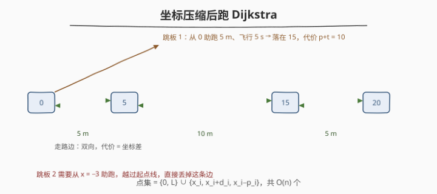
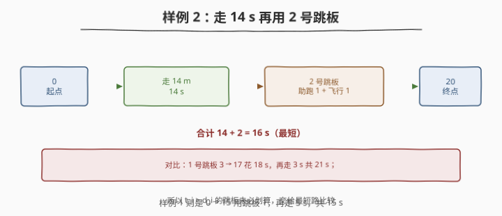

# Codeforces 141D 起飞跳板 题解

## 1. 题目概述

- **题目链接**：https://codeforces.com/problemset/problem/141/D
- **比赛来源**：Codeforces Round 101 (Div. 2) · Problem D（UTC 2012-01-08）
- **难度**：2300
- **标签**：图论、最短路
- **评测类型**：特殊评测（最优时间唯一，跳板方案可能不唯一）
- **限制**：时间 4 s / 内存 256 MB

**题意**：Vasya 沿 $X$ 轴从 $0$ 滑到 $L$，速度恒为 $1$ 米/秒，可向任意方向滑但不能越过起点线（坐标不能为负）。赛道上有 $n$ 个跳板，第 $i$ 个用四个数描述：$x_i$（起跳位置）、$d_i$（落点相对位移）、$t_i$（飞行秒数）、$p_i$（助跑距离）。使用它时从 $x_i-p_i$ 开始助跑（同样 $1$ 米/秒），在 $x_i$ 起跳，飞 $t_i$ 秒后落在 $x_i+d_i$；只能朝正方向使用，且 $x_i-p_i\ge0$ 才用得上。求最小总时间，并输出用到的跳板编号序列（每个跳板至多用一次，顺序即使用顺序）。

**约束**：

- $n\le10^5$，$L\le10^9$，所有参数不超过 $10^9$ —— 坐标轴太长，绝不能按坐标逐米建点；只能把“关键坐标”压缩成 $O(n)$ 个点。
- $x_i+d_i\le L$（不会飞过终点）、$d_i,t_i,p_i\ge1$，$x_i-p_i$ 可能为负 ⇒ 这类跳板直接判为不可用。
- 边权最大为 $L$ 或 $p_i+t_i\le2\cdot10^9$，必须用 64 位整数。
- $O(n^2)$ 的 Bellman-Ford 在 $10^5$ 上不可行，需要 $O(n\log n)$ 的 Dijkstra。
- 多解 ⇒ 用 checker 校验时间最优 + 方案可执行。

## 2. 示例与观察

官方样例 1（输入 / 输出原样）：

```text
输入：
2 20
5 10 5 5
4 16 1 7
输出：
15
1
1 
```

官方样例 2（输入 / 输出原样）：

```text
输入：
2 20
9 8 12 6
15 5 1 1
输出：
16
1
2 
```

**样例 1 走查**：$L=20$。1 号跳板 $x=5,d=10,t=5,p=5$：从 $0$ 助跑 $5$ 米到 $5$（$5$ s），飞 $5$ s 落在 $15$，再走 $5$ m，共 $15$ s。2 号跳板 $x=4,p=7$：助跑起点 $4-7=-3<0$，不允许，整条边丢弃。答案 $15$，用 1 号 ✓。

**样例 2 走查**：$L=20$。1 号：$x=9,d=8,t=12,p=6$，助跑起点 $3$，代价 $6+12=18$，落在 $17$，再走 $3$ ⇒ $21$ s。2 号：$x=15,d=5,t=1,p=1$，助跑起点 $14$，先走 $14$ s，再花 $1+1=2$ s 正好落在 $20$ ⇒ $16$ s，更优 ✓。注意这里 $t_1>d_1$，1 号虽然“跳得远”却更慢，可见不能只看 $d_i$。

**观察 1**：走路的耗时恒等于距离，与方向无关，所以只要把 $X$ 轴切成若干段，段内任意走动的总代价就是两端坐标差。

**观察 2**：所有“事件”只可能发生在关键坐标上：$0$、$L$、每个 $x_i$、$x_i+d_i$、以及可用的 $x_i-p_i$。把关键坐标排序后，只需在相邻点之间连双向走路边。

**观察 3**：每个可用跳板就是一条**有向**边 $x_i-p_i\to x_i+d_i$，权重 $p_i+t_i$。于是整题变成 $O(n)$ 点、$O(n)$ 边的最短路。

自造样例（标注“自造”）：`1 10` + `5 5 100 5` → 跳板太慢，直接走 $10$；`1 10` + `0 10 1 1`：助跑起点 $0-1=-1$ 不可用 → $10$；`1 10` + `1 9 1 1`：助跑起点恰为 $0$，助跑 $1$ s、飞行 $1$ s 正好落在 $10$ ⇒ $2$。

## 3. 解题思路

### 3.1 朴素做法与瓶颈

把 $[0,L]$ 上每一米都当成一个点、每米连一条权 $1$ 的边、再叠加跳板边，跑 Dijkstra —— 点数 $10^9$，直接爆掉。另一种思路是 DP：$f[v]=\min(f[v-1]+1,\min_{x_i+d_i=v}(f[x_i-p_i]+p_i+t_i))$，但 Vasya **可以往回走**（例如先冲过头再退回某个助跑起点），纯前向 DP 会漏解。瓶颈在于既要压缩坐标，又要保留“可后退”这一自由度。

### 3.2 核心观察



由于速度恒为 $1$，在一段没有任何关键坐标的区间里来回走动毫无意义；任何最优方案都可以拆成“在相邻关键点之间直走”与“整段使用某个跳板”。于是关键点集合

$$V=\{0,\ L\}\cup\{x_i\}\cup\{x_i+d_i\}\cup\{x_i-p_i\mid x_i-p_i\ge0\}$$

只有 $O(n)$ 个。相邻点之间连**双向**走路边（权为坐标差，这样就允许往回走），每个可用跳板连一条**单向**边（权 $p_i+t_i$）。

### 3.3 算法流程

1. 收集所有关键坐标，排序去重，得到 $V$（共 $|V|\le3n+2$ 个）。
2. 对相邻的两点 $u,v$ 连双向边，权为坐标差。
3. 对每个 $x_i-p_i\ge0$ 的跳板，连有向边 $(x_i-p_i)\to(x_i+d_i)$，权 $p_i+t_i$，边号记为 $i$。
4. 从坐标 $0$ 跑 Dijkstra，记录每个点的“最后一步”（走路或某条跳板边）。
5. 从 $L$ 反向回溯，把经过的跳板边按正序输出。



### 3.4 样例走查

样例 2 的图上：$0\to3\to14$ 全是走路（$14$ s），$14\to20$ 走 2 号跳板边（$p+t=2$），总 $16$ s。而 $0\to3$（$3$ s）加 1 号跳板边（$18$ s）到 $17$，再走 $3$ s 共 $21$ s，被 Dijkstra 淘汰。样例 1 中 $x_2-p_2=-3$ 的边根本不存在，所以只能选 1 号。

## 4. 正确性证明

**引理 1（方案 → 路径）**：任意可行方案都能对应图中一条 $0\to L$ 的路径，且路径总权不超过方案耗时（对最优方案取等）。

**证明**：把方案按时间顺序切成“走路段”和“跳板段”。每段走路的起止点之间插入所有落在其中的关键坐标，把它切成若干相邻关键点之间的直走，代价之和恰为两端距离（望远镜求和）；跳板段直接对应那条跳板边，代价 $p_i+t_i$ 与方案一致。于是得到一条 $0\to L$ 的路径，权等于耗时。∎

**引理 2（路径 → 方案）**：图中任意一条 $0\to L$ 的路径都能实现为一个合法方案，耗时等于路径权。

**证明**：沿路径依次执行：走路边按坐标差直走（两端坐标都非负，故不会越过起点线）；跳板边要求其起点 $x_i-p_i\ge0$（建边时已保证），执行“助跑 $p_i$、飞 $t_i$、落在 $x_i+d_i$”，与题面一致，且落点 $\le L$。所有坐标非负，全程合法。∎

**引理 3（每个跳板至多一次）**：最短路中每条跳板边至多出现一次；若出现两次，则路径重复经过同一节点，可以去掉中间的正权回路而严格变短，矛盾。

**证明**：所有边权为正（走路边 $>0$，跳板边 $p_i+t_i\ge2$），正权图的最短路是简单路径，故不会重复节点，自然也不会重复使用同一条跳板边。∎

**定理**：Dijkstra 求出的 $dist(L)$ 就是最小总时间，回溯得到的跳板序列是一个耗时等于该值、每个跳板至多用一次的合法方案。

**证明**：由引理 1，最小时间 $\ge$ 最短路径权；由引理 2，最短路径权 $\ge$ 最小时间；故两者相等。回溯沿最短路的前驱走，按引理 3 每个跳板只出现一次，且顺序即使用顺序。∎

## 5. 复杂度分析

- **时间**：建图 $O(n\log n)$（排序为主），Dijkstra $O(n\log n)$，总 $O(n\log n)$。
- **空间**：$O(n)$ 个点、$O(n)$ 条边，约 $5n$ 条有向边。
- **与时限的关系**：$n=10^5$ 时 $|V|\le3\cdot10^5$，实测约 $0.1$ s，远低于 $4$ s。

## 6. 参考代码

### C++17

```cpp
#include <bits/stdc++.h>
using namespace std;
typedef long long ll;
const ll INF = (ll)4e18;

int main() {
    int n;
    ll L;
    if (scanf("%d %lld", &n, &L) != 2) return 0;
    vector<ll> x(n), d(n), t(n), p(n);
    vector<ll> coord;
    coord.push_back(0);
    coord.push_back(L);
    for (int i = 0; i < n; ++i) {
        scanf("%lld %lld %lld %lld", &x[i], &d[i], &t[i], &p[i]);
        if (x[i] - p[i] >= 0) coord.push_back(x[i] - p[i]);   // 助跑起点须在非负半轴
        coord.push_back(x[i]);
        coord.push_back(x[i] + d[i]);
    }
    sort(coord.begin(), coord.end());
    coord.erase(unique(coord.begin(), coord.end()), coord.end());
    int V = (int)coord.size();
    vector<int> ru(n, -1), rv(n, -1);
    for (int i = 0; i < n; ++i) {
        if (x[i] - p[i] < 0) continue;                        // 该跳板不可用
        ru[i] = (int)(lower_bound(coord.begin(), coord.end(), x[i] - p[i]) - coord.begin());
        rv[i] = (int)(lower_bound(coord.begin(), coord.end(), x[i] + d[i]) - coord.begin());
    }
    // 邻接表：走路边按相邻坐标相连；跳板边单独编号
    vector<vector<pair<int, ll>>> walkAdj(V);                 // (to, cost)
    vector<vector<int>> rampAt(V);                            // 从该点起跳的跳板编号
    for (int i = 0; i + 1 < V; ++i) {
        ll w = coord[i + 1] - coord[i];
        walkAdj[i].push_back({i + 1, w});
        walkAdj[i + 1].push_back({i, w});
    }
    for (int i = 0; i < n; ++i)
        if (ru[i] >= 0) rampAt[ru[i]].push_back(i);

    vector<ll> dist(V, INF);
    vector<int> prevNode(V, -1), prevRamp(V, -1);             // 到达该点的最后一步
    priority_queue<pair<ll, int>, vector<pair<ll, int>>, greater<pair<ll, int>>> pq;
    dist[0] = 0;
    pq.push({0, 0});
    while (!pq.empty()) {
        auto [du, u] = pq.top();
        pq.pop();
        if (du != dist[u]) continue;
        for (auto& e : walkAdj[u])
            if (du + e.second < dist[e.first]) {
                dist[e.first] = du + e.second;
                prevNode[e.first] = u;
                prevRamp[e.first] = -1;
                pq.push({dist[e.first], e.first});
            }
        for (int id : rampAt[u]) {
            ll nd = du + p[id] + t[id];
            if (nd < dist[rv[id]]) {
                dist[rv[id]] = nd;
                prevNode[rv[id]] = u;
                prevRamp[rv[id]] = id;
                pq.push({nd, rv[id]});
            }
        }
    }
    vector<int> used;
    for (int v = V - 1; v != 0;) {                            // 终点是坐标 L 的下标 V-1
        if (prevRamp[v] >= 0) used.push_back(prevRamp[v]);
        v = prevNode[v];
    }
    reverse(used.begin(), used.end());
    cout << dist[V - 1] << '\n' << used.size() << '\n';
    for (size_t i = 0; i < used.size(); ++i) cout << used[i] + 1 << (i + 1 == used.size() ? '\n' : ' ');
    if (used.empty()) cout << '\n';
    return 0;
}
```

### Python3

```python
import heapq
import sys


def main() -> None:
    data = sys.stdin.buffer.read().split()
    if not data:
        return
    n, L = int(data[0]), int(data[1])
    x, d, t, p = [0] * n, [0] * n, [0] * n, [0] * n
    coord = [0, L]
    pos = 2
    for i in range(n):
        x[i], d[i], t[i], p[i] = (int(data[pos]), int(data[pos + 1]),
                                  int(data[pos + 2]), int(data[pos + 3]))
        pos += 4
        if x[i] - p[i] >= 0:                 # 助跑起点须在非负半轴
            coord.append(x[i] - p[i])
        coord.append(x[i])
        coord.append(x[i] + d[i])
    coord = sorted(set(coord))
    idx = {c: i for i, c in enumerate(coord)}
    V = len(coord)
    adj = [[] for _ in range(V)]             # (to, cost, ramp_id 或 -1)
    for i in range(V - 1):
        w = coord[i + 1] - coord[i]
        adj[i].append((i + 1, w, -1))
        adj[i + 1].append((i, w, -1))
    for i in range(n):
        if x[i] - p[i] < 0:
            continue
        u, v = idx[x[i] - p[i]], idx[x[i] + d[i]]
        adj[u].append((v, p[i] + t[i], i))

    INF = float('inf')
    dist = [INF] * V
    prev = [None] * V                        # (prev_node, ramp_id)
    dist[0] = 0
    pq = [(0, 0)]
    while pq:
        du, u = heapq.heappop(pq)
        if du != dist[u]:
            continue
        for v, w, rid in adj[u]:
            nd = du + w
            if nd < dist[v]:
                dist[v] = nd
                prev[v] = (u, rid)
                heapq.heappush(pq, (nd, v))
    used = []
    v = V - 1
    while v != 0:
        u, rid = prev[v]
        if rid >= 0:
            used.append(rid + 1)
        v = u
    used.reverse()
    out = [str(dist[V - 1]), str(len(used)), ' '.join(map(str, used))]
    sys.stdout.write('\n'.join(out) + '\n')


main()
```

Python 版在 $n=10^5$ 时偏慢，建议用 PyPy3 提交或直接交 C++。

## 7. 边界情况与易错点

1. **$n=0$**：没有跳板，答案是 $L$，第二行输出 $0$、第三行空行。
2. **$x_i-p_i<0$**：该跳板不可用，必须整条丢弃（样例 1 就是这个坑），不要把它当成“从 0 开始助跑”。
3. **$x_i-p_i=0$**：合法，起点就是起点线，不能误删。
4. **$k=0$ 的输出**：第二行输出 $0$ 后仍要输出第三行（空行），否则部分实现会漏行。
5. **边权溢出**：$p_i+t_i$ 与坐标差都可能到 $2\cdot10^9$，路径和到 $10^9$ 量级，务必用 `long long`。
6. **同一坐标重复**：多个跳板端点重合时必须去重，否则点数膨胀；去重后按坐标找下标（二分），不要用坐标值直接当数组下标。
7. **$t_i\ge d_i$ 的跳板**：未必无用（可能省去绕路），但通常更慢 —— 交给最短路统一比较，不要手工剪枝。
8. **落点恰为 $L$**：合法，且此时落地即到终点，不要再加走路代价。

## 8. 验证记录

- **编译环境与命令**：`Apple clang 21.0.0` + 仓库兼容头（`-std=c++17 -O2 -I codeforces/tools/include`），Python `3.9.6`。
- **官方样例**：`python3 codeforces/tools/verify_solution.py codeforces/contests/0101-0203/141/D_起飞跳板.md --checker codeforces/tools/checkers/cf141d.py` → `CF141D: samples 2`，C++ 2/2、Python 2/2。
- **方案校验器**：新增 `codeforces/tools/checkers/cf141d.py`，先用独立的 Dijkstra 算出最优时间 $T^*$；再要求输出时间等于 $T^*$、$k$ 与编号个数一致、编号互异且不越界；最后按输出顺序真实模拟（走到 $x-p$ 用绝对值距离、助跑 $p$ 秒、飞行 $t$ 秒、落地后走到 $L$），要求模拟耗时恰好等于声称的时间，且不使用 $x-p<0$ 的跳板。
- **额外测试**：随机 400 组小数据（$L\le25$、$n\le5$）用上面的 checker 校验 C++ 与 Python，全部通过；另写独立第二实现 `brute.py`（同样的压缩建图但用 Bellman-Ford 松弛求值），随机 300 组与主程序比对最短时间，全部一致。
- **最大约束性能**：$n=10^5$、$L=10^9$ 随机数据，C++ 约 $0.1$ s、内存约 $20$ MB。
- **复核状态**：verified。

## 相关题目与扩展

- [Codeforces 141B Hopscotch](https://codeforces.com/problemset/problem/141/B)：同场几何题。
- [Codeforces 141E Clearing Up](https://codeforces.com/problemset/problem/141/E)：同场图论。
- [Codeforces 20C Dijkstra?](https://codeforces.com/problemset/problem/20/C)：最短路 + 路径还原。
- [LeetCode 787. K 站中转内最便宜的航班](https://leetcode.cn/problems/cheapest-flights-within-k-stops/)：带约束的最短路。

**延伸思考**：

1. **如果允许反向使用跳板**：每条跳板再加一条反向边 $x_i+d_i\to x_i-p_i$，权仍是 $p_i+t_i$，但要注意“反向飞行”落点与助跑段的方向对应关系。
2. **如果助跑段可以被别的跳板“打断”**：那就不是简单的最短路了，因为边之间会相互影响；需要把状态扩成“当前累积助跑距离”。
3. **如果要求恰好用 $k$ 个跳板**：在 Dijkstra 上再加一维 $k$（点数 $\times k$），或建分层图，复杂度 $O(nk\log(nk))$。
4. **如果 $x_i+d_i$ 可以超过 $L$**：需要把落点截断到 $L$（落地即终点），否则会建出 $>L$ 的点并错误地“绕出去”。
