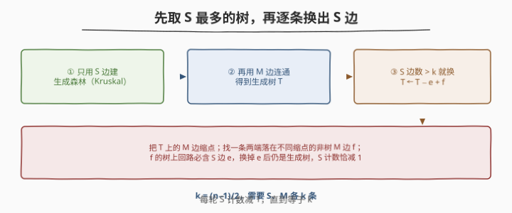
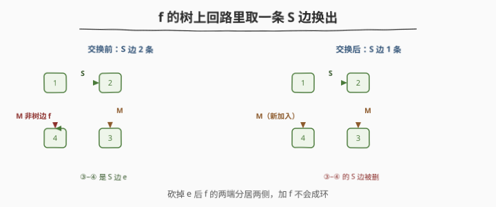

# Codeforces 141E 清理道路 题解

## 1. 题目概述

- **题目链接**：https://codeforces.com/problemset/problem/141/E
- **比赛来源**：Codeforces Round 101 (Div. 2) · Problem E（UTC 2012-01-08）
- **难度**：2300
- **标签**：构造、并查集、图论
- **评测类型**：特殊评测（多解）
- **限制**：时间 2 s / 内存 256 MB

**题意**：北极有 $n$ 个木屋、$m$ 条双向道路，每条路由 S（小精灵）或 M（圣诞老人）负责清扫。要选出一组道路，使得：(1) 任意两个木屋之间沿选出的道路**恰有一条简单路径**；(2) S 与 M 负责的道路数量相同。输出选出的道路条数与编号（顺序任意），无解输出 $-1$。

**约束**：

- $n\le1000$、$m\le10^5$：允许 $O(n\cdot m)$ 级别的构造（约 $10^8$ 次基本操作），但不允许 $O(n^3)$ 或枚举子集。
- 可能有多重边与自环（$x=y$）：自环永远不能入选（会立刻成环）。
- $n-1$ 必须是偶数，否则两种颜色不可能各占一半 → 直接 $-1$。
- 方案不唯一 ⇒ 必须用 checker 验证“是否生成树 + 两色数量是否相等”。

## 2. 示例与观察

官方样例 1（输入 / 输出原样）：

```text
输入：
1 2
1 1 S
1 1 M
输出：
0
```

官方样例 2（输入 / 输出原样）：

```text
输入：
3 3
1 2 S
1 3 M
2 3 S
输出：
2
2 1 
```

官方样例 3（输入 / 输出原样）：

```text
输入：
5 6
1 1 S
1 2 M
1 3 S
1 4 M
1 5 M
2 2 S
输出：
-1
```

**样例 1 走查**：$n=1$，只有一个木屋，两条自环。“任意两点间恰有一条简单路径”在单点图上空集就满足，且两种颜色都是 $0$ 条 → 输出 $0$（第二行空）。这条样例专门提醒：$n=1$ 要输出 $0$ 而不是 $-1$。

**样例 2 走查**：$n=3$，$n-1=2$，$k=1$。S 边：$1-2$、$2-3$；M 边：$1-3$。只用 S 边可成森林（$2$ 条），但我们要 $1$ 条 S、$1$ 条 M：取 S 的 $1-2$ 与 M 的 $1-3$，构成 $1-2$、$3-1$ 的生成树 ✓。

**样例 3 走查**：$n=5$，$n-1=4$，$k=2$。S 边只有 $1-3$ 与两条自环，所以任何生成树里 S 边最多 $1$ 条（自环不能进树），$k=2$ 不可达 → $-1$ ✓。

**观察 1**：条件 (1) 就是“选出的边构成一棵生成树”（$n=1$ 时为空集）：连通且无环，于是恰有 $n-1$ 条边。所以需要的 S 边数 = M 边数 = $(n-1)/2=:k$。

**观察 2**：S 边在任何生成树里都只能构成森林，所以 S 边数有上界 $\text{maxS}=n-c$，其中 $c$ 是“只用 S 边”时的连通块数 —— 用 S 边跑一遍 Kruskal，得到的森林边数就是 $\text{maxS}$。若 $k>\text{maxS}$ 立即无解。

**观察 3**：S 边数也有下界 $\text{minS}$（把所有 M 边优先加入 Kruskal 得到）。并且**从 $\text{maxS}$ 到 $\text{minS}$ 的每个整数都能取到** —— 每次把一条 S 边换成一条 M 边，计数就减一。

自造样例（标注“自造”）：`2 1` + `1 2 S` → $-1$（$n-1=1$ 为奇数）；`2 2` + `1 2 S` / `1 2 M` → 取两条中的一条即可，如 `1` + `2`（$0$ 条 S 与 $1$ 条 M 不等，所以只能是 $k=0$？注意 $n-1=1$ 是奇数 → 仍是 $-1$）；`2 3`（$n-1=1$ 奇数）也恒为 $-1$。

## 3. 解题思路

### 3.1 朴素做法与瓶颈

“选 $n-1$ 条边、两色各半”是带颜色配额的生成树问题，不能直接 Kruskal（Kruskal 只保证总权最优，管不了配额）。暴力枚举 $\binom{m}{n-1}$ 组边在 $m=10^5$ 时完全不可行。瓶颈是：如何在**保持生成树**的前提下，精确控制 S 边的条数。

### 3.2 核心观察



先求“S 边最多”的生成树 $T_0$：只用 S 边跑 Kruskal 得到森林（$\text{maxS}$ 条 S 边），再用 M 边把它连通成树。此时 S 边数就是上界 $\text{maxS}$。

若 $\text{maxS}>k$，就反复做一件事：把树上的一条 S 边 $e$ 换成一条非树的 M 边 $f$，使得换完仍是生成树。这样的交换每做一次，S 计数恰好减一。关键是**这种交换在 S 计数还大于 $\text{minS}$ 时总能找到**（见引理 3）。



找交换对的高效办法：把 $T$ 中的所有 M 边缩成一个点，得到若干“M 连通块”。若一条非树 M 边 $f$ 的两端落在不同块里，那么 $f$ 的树上回路必然穿过某条 S 边 $e$（否则两端会在同一个 M 块里）。于是 $T-e+f$ 仍是生成树，S 计数减一。

### 3.3 算法流程

1. 读边，记颜色。$n=1$ 直接输出 $0$ 与空行。
2. 若 $(n-1)$ 为奇数 → 输出 $-1$。
3. 用 S 边跑 Kruskal，得到 S 森林（边集 $F_S$）与 $\text{maxS}=|F_S|$；令 $k=(n-1)/2$，若 $k>\text{maxS}$ → $-1$。
4. 再用 M 边 Kruskal 把 $F_S$ 的连通块接起来，得到生成树 $T$；若图不连通 → $-1$。
5. 当 $T$ 的 S 边数 $>k$：
   - 把 $T$ 的 M 边缩点；
   - 扫所有非树 M 边，找到一条两端不同块者 $f$；
   - 在 $T$ 上求 $f$ 两端的路径，取路径上一条 S 边 $e$；
   - $T\leftarrow T-e+f$。
   - 若找不到 $f$（说明 S 计数已到 $\text{minS}>k$）→ $-1$。
6. 输出 $T$ 的边数与编号。

### 3.4 样例走查

样例 2：S 森林 = $\{1-2,2-3\}$，$\text{maxS}=2$，$k=1$。没有 M 边可加（$1-3$ 的两端已在同一 S 块里），所以 $T=\{1-2,2-3\}$，S 计数 $2>1$。缩 M 边后每个点自成一类，非树 M 边 $1-3$ 两端不同类 → 选它；$1\to3$ 的树上路径是 $1-2-3$（两条 S 边），换出任意一条（例如 $1-2$）→ $T=\{2-3,1-3\}$，S 计数 $1=k$，结束。输出 $\{2,1\}$ ✓。

## 4. 正确性证明

**引理 1（条件 (1) ⇔ 生成树）**：$n\ge2$ 时，“任意两木屋间沿选出的道路恰有一条简单路径”等价于选出的边集是一棵生成树；$n=1$ 时等价于边集为空。

**证明**：若任意两点间都有路径，则选出图连通；若某条边集含环，则环上两点之间至少有两条简单路径（走环的两侧），矛盾；故无环。连通无环图即树，恰有 $n-1$ 条边。反之生成树中任意两点间路径唯一（树的性质）。$n=1$ 时只有空集满足。∎

**引理 2（上界）**：设只用 S 边做 Kruskal 得到森林 $F_S$、连通块数 $c$，则 $\text{maxS}=|F_S|=n-c$，且任何生成树的 S 边数 $\le\text{maxS}$。

**证明**：S 边在任何生成树中都是森林，而 $F_S$ 是极大的 S 森林（Kruskal 取满），任何 S 森林的边数都不超过 $n-c$。∎

**引理 3（交换存在性）**：设 $T$ 是生成树，$\text{minS}$ 是所有生成树中 S 边数的最小值。若 $\text{sCount}(T)>\text{minS}$，则存在树边 $e$（S）与非树边 $f$（M），使 $T-e+f$ 仍是生成树。

**证明**：给边赋权 $w(\text{S})=1$、$w(\text{M})=0$。若不存在这样的交换对，则对 $T$ 的每条 S 树边 $e$，砍掉 $e$ 所得割上没有非树 M 边跨越，即所有跨越该割的边权都 $\ge1=w(e)$；而对 $T$ 的每条 M 树边 $e$ 有 $w(e)=0\le w(f)$ 恒成立。于是 $T$ 满足最小生成树的**割最优性**判据，$T$ 是权值最小的生成树，即 $\text{sCount}(T)=\text{minS}$，与前提矛盾。∎

**引理 4（交换效果）**：若 $f$ 的两端在“$T$ 的 M 边缩点”后属于不同块，则 $f$ 的树上回路含 S 边，且 $T-e+f$ 仍是生成树、S 计数减一。

**证明**：树上 $u\to v$ 的路径若全是 M 边，则 $u,v$ 被这些 M 边连在同一个块里，矛盾；故路径含 S 边 $e$。$f\notin T$ 且 $e$ 在 $f$ 的基本回路上，故 $T-e+f$ 无环且仍是 $n-1$ 条边的连通图，即生成树。换出 S、换入 M，S 计数减一。∎

**定理**：算法输出的边集合法；当算法输出 $-1$ 时确实无解。

**证明**：若算法正常结束，$T$ 始终是生成树（引理 4），且最终 S 边数 $=k=(n-1)/2$，M 边数也是 $k$，满足条件 (1)(2)。若在第 3、4 步输出 $-1$：$k>\text{maxS}$ 由引理 2 无解，图不连通显然无解，$(n-1)$ 为奇数则两色数量不可能相等。若在第 5 步找不到 $f$：由引理 3 的逆否，此时 $\text{sCount}(T)=\text{minS}>k$，任何生成树的 S 边数都 $>k$，无解。∎

## 5. 复杂度分析

- **时间**：前期两遍 Kruskal 为 $O(m\alpha)$；每次交换 $O(n+m)$，最多 $n/2$ 次，总 $O(n(n+m))$，$n\le1000,m\le10^5$ 时约 $5\times10^7$ 次操作。
- **空间**：$O(n+m)$。
- **与时限的关系**：实测 $n=1001$、$m=10^5$（S 路径 + 全 M 边，需要 500 次交换）约 $0.4$ s，2 s 时限内余量充足。

## 6. 参考代码

### C++17

```cpp
#include <bits/stdc++.h>
using namespace std;

struct DSU {
    vector<int> p;
    explicit DSU(int n) : p(n) { iota(p.begin(), p.end(), 0); }
    int find(int x) { while (p[x] != x) { p[x] = p[p[x]]; x = p[x]; } return x; }
    bool unite(int a, int b) { a = find(a); b = find(b); if (a == b) return false; p[a] = b; return true; }
};

int main() {
    ios::sync_with_stdio(false);
    cin.tie(nullptr);
    int n, m;
    if (!(cin >> n >> m)) return 0;
    vector<int> eu(m), ev(m);
    vector<char> isS(m);
    for (int i = 0; i < m; ++i) {
        char c;
        cin >> eu[i] >> ev[i] >> c;
        --eu[i]; --ev[i];
        isS[i] = (c == 'S');
    }
    if (n == 1) { cout << 0 << '\n' << '\n'; return 0; }
    if ((n - 1) % 2 != 0) { cout << -1 << '\n'; return 0; }
    int k = (n - 1) / 2;                       // 需要 S 与 M 各 k 条

    DSU d(n);
    vector<char> inTree(m, 0);
    int sCount = 0;
    for (int i = 0; i < m; ++i)                // 先用 S 边建生成森林，得到 S 边数的上界
        if (isS[i] && d.unite(eu[i], ev[i])) { inTree[i] = 1; ++sCount; }
    if (k > sCount) { cout << -1 << '\n'; return 0; }
    for (int i = 0; i < m; ++i)                // 再用 M 边把各连通块接起来
        if (!isS[i] && d.unite(eu[i], ev[i])) inTree[i] = 1;
    int r = d.find(0);
    for (int v = 1; v < n; ++v)
        if (d.find(v) != r) { cout << -1 << '\n'; return 0; }

    while (sCount > k) {
        // 树的邻接表
        vector<vector<pair<int, int>>> adj(n);
        vector<int> treeEdges;
        for (int i = 0; i < m; ++i)
            if (inTree[i]) {
                adj[eu[i]].push_back({ev[i], i});
                adj[ev[i]].push_back({eu[i], i});
                treeEdges.push_back(i);
            }
        // 把 M 树边缩点；跨越不同缩点的非树 M 边，其树上回路必含 S 边
        DSU c(n);
        for (int i : treeEdges) if (!isS[i]) c.unite(eu[i], ev[i]);
        int pick = -1;
        for (int i = 0; i < m && pick < 0; ++i)
            if (!inTree[i] && !isS[i] && c.find(eu[i]) != c.find(ev[i])) pick = i;
        if (pick < 0) { cout << -1 << '\n'; return 0; }   // 理论上不会发生
        // 求树上 u-v 路径（父指针 + 深度），找一条 S 边换出
        vector<int> par(n, -1), parEdge(n, -1), dep(n, 0);
        vector<int> st{0};
        par[0] = 0;
        while (!st.empty()) {
            int u = st.back(); st.pop_back();
            for (auto& e : adj[u])
                if (par[e.first] == -1) { par[e.first] = u; parEdge[e.first] = e.second; dep[e.first] = dep[u] + 1; st.push_back(e.first); }
        }
        int a = eu[pick], b = ev[pick], rem = -1;
        int x = a, y = b;
        while (dep[x] > dep[y]) { if (isS[parEdge[x]]) { rem = parEdge[x]; break; } x = par[x]; }
        if (rem < 0) while (dep[y] > dep[x]) { if (isS[parEdge[y]]) { rem = parEdge[y]; break; } y = par[y]; }
        if (rem < 0) while (x != y) {
            if (isS[parEdge[x]]) { rem = parEdge[x]; break; }
            if (isS[parEdge[y]]) { rem = parEdge[y]; break; }
            x = par[x]; y = par[y];
        }
        if (rem < 0) { cout << -1 << '\n'; return 0; }
        inTree[rem] = 0;
        inTree[pick] = 1;
        --sCount;
    }
    vector<int> ans;
    for (int i = 0; i < m; ++i) if (inTree[i]) ans.push_back(i + 1);
    cout << ans.size() << '\n';
    for (size_t i = 0; i < ans.size(); ++i) cout << ans[i] << (i + 1 == ans.size() ? '\n' : ' ');
    return 0;
}
```

### Python3

```python
import sys


class DSU:
    def __init__(self, n):
        self.p = list(range(n))

    def find(self, x):
        p = self.p
        while p[x] != x:
            p[x] = p[p[x]]
            x = p[x]
        return x

    def unite(self, a, b):
        a, b = self.find(a), self.find(b)
        if a == b:
            return False
        self.p[a] = b
        return True


def main() -> None:
    data = sys.stdin.buffer.read().split()
    if not data:
        return
    n, m = int(data[0]), int(data[1])
    eu, ev, isS = [0] * m, [0] * m, [False] * m
    pos = 2
    for i in range(m):
        eu[i], ev[i] = int(data[pos]) - 1, int(data[pos + 1]) - 1
        isS[i] = data[pos + 2] == b'S'
        pos += 3
    if n == 1:
        print(0)
        print()
        return
    if (n - 1) % 2:
        print(-1)
        return
    k = (n - 1) // 2

    d = DSU(n)
    in_tree = [False] * m
    s_count = 0
    for i in range(m):                       # 先用 S 边建生成森林
        if isS[i] and d.unite(eu[i], ev[i]):
            in_tree[i] = True
            s_count += 1
    if k > s_count:
        print(-1)
        return
    for i in range(m):                       # 再用 M 边连通各块
        if not isS[i] and d.unite(eu[i], ev[i]):
            in_tree[i] = True
    root = d.find(0)
    if any(d.find(v) != root for v in range(n)):
        print(-1)
        return

    while s_count > k:
        adj = [[] for _ in range(n)]
        for i in range(m):
            if in_tree[i]:
                adj[eu[i]].append((ev[i], i))
                adj[ev[i]].append((eu[i], i))
        c = DSU(n)                           # 缩掉树上的 M 边
        for i in range(m):
            if in_tree[i] and not isS[i]:
                c.unite(eu[i], ev[i])
        pick = -1
        for i in range(m):
            if not in_tree[i] and not isS[i] and c.find(eu[i]) != c.find(ev[i]):
                pick = i
                break
        if pick < 0:
            print(-1)
            return
        par = [-1] * n
        par_edge = [-1] * n
        dep = [0] * n
        par[0] = 0
        st = [0]
        while st:
            u = st.pop()
            for v, eid in adj[u]:
                if par[v] == -1:
                    par[v] = u
                    par_edge[v] = eid
                    dep[v] = dep[u] + 1
                    st.append(v)
        x, y, rem = eu[pick], ev[pick], -1
        while dep[x] > dep[y]:
            if isS[par_edge[x]]:
                rem = par_edge[x]
                break
            x = par[x]
        if rem < 0:
            while dep[y] > dep[x]:
                if isS[par_edge[y]]:
                    rem = par_edge[y]
                    break
                y = par[y]
        if rem < 0:
            while x != y:
                if isS[par_edge[x]]:
                    rem = par_edge[x]
                    break
                if isS[par_edge[y]]:
                    rem = par_edge[y]
                    break
                x, y = par[x], par[y]
        if rem < 0:
            print(-1)
            return
        in_tree[rem] = False
        in_tree[pick] = True
        s_count -= 1

    ans = [i + 1 for i in range(m) if in_tree[i]]
    print(len(ans))
    print(' '.join(map(str, ans)))


main()
```

Python 版同一算法，$m=10^5$ 时较慢，建议 PyPy3 或提交 C++。

## 7. 边界情况与易错点

1. **$n=1$**：输出 `0` 加一个空行；不要因为“没有边”就输出 $-1$（样例 1 就考这个）。
2. **$(n-1)$ 为奇数**：两色数量不可能相等，直接 $-1$，不要白跑 Kruskal。
3. **自环**：$x=y$ 的边永远不能进生成树（并查集 `unite` 会自然失败），但也不能因此误判无解。
4. **多重边**：允许同两端多条不同颜色的边，Kruskal 里它们是不同的边，编号要按输入顺序输出。
5. **图不连通**：加完所有 M 边后仍有多个连通块 → $-1$。
6. **$k<\text{minS}$**：不要额外去算 $\text{minS}$ —— 交换循环自然卡住并输出 $-1$ 就是正确行为。
7. **输出格式**：先输出条数（$n\ge2$ 时恒为 $n-1$），再输编号，编号互异、顺序任意；别输出 $-1$ 后又跟一堆边。
8. **交换时选边**：必须换出**树上**的 S 边、换入**非树**的 M 边，否则会破坏树结构或 S 计数不降。

## 8. 验证记录

- **编译环境与命令**：`Apple clang 21.0.0` + 仓库兼容头（`-std=c++17 -O2 -I codeforces/tools/include`），Python `3.9.6`。
- **官方样例**：`python3 codeforces/tools/verify_solution.py codeforces/contests/0101-0203/141/E_清理道路.md --checker codeforces/tools/checkers/cf141e.py` → `CF141E: samples 3`，C++ 3/3、Python 3/3。
- **方案校验器**：新增 `codeforces/tools/checkers/cf141e.py`，(a) 用两遍 Kruskal（M 优先 / S 优先）独立算出 $[\text{minS},\text{maxS}]$ 与连通性，据此判断可行性，输出 $-1$ 必须恰好对应不可行；(b) 校验条数为 $n-1$（$n=1$ 时为 $0$）、编号互异不越界；(c) 用并查集验证选出的边无环且连通（即生成树）；(d) 验证 S 与 M 数量相等。
- **额外测试**：独立暴力 `brute.py`（枚举所有 $\binom{m}{n-1}$ 组边找一棵合格生成树），对 $n\le6,m\le9$ 随机 300 组与 C++/Python 比对，可行性判定完全一致，方案均通过 checker。
- **最大约束性能**：$n=1001$、$m=10^5$（需要 500 次交换）C++ 约 $0.4$ s，检查器复核输出合法。
- **复核状态**：verified。

## 相关题目与扩展

- [Codeforces 141D Take-off Ramps](https://codeforces.com/problemset/problem/141/D)：同场图论最短路。
- [Codeforces 76A Gift](https://codeforces.com/problemset/problem/76/A)：带两维代价的生成树。
- [Codeforces 1108F MST Unification](https://codeforces.com/problemset/problem/1108/F)：MST 的割/回路性质。
- [LeetCode 1489. 找到最小生成树里的关键边和伪关键边](https://leetcode.cn/problems/find-critical-and-pseudo-critical-edges-in-minimum-spanning-tree/)：MST 边分类。

**延伸思考**：

1. **如果要求 S 边恰好占 $\ge k$ 条**：问题变成“带下界的生成树”，可以在交换循环里加一条“不必再降”的终止条件，或直接求 maxS。
2. **如果颜色有 $c$ 种、要求每种数量相等**：需要 $n-1$ 能被 $c$ 整除，并且用 $(c-1)$ 维配额；此时单次交换可能让两种颜色同时变化，构造要换成拟阵交。
3. **如果还要求总长度最小**：在所有合法配额树里取最小权，可以给权重加上拉格朗日项 $\lambda\cdot[\text{颜色}]$ 并二分 $\lambda$，或用拟阵交 + 费用流。
4. **如果 $m$ 达到 $10^6$**：$O(nm)$ 的交换会超时，需要把“找跨块 M 边”放到并查集 + 链表上做增量维护，做到接近 $O(m\alpha)$。
