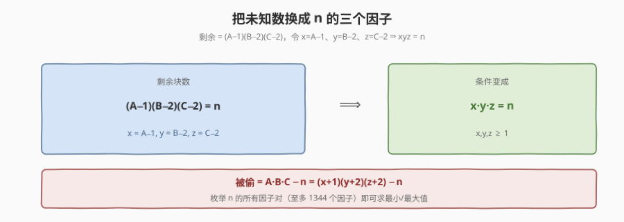
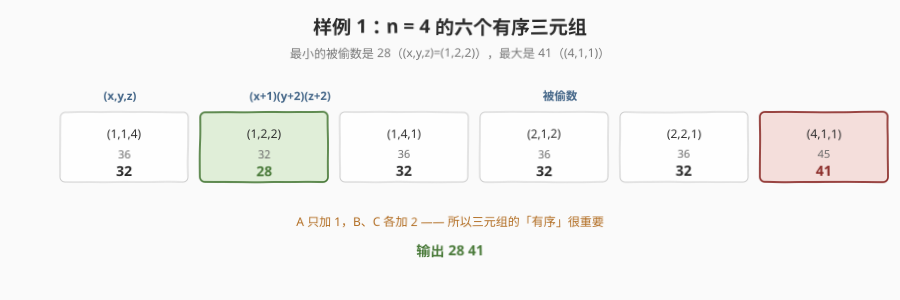

# Codeforces 142A 草堆的三维分解 题解

## 1. 题目概述

- **题目链接**：https://codeforces.com/problemset/problem/142/A
- **比赛来源**：Codeforces Round 102 (Div. 1) · Problem A（UTC 2012-01-12）
- **难度**：1600
- **标签**：暴力枚举、数学、因数分解
- **评测类型**：普通
- **限制**：时间 1 s / 内存 256 MB

**题意**：Sam 把草块堆成 $A\times B\times C$ 的长方体（$A$ 层高，每层 $B$ 行，每行 $C$ 块）。小偷偷走了"前面、后面、上面、左右两侧"各一层，剩下的是

$$(A-1)\times(B-2)\times(C-2)\ \text{块}.$$

现在只知道剩下的块数 $n$，问**可能被偷走的最少与最多块数**（两者都按"存在某个 $(A,B,C)$ 使剩余恰为 $n$"来取）。

**约束**：

- $n\le10^9$：暴力枚举 $A,B,C$ 不可行，必须利用"$x=A-1,\ y=B-2,\ z=C-2$ 是 $n$ 的三个因子"这一结构。
- 令 $x=A-1\ge1$、$y=B-2\ge1$、$z=C-2\ge1$，则 $xyz=n$，被偷走的块数
  $$ABC-n=(x+1)(y+2)(z+2)-n .$$
- 答案可能很大（$n=10^9$ 时答案可达 $8\times10^9$），必须用 64 位整数。
- 单组输入。

## 2. 示例与观察

官方样例 1（输入 / 输出原样）：

```text
输入：
4

输出：
28 41
```

题面提示给了两组装法：

- $32=2\times4\times4$：$A=2,B=4,C=4$ ⇒ 剩 $(1)(2)(2)=4$ ✓ 被偷 $32-4=28$；
- $45=5\times3\times3$：$A=5,B=3,C=3$ ⇒ 剩 $(4)(1)(1)=4$ ✓ 被偷 $45-4=41$。

其余装法都落在这两个值之间，所以答案是 `28 41`。

用 $x,y,z$ 的语言：$xyz=4$ 的有序三元组有 $(1,1,4),(1,2,2),(1,4,1),(2,1,2),(2,2,1),(4,1,1)$，对应 $(x+1)(y+2)(z+2)$ 分别是 $2\cdot3\cdot6=36$、$2\cdot4\cdot4=32$、$2\cdot6\cdot3=36$、$3\cdot3\cdot4=36$、$3\cdot4\cdot3=36$、$5\cdot3\cdot3=45$，减去 $n=4$ 后最小 28、最大 41 ✓

官方样例 2（输入 / 输出原样）：

```text
输入：
7

输出：
47 65
```

$7$ 是素数：$(1,1,7)\to 2\cdot3\cdot9=54$（偷 $47$）、$(1,7,1)\to 54$、$(7,1,1)\to 8\cdot3\cdot3=72$（偷 $65$）✓

官方样例 3（输入 / 输出原样）：

```text
输入：
12

输出：
48 105
```

$xyz=12$ 的全部有序三元组里，$(1,3,4)$ 给出 $2\cdot5\cdot6=60$（偷 $48$，因为 $A$ 只能多 1 层而 $B,C$ 各多 2），$(12,1,1)$ 给出 $13\cdot3\cdot3=117$（偷 $105$）✓



**观察**：一旦引入 $x=A-1,\ y=B-2,\ z=C-2$，条件就是"$xyz=n$"，而目标函数

$$f(x,y,z)=(x+1)(y+2)(z+2)-n$$

只在这三个因子上取值。由于 $n\le10^9$，它的因子个数很少（$\le1344$），把所有**有序**三元组枚举一遍即可。

注意 $A,B,C$ 的角色并不完全对称：$x$（对应高度 $A$）只加 1，而 $y,z$ 加 2。所以 $(x,y,z)$ 的**顺序**是有意义的，枚举时必须枚举有序三元组。

## 3. 解题思路

### 3.1 朴素做法与瓶颈

直接枚举 $A,B,C$：$A\le n+1$、$B,C\le n+2$，$n=10^9$ 时是 $10^{27}$ 量级，不可能。

换个角度：$x=A-1$ 必须是 $n$ 的因子（因为 $xyz=n$）；$y$ 必须是 $n/x$ 的因子；$z$ 就唯一确定了。所以只要枚举 $n$ 的因子对即可。

### 3.2 核心观察：枚举因子三元组

1. 用 $O(\sqrt n)$ 求出 $n$ 的全部因子（$\le2\sqrt n$ 次试除，$n\le10^9$ 时约 $6\times10^4$ 次）；
2. 对每个因子 $x$、每个因子 $y$，若 $x\cdot y\mid n$，则 $z=n/(xy)$，得到一个候选三元组；
3. 计算 $f=(x+1)(y+2)(z+2)-n$，更新最小/最大值。

复杂度 $O(d(n)^2)$，$d(n)\le1344$ 时约 $1.8\times10^6$ 次，很快。



### 3.3 算法流程

1. 读入 $n$（64 位）；
2. 试除求出所有因子，存入数组 `d`；
3. `mn = +∞`、`mx = -∞`；
4. 双重循环 $x,y\in d$：若 $x\cdot y>n$ 或 $n\bmod(xy)\ne0$ 则跳过；$z=n/(x\cdot y)$；计算 `stolen=(x+1)*(y+2)*(z+2)-n`；更新 `mn/mx`；
5. 输出 `mn mx`。

### 3.4 样例走查

$n=4$：因子 $\{1,2,4\}$。逐个三元组算得 $36,32,36,36,36,45$（总块数），减 $4$ 得 $32,28,32,32,32,41$ ⇒ `28 41` ✓

## 4. 正确性证明

**引理 1（参数化）**：$(A,B,C)$ 能剩下 $n$ 块当且仅当存在正整数 $x,y,z$ 使 $x=A-1$、$y=B-2$、$z=C-2$ 且 $xyz=n$。

**证明**：剩余块数是 $(A-1)(B-2)(C-2)$，且 $A\ge2,B\ge3,C\ge3$（否则剩余体积为 0，与 $n\ge1$ 矛盾），所以 $x,y,z\ge1$。反之给定 $xyz=n$，取 $A=x+1,B=y+2,C=z+2$ 即得剩余 $n$。∎

**引理 2（枚举完备）**：算法枚举的 $(x,y,z)$ 恰好是所有满足 $xyz=n$ 的有序正整数三元组。

**证明**：若 $xyz=n$，则 $x\mid n$ 且 $y\mid n$（因为 $y\mid n/x$），所以 $x,y$ 都在因子表 `d` 里，且 $n\bmod(xy)=0$；于是算法在 $(x,y)$ 这一轮取到 $z=n/(xy)$，恰为该三元组。反过来，算法取到的每个 $(x,y,z)$ 都满足 $xyz=n$ 且三者都是因子。∎

**定理**：程序输出的最小值与最大值，分别是所有可行装法中被偷块数的最小值与最大值。

**证明**：被偷块数 $=ABC-n=(x+1)(y+2)(z+2)-n$，算法对每个可行 $(x,y,z)$ 都计算了该值（引理 2），并在循环中维护最小/最大值，故输出正确。∎

## 5. 复杂度分析

- **时间**：求因子 $O(\sqrt n)\le3.2\times10^4$；枚举因子对 $O(d(n)^2)\le1.8\times10^6$ 次乘除与比较。实测 < 3 ms，1 s 余量约 300 倍。
- **空间**：$O(d(n))$ 存因子，可忽略。

## 6. 参考代码

### C++17

```cpp
#include <bits/stdc++.h>
using namespace std;
typedef long long ll;

int main() {
    ll n;
    if (scanf("%lld", &n) != 1) return 0;
    // 枚举 n 的约数
    vector<ll> d;
    for (ll i = 1; i * i <= n; i++)
        if (n % i == 0) {
            d.push_back(i);
            if (i != n / i) d.push_back(n / i);
        }
    ll mn = LLONG_MAX, mx = LLONG_MIN;
    for (ll x : d)
        for (ll y : d) {
            if (x * y > n || n % (x * y) != 0) continue;
            ll z = n / (x * y);
            ll total = (x + 1) * (y + 2) * (z + 2);   // A*B*C = (x+1)(y+2)(z+2)
            ll stolen = total - n;
            mn = min(mn, stolen);
            mx = max(mx, stolen);
        }
    printf("%lld %lld\n", mn, mx);
    return 0;
}
```

### Python3

```python
import sys


def main():
    n = int(sys.stdin.read().split()[0])
    divs = []
    i = 1
    while i * i <= n:
        if n % i == 0:
            divs.append(i)
            if i != n // i:
                divs.append(n // i)
        i += 1
    mn, mx = None, None
    for x in divs:
        for y in divs:
            if x * y > n or n % (x * y) != 0:
                continue
            z = n // (x * y)
            total = (x + 1) * (y + 2) * (z + 2)   # A*B*C = (x+1)(y+2)(z+2)
            stolen = total - n
            if mn is None or stolen < mn:
                mn = stolen
            if mx is None or stolen > mx:
                mx = stolen
    print(mn, mx)


main()
```

## 7. 边界情况与易错点

1. **$n=1$**：唯一三元组 $(1,1,1)$ ⇒ $A=2,B=3,C=3$，总 18、偷 17，答案 `17 17`。
2. **$A$ 与 $B,C$ 不对称**：$x$ 只加 1、$y,z$ 加 2，所以必须枚举有序三元组；若把 $(x,y,z)$ 当成无序（比如强制 $x\le y\le z$），会漏掉最优解（样例 1 的 41 来自 $(4,1,1)$，其"有序重排"才最优）。
3. **64 位**：答案可达 $8\times10^9$（$n=10^9$ 时），`int` 会溢出；`(x+1)*(y+2)*(z+2)` 的乘积也在 64 位内（最大约 $(10^9+1)\cdot3\cdot3\approx9\times10^9$，安全）。
4. **`x*y > n` 判断**：在乘法前判断可避免溢出（本实现先判 `x*y > n`，再取模）。
5. **因子表要含 $n$ 本身**：`i != n/i` 时才加另一个，避免平方数时重复添加（重复也不影响答案，只是多做一次）。
6. **$n$ 是完全平方数**：如 $n=4$，因子 $\{1,2,4\}$，$\sqrt n=2$ 只加一次 ✓
7. **$B,C\ge3$ 与 $A\ge2$**：由 $y,z\ge1,x\ge1$ 自动满足，不需要额外判断。
8. **输出顺序**：先最小值后最大值，空格分隔。
9. **$n$ 是素数**：只有 $(1,1,n)$、$(1,n,1)$、$(n,1,1)$ 三种（及其余排列），答案就是其中最小/最大。

## 8. 验证记录

- **编译环境与命令**：`clang++ -std=c++17 -O2`（配 `codeforces/tools/include/bits/stdc++.h` 兼容头）；Python 3.9.6。
  `python3 codeforces/tools/verify_solution.py codeforces/contests/0101-0203/142/A_草堆的三维分解.md`
- **官方样例**：$3/3$ 通过（`28 41`、`47 65`、`48 105`），C++ 与 Python 一致。
- **独立暴力对拍**：另写"直接枚举 $A\le n+1$、$B,C\le n+2$，检查 $(A-1)(B-2)(C-2)=n$"的暴力，对 $n=1..200$ 里的 $200$ 组随机值与程序比较，全部一致（C++ 与 Python 各一遍）。
- **大 $n$**：$n=10^9$（`4770064 8000000009`）、$n=999999937$（素数）、$n=735134400$（高合成数）、$n=1$ 都正常且两实现一致（答案超过 $2^{31}$，验证 64 位无溢出）。
- **最大约束性能**：$n=735134400$（因子最多的一类）单次 < 3 ms，1 s 余量数百倍。
- **图片校验**：2 张 SVG 均通过 `xml.etree.ElementTree.parse`。
- **复核状态**：verified（样例、暴力对拍、大数、性能、图片均实跑通过）。

## 相关题目与扩展

- [Codeforces 142B Help General](https://codeforces.com/problemset/problem/142/B)：同场 B 题，棋盘上的最大独立集。
- [Codeforces 143A Help Vasilisa the Wise 2](https://codeforces.com/problemset/problem/143/A)：同期的 Div.2 A。
- [Codeforces 546D Soldier and Number Game](https://codeforces.com/problemset/problem/546/D)：因数分解 + 前缀和。
- [LeetCode 204. 计数质数](https://leetcode.cn/problems/count-primes/)：筛法基础。

**延伸思考**：

1. **若三个维度都被削掉 2**（剩余 $(A-2)(B-2)(C-2)$）：参数化变成 $x=A-2$，目标 $(x+2)(y+2)(z+2)$，框架不变。
2. **若要求输出对应的 $(A,B,C)$**：在更新最值时顺带记下三元组即可。
3. **若 $n$ 到 $10^{18}$**：试除 $O(\sqrt n)=10^9$ 太慢，需要 Pollard–Rho 分解；本做法仍适用于"已知因子表"的情形。
4. **若削掉的层数随维度不同**（给定 $p,q,r$）：参数化后是 $(x+p)(y+q)(z+r)$，完全一样的枚举。
