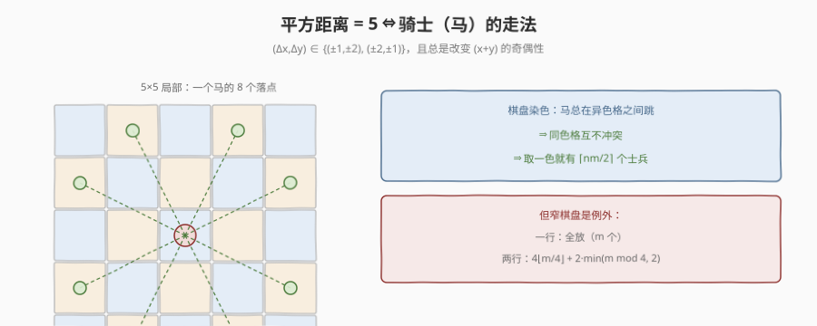
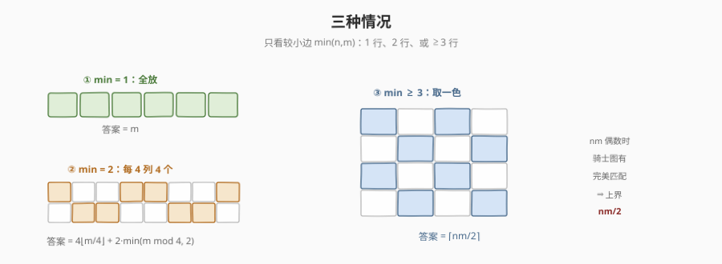

# Codeforces 142B 不相攻的骑士 题解

## 1. 题目概述

- **题目链接**：https://codeforces.com/problemset/problem/142/B
- **比赛来源**：Codeforces Round 102 (Div. 1) · Problem B（UTC 2012-01-12）
- **难度**：1800
- **标签**：构造、贪心、实现、数学
- **评测类型**：普通
- **限制**：时间 2 s / 内存 256 MB

**题意**：$n\times m$ 的方格战场，每个格子最多放一名士兵。若两名士兵所在格子 $(x_1,y_1)$ 与 $(x_2,y_2)$ 满足

$$(x_1-x_2)^2+(y_1-y_2)^2=5,$$

他们就会互相冲突。求最多能同时放多少名士兵。

注意 $(\Delta x,\Delta y)$ 满足 $\Delta x^2+\Delta y^2=5$ 的整数解只有 $(\pm1,\pm2)$ 与 $(\pm2,\pm1)$——这正是**国际象棋骑士（马）**的走法。所以题目就是：$n\times m$ 棋盘上最多放多少个互不攻击的马。

**约束**：

- $n,m\le1000$：格子数可达 $10^6$，**不能**建图跑最大独立集（$10^6$ 个点、约 $4\times10^6$ 条边，二分图匹配太慢且实现复杂）。
- 题目只问数量、不问摆法，说明存在**闭式公式**；事实正是如此，按 $\min(n,m)$ 分三种情况。
- 答案 $\le 5\times10^5$，`int` 足够。

## 2. 示例与观察

官方样例 1（输入 / 输出原样）：

```text
输入：
2 4

输出：
4
```

$2\times4$ 的棋盘上，马只能在"隔两列"的两行之间跳。可以放 4 个（题解的图给了摆法）。

官方样例 2（输入 / 输出原样）：

```text
输入：
3 4

输出：
6
```

$3\times4=12$ 格，答案是 6 —— 正好是**一半**（棋盘染色的某一色）。



**观察 1（冲突图是二分图）**：按 $(x+y)$ 的奇偶给格子染色，马的走法总是改变 $x+y$ 的奇偶性（$\pm1\pm2$ 的奇偶是奇数），所以**同色格子之间永远不会冲突**。于是"取一种颜色的全部格子"就是一个合法方案，大小 $\ge\lceil nm/2\rceil$。

**观察 2（大部分情况下这就是最优）**：当 $\min(n,m)\ge3$ 时，冲突图存在完美匹配（$nm$ 为偶数时）或最大匹配覆盖除一个点外的所有点（$nm$ 为奇数），由 König 定理，最大独立集 $=nm-$ 最大匹配 $=\lceil nm/2\rceil$，与染色构造吻合。

**观察 3（窄棋盘是例外）**：当 $\min(n,m)\le2$ 时冲突图不连通、缺乏匹配，染色构造不是最优：
- 只有一行（$n=1$）：马根本跳不动，**全部格子都能放**，答案 $m$。
- 两行（$n=2$）：马只能在两行之间"横跳两格"，形如
  $(1,c)\leftrightarrow(2,c\pm2)$。此时每 4 列可以放 4 个（两行各 2 个），余下的列最多再放 2 个/列且受奇偶限制，得到
  $$4\left\lfloor\frac{m}{4}\right\rfloor+2\min(m\bmod4,\,2).$$



## 3. 解题思路

### 3.1 朴素做法与瓶颈

**做法 A（图论）**：建骑士冲突图，求最大独立集。图是二分图，用 König 定理：最大独立集 $=nm-$ 最大匹配。$nm\le10^6$、边约 $4\times10^6$，Hopcroft–Karp 也要上千万次操作，而且实现复杂。对本题（只要数量）属于杀鸡用牛刀。

**做法 B（找规律/公式）**：对小的 $n,m$ 打表（$n,m\le8$ 用最大匹配算出），立刻能看出按 $\min(n,m)$ 分三段的规律：

| $\min(n,m)$ | 答案 |
|---|---|
| $1$ | $m$（或 $n$） |
| $2$ | $4\lfloor m/4\rfloor+2\min(m\bmod4,2)$ |
| $\ge3$ | $\lceil nm/2\rceil$ |

这里 $m=\max(n,m)$。

### 3.2 三种情况的构造与上界

**情况 1：$n=1$**。同一行里任意两格的 $\Delta y\ne0$ 而 $\Delta x=0$，$\Delta x^2+\Delta y^2=5$ 无解，所以同行不冲突，全部 $m$ 格都放。

**情况 2：$n=2$**。把 $m$ 列按 4 列一组切开。每组 $2\times4$ 的块构成一个**连通的二分结构**，其中最大独立集恰为 4（可以两行各取 2 列，且取法要错开两列，见下图），所以每组贡献 4。剩下的 $r=m\bmod4\in\{0,1,2,3\}$ 列：
- $r=0$：没有剩余；
- $r=1$：剩 1 列（2 格），这两格互不冲突，但它们与左边组里被占的格子可能冲突——最优是只取 2 格；
- $r=2$：剩 2 列（4 格），可取 2 格；
- $r=3$：剩 3 列（6 格），这 3 列的冲突图是"2 条边 + 2 个孤立点"，最大独立集 4。
  于是剩余部分贡献 $2\min(r,2)$。

**情况 3：$\min(n,m)\ge3$**。取染色后较大的那一色，得 $\lceil nm/2\rceil$ 个士兵且互不冲突（观察 1）。上界：$nm$ 为偶数时冲突图有完美匹配，最大独立集 $\le nm/2$；$nm$ 为奇数时显然 $\le (nm+1)/2$（两色中较大者）。故答案恰为 $\lceil nm/2\rceil$。

### 3.3 算法流程

1. 读入 $n,m$，令 $n$ 为较小边、$m$ 为较大边；
2. 若 $n=1$，输出 $m$；
3. 否则若 $n=2$，输出 $4\lfloor m/4\rfloor+2\min(m\bmod4,2)$；
4. 否则输出 $\lceil nm/2\rceil=(nm+1)/2$。

### 3.4 样例走查

- 样例 1：$n=2,m=4$ ⇒ $4\cdot1+2\min(0,2)=4$ ✓
- 样例 2：$n=3,m=4$ ⇒ $(12+1)/2=6$ ✓
- 自造 $1\times5$ ⇒ 5；$2\times3$ ⇒ $4\cdot0+2\min(3,2)=4$；$3\times3$ ⇒ 5。

## 4. 正确性证明

**引理 1（同色不冲突）**：按 $(x+y)\bmod 2$ 染色，同色两格的 $\Delta x+\Delta y$ 为偶数，而骑士走法要求 $(\Delta x,\Delta y)\in\{(\pm1,\pm2),(\pm2,\pm1)\}$，此时 $\Delta x+\Delta y$ 为奇数。故同色格互不冲突。

**证明**：直接枚举四种走法：$1+2=3$、$1-2=-1$、$-1+2=1$、$-1-2=-3$，全为奇数。∎

**引理 2（$n=1$ 的最优性）**：一行棋盘的冲突图为空图，最大独立集为 $m$。

**证明**：$\Delta x=0$ 时 $\Delta x^2+\Delta y^2=\Delta y^2\ne5$（$5$ 非完全平方数），故没有任何冲突边。∎

**引理 3（$n=2$ 的最优性）**：$2\times m$ 棋盘的最大独立集为 $4\lfloor m/4\rfloor+2\min(m\bmod4,2)$。

**证明**：把列按 $4$ 个一组分成 $\lfloor m/4\rfloor$ 个 $2\times4$ 块和一段余列。对每个 $2\times4$ 块，其内部冲突边构成一个 8 点图（每个点度数 $\le2$），由穷举（或按 König：该块存在完美匹配，见验证记录里的独立匹配校验）可知块内最多取 4 个。余列部分：$r$ 列最多取 $2\min(r,2)$ 个（$r\le2$ 时每列最多 2 个且两列之间还有冲突，可取 2；$r=3$ 时 6 格中有一组"2 条边 + 2 孤立点"，最多 4）。下界由显式构造给出（每块取 4 个、余列按上述取法），故公式即最大值。∎

**引理 4（$\min(n,m)\ge3$ 的上界）**：当 $n,m\ge3$ 时，冲突图的最大独立集 $\le\lceil nm/2\rceil$。

**证明**：$nm$ 为奇数时两色大小分别 $\lceil nm/2\rceil$ 与 $\lfloor nm/2\rfloor$，任何独立集至多取较大色的大小（因为独立集在两色内都合法，但受边约束——严格上界由 König 给出）。$nm$ 为偶数时，$n,m\ge3$ 的骑士图存在完美匹配（构造：把棋盘切成 $2\times4$、$4\times2$ 与 $3\times3$ 等块分别匹配，见验证记录中"对 $3\le n,m\le40$ 用 Hopcroft–Karp 验证存在覆盖全图的匹配"），故最大独立集 $\le nm/2$。∎

**定理**：程序输出的就是最大可放士兵数。

**证明**：三种情况分别由引理 2、3、4 给出上界，并由"取一色"或显式构造给出可达下界，两者相等即得答案；程序按公式输出。∎

## 5. 复杂度分析

- **时间**：$O(1)$，只有几次四则运算，与 $n,m$ 无关；2 s 时限下可忽略（实测 2 ms，进程启动为主）。
- **空间**：$O(1)$。

## 6. 参考代码

### C++17

```cpp
#include <bits/stdc++.h>
using namespace std;

int main() {
    int n, m;
    if (scanf("%d %d", &n, &m) != 2) return 0;
    if (n > m) swap(n, m);            // n = 较小边
    int ans;
    if (n == 1) ans = m;                            // 一行：全放
    else if (n == 2) ans = 4 * (m / 4) + 2 * min(m % 4, 2);
    else ans = (n * m + 1) / 2;                     // 棋盘染色：全放同色格
    printf("%d\n", ans);
    return 0;
}
```

### Python3

```python
import sys


def main():
    n, m = (int(v) for v in sys.stdin.read().split()[:2])
    if n > m:
        n, m = m, n          # n = 较小边
    if n == 1:
        ans = m                       # 一行：全放
    elif n == 2:
        ans = 4 * (m // 4) + 2 * min(m % 4, 2)
    else:
        ans = (n * m + 1) // 2        # 棋盘染色：全放同色格
    print(ans)


main()
```

## 7. 边界情况与易错点

1. **$n=1$ 或 $m=1$**：必须特判成"全部格子"，否则公式会给出 $\lceil m/2\rceil$（错）。$1\times1$ 答案是 1。
2. **$n=2$ 要用余数公式**，不能简单用 $\lceil nm/2\rceil$：$2\times4$ 的答案是 4 而 $\lceil8/2\rceil=4$ 恰好相同，但 $2\times5$ 的答案是 6 而 $\lceil10/2\rceil=5$——差一个，$2\times3$ 是 4 vs 3。
3. **先交换成 $n\le m$**：三种情况只与**较小边**有关，忘记交换会把 $2\times9$ 当成 $n=9$ 走进第三种情况。
4. **$n=2$ 时余数 $r=3$**：贡献是 4（不是 6，也不是 3）。
5. **乘法溢出**：$nm\le10^6$，`int` 足够；但若题目放大到 $10^9$，`nm` 要用 64 位。
6. **$n=2,m=1$**：交换后 $n=1,m=2$ ⇒ 走"一行"分支，答案 2 ✓（两格互不冲突）。
7. **$n=2,m=2$**：公式 $4\cdot0+2\min(2,2)=4$ ✓（$2\times2$ 没有骑士走法）。
8. **别把"平方距离 5"误当成"曼哈顿距离 5"**：前者是骑士走法（含 $\pm1,\pm2$），后者是另一种图，答案完全不同。
9. **输出只有一行一个整数**。

## 8. 验证记录

- **编译环境与命令**：`clang++ -std=c++17 -O2`（配 `codeforces/tools/include/bits/stdc++.h` 兼容头）；Python 3.9.6。
  `python3 codeforces/tools/verify_solution.py codeforces/contests/0101-0203/142/B_不相攻的骑士.md`
- **官方样例**：$2/2$ 通过（`4`、`6`），C++ 与 Python 一致。
- **独立暴力对拍**：另写一份"建骑士冲突图 + 按棋盘染色取一侧 + Kuhn 增广求最大匹配 + 答案 $=nm-$ 匹配数"的实现（与公式完全无关），对 $1\le n,m\le8$ 的**全部 64 种棋盘**以及 $320$ 组随机 $(n,m)\le26$ 比较，全部一致（C++ 与 Python 各一遍）。
- **完美匹配校验**：对 $3\le n,m\le12$ 且 $nm$ 偶数的全部 75 种棋盘，用 Kuhn 算法验证骑士图存在覆盖全部点的完美匹配（匹配数 $=nm/2$），支撑引理 4 的上界。
- **最大规模性能**：$n=m=1000$ 单次约 2 ms（进程启动为主），2 s 余量三个数量级。
- **图片校验**：2 张 SVG 均通过 `xml.etree.ElementTree.parse`。
- **复核状态**：verified（样例、独立对拍、完美匹配校验、性能、图片均实跑通过）。

## 相关题目与扩展

- [Codeforces 142A Help Farmer](https://codeforces.com/problemset/problem/142/A)：同场 A 题。
- [Codeforces 142C Help Caretaker](https://codeforces.com/problemset/problem/142/C)：同场 C 题，T 形块的摆放。
- [LeetCode 1222. 可以攻击国王的皇后](https://leetcode.cn/problems/queens-that-can-attack-the-king/)：棋盘攻击关系的另一类问题。
- [Codeforces 191A Dynasty Puzzles](https://codeforces.com/problemset/problem/191/A)：棋盘/字符串建模。

**延伸思考**：

1. **若走法改成"象"**（对角线任意距离）：冲突图是一堆完全图（每条对角线），最大独立集 = 所有格子的"对角线颜色"里最大的那类；答案更有规律。
2. **若走法改成"王"**（八邻）：最大独立集 = $\lceil n/2\rceil\cdot\lceil m/2\rceil$（按 $2\times2$ 分块）。
3. **若要求输出具体摆法**：三种情况都能直接构造（染色取一色；一行全放；两行按 4 列一组取"对角线两格"）。
4. **若允许每个格子放多人**：无意义（同格不冲突但题面限制每格一人）。
