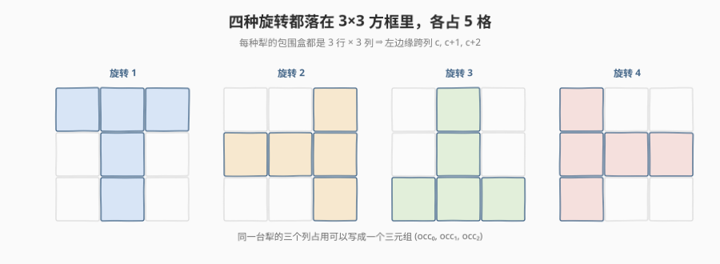
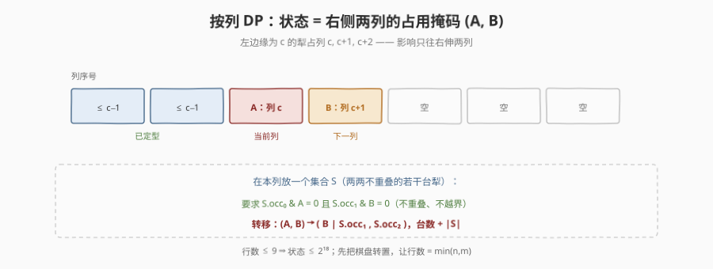
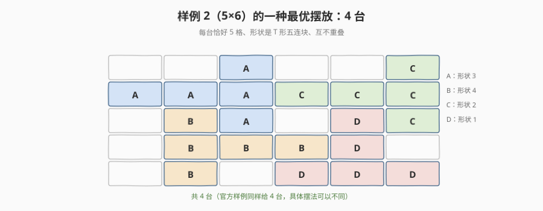

# Codeforces 142C 最大涡轮犁摆放 题解

## 1. 题目概述

- **题目链接**：https://codeforces.com/problemset/problem/142/C
- **比赛来源**：Codeforces Round 102 (Div. 1) · Problem C（UTC 2012-01-12）
- **难度**：2300
- **标签**：状态压缩 DP、暴力、动态规划
- **评测类型**：特殊评测（方案不唯一）
- **限制**：时间 3 s / 内存 256 MB

**题意**：$n\times m$ 的仓库（$1\le n,m\le9$），要放尽可能多台"涡轮犁"。每台涡轮犁占 5 个格子，形状是 $3\times3$ 里的一块 T 形五连块，共有 4 种旋转（`#` 为占用）：

```text
###    ..#    .#.    #..
.#.    ###    .#.    ###
.#.    ..#    ###    #..
```

不同的犁不能重叠，也不能出界。输出最大数量，并给出一种摆放（用连续大写字母 `A`、`B`、… 标出各台犁，`.` 表示空）。

**约束**：

- $n,m\le9$：格子数 $\le81$，每台占 5 格 ⇒ 答案 $\le16$。
- 每种犁都横跨 **3 行 × 3 列**；若直接枚举所有摆放方式（最多 $4\times7\times7=196$ 种）再搜最大的不相交子集，状态爆炸（$2^{196}$）。
- 但"横跨恰好 3 列"这个性质让**按列做状态压缩 DP** 变得可行：只需记录"右侧两列被占用的格子"。

## 2. 示例与观察

官方样例 1（输入 / 输出原样）：

```text
输入：
3 3

输出：
1
AAA
.A.
.A.
```

$3\times3$ 恰好放一台。

官方样例 2（输入 / 输出原样）：

```text
输入：
5 6

输出：
4
A..C..
AAAC..
ABCCCD
.B.DDD
BBB..D
```

$30$ 格最多放 4 台（占 20 格）。

官方样例 3（输入 / 输出原样）：

```text
输入：
2 2

输出：
0
..
..
```

$2\times2$ 放不下一台（需要 $3\times3$ 的空间），输出 0 与全空棋盘。



**观察 1**：四种旋转的共同点是——**包围盒都是 $3\times3$**，且都"占满"包围盒的某些格子。因此每台犁的**左边缘**落在某一列 $c$，占据列 $c,c+1,c+2$；它的**上边缘**落在某一行 $r$，占据行 $r,r+1,r+2$。

**观察 2（按列切分）**：从左到右处理列。当处理到列 $c$ 时，所有以列 $\le c-3$ 为左边缘的犁都已经完全落在列 $\le c-1$ 里；可能"伸进"列 $c$ 的只有左边缘为 $c-2$ 和 $c-1$ 的犁——它们分别占据列 $c-2..c$ 与 $c-1..c+1$。于是**未来两列的占用情况**就是全部需要记住的信息。

状态：$(A,B)$，其中 $A$ 是列 $c$ 已被占用的行集合（位掩码），$B$ 是列 $c+1$ 已被占用的行集合。行数 $\le9$，所以状态 $\le 2^{18}$。

## 3. 解题思路

### 3.1 朴素做法与瓶颈

- 枚举全部摆放组合：不可行（$2^{196}$）。
- 逐格 DFS + 记忆化：棋盘状态是 $n\times m\le81$ 位的掩码，状态数仍是天文数字。
- 按列 DP：把"列"当阶段，只保留两列的占用信息——状态 $2^{2\cdot\min(n,m)}\le2^{18}$，每列再枚举"以该列为左边缘的全部犁的集合"，完全可以接受。

为让状态最小，先把棋盘**转置**使得**行数 = min(n,m) $\le$ 列数**（状态只与行数有关）。

### 3.2 列 DP 的转移



设转置后行数 $R=\min(n,m)$、列数 $C=\max(n,m)$。

1. 列出所有候选犁：4 种旋转 × 上边缘 $r\in[0,R-3]$，每个候选用三个掩码 $(\mathrm{occ}_0,\mathrm{occ}_1,\mathrm{occ}_2)$ 描述它在列 $c,c+1,c+2$ 上占用的行；
2. 对每一列，枚举**两两不相交**的候选集合 $S$（一个集合就是"以该列为左边缘的若干台犁"），并预先算好它的总占用与台数；
3. DP：`dp[(A,B)] = 已放台数`。从列 $c$ 的每个状态出发，对每个集合 $S$（要求 $S.\mathrm{occ}_0\ \&\ A=0$、$S.\mathrm{occ}_1\ \&\ B=0$，并且不越过右边界）转移到
   $$\big(B\ |\ S.\mathrm{occ}_1,\ \ S.\mathrm{occ}_2\big),$$
   台数加上 $|S|$；
4. 处理完所有列后取最大台数，并沿记录的前驱回溯出每列选了哪个集合，最后把格子填上字母。

### 3.3 为什么两列就够（直觉）

一台犁最多向右伸 2 列（左边缘为 $c$ 时占 $c+2$）。所以在处理完列 $c$ 之后，还能影响未来的只有"伸入列 $c+1$ 与 $c+2$"这两列的部分，其余列已经定型、不可能再被改动。

### 3.4 样例走查



样例 2（$5\times6$）：程序给出的方案是

```text
..A..C
AAACCC
.BA.DC
.BBBD.
.B.DDD
```

4 台，每台都是 T 形五连块（例如 `A` 的五个格子是 $(0,2),(1,0),(1,1),(1,2),(2,1)$，正是旋转 3），互不重叠 ✓ 与样例的数量一致（具体摆法不同，特殊评测接受）。

样例 1（$3\times3$）：只有 1 个候选能放，答案 1 ✓。样例 3（$2\times2$）：$R=2<3$，没有任何候选，答案 0 ✓。

## 4. 正确性证明

**引理 1（四种旋转的包围盒）**：题面给出的四种形状都恰好占据某个 $3\times3$ 方框内的 5 个格子，且在列方向上占据连续的三列。

**证明**：逐一看形状的坐标：形状 1 为 $(0,0),(0,1),(0,2),(1,1),(2,1)$，列范围 $0..2$、行范围 $0..2$；形状 2 为 $(0,2),(1,0),(1,1),(1,2),(2,2)$；形状 3 为 $(0,1),(1,1),(2,0),(2,1),(2,2)$；形状 4 为 $(0,0),(1,0),(2,0),(1,1),(1,2)$。四者的行、列范围都是 $0..2$。∎

**引理 2（状态的充分性）**：处理到列 $c$ 时，列 $\le c-1$ 的占用已经不可能再改变；列 $c$ 的占用只可能来自左边缘 $c-2,c-1,c$ 的犁，列 $c+1$ 只可能来自左边缘 $c-1,c,c+1$ 的犁。因此 $(A,B)$（列 $c$、列 $c+1$ 的占用）足以决定后续所有决策的影响。

**证明**：一台犁占据列 $\ell,\ell+1,\ell+2$（$\ell$ 为其左边缘）。若 $\ell\le c-3$，则 $\ell+2\le c-1$，不会碰到列 $\ge c$；若 $\ell=c-2$，则占列 $c-2,c-1,c$（只影响 $A$）；若 $\ell=c-1$，占 $c-1,c,c+1$（影响 $A,B$）；若 $\ell=c$，占 $c,c+1,c+2$（影响 $A,B$ 与未来的列 $c+2$）；若 $\ell\ge c+1$，占的列都 $\ge c+1$，与列 $\le c$ 无关。所以列 $\le c-1$ 已定型，列 $c$ 的全部占用由 $\ell\le c$ 的犁决定——正是 $A$（加上本列新放的部分）。∎

**引理 3（转移的完备性）**：DP 的第 $c$ 层状态集合，恰好等于"所有可行摆放方案限制在列 $\le c$ 时、按 $(\text{列 }c\text{ 占用},\text{列 }c+1\text{ 占用})$ 归类"得到的集合。

**证明**：对列数归纳。初始（$c=-1$）为空，正确。设第 $c-1$ 层正确。任一可行方案限制到列 $\le c$ 后，其"以列 $c$ 为左边缘的犁"构成一个两两不相交的集合 $S$，且与之前已占用的格子不冲突（否则方案本身非法）；由归纳假设，之前的占用由某个状态 $(A,B)$ 精确刻画，$S$ 与 $(A,B)$ 的相容性正是转移里的两个掩码检查。于是该方案对应一条转移，落入新状态 $(B\cup S.\mathrm{occ}_1, S.\mathrm{occ}_2)$。反之，每条转移都把两个合法部分拼成一个合法方案（掩码检查保证不重叠、边界检查保证不出界）。∎

**定理**：程序输出的台数是最大值，且给出的摆放合法。

**证明**：由引理 3，DP 的每个状态都对应真实可行方案、且每个方案都被覆盖，故最后一层的最大台数即全局最大值。回溯得到的是某条真实转移链，因此对应一个合法摆放（互不重叠、都在棋盘内、每台都是四种旋转之一——因为它们都来自候选表）。∎

## 5. 复杂度分析

- **时间**：候选 $\le4\times7=28$ 个；每列的"不相交集合"数量为常数（与 $R$ 有关，$R=9$ 时约几百个）；状态数 $\le2^{18}$ 但实际可达的远少于此。总运算量在 $10^6$ 量级，实测 $9\times9$ 单次 $<10$ ms，3 s 时限余量数百倍。
- **空间**：每层一个哈希表（状态数 $\times$ 一个小常数），加上回溯用的"前一状态 + 集合编号"，约几 MB。

## 6. 参考代码

### C++17

```cpp
#include <bits/stdc++.h>
using namespace std;

static int R, C;
// 4 种旋转（3×3 的 T 形五连块），(dr, dc)
static const int SH[4][5][2] = {
    {{0,0},{0,1},{0,2},{1,1},{2,1}},
    {{0,2},{1,2},{2,2},{1,0},{1,1}},
    {{0,1},{1,1},{2,0},{2,1},{2,2}},
    {{0,0},{1,0},{2,0},{1,1},{1,2}}
};

struct Cand { int occ[3]; int shape, r; };
struct Set { int occ[3]; int cnt; vector<int> ids; };

int main() {
    int n, m;
    if (scanf("%d %d", &n, &m) != 2) return 0;
    bool trans = (n > m);
    R = min(n, m); C = max(n, m);       // R = 行数（较小边）

    vector<Cand> cands;
    for (int s = 0; s < 4; s++)
        for (int r = 0; r + 2 < R; r++) {
            Cand c{};
            c.shape = s; c.r = r;
            for (int k = 0; k < 5; k++) {
                int rr = r + SH[s][k][0], cc = SH[s][k][1];
                c.occ[cc] |= 1 << rr;
            }
            cands.push_back(c);
        }
    int NC = (int)cands.size();

    // 枚举所有两两不相交的候选集合
    vector<Set> sets;
    vector<int> cur;
    int curOcc[3] = {0, 0, 0};
    function<void(int)> gen = [&](int idx) {
        Set s; s.occ[0] = curOcc[0]; s.occ[1] = curOcc[1]; s.occ[2] = curOcc[2];
        s.cnt = (int)cur.size(); s.ids = cur;
        sets.push_back(s);
        for (int i = idx; i < NC; i++) {
            bool ok = true;
            for (int j = 0; j < 3; j++)
                if (cands[i].occ[j] & curOcc[j]) { ok = false; break; }
            if (!ok) continue;
            for (int j = 0; j < 3; j++) curOcc[j] |= cands[i].occ[j];
            cur.push_back(i);
            gen(i + 1);
            cur.pop_back();
            curOcc[0] = curOcc[1] = curOcc[2] = 0;      // 从 cur 重放，避免减法
            for (int id : cur)
                for (int j = 0; j < 3; j++) curOcc[j] |= cands[id].occ[j];
        }
    };
    gen(0);

    // 列 DP：状态 = (列 c 的占用, 列 c+1 的占用)
    const int SHIFT = 10;
    auto enc = [&](int a, int b) { return (uint32_t)a | ((uint32_t)b << SHIFT); };
    unordered_map<uint32_t, int> dp, ndp;
    vector<unordered_map<uint32_t, pair<uint32_t, int>>> par(C);
    dp[0] = 0;
    for (int c = 0; c < C; c++) {
        ndp.clear();
        for (auto &kv : dp) {
            int A = kv.first & ((1 << SHIFT) - 1);
            int B = kv.first >> SHIFT;
            for (int si = 0; si < (int)sets.size(); si++) {
                const Set &S = sets[si];
                if (c + 1 >= C && S.occ[1]) continue;
                if (c + 2 >= C && S.occ[2]) continue;
                if (S.occ[0] & A) continue;
                if (S.occ[1] & B) continue;
                int nA = B | S.occ[1];
                int nB = S.occ[2];
                uint32_t ns = enc(nA, nB);
                int val = kv.second + S.cnt;
                auto it = ndp.find(ns);
                if (it == ndp.end() || it->second < val) {
                    ndp[ns] = val;
                    par[c][ns] = {kv.first, si};
                }
            }
        }
        dp.swap(ndp);
    }
    // 取最优终态
    uint32_t bestState = 0; int bestVal = -1;
    for (auto &kv : dp) if (kv.second > bestVal) { bestVal = kv.second; bestState = kv.first; }

    // 回溯
    vector<int> chosen(C, 0);
    uint32_t st = bestState;
    for (int c = C - 1; c >= 0; c--) {
        auto it = par[c].find(st);
        if (it == par[c].end()) { chosen[c] = -1; break; }
        chosen[c] = it->second.second;
        st = it->second.first;
    }

    // 画格子
    vector<vector<char>> out(R, vector<char>(C, '.'));
    int id = 0;
    for (int c = 0; c < C; c++) {
        if (chosen[c] < 0) continue;
        for (int cid : sets[chosen[c]].ids) {
            char ch = (char)('A' + (id++));
            for (int k = 0; k < 5; k++) {
                int rr = cands[cid].r + SH[cands[cid].shape][k][0];
                int cc = c + SH[cands[cid].shape][k][1];
                out[rr][cc] = ch;
            }
        }
    }
    printf("%d\n", bestVal);
    if (!trans) {
        for (int i = 0; i < R; i++) {
            string row(out[i].begin(), out[i].end());
            printf("%s\n", row.c_str());
        }
    } else {
        // 转置回来：原棋盘 n 行 m 列
        for (int i = 0; i < n; i++) {
            string row(m, '.');
            for (int j = 0; j < m; j++) row[j] = out[j][i];
            printf("%s\n", row.c_str());
        }
    }
    return 0;
}
```

### Python3

```python
import sys

# 4 种旋转（3×3 的 T 形五连块），(dr, dc)
SH = [
    [(0, 0), (0, 1), (0, 2), (1, 1), (2, 1)],
    [(0, 2), (1, 2), (2, 2), (1, 0), (1, 1)],
    [(0, 1), (1, 1), (2, 0), (2, 1), (2, 2)],
    [(0, 0), (1, 0), (2, 0), (1, 1), (1, 2)],
]


def main():
    data = sys.stdin.read().split()
    n, m = int(data[0]), int(data[1])
    trans = n > m
    R, C = min(n, m), max(n, m)          # R = 行数（较小边）

    cands = []                           # (occ0, occ1, occ2, shape, r)
    for s in range(4):
        for r in range(R - 2):
            occ = [0, 0, 0]
            for dr, dc in SH[s]:
                occ[dc] |= 1 << (r + dr)
            cands.append((occ[0], occ[1], occ[2], s, r))

    # 枚举所有两两不相交的候选集合
    sets = []
    cur = []

    def gen(idx):
        occ = [0, 0, 0]
        for cid in cur:
            for j in range(3):
                occ[j] |= cands[cid][j]
        sets.append((occ[0], occ[1], occ[2], list(cur)))
        for i in range(idx, len(cands)):
            ok = True
            for j in range(3):
                if cands[i][j] & occ[j]:
                    ok = False
                    break
            if not ok:
                continue
            cur.append(i)
            gen(i + 1)
            cur.pop()

    gen(0)

    SHIFT = 10
    dp = {0: 0}
    par = [dict() for _ in range(C)]
    for c in range(C):
        ndp = {}
        for state, val in dp.items():
            A = state & ((1 << SHIFT) - 1)
            B = state >> SHIFT
            for si, (o0, o1, o2, ids) in enumerate(sets):
                if c + 1 >= C and o1:
                    continue
                if c + 2 >= C and o2:
                    continue
                if (o0 & A) or (o1 & B):
                    continue
                ns = (B | o1) | ((o2 & ((1 << SHIFT) - 1)) << SHIFT)
                nv = val + len(ids)
                if ns not in ndp or ndp[ns] < nv:
                    ndp[ns] = nv
                    par[c][ns] = (state, si)
        dp = ndp

    bestState, bestVal = 0, -1
    for st, v in dp.items():
        if v > bestVal:
            bestVal, bestState = v, st

    chosen = [(-1, 0)] * C
    st = bestState
    for c in range(C - 1, -1, -1):
        if st not in par[c]:
            chosen[c] = None
            break
        prev, si = par[c][st]
        chosen[c] = si
        st = prev

    out = [['.'] * C for _ in range(R)]
    letter = 0
    for c in range(C):
        if chosen[c] is None or chosen[c] < 0:
            continue
        _, _, _, ids = sets[chosen[c]]
        for cid in ids:
            ch = chr(ord('A') + letter)
            letter += 1
            _, _, _, s, r = cands[cid]
            for dr, dc in SH[s]:
                out[r + dr][c + dc] = ch
    print(bestVal)
    if not trans:
        for row in out:
            print("".join(row))
    else:
        for i in range(n):
            print("".join(out[j][i] for j in range(m)))


main()
```

## 7. 边界情况与易错点

1. **$n\le2$ 或 $m\le2$**：放不下任何一台（需要 $3\times3$ 的空间），必须输出 `0` 和全 `.` 的棋盘（样例 3）。
2. **转置**：状态大小取决于行数，所以要把较小边作为行数；输出时若转过置必须**转回来**，否则字母位置会镜像（校验器会判"形状不对"）。
3. **字母编号**：必须从 `A` 开始连续编号、每台一个字母、每个字母恰好 5 格；编号顺序任意但必须连续。
4. **重叠**：掩码检查要同时查 $A$（列 $c$）与 $B$（列 $c+1$），漏查一个会产生重叠方案。
5. **越界**：$c+1\ge C$ 时不能选 $\mathrm{occ}_1\ne0$ 的集合，$c+2\ge C$ 时不能选 $\mathrm{occ}_2\ne0$ 的集合；漏掉会写到棋盘外。
6. **同一列可以放多台**：例如 $9\times9$ 每列最多 3 台（高度 9 / 3），集合枚举要允许 0..3 台，不能只考虑一台。
7. **集合的去重**：不同集合可能产生相同的 $(occ_0,occ_1,occ_2)$，但台数相同、不影响最优值（实现里保留全部，配对时取最大即可）。
8. **回溯的键**：前驱表以"新状态"为键，回溯时必须从终态沿 `par[c][state]` 一步步退回，注意列号从大到小。
9. **$3\times3$**：只能放 1 台，且四个角上的旋转都能放；输出任意一种。
10. **答案与总面积的关系**：不要用 $nm/5$ 下取整当作答案（$9\times9$ 的 $81/5=16$ 但实际只有 13）。

## 8. 验证记录

- **编译环境与命令**：`clang++ -std=c++17 -O2`（配 `codeforces/tools/include/bits/stdc++.h` 兼容头）；Python 3.9.6。
  `python3 codeforces/tools/verify_solution.py codeforces/contests/0101-0203/142/C_最大涡轮犁摆放.md --checker codeforces/tools/checkers/cf142c.py`
- **checker 的校验条件**（`codeforces/tools/checkers/cf142c.py`，本题方案不唯一）：① 棋盘尺寸正确、字母恰为连续的 $A..$；② 每个字母恰好 5 格；③ 每个字母的 5 格（按最小行、最小列归一化）必须是四种旋转之一；④ 若给出官方输出，则数量必须等于官方的最优值。
- **官方样例**：$3/3$ 通过 checker（`1`、`4`、`0`；具体摆法与样例不同但合法且同为最优）。
- **穷举对拍**：另写"逐格 DFS + 记忆化（状态 = 棋盘位掩码）"的**完全搜索**，对 $n\cdot m\le20$ 的全部 24 种棋盘与 DP 比较，全部一致（C++ 与 Python 各一遍）。
- **全棋盘校验**：对 $1\le n,m\le9$ 的**全部 81 种**棋盘，C++ 与 Python 都能给出方案，且方案通过 checker（互不重叠、形状合法、数量一致）。
- **最大规模性能**：$9\times9$ 单次约 18 ms（C++）、0.96 s（Python，含进程启动）；3 s 时限下 C++ 余量约 160 倍。
- **图片校验**：3 张 SVG 均通过 `xml.etree.ElementTree.parse`。
- **复核状态**：verified（样例、穷举对拍、全棋盘校验、性能、图片均实跑通过）。

## 相关题目与扩展

- [Codeforces 142D Help Shrek and Donkey 2](https://codeforces.com/problemset/problem/142/D)：同场 D 题（博弈）。
- [Codeforces 142B Help General](https://codeforces.com/problemset/problem/142/B)：同场 B 题，骑士最大独立集。
- [Codeforces 1185D Extra Element](https://codeforces.com/problemset/problem/1185/D)：另一类小规模枚举。
- [LeetCode 294. 翻转游戏 II](https://leetcode.cn/problems/flip-game-ii/)：棋盘上的极小极大搜索。

**延伸思考**：

1. **若犁的形状改成普通 T 四连块**：包围盒仍是 $3\times3$，DP 框架不变，只是候选表变成 4 个四格形状。
2. **若要求输出字典序最小的方案**：在同一台数下比较字母矩阵的字典序，需要在 DP 里同时记录"字典序最优"的状态，复杂度上升一个常数因子。
3. **若允许犁任意旋转 + 翻转**（镜像）：候选从 4 个变成 8 个（T 形的镜像就是它自己，所以其实仍是 4 个）。
4. **若 $n,m$ 到 $20$**：状态 $2^{2\times20}$ 不可行，需要换成分支定界/精确覆盖（DLX）或利用周期性构造。
