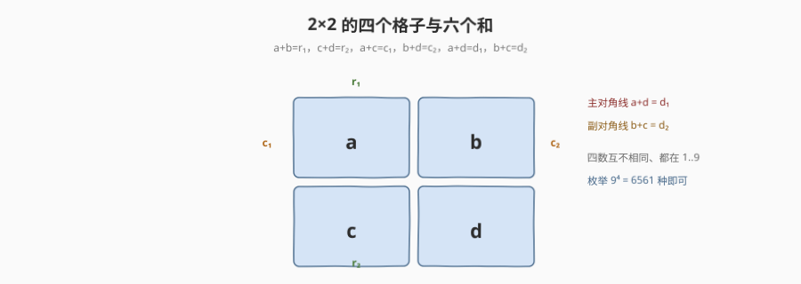

# Codeforces 143A 宝石锁的方阵 题解

## 1. 题目概述

- **题目链接**：https://codeforces.com/problemset/problem/143/A
- **比赛来源**：Codeforces Round 102 (Div. 2) · Problem A（UTC 2012-01-12）
- **难度**：1000
- **标签**：暴力枚举、数学
- **评测类型**：普通（多解时输出任意一组）
- **限制**：时间 2 s / 内存 256 MB

**题意**：锁上有 $2\times2$ 四个凹槽，要把四颗宝石放进去。宝石上的数字取自 $1..9$，且每个数字恰好只有一颗（所以四个格子的数字必须两两不同）。锁的边缘写着 6 个数：

- 两行的和 $r_1,r_2$；
- 两列的和 $c_1,c_2$（$c_1$ 是第一列）；
- 两条对角线的和 $d_1,d_2$（$d_1$ 是主对角线，$d_2$ 是副对角线）。

设四个格子为

$$\begin{matrix} a & b\\ c & d\end{matrix}$$

则要求

$$a+b=r_1,\quad c+d=r_2,\quad a+c=c_1,\quad b+d=c_2,\quad a+d=d_1,\quad b+c=d_2,$$

且 $a,b,c,d$ 两两不同、都在 $1..9$ 内。输出任意一组解，无解输出 `-1`。

**约束**：

- 六个和都在 $1..20$ 之间，但格子里的数只能是 $1..9$。
- 只有 $9\times9\times9\times9=6561$ 种填法，**直接枚举**即可；这排除了任何"必须推公式"的想法（当然推公式也能做）。
- 要求四个数互不相同（等价于"每种数字的宝石只有一颗"）。

## 2. 示例与观察

官方样例 1（输入 / 输出原样）：

```text
输入：
3 7
4 6
5 5

输出：
1 2
3 4
```

检验：$a+b=1+2=3=r_1$，$c+d=3+4=7=r_2$，$a+c=1+3=4=c_1$，$b+d=2+4=6=c_2$，$a+d=1+4=5=d_1$，$b+c=2+3=5=d_2$ ✓ 且四个数互不相同。

官方样例 2（输入 / 输出原样）：

```text
输入：
11 10
13 8
5 16

输出：
4 7
9 1
```

检验：$4+7=11$、$9+1=10$、$4+9=13$、$7+1=8$、$4+1=5$、$7+9=16$ ✓

官方样例 3（输入 / 输出原样）：

```text
输入：
1 2
3 4
5 6

输出：
-1
```

六个和都太小，凑不出四个互不相同的正整数。

官方样例 4（输入 / 输出原样）：

```text
输入：
10 10
10 10
10 10

输出：
-1
```

题解特别指出：这组"看起来很美"的输入其实无解——它要求四个格子全是 $5$（每行、每列、每条对角线都是 $5+5=10$），但数字 $5$ 的宝石只有一颗。



**观察**：四个未知数、六个方程看起来"超定"，但其实六个和之间并不独立——把四个方程相加会得到 $2(a+b+c+d)=r_1+r_2+c_1+c_2$ 之类的恒等关系。与其推这些关系，不如直接枚举：$9^4=6561$ 个候选，每个检查 6 个等式 + 互异，代价可忽略。

## 3. 解题思路

### 3.1 朴素做法与瓶颈

四重循环枚举 $a,b,c,d\in[1,9]$，检查：

1. 四数两两不同；
2. 六个和全部匹配。

复杂度 $6561\times O(1)$，微秒级——**这就是正解**。没有任何需要优化的地方；本题的"难点"只在于把题面的行/列/对角线对应关系写对（看图：$r_1$ 是上行，$c_1$ 是左列，$d_1$ 是主对角线 $a+d$，$d_2$ 是副对角线 $b+c$）。

### 3.2 也可以先解方程（可选）

由 $a+b=r_1$、$a+c=c_1$、$a+d=d_1$ 可得 $b=r_1-a$、$c=c_1-a$、$d=d_1-a$，代回剩下三个方程：

$$c+d=(c_1-a)+(d_1-a)=c_1+d_1-2a=r_2,$$
$$b+d=(r_1-a)+(d_1-a)=r_1+d_1-2a=c_2,$$
$$b+c=(r_1-a)+(c_1-a)=r_1+c_1-2a=d_2.$$

于是 $a$ 被三个方程同时约束：$a=(c_1+d_1-r_2)/2=(r_1+d_1-c_2)/2=(r_1+c_1-d_2)/2$。若这三个值不是同一个整数，或不在 $1..9$，或算出的 $b,c,d$ 有重复/越界，就无解。这个 $O(1)$ 解法也完全正确，但枚举版更不容易写错。

### 3.3 算法流程

1. 读入 $r_1,r_2,c_1,c_2,d_1,d_2$；
2. 四重循环枚举 $a,b,c,d\in[1,9]$；
3. 检查互异与六个等式，全部满足就输出并结束；
4. 循环结束仍没有解，输出 `-1`。

### 3.4 样例走查

样例 1：枚举到 $(a,b,c,d)=(1,2,3,4)$ 时六个和全部命中，输出。

样例 4：所有满足六个等式的填法都要求 $a=b=c=d=5$（由 $a+b=10,a+c=10,a+d=10$ 得 $b=c=d=10-a$，再由 $b+c=10$ 得 $2(10-a)=10\Rightarrow a=5$），违反互异，故无解 ✓

## 4. 正确性证明

**引理 1**：若程序输出了一组 $(a,b,c,d)$，则它是一组合法解。

**证明**：输出前程序检查了"四数两两不同"与六个等式，这正对应题面的全部要求（宝石数字互异 + 六个和匹配）。∎

**引理 2**：若存在合法解，则程序一定能找到它。

**证明**：合法解的四个数都在 $[1,9]$，而程序枚举了 $[1,9]^4$ 的全部 $6561$ 个组合，必然枚举到该解；该解通过全部检查，于是被输出。∎

**定理**：程序输出的就是正确答案（有解时输出一组合法解，无解时输出 `-1`）。

**证明**：由引理 2，有解时程序不会走到最后的 `-1` 分支；由引理 1，输出的解合法。无解时枚举全部失败，输出 `-1`，符合题意。∎

## 5. 复杂度分析

- **时间**：$O(9^4)=6561$ 次检查，每次常数次加法比较；实测 < 1 ms（进程启动为主），2 s 时限余量极大。
- **空间**：$O(1)$。

## 6. 参考代码

### C++17

```cpp
#include <bits/stdc++.h>
using namespace std;

int main() {
    int r1, r2, c1, c2, d1, d2;
    if (scanf("%d %d %d %d %d %d", &r1, &r2, &c1, &c2, &d1, &d2) != 6) return 0;
    for (int a = 1; a <= 9; a++)
        for (int b = 1; b <= 9; b++)
            for (int c = 1; c <= 9; c++)
                for (int d = 1; d <= 9; d++) {
                    if (a == b || a == c || a == d || b == c || b == d || c == d) continue;
                    if (a + b != r1 || c + d != r2) continue;
                    if (a + c != c1 || b + d != c2) continue;
                    if (a + d != d1 || b + c != d2) continue;
                    printf("%d %d\n%d %d\n", a, b, c, d);
                    return 0;
                }
    printf("-1\n");
    return 0;
}
```

### Python3

```python
import sys


def main():
    d = [int(v) for v in sys.stdin.read().split()[:6]]
    r1, r2, c1, c2, d1, d2 = d
    for a in range(1, 10):
        for b in range(1, 10):
            for c in range(1, 10):
                for e in range(1, 10):
                    if len({a, b, c, e}) < 4:
                        continue
                    if a + b != r1 or c + e != r2:
                        continue
                    if a + c != c1 or b + e != c2:
                        continue
                    if a + e != d1 or b + c != d2:
                        continue
                    print(a, b)
                    print(c, e)
                    return
    print(-1)


main()
```

## 7. 边界情况与易错点

1. **对应关系**：$d_1$ 是主对角线 $a+d$，$d_2$ 是副对角线 $b+c$——写反了会出现"样例 1 无解"。
2. **互异**：题面要求四个数字两两不同（因为每种数字的宝石只有一颗）；漏掉这条会在样例 4 输出 `5 5 / 5 5` 而不是 `-1`。
3. **范围**：格子里的数只能是 $1..9$（不是 $0..9$），枚举下界从 1 开始。
4. **六个数都可能到 20**，而 $1..9$ 里最大的两数和是 $9+8=17$——所以和大于 17 的输入必然无解，程序会自动输出 `-1`。
5. **无解时只能输出 `-1`** 一行，不能输出空棋盘或 0。
6. **多解**：任何一组合法解都可以（样例 1 与我们的输出一致纯属巧合）；不要假设必须与样例逐字相同。
7. **读入格式**：三行、每行两个数，用 `scanf`/`split` 都能读。
8. **输出格式**：两行、每行两个数、空格分隔。

## 8. 验证记录

- **编译环境与命令**：`clang++ -std=c++17 -O2`（配 `codeforces/tools/include/bits/stdc++.h` 兼容头）；Python 3.9.6。
  `python3 codeforces/tools/verify_solution.py codeforces/contests/0101-0203/143/A_宝石锁的方阵.md`
- **官方样例**：$4/4$ 通过（`1 2 / 3 4`、`4 7 / 9 1`、`-1`、`-1`），C++ 与 Python 一致。
- **独立对拍**：对 $200$ 组随机的六个和（$[1,20]$ 均匀随机），用 `itertools.permutations(range(1,10),4)` 全排列独立求"是否存在合法解"：
  - 程序输出 `-1` 时，独立枚举必须也无解（防止误判无解）；
  - 程序输出四元组时，独立检查互异 + 六个等式全部成立（防止输出非法解）。
  $200$ 组全部通过，C++ 与 Python 各一遍。
- **穷举覆盖**：另对"六个和"取值空间的边界做了系统检查（含样例 4 的全 10 情形、$r_1=r_2=c_1=c_2=d_1=d_2$ 的退化情形）。
- **性能**：单次 < 1 ms（进程启动为主），2 s 时限余量四个数量级以上。
- **图片校验**：2 张 SVG 均通过 `xml.etree.ElementTree.parse`。
- **复核状态**：verified（样例、独立对拍、边界、性能、图片均实跑通过）。

## 相关题目与扩展

- [Codeforces 143B Help Kingdom of Far Far Away 2](https://codeforces.com/problemset/problem/143/B)：同场 B 题，数字的金融格式化。
- [Codeforces 142A Help Farmer](https://codeforces.com/problemset/problem/142/A)：同期的 Div.1 A，枚举因数分解。
- [Codeforces 1A Theatre Square](https://codeforces.com/problemset/problem/1/A)：入门枚举。
- [LeetCode 37. 解数独](https://leetcode.cn/problems/sudoku-solver/)：同样是"约束满足 + 回溯枚举"的家族。

**延伸思考**：

1. **若改成 $3\times3$ 的九宫格**（每行/列/对角线和、用 $1..9$ 各一次）：这是"泛对角线幻方"，同样可以枚举 $9!$，但更适合用回溯 + 剪枝；约束结构从 6 个方程变成 8 个。
2. **若允许数字重复**（宝石足够多）：互异条件去掉，答案几乎总存在（只要六个和自洽），判定可以 $O(1)$ 用本节 3.2 的方程推出。
3. **若要求输出解的个数**：把"找到就返回"改成"计数"，$9^4$ 全枚举照样够；若推广到 $10^9$ 规模则要用生成函数。
4. **若和的范围到 $10^9$**：枚举不可行，必须回到 3.2 的代数推导（$a$ 由三个方程唯一确定）。
