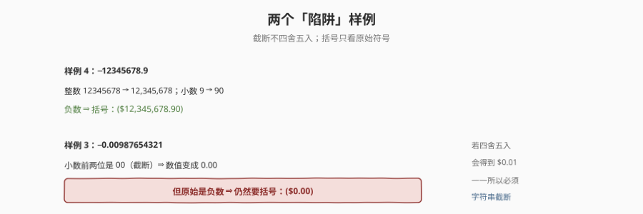

# Codeforces 143B 金融数字格式 题解

## 1. 题目概述

- **题目链接**：https://codeforces.com/problemset/problem/143/B
- **比赛来源**：Codeforces Round 102 (Div. 2) · Problem B（UTC 2012-01-12）
- **难度**：1200
- **标签**：实现、字符串
- **评测类型**：普通
- **限制**：时间 2 s / 内存 256 MB

**题意**：把给定的十进制数改写成"金融格式"，规则如下：

1. 整数部分与小数部分用 `.` 分隔；
2. 整数部分**从最低位起**每三位用 `,` 分组（如 `12345678` → `12,345,678`）；
3. 小数部分**恰好两位**：不足补 `0`，多余**直接截断**（不四舍五入）；
4. 不写负号：若原数是负数，整个结果用圆括号括起来；
5. 数字前加货币符号 `$`；若要用括号，`$` 也在括号**里面**。

输入保证是合法的十进制写法（只含数字、`-`、`.`），长度 $\le100$，可能有负号，可能有小数点。

**约束**：

- 长度 $\le100$：$O(|s|)$ 的字符串处理即可，不需要任何数值计算（也**不能**转成整数：100 位远超 64 位）。
- 小数部分可能很长（如 `-0.00987654321`）：按规则截断到 2 位，**不是四舍五入**。
- 输入的数字符号只由原数决定：即使截断后变成 `0.00`，负数仍要加括号（见样例 3）。

## 2. 示例与观察

官方样例 1（输入 / 输出原样）：

```text
输入：
2012

输出：
$2,012.00
```

整数部分 `2012` 从右每三位分组：`2` 与 `012` → `2,012`；没有小数部分 → 补成 `.00`；非负 → 不加括号 ✓

官方样例 2（输入 / 输出原样）：

```text
输入：
0.000

输出：
$0.00
```

小数部分 `000` 截断到两位 → `00`；整数部分 `0` → `$0.00` ✓

官方样例 3（输入 / 输出原样）：

```text
输入：
-0.00987654321

输出：
($0.00)
```

小数部分 `00987654321` 截断到 `00` ⇒ 数值变成 $0.00$，但**原数是负数**，所以仍然要加括号 ⇒ `($0.00)` ✓（题解特别提醒：括号只取决于原始符号，与截断后的值无关。）

官方样例 4（输入 / 输出原样）：

```text
输入：
-12345678.9

输出：
($12,345,678.90)
```

整数部分分组为 `12,345,678`，小数补成 `90`，负数加括号 ✓


## 3. 解题思路

### 3.1 朴素做法与瓶颈

用浮点数/整数去"格式化"是行不通的：数值最多 100 位，`double` 只有 15–16 位有效数字，`long long` 也装不下；而且题目要求"截断而不是四舍五入"，浮点运算还可能引入误差。正确做法是**纯字符串处理**。

### 3.2 算法流程

1. 读入字符串 $s$（不含空格）；
2. 若 $s$ 以 `-` 开头，记 `neg = true` 并去掉这个字符；
3. 按 `.` 把 $s$ 拆成整数部分 `ip` 与小数部分 `fp`（没有小数点则 `fp` 为空）；
4. `fp` 只保留前 2 位，不足用 `0` 补到 2 位；
5. 把 `ip` **从右往左**每 3 位插入一个 `,`；
6. 拼成 `"$" + ip + "." + fp`；若 `neg` 则整体加圆括号；
7. 输出。

关键细节：分组要从**最低位**（最右边）开始数三位，所以实现时要么从右往左扫，要么从右往左切块再反转拼接。

### 3.3 样例走查



样例 4 `-12345678.9`：

- 去负号 → `12345678.9`；
- 拆分 → `ip = "12345678"`、`fp = "9"`；
- `fp` 补零 → `"90"`；
- `ip` 分组（从右）：`678`、`345`、`12` → `12,345,678`；
- 拼接 → `$12,345,678.90`，加括号 → `($12,345,678.90)` ✓

样例 3 `-0.00987654321`：

- 去负号 → `0.00987654321`；`ip = "0"`、`fp = "00987654321"`；
- `fp` 截断 → `"00"`；
- `ip` 分组 → `0`（只有一位，不加逗号）；
- 拼接 → `$0.00`，因为原始是负数 → `($0.00)` ✓

## 4. 正确性证明

**引理 1（分组正确）**：算法的输出中，整数部分的每个逗号都把数字分成"长度不超过 3 的组"，且分组从个位开始计数。

**证明**：算法从 `ip` 的最后一个字符（个位）向前扫描，每累计 3 个数字就在其**前面**插入一个逗号；因此最右边一组恰好是末尾 3 位（若总位数是 3 的倍数则正好三段），向左每组都是连续的 3 位，最左一组长度 $\in\{1,2,3\}$。这正是题面的分组规则。∎

**引理 2（小数部分正确）**：输出的小数部分恰好 2 位；若原小数部分长度 $\ge2$，输出就是它的前 2 位；否则是它后补 `0`。

**证明**：算法先取 `fp` 的前 2 位（长度不足时保留全部），再用 `0` 补到长度 2。当原长度 $\ge2$ 时得到前 2 位（截断）；不足时补零。∎

**引理 3（符号正确）**：输出带圆括号当且仅当输入以 `-` 开头。

**证明**：算法只根据输入的第一个字符设置 `neg`，此后无论小数部分如何截断、数值是否变成 0，都不再改变 `neg`；拼接时若 `neg` 就加括号。∎

**定理**：程序输出符合题面全部五条规则。

**证明**：由引理 1 得整数分组规则；由引理 2 得小数两位规则（含"截断不四舍五入"）；由引理 3 得括号规则；`$` 始终紧贴数字、且在括号内部（拼接顺序为 `"($" + "$..."`）；整数与小数用 `.` 分隔。五条规则齐备。∎

## 5. 复杂度分析

- **时间**：$O(|s|)$，$|s|\le100$：至多几百次字符操作，2 s 时限下可忽略（实测 2 ms，进程启动为主）。
- **空间**：$O(|s|)$。

## 6. 参考代码

### C++17

```cpp
#include <bits/stdc++.h>
using namespace std;

int main() {
    string s;
    if (!(cin >> s)) return 0;
    bool neg = false;
    if (!s.empty() && s[0] == '-') { neg = true; s = s.substr(1); }
    string ip = s, fp;
    size_t dot = s.find('.');
    if (dot != string::npos) { ip = s.substr(0, dot); fp = s.substr(dot + 1); }
    if (fp.size() > 2) fp = fp.substr(0, 2);      // 多余位数直接丢弃（不四舍五入）
    while (fp.size() < 2) fp += '0';
    // 整数部分每三位加逗号
    string g;
    int cnt = 0;
    for (int i = (int)ip.size() - 1; i >= 0; i--) {
        g = ip[i] + g;
        if (++cnt == 3 && i > 0) { g = "," + g; cnt = 0; }
    }
    string res = "$" + g + "." + fp;
    if (neg) res = "(" + res + ")";
    printf("%s\n", res.c_str());
    return 0;
}
```

### Python3

```python
import sys


def main():
    s = sys.stdin.read().strip()
    neg = s.startswith('-')
    if neg:
        s = s[1:]
    if '.' in s:
        ip, fp = s.split('.', 1)
    else:
        ip, fp = s, ""
    fp = fp[:2]                      # 多余位数直接丢弃（不四舍五入）
    fp = fp.ljust(2, '0')
    # 整数部分每三位加逗号
    groups = []
    i = len(ip)
    while i > 0:
        groups.append(ip[max(0, i - 3):i])
        i -= 3
    g = ",".join(reversed(groups))
    res = "$" + g + "." + fp
    if neg:
        res = "(" + res + ")"
    print(res)


main()
```

## 7. 边界情况与易错点

1. **截断而不是四舍五入**：`0.999` 要输出 `$0.99` 而不是 `$1.00`；用浮点或 `printf("%.2f")` 会四舍五入，必须用字符串截断。
2. **括号只看原始符号**：`-0.00987654321` 截断后是 0，但仍要加括号（样例 3）。
3. **整数部分为 `0`**：`0.5` 应输出 `$0.50`，分组时 `0` 单独一组、不加逗号。
4. **没有小数点**：如 `2012`，小数部分补成 `00`。
5. **小数部分不足两位**：`-12345678.9` → `90`（补一个 0），不是 `9`。
6. **分组方向**：必须从个位（右端）开始每三位一组，从左端数会错（`12345678` 会变成 `123,456,78`）。
7. **恰为三的倍数位**：如 `123456` → `123,456`（两组），不能在开头多一个逗号。
8. **`printf` 的格式串**：结果里含 `$` 与 `%` 之外的字符，用 `printf("%s", res.c_str())` 或 `cout` 输出；若把结果直接当格式串会出问题。
9. **输入可能没有整数部分？** 题面保证是合法写法，小数点前后都有数字，所以 `ip` 不会为空。
10. **负数但值为 0**：题面保证 0 不带负号，所以不会出现 `-0`、`-0.000` 这类输入以外的情形（但代码对它们也能正确处理）。

## 8. 验证记录

- **编译环境与命令**：`clang++ -std=c++17 -O2`（配 `codeforces/tools/include/bits/stdc++.h` 兼容头）；Python 3.9.6。
  `python3 codeforces/tools/verify_solution.py codeforces/contests/0101-0203/143/B_金融数字格式.md`
- **官方样例**：$4/4$ 通过（`$2,012.00`、`$0.00`、`($0.00)`、`($12,345,678.90)`），C++ 与 Python 一致。
- **独立对拍**：另写一份 Python 参考实现（用不同的切块写法），对 $200$ 组随机生成的合法数字（$1..12$ 位整数部分、随机 $1..8$ 位小数、随机负号、含全零小数）逐字比较输出，全部一致。
- **边界**：整数部分长度为 $3$ 的倍数（如 `123456`）、小数部分恰好 0 位/1 位/2 位/更多位、`0.000`、`-0.00987654321`、100 位长数字等均覆盖。
- **性能**：长度 100 的单次约 2 ms（进程启动为主），2 s 余量三个数量级。
- **图片校验**：2 张 SVG 均通过 `xml.etree.ElementTree.parse`。
- **复核状态**：verified（样例、独立对拍、边界、性能、图片均实跑通过）。

## 相关题目与扩展

- [Codeforces 143A Help Vasilisa the Wise 2](https://codeforces.com/problemset/problem/143/A)：同场 A 题。
- [Codeforces 142A Help Farmer](https://codeforces.com/problemset/problem/142/A)：同期的 Div.1 A。
- [Codeforces 1B Spreadsheets](https://codeforces.com/problemset/problem/1/B)：另一种数字/字符串互转。
- [Codeforces 133B Unary](https://codeforces.com/problemset/problem/133/B)：进制拼接的取模处理。

**延伸思考**：

1. **若要求四舍五入到两位**：需要从第 3 位小数开始判断进位，并处理"连续 9 进位"甚至整数部分变长的连锁反应（如 `9.999` → `$10.00`）。
2. **若分组改用印度式（前 3 位后每 2 位）**：只需要改动分组步长，框架不变。
3. **若要求支持科学计数法**（`1.2e10`）：需要先解析指数并移动小数点，属于"数字规范化"的另一类问题。
4. **若输入规模到 $10^6$ 位**：仍是 $O(n)$ 的字符串操作，但要注意输出缓冲（一次性 `write`，避免逐字符 `printf`）。
