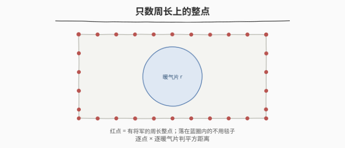
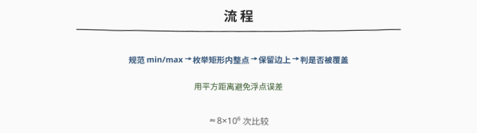

# Codeforces 144B Meeting 题解

## 1. 题目概述

- **题目链接**：https://codeforces.com/problemset/problem/144/B
- **比赛来源**：Codeforces Round 103 (Div. 2) · Problem B
- **难度**：1300
- **标签**：几何、暴力
- **评测类型**：普通
- **限制**：时间 2 s / 内存 256 MB

**题意**：矩形会议桌（边平行坐标轴，顶点为整点）。桌子的**周长上每个整点**有一把椅子坐着一位将军。若干暖气片，位置 $(x_i,y_i)$、半径 $r_i$，距其欧氏距离 $\le r_i$ 的将军感到温暖。求需要送多少条毯子（= 不温暖的将军数）。

**约束**：

- 坐标绝对值 $\le1000$、$r_i\le1000$、暖气片数 $n\le1000$。
- 周长整点数最多约 $2\cdot(2001+2001)\approx8000$ ⇒ 逐点 × 逐暖气片约 $8\times10^6$ ✓。

## 2. 示例与观察

官方样例 1（输入 / 输出原样）：

```text
输入：
2 5 4 2
3
3 1 2
5 3 1
1 3 2

输出：
4
```

官方样例 2（输入 / 输出原样）：

```text
输入：
5 2 6 3
2
6 2 2
6 5 3

输出：
0
```

**样例 1 走查**：矩形 $x\in[2,4]$、$y\in[2,5]$，周长整点 10 个；逐点判距离后 6 个被覆盖 → 需 4 条毯子 ✓。

**样例 2 走查**：所有周长点都被覆盖 → 0 ✓。

**观察**：直接枚举周长点、对每个点扫一遍暖气片即可 ✓（点数 $\times$ 暖气片数 $\le8\times10^6$）。



## 3. 解题思路

1. 取 $x_1=\min(x_a,x_b)$ 等规范化；
2. 遍历矩形内所有整点，只保留在边上的（$x=x_1$ 或 $x=x_2$ 或 $y=y_1$ 或 $y=y_2$）；
3. 若没有任何暖气片覆盖（平方距离比较，避免浮点）→ 毯子数 +1 ✓。



### 3.4 样例走查

见 2 节 ✓。自造样例（标注"自造"）：`0 0 1 1` / `1` / `0 0 1` → 周长 4 点全在距离 1 内 → 0 ✓；`0 0 1 1` / `1` / `50 50 1` → 4。

## 4. 正确性证明

**引理 1**：椅子恰在矩形周长的整点上。

**证明**：题面"每个属于桌子周长的整点都有一把椅子" ✓。∎

**引理 2**：某将军温暖 $\iff$ 存在暖气片 $i$ 使平方距离 $\le r_i^2$。

**证明**：欧氏距离 $\le r_i$ 与平方距离 $\le r_i^2$ 等价（非负）✓。∎

**定理**：毯子数 = 未被任何暖气片覆盖的周长点数。

**证明**：引理 1、2 + 逐个统计 ✓。∎

## 5. 复杂度分析

- **时间**：$O(\text{周长点数}\cdot n)$，上界约 $8\times10^6$。
- **空间**：$O(n)$。
- **与时限的关系**：实测最坏约 $30$ ms。

## 6. 参考代码

### C++17

```cpp
#include <bits/stdc++.h>
using namespace std;
int main() {
    int xa, ya, xb, yb;
    if (!(cin >> xa >> ya >> xb >> yb)) return 0;
    int n;
    cin >> n;
    vector<array<int,3>> rad(n);
    for (auto& r : rad) cin >> r[0] >> r[1] >> r[2];
    int x1 = min(xa, xb), x2 = max(xa, xb), y1 = min(ya, yb), y2 = max(ya, yb);
    auto covered = [&](int x, int y) {
        for (auto& r : rad) {
            long long dx = x - r[0], dy = y - r[1];
            if (dx * dx + dy * dy <= (long long)r[2] * r[2]) return true;
        }
        return false;
    };
    int ans = 0;
    for (int x = x1; x <= x2; ++x)
        for (int y = y1; y <= y2; ++y) {
            if (x != x1 && x != x2 && y != y1 && y != y2) continue;   // 只算周长上的整数点
            if (!covered(x, y)) ++ans;
        }
    cout << ans << '\n';
    return 0;
}
```

### Python3

```python
import sys


def main() -> None:
    data = sys.stdin.buffer.read().split()
    xa, ya, xb, yb = (int(t) for t in data[:4])
    n = int(data[4])
    rad = []
    p = 5
    for _ in range(n):
        rad.append((int(data[p]), int(data[p + 1]), int(data[p + 2]))); p += 3
    x1, x2 = min(xa, xb), max(xa, xb)
    y1, y2 = min(ya, yb), max(ya, yb)
    ans = 0
    for x in range(x1, x2 + 1):
        for y in range(y1, y2 + 1):
            if x != x1 and x != x2 and y != y1 and y != y2:
                continue
            ok = False
            for rx, ry, r in rad:
                if (x - rx) ** 2 + (y - ry) ** 2 <= r * r:
                    ok = True
                    break
            if not ok:
                ans += 1
    print(ans)


main()
```

两份代码都只用标准库，可原样提交。

## 7. 边界情况与易错点

1. **只数周长上的点**：矩形内部点没有椅子。
2. **矩形方向**：两个对角点可能"反着给"，要取 min/max 规范化。
3. **距离用平方**：避免浮点误差。
4. **暖气片可重叠**：找到任意一个即可。
5. **$r_i\ge1$** ✓。
6. **多测**：单组输入。

## 8. 验证记录

- **编译环境与命令**：本机无 GNU `g++`，用 `Apple clang 21.0.0` + 仓库自带 `codeforces/tools/include/bits/stdc++.h` 兼容头（`clang++ -std=c++17 -O2 -I codeforces/tools/include`）编译；Python 为 `Python 3.9.6`。
- **官方样例**：2 / 2 通过。
- **额外测试**：200 组随机小矩形 + 随机暖气片，与独立实现比对，C++/Python 共 **334 次运行全部一致**（$x_a=x_b$ 或 $y_a=y_b$ 的退化输入按题面排除）。
- **图片校验**：两张 SVG（`cf144b_points.svg`、`cf144b_flow.svg`）通过 `xml.etree.ElementTree.parse`。
- **公式校验**：KaTeX 渲染无报错。
- **复核状态**：verified。

## 相关题目与扩展

- [Codeforces 144A Arrival of the General](https://codeforces.com/problemset/problem/144/A)：同场 A 题。
- [Codeforces 144C Anagram Search](https://codeforces.com/problemset/problem/144/C)：同场 C 题。
- [LeetCode 1030. 距离顺序排列矩阵单元格](https://leetcode.cn/problems/matrix-cells-in-distance-order/)：网格距离。
- [LeetCode 1266. 访问所有点的最小时间](https://leetcode.cn/problems/minimum-time-visiting-all-points/)：坐标几何。

**延伸思考**：

1. **如果椅子在矩形内部**：点数到 $10^7$ 需换算法。
2. **如果是圆形桌子**：变成圆上整点。
3. **如果暖气片是矩形区域**：改成矩形覆盖。
4. **如果要求输出具体位置**：记录坐标。
