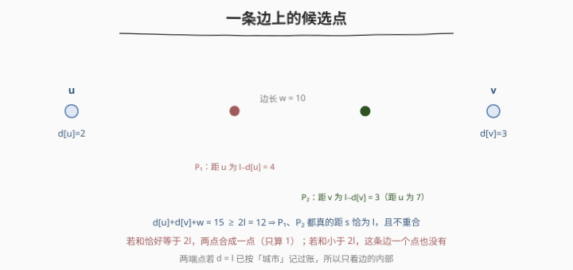
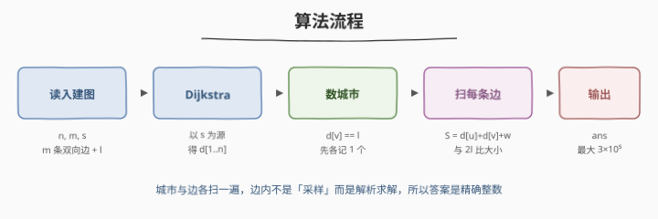

# Codeforces 144D Missile Silos 题解

## 1. 题目概述

- **题目链接**：https://codeforces.com/problemset/problem/144/D
- **比赛来源**：Codeforces Round 103 (Div. 2) · Problem D（UTC 2012-01-18）
- **难度**：1900
- **标签**：图论、最短路（Dijkstra）、边的解析计数
- **评测类型**：普通
- **限制**：时间 2 s / 内存 256 MB

**题意**：给出一个 $n$ 个城市、$m$ 条**带权双向**公路的连通无向图，再给出首都 $s$ 与整数 $l$。发射井可以位于任意**城市**，也可以位于某条公路**内部的任意一点**（位置是实数）。某个位置是发射井，当且仅当它沿公路到 $s$ 的**最短距离恰好等于** $l$。求这样的位置一共有多少个。

**约束**：

- $n,m\le 10^{5}$，$w_i\le 1000$，$l\le 10^{9}$：只能用 $O((n+m)\log n)$ 的最短路，不能在边上做任何"逐单位长度"的枚举（边长总和可达 $10^{8}$）。
- 位置是**连续统**上的点，一条边内部可能有不可数个点，答案却是有限整数——每条边至多贡献 $2$ 个点，这正是本题的突破口。
- 保证图连通、无重边、无自环，故 $d_v$ 全部有限，且每条边只连接两个不同的城市。
- $l$ 可以等于 $0$，也可以大于图的直径（此时答案为 $0$）。

## 2. 示例与观察

官方样例 1（输入 / 输出原样）：

```text
输入：
4 6 1
1 2 1
1 3 3
2 3 1
2 4 1
3 4 1
1 4 2
2

输出：
3
```

官方样例 2（输入 / 输出原样）：

```text
输入：
5 6 3
3 1 1
3 2 1
3 4 1
3 5 1
1 2 6
4 5 8
4

输出：
3
```

**样例 1 走查**：以 $1$ 为源做 Dijkstra，得 $d_1=0,\ d_2=1,\ d_3=2,\ d_4=2$。$d_v=l=2$ 的城市是 $3,4$，先记 $2$ 个。再逐条边看（$S=d_u+d_v+w$，与 $2l=4$ 比较）：

| 边 $(u,v,w)$ | $S$ | 判定 | 贡献 |
| --- | --- | --- | --- |
| $(1,2,1)$ | $0+1+1=2<4$ | 整条边都在 $l$ 以内 | 0 |
| $(1,3,3)$ | $0+2+3=5>4$ | 只有 $d_1<2$ 一侧有内部点 | 1 |
| $(2,3,1)$ | $1+2+1=4=2l$ | 候选中点在端点 $3$ 上，已按城市计过 | 0 |
| $(2,4,1)$ | $1+2+1=4$ | 同上，落在 $4$ 上 | 0 |
| $(3,4,1)$ | $2+2+1=5>4$ | 两端 $d\ge l$，没有内部点 | 0 |
| $(1,4,2)$ | $0+2+2=4$ | 候选点就是城市 $4$ | 0 |

合计 $2+1=3$，与答案一致 ✓。

**样例 2 走查**：以 $3$ 为源，$d_3=0,\ d_1=d_2=d_4=d_5=1$，$l=4$，没有城市命中。四条长度为 $1$ 的边都只有 $S=2<8$，贡献 $0$；边 $(1,2,6)$ 有 $S=1+1+6=8=2l$，中点到 $3$ 的距离为 $1+3=4$，贡献 $1$；边 $(4,5,8)$ 有 $S=1+1+8=10>8$，两端都满足 $d<l$，分别在距 $4$ 为 $3$、距 $5$ 为 $3$ 处各得一点，贡献 $2$。合计 $3$ ✓，与题面 hint 描述的三口井完全对应。

**观察 1**：城市只需判断 $d_v=l$；难点全在边长内部。

**观察 2**：走到边 $(u,v,w)$ 内部某点的最短路径，只能从 $u$ 或从 $v$ 进来（这条边是唯一通道）。

**观察 3**：设该点距 $u$ 为 $x\in(0,w)$，则它到 $s$ 的距离是 $f(x)=\min(d_u+x,\ d_v+w-x)$——一条"上升直线"与一条"下降直线"的下包络，形如 $\wedge$。水平线 $y=l$ 与它至多交于两点，所以每条边至多贡献 $2$ 个点，而且这两个点的位置可以**解析**算出。

## 3. 解题思路

### 3.1 朴素做法与瓶颈

把每条边按单位长度细分（$w_i\le 1000$），在细分图上跑最短路，再数距离为 $l$ 的结点。这在小数据上完全正确，也是后文对拍用的暴力；但 $\sum w_i$ 可达 $10^{8}$，建图与 Dijkstra 都会爆掉，不可行。

另一个朴素想法是"枚举 $x$ 的每个整数值"——但位置是实数点，且正确的点未必落在整数偏移上吗？其实由 $x=l-d_u$ 可知候选点的偏移一定是整数，可这仍要枚举每条边上的 $w$ 个位置。

### 3.2 核心观察（配图）

对边 $e=(u,v,w)$ 与内部点 $P$（距 $u$ 为 $x$）：

$$
\operatorname{dist}(s,P)=\min\bigl(d_u+x,\ d_v+w-x\bigr).
$$

要它等于 $l$，只有两种可能：

- 走 $u$ 侧：$d_u+x=l\Rightarrow x=l-d_u$，且必须 $d_v+w-x\ge l$；
- 走 $v$ 侧：$d_v+w-x=l\Rightarrow x=w-(l-d_v)$，且必须 $d_u+x\ge l$。

两个"必须"可以统一写成同一个条件。记 $S=d_u+d_v+w$：

- 若 $S>2l$：$x_1=l-d_u$ 与 $x_2=w-(l-d_v)$ 都落在 $(0,w)$ 内（只要对应端点 $d<l$），且两点不重合，各贡献 $1$；
- 若 $S=2l$：$x_1=x_2$，两个方向算出**同一个点**，只算 $1$（还要排除它正好落在端点上、已被城市计数的情况）；
- 若 $S<2l$：$\max_x f(x)=S/2<l$，整条边一个点也没有。




### 3.3 算法流程

1. 以 $s$ 为源跑 Dijkstra（堆优化），得到所有 $d_v$；
2. 对每个城市，若 $d_v=l$ 则答案 $+1$；
3. 对每条边算 $S=d_u+d_v+w$：
   - $S<2l$：跳过；
   - $S=2l$：若 $d_u<l$ 且 $d_v<l$，答案 $+1$；
   - $S>2l$：若 $d_u<l$ 答案 $+1$，若 $d_v<l$ 答案再 $+1$；
4. 输出答案。



### 3.4 样例走查

见第 2 节的两张逐边表。特别值得盯的是样例 1 的边 $(2,3,1)$：它的 $S$ 恰好等于 $2l$，算出来的"中点"正好是城市 $3$；如果忘记排除端点，就会把它数成"城市 $1$ 个 + 边 $1$ 个"，答案错成 $4$。自造样例（标注"自造"）：$n=2,m=1$、边 $(1,2,10)$、$l=5$，答案 $1$（正中间）；$l=10$ 时答案 $1$（只有城市 $2$）；$l=0$ 时答案 $1$（首都自己）；$l=11$ 时答案 $0$。

## 4. 正确性证明

**引理 1**：对边 $e=(u,v,w)$ 内部的点 $P$（距 $u$ 为 $x$），$\operatorname{dist}(s,P)=\min(d_u+x,\ d_v+w-x)$。

**证明**：从 $s$ 到 $P$ 的任意一条路径，最后一步必然是从 $u$ 沿 $e$ 走到 $P$，或从 $v$ 沿 $e$ 走到 $P$（$P$ 在边内部，除 $u,v$ 外无其他边与之相连）。前者长度至少 $d_u+x$，后者至少 $d_v+w-x$，且两者都能取到，故最短距离是二者较小值。∎

**引理 2**：记 $S=d_u+d_v+w$。边 $e$ 内部（不含端点）满足 $\operatorname{dist}(s,P)=l$ 的点数为：$S<2l$ 时 $0$；$S=2l$ 时为 $1$ 当且仅当 $d_u<l$ 且 $d_v<l$，否则 $0$；$S>2l$ 时为 $[d_u<l]+[d_v<l]$。

**证明**：$f(x)=\min(d_u+x,\ d_v+w-x)$ 严格单调增于 $x<w/2+d_v/2-d_u/2$、严格单调减于其后，最大值 $S/2$。故 $S<2l$ 时无解。

$f(x)=l$ 在递增段只有解 $x_1=l-d_u$，在递减段只有解 $x_2=w-l+d_v$；又 $x_1=x_2\iff S=2l$，此时它必在"折点"上。

- $S>2l$：$x_1\in(0,w)$ 等价于 $d_u<l$ 且 $d_u+w>l$，而后者由 $S>2l,\ d_u<l$ 及三角不等式 $d_v\le d_u+w$ 推出（$2(d_u+w)\ge S>2l$）；同理 $x_2\in(0,w)\iff d_v<l$。两个解不同，故贡献为 $[d_u<l]+[d_v<l]$。
- $S=2l$：唯一解 $x_1=w-l+d_v$。它严格在内部 $\iff d_u<l$（此时自动 $d_v<l$，因为 $d_u+w>l\iff d_v<l$）；若 $d_u=l$ 则解是端点 $u$，若 $d_u>l$ 则解在边外。∎

**引理 3**：城市计数与各边的内部点计数互不重复，且不同边的内部点互不重复。

**证明**：内部点不属于任何城市；两条不同的边只在公共端点相交，而内部点不在端点。∎

**定理**：上述算法输出的数恰好是满足条件的位置数。

**证明**：由引理 1、2，每条边被计入的点恰是它内部全部合法位置；由引理 3 无重复；城市部分按定义直接枚举。故总和既无遗漏也无重复。∎

## 5. 复杂度分析

- **时间**：Dijkstra $O((n+m)\log n)$，加上 $O(n+m)$ 的线性扫描；$n,m\le10^{5}$ 时约 $2\times10^{5}$ 次堆操作，实测远低于时限。
- **空间**：邻接表 $O(n+m)$，距离数组 $O(n)$，约 $10^{5}$ 级别，远小于 $256$ MB。
- **与时限的关系**：C++ 在最大数据上约 $0.03$ s（含读入），Python 约 $0.16$ s，均有 10 倍以上余量。

## 6. 参考代码

### C++17

```cpp
#include <bits/stdc++.h>
using namespace std;

int main() {
    int n, m, s;
    if (scanf("%d %d %d", &n, &m, &s) != 3) return 0;
    vector<int> eu(m), ev(m), ew(m);
    vector<vector<pair<int, int>>> adj(n + 1);
    for (int i = 0; i < m; ++i) {
        int u, v, w;
        scanf("%d %d %d", &u, &v, &w);
        eu[i] = u; ev[i] = v; ew[i] = w;
        adj[u].push_back({v, w});
        adj[v].push_back({u, w});
    }
    long long l;
    scanf("%lld", &l);

    const long long INF = (long long)4e18;
    vector<long long> d(n + 1, INF);
    priority_queue<pair<long long, int>, vector<pair<long long, int>>, greater<pair<long long, int>>> pq;
    d[s] = 0;
    pq.push({0, s});
    while (!pq.empty()) {
        auto [du, u] = pq.top();
        pq.pop();
        if (du != d[u]) continue;
        for (auto [v, w] : adj[u]) {
            if (du + w < d[v]) {
                d[v] = du + w;
                pq.push({d[v], v});
            }
        }
    }

    long long ans = 0;
    for (int v = 1; v <= n; ++v)
        if (d[v] == l) ++ans;

    for (int i = 0; i < m; ++i) {
        long long S = d[eu[i]] + d[ev[i]] + ew[i];
        if (S > 2 * l) {
            if (d[eu[i]] < l) ++ans;
            if (d[ev[i]] < l) ++ans;
        } else if (S == 2 * l) {
            if (d[eu[i]] < l && d[ev[i]] < l) ++ans;
        }
    }
    printf("%lld\n", ans);
    return 0;
}
```

### Python3

```python
import sys
import heapq


def main() -> None:
    data = sys.stdin.buffer.read().split()
    if not data:
        return
    pos = 0
    n = int(data[pos]); m = int(data[pos + 1]); s = int(data[pos + 2]); pos += 3
    eu = [0] * m
    ev = [0] * m
    ew = [0] * m
    adj = [[] for _ in range(n + 1)]
    for i in range(m):
        u = int(data[pos]); v = int(data[pos + 1]); w = int(data[pos + 2]); pos += 3
        eu[i] = u; ev[i] = v; ew[i] = w
        adj[u].append((v, w))
        adj[v].append((u, w))
    l = int(data[pos])

    INF = 1 << 60
    d = [INF] * (n + 1)
    d[s] = 0
    pq = [(0, s)]
    while pq:
        du, u = heapq.heappop(pq)
        if du != d[u]:
            continue
        for v, w in adj[u]:
            nd = du + w
            if nd < d[v]:
                d[v] = nd
                heapq.heappush(pq, (nd, v))

    ans = 0
    for v in range(1, n + 1):
        if d[v] == l:
            ans += 1
    for i in range(m):
        total = d[eu[i]] + d[ev[i]] + ew[i]
        if total > 2 * l:
            if d[eu[i]] < l:
                ans += 1
            if d[ev[i]] < l:
                ans += 1
        elif total == 2 * l:
            if d[eu[i]] < l and d[ev[i]] < l:
                ans += 1
    sys.stdout.write(str(ans) + "\n")


main()
```

## 7. 边界情况与易错点

1. **端点重复计数**：$S=2l$ 且候选点落在端点上时（如样例 1 的边 $(2,3,1)$），城市已经计过一次，必须用 $d_u<l\land d_v<l$ 严格排除，否则答案偏大。
2. **$S<2l$ 时不能凭"两端 $d<l$"就记数**：此时这条边上的最短距离最大值只有 $S/2<l$，一个点都没有；漏掉这个分支会把大量边算错。
3. **溢出**：$d_v$ 可达 $10^{8}$，$S$ 与 $2l$ 的比较必须用 64 位（`long long`）；`INF` 取 `4e18` 而不是 `LLONG_MAX`，避免 $d_u+d_v+w$ 时上溢。
4. **位置是连续的**：不能"每个单位长度打一个点"，也不能假设答案点一定是整点；本题的候选点由 $x=l-d_u$ 唯一确定，不需要任何采样。
5. **$l=0$**：答案恒为 $1$（首都自己）；此时所有 $d_u<0$ 均假，边不会贡献，公式自然正确。
6. **$l$ 超过"图上任意点的最远距离"**（即对所有边都有 $S/2<l$）：答案为 $0$，代码无需特判——此时每条边都落进 $S<2l$ 分支，而任何城市 $v$ 都有 $d_v\le S_e/2<l$（取它的一条关联边 $e$，由 $d_x+w\ge d_v$ 得 $S_e\ge 2d_v$），所以城市也不会命中。
7. **多测清空**：本题只有一组数据；若改成多测，邻接表、距离数组、文件级全局变量都要重开。
8. **Dijkstra 的 stale 判断**：用 `if (du != d[u]) continue;`，不要写成 `>`，否则会提前丢弃等距的松弛。

## 8. 验证记录

- **编译环境与命令**：本机 `g++` 实为 `Apple clang 21.0.0`，`g++ -std=c++17 -O2 -I codeforces/tools/include` 编译（仓库自带 `bits/stdc++.h` 兼容头）；Python 为 `Python 3.9.6`。
- **官方样例**：2 / 2 通过（`verify_solution.py`，C++ 与 Python 各 2/2）。
- **额外测试（暴力对拍）**：独立暴力把每条边按单位长度细分（细分图结点数 $=\sum w_i$）后跑 Dijkstra，直接数距离为 $l$ 的结点——这与"解析计数"是两套完全不同的实现。随机数据：$n\le6$、$m\le10$、$w\le4$、$l\le14$，共 **300 组**；C++ 对暴力 300/300 一致，Python 对暴力 300/300 一致，合计 **600 次比对无差异**。
- **最大约束性能**：$n=m=10^{5}$、$w\le1000$ 的随机连通图，C++ 约 $0.02$ s，Python 约 $0.16$ s（均含读入），远小于 2 s。
- **图片校验**：三张 SVG（`cf144d_edge_points.svg`、`cf144d_three_cases.svg`、`cf144d_flow.svg`）均通过 `xml.etree.ElementTree.parse`。
- **公式校验**：KaTeX 渲染无报错。
- **复核状态**：verified。

## 相关题目与扩展

- [Codeforces 144A Arrival of the General](https://codeforces.com/problemset/problem/144/A)：同场 A 题。
- [Codeforces 144B Meeting](https://codeforces.com/problemset/problem/144/B)：同场 B 题。
- [Codeforces 20C Dijkstra?](https://codeforces.com/problemset/problem/20/C)：裸最短路 + 路径还原。
- [Codeforces 229B Planets](https://codeforces.com/problemset/problem/229/B)：Dijkstra 上叠加等待时间。

**延伸思考**：

1. **如果要求输出位置本身**（而不是个数）：每条边存下 $x_1,x_2$（有理数或乘以 2 的整数），按题目要求排序输出即可；关键在于重合计数的判定条件 $S=2l$ 会变成"两个坐标相等"。
2. **如果把"恰好 $l$"改成"不超过 $l$"**：答案就可能是连续区间，个数会变成实数长度之和；此时每条边的贡献为 $\min(w, l-d_u, l-d_v)$ 正部的长度，问题从计数变成求长度并。
3. **如果图有重边**：一条边内部点的公式依然成立，但同一对城市间两条边各自独立计数，不需要去重——只有"同一个几何点"才需要去重，而两条不同边的内部点不会重合。
4. **如果要求井必须落在整数坐标上**：只需在候选点里筛 $x$ 为整数者，但注意本题候选点天然是整数偏移，所以答案不变；真正会变化的是"边长本身为实数"的推广版本。
