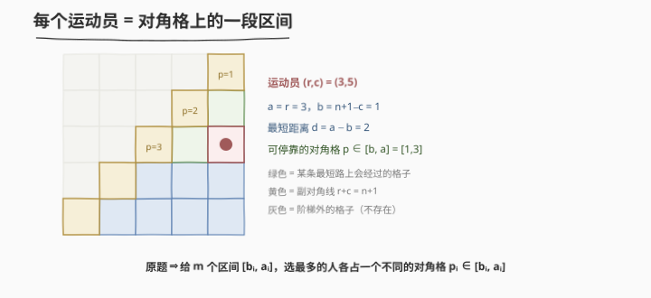
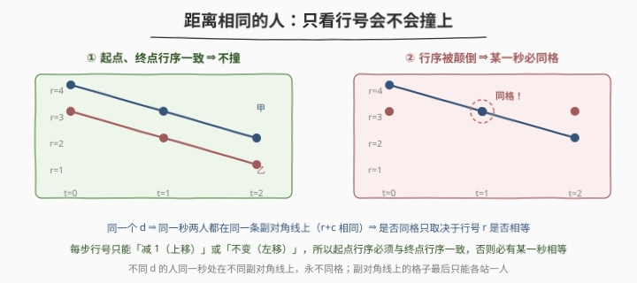
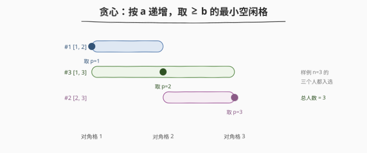

# Codeforces 144E Competition 题解

## 1. 题目概述

- **题目链接**：https://codeforces.com/problemset/problem/144/E
- **比赛来源**：Codeforces Round 103 (Div. 2) · Problem E（UTC 2012-01-18）
- **难度**：2200
- **标签**：贪心、数据结构、区间匹配
- **评测类型**：多解 / 特殊评测（第二行输出方案，任意合法解均可）
- **限制**：时间 2 s / 内存 256 MB

**题意**：一个 $n$ 度"阶梯"是 $n\times n$ 方阵挖掉副对角线（从右上到左下）以上的格子后剩下的部分，即格 $(r,c)$ 存在当且仅当 $r+c\ge n+1$。阶梯上站着 $m$ 个运动员，每人必须选一条**最短**路径走到副对角线（每步走向上下左右相邻的格子），走到后停住不动。所有人同时出发，任一时刻任意格子里最多一个人（副对角线上的格子也一样）。求最多能保留多少个运动员，并输出这些人按输入顺序的编号（任意一组合法解）。

**约束**：

- $n,m\le10^{5}$：不能按时间逐秒模拟（最长路径可达 $n-1$ 步），也不能枚举子集。
- 每格的 $r,c$ 满足 $n-c<r$，即 $r+c\ge n+1$：说明输入只给阶梯内的格子，走路时也只需考虑"上、左"两个方向。
- 每个格子最多一个运动员；输出编号必须互不相同。
- 目标只是**人数最多**，不要求路径最短之外的任何优化，这给贪心留了空间。

## 2. 示例与观察

官方样例 1（输入 / 输出原样）：

```text
输入：
3 3
2 3
3 2
3 3

输出：
3
1 2 3 
```

**样例走查**：$n=3$ 的副对角线是 $(1,3),(2,2),(3,1)$。三人分别是 $(2,3),(3,2),(3,3)$，到副对角线的最短距离分别为 $1,1,2$。

| 编号 | $(r,c)$ | $a=r$ | $b=n+1-c$ | $d=a-b$ | 可停靠的对角格 $p\in[b,a]$ |
| --- | --- | --- | --- | --- | --- |
| 1 | $(2,3)$ | 2 | 1 | 1 | $\{1,2\}$ |
| 2 | $(3,2)$ | 3 | 2 | 1 | $\{2,3\}$ |
| 3 | $(3,3)$ | 3 | 1 | 2 | $\{1,2,3\}$ |

一个可行方案：让 $1$ 号向上走到 $(1,3)$（$p=1$），$3$ 号先上后左走到 $(2,2)$（$p=2$），$2$ 号向左走到 $(3,1)$（$p=3$）。三秒内没有同格，答案 $3$ ✓。

**观察 1**：最短路只能"上"或"左"走，每步把 $r+c$ 减 $1$，所以从 $(r,c)$ 到副对角线恰好要走 $d=r+c-(n+1)$ 步，**每个人到达的时间是固定的**。

**观察 2**：把格子换成 $(a,b)=(r,\ n+1-c)$，则副对角线是 $a=b$，"上"= $a$ 减 $1$，"左"= $b$ 加 $1$，距离 $d=a-b$，而**终点对角格** $p$（即停下的位置 $(p,p)$）可以是 $[b,a]$ 中的任意整数。

**观察 3**：第 $t$ 秒时，距离为 $d$ 的人一定落在 $r+c=n+1+d-t$ 这条副对角线上。**$d$ 不同的人，同一秒在两条不同的副对角线上，永不同格**。所以真正要小心的只有 $d$ 相同的人，以及最后停在对角格上的占位。

## 3. 解题思路

### 3.1 朴素做法与瓶颈

- 枚举子集再枚举每个人的路径：路径数 $2^{d}$，$d$ 可达 $n$，完全不可行。
- 模拟时间：把每个人的位置逐秒推演，$O(nm)$ 且要对所有子集试，更不可行。
- 只按"区间 $[b,a]$ 分配不同对角格"做匹配，却忽略同 $d$ 组内的**交叉**——会错（下面的反例会给出）。

### 3.2 核心观察（配图）



**观察 4（同 $d$ 的碰撞判据）**：设两人距离都是 $d$，起点行号 $a_1<a_2$，终点行号 $p_1,p_2$。第 $t$ 秒两人都在同一条副对角线上，所以"同格"$\iff$"行号相同"。每步行号只能**减 $1$（上移）或不变（左移）**，于是：

- 若 $p_1<p_2$（顺序保持），可以让"行号小的先上、行号大的后上"，两人行号始终不等 ✓；
- 若 $p_1>p_2$（顺序颠倒），$t=0$ 时 $a_1<a_2$、$t=d$ 时 $p_1>p_2$，行号序列只能逐格变化，离散中值定理保证**某一秒行号相等**，必撞 ✗。



于是问题被压成一条纯组合条件：

> 选出一个子集，给每人分配一个**互不相同**的对角格 $p_i\in[b_i,a_i]$，并且**每个 $d$ 组内 $a$ 递增的人对应的 $p$ 也递增**。

**观察 5**：这个条件恰好能被一个经典贪心同时满足——把所有区间 $[b_i,a_i]$ 按右端点 $a_i$ 升序处理，每次取"不小于 $b_i$ 的最小空闲对角格"；取不到（$>a_i$）就丢掉这个人。

为什么它同时满足组内递增？同组内 $d$ 相同，故 $b_i=a_i-d$；处理顺序按 $a$ 递增，若后处理的人拿到更小的 $p$，那个 $p$ 在处理前一个人时一定还空着且 $\ge b_{\text{前}}$，贪心就会更早拿它——矛盾。所以同组内 $p$ 严格递增 ✓。



### 3.3 算法流程

1. 读入 $(r,c)$，算出 $a=r$、$b=n+1-c$、$d=a-b$；
2. 按 $(a,b)$ 升序排序；
3. 维护 $1..n$ 的空闲对角格（`std::set` / 并查集跳跃指针），对每个人取 $\ge b$ 的最小空闲 $p$：若 $p\le a$ 则选中并占住 $p$，否则丢弃；
4. 输出选中人数与编号。

### 3.4 样例走查

见第 2 节的表：按 $a$ 排序得 $1,3,2$；$1$ 号取 $1$，$3$ 号取 $2$，$2$ 号取 $3$，三人全部入选。注意 $d=1$ 的 $1,2$ 号分到 $p=1<3$，与其 $a=2<3$ 同序，符合观察 4。

自造样例（标注"自造"）：$n=2$、只有一个运动员 $(1,2)$ → 答案 $1$；$n=4$、两人 $(3,4),(4,3)$（$d$ 都为 $2$，区间 $[1,3]$ 与 $[2,4]$）→ 答案 $2$；同上的两人若强行分 $p=3$ 与 $p=2$ 就会在 $(3,3)$ 相撞——这正是"只看区间匹配"会漏掉的情形。

## 4. 正确性证明

**引理 1**：从 $(r,c)$ 出发的每条最短路都只含"上/左"步，长度恰为 $d=r+c-(n+1)$，且第 $t$ 秒位于某条满足 $r'+c'=n+1+d-t$ 的格子上；终点可为 $[b,a]$ 中任一整数 $p$ 对应的 $(p,p)$。

**证明**：每步改变 $r+c$ 恰好 $\pm1$，要从 $r+c$ 走到 $n+1$，至少 $d$ 步；含"下/右"步的走法不可能在 $d$ 步内到达。反之只走上/左、任意顺序都保持 $r+c\ge n+1$（未到对角线时 $r+c>n+1$，上/左后仍 $\ge n+1$），故都是合法最短路。终点 $p=r-\#\text{上}$，$\#\text{上}\in[0,d]$，故 $p\in[a-d,a]=[b,a]$，且每个值都能取到。∎

**引理 2**：距离 $d_1\ne d_2$ 的两个人在任何整数时刻都不同格。

**证明**：第 $t$ 秒两人分别在 $r+c=n+1+d_1-t$ 与 $n+1+d_2-t$ 两条不同的副对角线上；对角格只属于 $r+c=n+1$ 这一条，且到达后停住也不会跑到别人的层。∎

**引理 3**：同 $d$ 的两人可同时不撞 $\iff$ 起点行号与终点行号同序（严格）；并且当一组同 $d$ 的人按 $a$ 升序对应 $p$ 升序时，所有人可以同时安排成互不碰撞。

**证明**：必要性见 3.2 的离散中值论证。充分性：让每个人"先尽量上移，再左移"，即第 $t$ 秒行号为 $\max(p_i,\ a_i-t)$。若 $a_i<a_j$ 且 $p_i<p_j$，则 $\max(p_i,a_i-t)<\max(p_j,a_j-t)$ 恒成立（分 $a_i-t\le p_i$ 与 $>p_i$ 两种情形，前者用 $p_i<p_j$，后者用 $a_i<a_j$），故行号始终严格递增，无碰撞。∎

**引理 4**：按 $a$ 升序、每次取 $\ge b$ 的最小空闲点、取不到就丢弃的贪心，得到的匹配大小是区间—点匹配的最大值；且它给出的 $p$ 在任意同 $d$ 组内随 $a$ 严格递增。

**证明**：第一句是区间调度的经典交换论证：设最优解在某一步与贪心不同，把最优解中占用贪心所选 $p$ 的人改到最优解里那个 $\ge p$ 的位置（由右端点排序可知不会超出其 $a$），不减小规模。第二句见 3.2 观察 5 的反证。∎

**定理**：算法输出的人数等于最优值，且输出的这组人存在合法走法。

**证明**：上界由引理 3 的必要性：任何合法方案都对应一个"互不相同的 $p_i\in[b_i,a_i]$、同 $d$ 组内保持序"的分配，从而是一个区间匹配，规模不超过引理 4 的最大匹配。可达性：贪心的分配满足引理 3 的充分条件（不同 $d$ 由引理 2 自动安全，同 $d$ 由组内递增保证），故按"先上后左"走即可。∎

## 5. 复杂度分析

- **时间**：排序 $O(m\log m)$，每次取最小空闲格 $O(\log n)$（`set`）或 $O(\alpha(n))$（并查集），总计 $O((n+m)\log n)$，$10^{5}$ 级别轻松通过 2 s。
- **空间**：$O(n+m)$，几组 `int` 数组加一个 `set`，约数 MB，远小于 256 MB。
- **与时限的关系**：C++ 实测 $0.04$ s（含读入输出 $10^{5}$ 个编号），Python 约 $0.21$ s。

## 6. 参考代码

### C++17

```cpp
#include <bits/stdc++.h>
using namespace std;

int main() {
    int n, m;
    if (scanf("%d %d", &n, &m) != 2) return 0;
    vector<int> a(m), b(m);
    for (int i = 0; i < m; ++i) {
        int r, c;
        scanf("%d %d", &r, &c);
        a[i] = r;             // 可达的最后一个对角格上界
        b[i] = n + 1 - c;     // 下界
    }
    vector<int> ord(m);
    iota(ord.begin(), ord.end(), 0);
    sort(ord.begin(), ord.end(), [&](int x, int y) {
        if (a[x] != a[y]) return a[x] < a[y];
        return b[x] < b[y];
    });

    set<int> freePts;                       // 仍未被占用的对角格
    for (int p = 1; p <= n; ++p) freePts.insert(p);
    vector<int> chosen;
    for (int id : ord) {
        auto it = freePts.lower_bound(b[id]);
        if (it != freePts.end() && *it <= a[id]) {
            chosen.push_back(id + 1);
            freePts.erase(it);
        }
    }
    printf("%d\n", (int)chosen.size());
    for (size_t i = 0; i < chosen.size(); ++i)
        printf("%d%c", chosen[i], i + 1 == chosen.size() ? '\n' : ' ');
    if (chosen.empty()) printf("\n");
    return 0;
}
```

### Python3

```python
import sys


def main() -> None:
    data = sys.stdin.buffer.read().split()
    if not data:
        return
    n = int(data[0]); m = int(data[1])
    a = [0] * m
    b = [0] * m
    for i in range(m):
        r = int(data[2 + 2 * i]); c = int(data[3 + 2 * i])
        a[i] = r
        b[i] = n + 1 - c

    order = sorted(range(m), key=lambda i: (a[i], b[i]))

    # nxt[p] = 不小于 p 的最小空闲对角格（并查集跳跃指针）
    nxt = list(range(n + 2))

    def find(x: int) -> int:
        root = x
        while nxt[root] != root:
            root = nxt[root]
        while nxt[x] != root:
            nxt[x], x = root, nxt[x]
        return root

    chosen = []
    for i in order:
        p = find(b[i])
        if p <= a[i]:
            chosen.append(i + 1)
            nxt[p] = find(p + 1)

    out = [str(len(chosen)), " ".join(map(str, chosen))]
    sys.stdout.write("\n".join(out) + "\n")


main()
```

## 7. 边界情况与易错点

1. **只做区间匹配、忽略同 $d$ 的顺序**：$(3,4)$ 与 $(4,3)$（$n=4$）分到 $p=3,2$ 时区间都合法，但两人会在 $(3,3)$ 相撞——这是本题最容易踩的坑。
2. **$d$ 不同的人真的不会撞**：不要额外加"不同 $d$ 也要比行号"的限制，会把正确答案判小（第 $t$ 秒两人在不同副对角线上）。
3. **对角格编号边界**：$p\in[1,n]$；$b=n+1-c$ 在 $c=n$ 时为 $1$，$a=r$ 在 $r=n$ 时为 $n$，不要写成 $[0,n-1]$。
4. **$k=0$ 的输出**：题目要求第二行给出编号列表，$k=0$ 时输出一个空行；只输出一行会被判格式错误。
5. **多解**：编号顺序任意，但必须互不相同、数量与第一行一致；本仓库的 checker 会按"存在合法走法"验证，而不是比对文本。
6. **$n=1$**：唯一的格子 $(1,1)$ 就在副对角线上（$d=0$），区间 $[1,1]$，若 $m=1$ 答案必为 $1$。
7. **重复编号**：输入保证不同格，但输出仍要用 `set` 占位，保证一个对角格只分给一个人。
8. **复杂度陷阱**：Python 里别用 `list.pop(pos)` 维护空闲格（$O(n)$ 一次，总 $O(nm)$），要用并查集跳跃指针或 `sortedcontainers`。

## 8. 验证记录

- **编译环境与命令**：`g++ -std=c++17 -O2`（本机为 `Apple clang 21.0.0` + 仓库自带 `bits/stdc++.h` 兼容头），Python 为 `Python 3.9.6`。
- **官方样例**：1 / 1 通过（C++ 与 Python 各 1/1），使用 `--checker codeforces/tools/checkers/cf144e.py`。
- **checker 校验条件**：第一行人数 $k\in[0,m]$；第二行恰好 $k$ 个互不相同的 $1..m$ 编号；再对这 $k$ 人判定"能否同时参赛"——按 $a$ 升序贪心分配 $p\in[b,a]$，全部成功才算通过。
- **额外测试（全枚举暴力对拍）**：暴力枚举**子集**与每个人的**每一条具体最短路**，逐秒检查是否同格，取最大可行子集——与贪心是两套完全独立的实现。随机数据 $n\le5$、$m\le4$，共 **350 组**：C++ 350/350、Python 350/350 与暴力一致（合计 700 次比对 0 差异）。
- **checker 自校验**：对随机小数据枚举全部 $2^m$ 个子集，把 checker 的判定与暴力可行性逐一对齐，共 **2650 个子集判定完全一致**。
- **最大约束性能**：$n=m=10^{5}$ 的随机阶梯，C++ 约 $0.04$ s，Python 约 $0.21$ s（含输出 $10^{5}$ 个编号）。
- **图片校验**：三张 SVG（`cf144e_interval.svg`、`cf144e_same_level.svg`、`cf144e_greedy.svg`）均通过 `xml.etree.ElementTree.parse`。
- **公式校验**：KaTeX 渲染无报错。
- **复核状态**：verified。

## 相关题目与扩展

- [Codeforces 144A Arrival of the General](https://codeforces.com/problemset/problem/144/A)：同场 A 题。
- [Codeforces 144D Missile Silos](https://codeforces.com/problemset/problem/144/D)：同场 D 题，也是"最短路 + 边/点解析计数"。
- [LeetCode 435. 无重叠区间](https://leetcode.cn/problems/non-overlapping-intervals/)：区间贪心的模板题。
- [Codeforces 845C Two TVs](https://codeforces.com/problemset/problem/845/C)：同一时刻互斥的区间调度。

**延伸思考**：

1. **如果要求输出字典序最小的编号方案**：贪心分配只固定了"每个人分到哪个 $p$"，编号顺序可以再排；但若要"编号集合字典序最小"，需要先求最大规模，再从左到右贪心尝试加入（每次用匹配可行性判定），退化成 $O(m)$ 次匹配。
2. **如果每人的可选停靠格不是区间**：观察 4 的顺序判据仍然成立，但可行分配变成一般二分图匹配，需要用 Hopcroft–Karp/最大流，复杂度升到 $O(E\sqrt{V})$。
3. **如果冲突判据改成"整条路径不能共格"（不限时刻）**：问题立刻变成路径不相交，二维网格上的这类问题通常 NP 难，贪心失效。
4. **如果把阶梯换成一般的 Young 图（每行长度不同）**：坐标变换后的区间变成 $[b_i,a_i]$ 的一个"单调边界"，可以继续用同样的匹配贪心，但顺序判据要按每行的实际长度修正。
