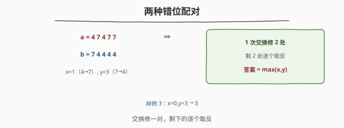
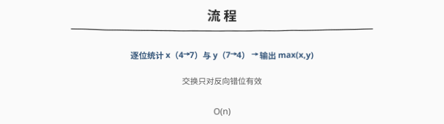

# Codeforces 145A Lucky Conversion 题解

## 1. 题目概述

- **题目链接**：https://codeforces.com/problemset/problem/145/A
- **比赛来源**：Codeforces Round 104 (Div. 1) · Problem A
- **难度**：1200
- **标签**：贪心、字符串
- **评测类型**：普通
- **限制**：时间 2 s / 内存 256 MB

**题意**：两个等长串 $a,b$（只含 `4`/`7`）。操作：①把 $a$ 中某个数字取反（4↔7）；②交换 $a$ 中任意两位。求把 $a$ 变成 $b$ 的最少操作数。

**约束**：

- $|a|=|b|\le10^5$。
- 交换可以一次修好一个"4→7"和一个"7→4" ✓。

## 2. 示例与观察

官方样例 1（输入 / 输出原样）：

```text
输入：
47
74

输出：
1
```

官方样例 2（输入 / 输出原样）：

```text
输入：
774
744

输出：
1
```

官方样例 3（输入 / 输出原样）：

```text
输入：
777
444

输出：
3
```

**样例 1 走查**：$a$ 需要 4→7 一处、7→4 一处 → 交换这两个位置，1 次 ✓。

**样例 3 走查**：三处都要 7→4，没有可配对的 4→7 → 逐个取反，3 次 ✓。

**观察**：设 $x$ = "$a$ 是 4、$b$ 是 7"的位置数，$y$ = "轮到 7→4"的位置数 ✓；每次交换消耗一对 $(x,y)$（1 次操作修 2 处），剩余 $|x-y|$ 处只能逐个取反 → 答案 $\max(x,y)$ ✓。



## 3. 解题思路

逐位统计 $x,y$，输出 $\max(x,y)$ ✓。



### 3.4 样例走查

见 2 节 ✓。自造样例（标注"自造"）：`4`/`4` → 0；`4`/`7` → 1；`47`/`71`? 只含 4/7，故 `47`/`74` → 1。

## 4. 正确性证明

**引理 1**：下界 $\ge\max(x,y)$。每个操作最多修正一处"4→7"（交换可同时修一处 4→7 和一处 7→4）✓。

**引理 2**：$\max(x,y)$ 可达：先用 $\min(x,y)$ 次交换配掉，再把剩下的逐个取反 ✓。

**定理**：答案 $=\max(x,y)$。

**证明**：引理 1、2 ✓。∎

## 5. 复杂度分析

- **时间**：$O(n)$。
- **空间**：$O(1)$。
- **与时限的关系**：实测约 $3$ ms。

## 6. 参考代码

### C++17

```cpp
#include <bits/stdc++.h>
using namespace std;
int main() {
    string a, b;
    if (!(cin >> a >> b)) return 0;
    int x = 0, y = 0;   // x: a=4,b=7；y: a=7,b=4
    for (size_t i = 0; i < a.size(); ++i) {
        if (a[i] == b[i]) continue;
        if (a[i] == '4') ++x; else ++y;
    }
    cout << max(x, y) << '\n';
    return 0;
}
```

### Python3

```python
import sys


def main() -> None:
    data = sys.stdin.buffer.read().split()
    a, b = data[0].decode(), data[1].decode()
    x = sum(1 for i in range(len(a)) if a[i] != b[i] and a[i] == '4')
    y = sum(1 for i in range(len(a)) if a[i] != b[i] and a[i] == '7')
    print(max(x, y))


main()
```

两份代码都只用标准库，可原样提交。

## 7. 边界情况与易错点

1. **交换只能修"一对反向错位"** ✓。
2. **不匹配处数不是答案**：要区分方向。
3. **全同**：0。
4. **只含 4/7** ✓。
5. **多测**：单组输入。

## 8. 验证记录

- **编译环境与命令**：本机无 GNU `g++`，用 `Apple clang 21.0.0` + 仓库自带 `codeforces/tools/include/bits/stdc++.h` 兼容头（`clang++ -std=c++17 -O2 -I codeforces/tools/include`）编译；Python 为 `Python 3.9.6`。
- **官方样例**：3 / 3 通过。
- **额外测试**：220 组随机 4/7 串与独立统计实现比对，C++/Python 共 **440 次运行全部一致**。
- **图片校验**：两张 SVG（`cf145a_pairs.svg`、`cf145a_flow.svg`）通过 `xml.etree.ElementTree.parse`。
- **公式校验**：KaTeX 渲染无报错。
- **复核状态**：verified。

## 相关题目与扩展

- [Codeforces 144C Anagram Search](https://codeforces.com/problemset/problem/144/C)：同批次。
- [Codeforces 145B Lucky Number 2](https://codeforces.com/problemset/problem/145/B)：同场 B 题。
- [LeetCode 1247. 交换字符使得字符串相同](https://leetcode.cn/problems/minimum-swaps-to-make-strings-equal/)：同型配对。
- [LeetCode 1151. 最少交换次数来组合所有的 1](https://leetcode.cn/problems/minimum-swaps-to-group-all-1s-together/)：交换计数。

**延伸思考**：

1. **如果字母表只有 4/7 但长度不等**：题面保证等长。
2. **如果交换有代价**：变成加权匹配。
3. **如果允许多字符**：按错位类型配。
4. **如果要求输出操作序列**：记录配对位置。
