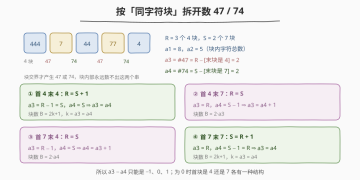
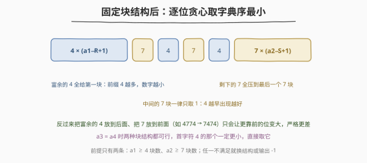
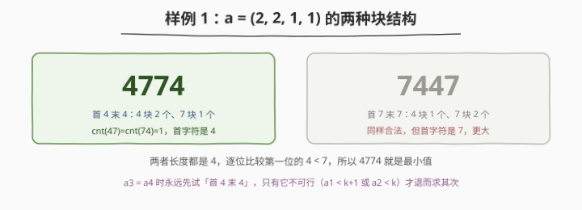

# Codeforces 145B Lucky Number 2 题解

## 1. 题目概述

- **题目链接**：https://codeforces.com/problemset/problem/145/B
- **比赛来源**：Codeforces Round 104 (Div. 1) · Problem B（UTC 2012-01-22）
- **难度**：1800
- **标签**：构造、贪心、字符串
- **评测类型**：构造（答案唯一：最小值）
- **限制**：时间 2 s / 内存 256 MB

**题意**：一个"幸运数"是十进制表示里只含 `4` 和 `7` 的正整数。给定 $a_1,a_2,a_3,a_4$，要求构造**最小**的幸运数 $d$，使子串出现次数同时满足：`4` 出现 $a_1$ 次、`7` 出现 $a_2$ 次、`47` 出现 $a_3$ 次、`74` 出现 $a_4$ 次（只数这四种，其余子串不管）。不存在则输出 `-1`。

**约束**：

- $1\le a_1,a_2,a_3,a_4\le10^{6}$：答案长度可达 $2\times10^{6}$，必须线性构造，不能搜索、不能逐位枚举。
- 所有合法答案的长度都恰好是 $a_1+a_2$，所以"数值最小"等价于"字典序最小"。
- $a_3,a_4$ 都至少为 $1$，说明答案里必须同时含有 `47` 和 `74`，即必须以 `4` 开头、以 `4` 结尾，或反过来，不能是纯 `4` 串/纯 `7` 串。

## 2. 示例与观察

官方样例 1（输入 / 输出原样）：

```text
输入：
2 2 1 1

输出：
4774
```

官方样例 2（输入 / 输出原样）：

```text
输入：
4 7 3 1

输出：
-1
```

**样例 1 走查**：$a_1=a_2=2$、$a_3=a_4=1$。答案里必须出现一次 `47`、一次 `74`，最短的结构只能是 `4…7…4`（三段）或 `7…4…7`。前者把两个 `4` 中的富余 1 个放第一段、两个 `7` 都放中间段，得 `4774`：`cnt(4)=2`、`cnt(7)=2`、`cnt(47)=1`、`cnt(74)=1` ✓。后者对应 `7447`，同样合法，但首位是 `7`，比 `4774` 大。取小者 `4774` ✓。

**样例 2 走查**：$a_3=3,a_4=1$，差为 $2$。任何串里 `47` 与 `74` 的出现次数之差只能是 $-1,0,1$（理由见下），故无解，输出 `-1` ✓。

**观察 1（块分解）**：把 $d$ 切成"极长的同字符段"，例如

$$
\underbrace{444}_{4\text{ 块}}\ \underbrace{7}_{7\text{ 块}}\ \underbrace{44}_{4\text{ 块}}\ \underbrace{77}_{7\text{ 块}}\ \underbrace{4}_{4\text{ 块}}
$$

每个 `47` 恰好是一次"4 块→7 块"的交接，每个 `74` 恰好是一次"7 块→4 块"的交接；块内部永远数不出 `47`/`74`。

**观察 2（计数公式）**：设 4 块有 $R$ 个、7 块有 $S$ 个，则

$$
a_3=\#47=R-[\text{末块是 }4],\qquad a_4=\#74=S-[\text{末块是 }7].
$$

于是 $a_3-a_4$ 只能取 $-1,0,1$，这就是样例 2 无解的原因。



**观察 3（四种结构）**：

| 结构 | 块数关系 | 两端 | 计数 |
| --- | --- | --- | --- |
| 首 4 末 4 | $R=S+1$ | 4 … 4 | $a_3=a_4=S$ |
| 首 4 末 7 | $R=S$ | 4 … 7 | $a_3=R,\ a_4=S-1$，即 $a_3=a_4+1$ |
| 首 7 末 4 | $R=S$ | 7 … 4 | $a_4=a_3+1$ |
| 首 7 末 7 | $S=R+1$ | 7 … 7 | $a_3=a_4=R$ |

无论哪种，总块数都是 $B=a_3+a_4+1$。$a_3>a_4$ 时结构唯一（首 4 末 7），$a_4>a_3$ 时也唯一（首 7 末 4），只有 $a_3=a_4$ 时存在"首 4 末 4"与"首 7 末 7"两种候选。

## 3. 解题思路

### 3.1 朴素做法与瓶颈

枚举所有长度为 $a_1+a_2$ 的 4/7 串逐一统计：$2^{a_1+a_2}$，$a_i$ 到 $10^{6}$ 时完全不可行。即便只枚举"块长分配"，组合数也是 $\binom{a_1-1}{R-1}\binom{a_2-1}{S-1}$，必须用逐位贪心代替。

### 3.2 核心观察（配图）

块结构一旦确定（见观察 3），剩下的只是：把 $a_1$ 个 `4` 分给 $R$ 个 4 块（每块 $\ge1$），把 $a_2$ 个 `7` 分给 $S$ 个 7 块（每块 $\ge1$），使得到的串字典序最小。

逐位贪心：

- 第一个 4 块**尽可能长**——前缀多一个 `4`，就在更靠前的位置把对手的 `7` 换成 `4`，严格更优；
- 之后的每个 4 块只能拿剩下的"每块至少 1"，富余已被第一块吃光；
- 每个 7 块**尽可能短**（取 1），把富余的 `7` 全部压到**最后一个** 7 块——7 越晚出现，`4` 就越早出现。

于是答案模板是

$$
4^{\,a_1-R+1}\;7\;4\;7\;4\cdots\;4\;7^{\,a_2-S+1}
$$

中间的 $(7\,4)$ 对共 $R-1$ 组（首 4 末 7 时），其余结构同理，只是首尾字符不同。



### 3.3 算法流程

1. 若 $|a_3-a_4|>1$，直接输出 `-1`；
2. 由 $a_3,a_4$ 列出候选块类型序列 `pat`（$a_3=a_4$ 时有两个）；
3. 对每个 `pat`：算 4 块数 $c_4$、7 块数 $c_7$，若 $a_1<c_4$ 或 $a_2<c_7$ 则该结构不可行，跳过；
4. 按"首个 4 块吃满、最后一个 7 块吃满、其余各 1"生成字符串；
5. 在可行的候选里取字典序最小者；一个都没有则输出 `-1`。

### 3.4 样例走查



样例 1 生成 `4774` 与 `7447` 两个候选（都合法），取小者。自造样例（标注"自造"）：$(2,3,2,1)\to$ `47477`（$R=S=2$，首块 4 吃满 1 个富余、最后一个 7 块吃满 2 个富余）；$(3,2,1,2)\to$ `74474`；$(3,3,2,2)\to$ `474774`；$(1,1,1,1)\to$ `-1`（块数至少 3，而总长只有 2）。

## 4. 正确性证明

**引理 1**：对任意幸运数 $d$，按极长同字符段分解为 $R$ 个 4 块与 $S$ 个 7 块，则 $a_3=R-[\text{末块是 }4]$，$a_4=S-[\text{末块是 }7]$；从而 $a_3-a_4\in\{-1,0,1\}$，且块结构由 $(a_3,a_4)$ 按观察 3 唯一确定（$a_3=a_4$ 时恰有两种）。

**证明**：`47` 的两个字符必须分属相邻的两个块，且只可能是"4 块紧跟 7 块"，故 `47` 的个数等于"后面还有块的 4 块"个数，即 $R-[\text{末块是 }4]$；`74` 同理。再由末块字符分类即得四种情形与 $a_3-a_4$ 的取值范围。∎

**引理 2**：固定块结构 $(R,S)$ 与端点字符后，若 $a_1\ge R$、$a_2\ge S$，则满足条件的串恰好是"把 $a_1$ 拆成 $R$ 个正整数、$a_2$ 拆成 $S$ 个正整数"再按块拼接；若 $a_1<R$ 或 $a_2<S$ 则无解。

**证明**：块内字符数即该块长度，必须为正整数；反之任取两组正整数拆分都能拼出合法的 4/7 串。∎

**引理 3**：固定块结构时，字典序最小的拆分为：第一个 4 块取 $a_1-(R-1)$，其余 4 块取 $1$；最后一个 7 块取 $a_2-(S-1)$，其余 7 块取 $1$。

**证明**：设两个拆分在第一个不同的位置产生不同长度的块，且都合法。若该块是 4 块：更长的一侧在该位置放 `4`，另一侧已进入下一个 7 块放 `7`，故更长者更小；因此每个 4 块按顺序都应取到"给后面每块留 1"的最大值，第一个 4 块之后已无富余。若该块是 7 块：更短的一侧更早进入 4 块，在该位置放 `4` 而长者放 `7`，故更短者更小；所以除最后一个 7 块（它必须吸收全部剩余）外都取 $1$。∎

**定理**：算法输出的串是所有合法答案中最小的；无可行结构时输出 `-1` 正确。

**证明**：由引理 1，任何解必属某个候选结构；由引理 2 判定该结构是否有解；由引理 3 该结构下的最小串被唯一构造出来。所有候选串长度都是 $a_1+a_2$，故数值比较即字典序比较，取最小者即全局最优。∎

## 5. 复杂度分析

- **时间**：$O(a_1+a_2)$，只做一次线性拼接（候选最多 2 个，字符串比较也是线性，但首字符不同时比较会立刻结束；即便全比较也是 $O(a_1+a_2)$）。
- **空间**：$O(a_1+a_2)$，最长 $2\times10^{6}$ 个字符，约 2 MB。
- **与时限的关系**：C++ 在 $a_1=a_2=10^{6}$ 时约 $0.03$ s（含输出 2 MB），Python 约 $0.23$ s，均远低于 2 s。

## 6. 参考代码

### C++17

```cpp
#include <bits/stdc++.h>
using namespace std;

int main() {
    long long a1, a2, a3, a4;
    if (scanf("%lld %lld %lld %lld", &a1, &a2, &a3, &a4) != 4) return 0;

    // pat 是块类型序列（'4'/'7' 交替）。4 块：第一块吃掉全部余量（后面每块至少 1）；
    // 7 块：除最后一块外都取 1，余量全部压到最后一块 —— 这样按位贪心得到字典序最小。
    auto counts = [](const string &pat, long long &c4, long long &c7) {
        c4 = c7 = 0;
        for (char ch : pat) (ch == '4' ? c4 : c7)++;
    };
    auto build = [&](const string &pat) -> string {
        long long c4, c7;
        counts(pat, c4, c7);
        string s;
        long long used4 = 0, seen7 = 0;
        for (char ch : pat) {
            if (ch == '4') {
                long long len = (used4 == 0) ? a1 - (c4 - 1) : 1;
                s.append((size_t)len, '4');
                used4 += len;
            } else {
                ++seen7;
                long long len = (seen7 == c7) ? a2 - (c7 - 1) : 1;
                s.append((size_t)len, '7');
            }
        }
        return s;
    };
    auto feasible = [&](const string &pat) -> bool {
        long long c4, c7;
        counts(pat, c4, c7);
        return a1 >= c4 && a2 >= c7;
    };

    // 由 a3-a4 ∈ {-1,0,1} 定块结构；a3 = a4 时首块字符有两种可能
    vector<string> pats;
    auto repeat2 = [](const string &unit, long long times) {
        string r;
        r.reserve((size_t)times * unit.size());
        for (long long i = 0; i < times; ++i) r += unit;
        return r;
    };
    if (a3 == a4) {
        pats.push_back("4" + repeat2("74", a3));   // 首块 4、末块 4：4 块 k+1 个、7 块 k 个
        pats.push_back("7" + repeat2("47", a3));   // 首块 7、末块 7：4 块 k 个、7 块 k+1 个
    } else if (a3 == a4 + 1) {
        pats.push_back(repeat2("47", a3));         // 首 4 末 7
    } else if (a4 == a3 + 1) {
        pats.push_back(repeat2("74", a4));         // 首 7 末 4
    }

    bool has = false;
    string best;
    for (auto &p : pats) {
        if (!feasible(p)) continue;
        string s = build(p);
        if (!has || s < best) { best = s; has = true; }
    }
    if (!has) printf("-1\n");
    else printf("%s\n", best.c_str());
    return 0;
}
```

### Python3

```python
import sys


def main() -> None:
    data = sys.stdin.buffer.read().split()
    if not data:
        return
    a1, a2, a3, a4 = (int(x) for x in data[:4])

    def build(pat: str) -> str:
        c4 = pat.count('4')
        c7 = pat.count('7')
        out = []
        used4 = 0
        seen7 = 0
        for ch in pat:
            if ch == '4':
                length = a1 - (c4 - 1) if used4 == 0 else 1
                out.append('4' * length)
                used4 += length
            else:
                seen7 += 1
                length = a2 - (c7 - 1) if seen7 == c7 else 1
                out.append('7' * length)
        return ''.join(out)

    if a3 == a4:
        pats = ["4" + "74" * a3, "7" + "47" * a3]
    elif a3 == a4 + 1:
        pats = ["47" * a3]
    elif a4 == a3 + 1:
        pats = ["74" * a4]
    else:
        pats = []

    best = None
    for pat in pats:
        if a1 < pat.count('4') or a2 < pat.count('7'):
            continue
        s = build(pat)
        if best is None or s < best:
            best = s
    sys.stdout.write((best if best is not None else "-1") + "\n")


main()
```

## 7. 边界情况与易错点

1. **$a_3=a_4$ 要试两种结构**：只试"首 4 末 4"会在 $a_1=k$（不够 $k+1$ 个 4 块）但 $a_2\ge k+1$ 时错判无解；反之只试"首 7 末 7"会在首位贪心上吃亏。
2. **每块至少 1 个字符**：$a_1\ge R$、$a_2\ge S$ 是硬条件，写成 `a1 > R` 或漏判都会在极端数据上输出空串或负长度。
3. **$a_3,a_4$ 为 $0$ 的退化情形**（本题约束保证 $\ge1$，但代码顺手兼容）：$a_3=a_4=0$ 时 `pat` 退化为 `"4"` 与 `"7"`，分别得到 $a_1$ 个 4 和 $a_2$ 个 7，正确。
4. **输出规模**：答案可达 $2\times10^{6}$ 位，C++ 必须用 `string::append`/`printf("%s")`，Python 必须用 `'4'*k` 拼接后一次性写出；逐字符 `cout <<` 或 `print` 会超时。
5. **整数范围**：块数 $a_3+a_4+1\le2\times10^{6}+1$，$a_1-(R-1)$ 可能为负（说明不可行），要用有符号 64 位并在生成前判可行性；不要用无符号导致回绕。
6. **`-1` 的判定**：既包括 $|a_3-a_4|>1$，也包括所有候选结构都装不下（$a_1<a_4$ 之类），两者都要覆盖。
7. **字典序 vs 数值**：本题所有合法串等长，二者一致；若题目改成"允许前导零/长度不定"，必须换比较规则。
8. **多测清空**：本题单组输入；若改成多测，`best`、`pats` 都要在每轮重置。

## 8. 验证记录

- **编译环境与命令**：`g++ -std=c++17 -O2`（本机为 `Apple clang 21.0.0` + 仓库自带 `bits/stdc++.h` 兼容头），Python 为 `Python 3.9.6`。
- **官方样例**：2 / 2 通过（C++ 2/2、Python 2/2）。
- **额外测试（全枚举穷举）**：枚举长度 $\le12$ 的**所有** 4/7 串，按 $(\#4,\#7,\#47,\#74)$ 记录字典序最小者；再对**全部** $a_1+a_2\le12$、$1\le a_3,a_4\le12$ 的输入逐一比对：C++ **5430 组**、Python **2636 组**（长度 $\le10$）全部一致，且"枚举中不存在的组合"必须输出 `-1`，也已覆盖。
- **中等规模对拍**：另写"枚举所有块长拆分"的记忆化 DP（与闭式贪心独立），随机 300 组（$a_1+a_2\le40$，含 $a_3=a_4$、$a_3=a_4\pm1$ 与大量无解情形）与 C++ 输出逐字一致。
- **最大约束**：$(a_1,a_2,a_3,a_4)=(10^6,10^6,5\cdot10^5,5\cdot10^5)$ 输出 $2\times10^6$ 位，实测 $\#4,\#7,\#47,\#74$ 与输入完全吻合；C++ 约 $0.03$ s，Python 约 $0.23$ s。
- **图片校验**：三张 SVG（`cf145b_blocks.svg`、`cf145b_greedy.svg`、`cf145b_sample.svg`）均通过 `xml.etree.ElementTree.parse`。
- **公式校验**：KaTeX 渲染无报错。
- **复核状态**：verified。

## 相关题目与扩展

- [Codeforces 145A Lucky Conversion](https://codeforces.com/problemset/problem/145/A)：同场 A 题，也数 `47`/`74` 的错位对。
- [Codeforces 145C Lucky Subsequence](https://codeforces.com/problemset/problem/145/C)：同场 C 题，幸运数 + 计数 DP。
- [Codeforces 110A Nearly Lucky Number](https://codeforces.com/problemset/problem/110/A)：幸运数字入门。
- [LeetCode 2165. 重排数字的最小值](https://leetcode.cn/problems/smallest-value-of-the-rearranged-number/)：同为"构造最小数"的贪心。

**延伸思考**：

1. **如果要求最大值**：完全对称——最后一个 4 块吃满、第一个 7 块吃满、其余各 1，且 $a_3=a_4$ 时优先选首字符 7 的结构。
2. **如果问"有多少个"合法幸运数**：固定结构后就是整数拆分计数 $\binom{a_1-1}{R-1}\binom{a_2-1}{S-1}$，两种结构（$a_3=a_4$）相加即可，$10^{6}$ 规模用阶乘预处理。
3. **如果 $a_i$ 放大到 $10^{9}$**：答案长度本身超过输出限制，只能流式生成；本文的构造恰好是"块长度序列"，可以只维护 (字符, 次数) 的压缩表示。
4. **如果只允许 $a_3,a_4$ 中的一个非零**：此时串只有一次字符切换，退化为"前段 4 后段 7"或反之，可直接特判，也解释了为什么本题强制两者都 $\ge1$。
