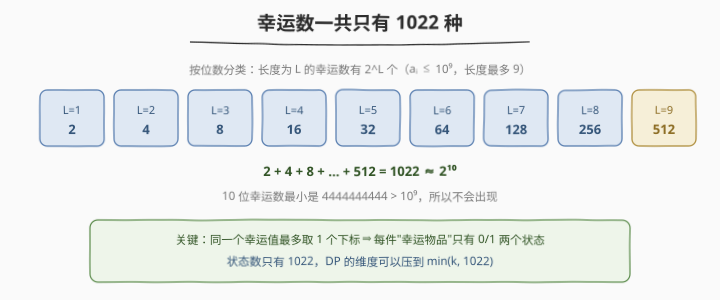
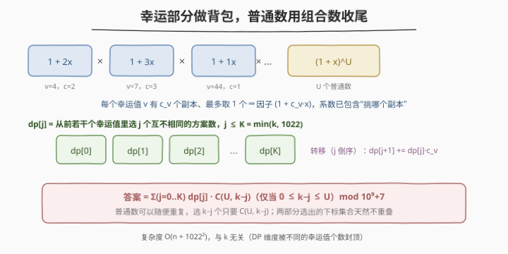
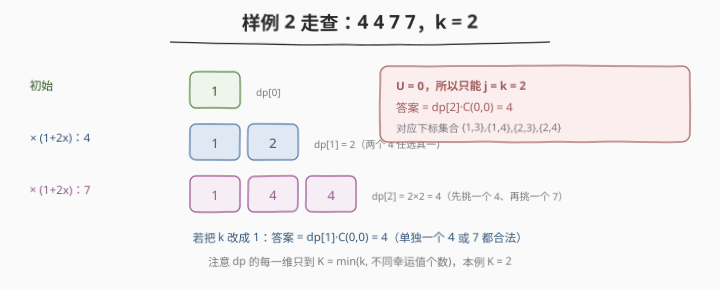

# Codeforces 145C Lucky Subsequence 题解

## 1. 题目概述

- **题目链接**：https://codeforces.com/problemset/problem/145/C
- **比赛来源**：Codeforces Round 104 (Div. 1) · Problem C（UTC 2012-01-22）
- **难度**：2100
- **标签**：计数、背包 DP、组合数学
- **评测类型**：普通
- **限制**：时间 2 s / 内存 256 MB

**题意**：给定长度为 $n$ 的序列 $a$，求长度为 $k$ 的**子序列**（按下标集合区分，值相同但下标不同算不同方案）的个数，要求子序列里**不能出现两个相等的幸运数**；非幸运数可以随便重复。幸运数指十进制表示只含 `4`/`7` 的正整数。答案对 $10^{9}+7$ 取模。

**约束**：

- $n\le10^{5}$：不能枚举子序列，需要 $O(n\log n)$ 或 $O(n+\text{常数})$ 的做法。
- $a_i\le10^{9}$：**不同的幸运数最多 1022 个**（长度 1..9 各 $2^L$ 个），这是整个解法的支点。
- $1\le k\le n$：合法子序列长度固定，答案只与"幸运数取几个"有关。
- 模数是质数 $10^{9}+7$：可以用阶乘 + 逆元算组合数。

## 2. 示例与观察

官方样例 1（输入 / 输出原样）：

```text
输入：
3 2
10 10 10

输出：
3
```

官方样例 2（输入 / 输出原样）：

```text
输入：
4 2
4 4 7 7

输出：
4
```

**样例 1 走查**：三个数都不是幸运数（含 `0`、`1`），限制形同虚设，任取 2 个下标即可：$\binom32=3$ ✓。

**样例 2 走查**：$4,7$ 都是幸运数，每个各出现 2 次。长度 2 的子序列若含两个相同的幸运数（两个 4 或两个 7）就不合法，所以必须"一个 4 + 一个 7"：$2\times2=4$ 种，下标集合为 $\{1,3\},\{1,4\},\{2,3\},\{2,4\}$ ✓，与题面 hint 完全一致。

**观察 1（幸运数种类很少）**：长度 $L$ 的幸运数有 $2^L$ 个，$a_i\le10^{9}$ 时 $L\le9$（$4444444444>10^{9}$），所以不同幸运数至多

$$
2+4+8+\dots+512=1022 .
$$

**观察 2（同一幸运值等价于一件 0/1 物品）**：设幸运值 $v$ 在原序列中出现 $c_v$ 次。由于最多选 1 个，选法有 $1+c_v$ 种（不选，或选 $c_v$ 个下标中的任意一个）。于是幸运部分的生成函数是

$$
\prod_{v}\bigl(1+c_v x\bigr).
$$

**观察 3（普通数随便选）**：设普通数共 $U$ 个，从中选 $m$ 个有 $\binom{U}{m}$ 种，生成函数 $(1+x)^U$。

**观察 4（合并）**：答案就是 $\bigl[x^k\bigr]\ (1+x)^U\prod_v(1+c_vx)$。由于幸运因子只有 $L\le1022$ 个，只需 DP 出"选 $j$ 个不同幸运值"的方案数 $dp[j]$，再枚举 $j$ 与普通数拼接：

$$
\text{ans}=\sum_{j=0}^{\min(k,L)} dp[j]\cdot\binom{U}{k-j}.
$$



## 3. 解题思路

### 3.1 朴素做法与瓶颈

- 枚举所有子序列：$2^{n}$，不可行。
- 枚举"选哪些幸运值"：$2^{1022}$，同样不可行——必须用 DP 把"选 $j$ 个"的方案数压成一个一维数组。
- 按值做多重背包时若把 $c_v$ 个副本当成 $c_v$ 件物品，会让"同一个值选两次"，正是题目禁止的，必须写成"每件物品体积 1、价值 $c_v$、只能选一次"。

### 3.2 核心观察（配图）



DP 的定义与转移：

- $dp[j]$：处理完当前这些幸运值后，选出 $j$ 个**互不相同**幸运值的方案数；
- 加入值为 $v$、出现 $c_v$ 次的新物品：$dp[j+1]\mathrel{+}=dp[j]\cdot c_v$（选这个值就乘上"选哪个副本"）；
- 因为每件物品只能用一次，$j$ 必须**倒序**枚举。

维度只需到 $K=\min(k,L)\le1022$，所以 DP 复杂度 $O(L\cdot K)=O(1022^2)\approx10^{6}$，与 $k$ 无关。

### 3.3 算法流程

1. 读入序列，把每个数判成"幸运/普通"：幸运值用哈希表累计出现次数 $c_v$，普通数计数 $U$；
2. 预处理阶乘与逆阶乘到 $n$，得到 $\binom{U}{m}$ 的 $O(1)$ 查询；
3. 对每个 $(v,c_v)$ 做倒序 0/1 背包，得到 $dp[0..K]$；
4. 枚举 $j=0..K$，若 $0\le k-j\le U$ 就累加 $dp[j]\cdot\binom{U}{k-j}$，输出模 $10^{9}+7$ 的结果。

### 3.4 样例走查



样例 2：$c_4=2,\ c_7=2,\ U=0$。初始 $dp=[1]$；加入 $v=4$ 得 $dp=[1,2]$；加入 $v=7$ 得 $dp=[1,4,4]$。因为 $U=0$，只有 $j=k=2$ 一项有效，答案 $dp[2]=4$ ✓。

自造样例（标注"自造"）：`5 2 / 4 4 4 7 9` → $c_4=3,c_7=1,U=1$，$dp=[1,4,3]$，答案 $=dp[1]\binom12+dp[2]\binom10=4\cdot1+3=7$（验证：选一个幸运数 + 一个 9 有 4 种；选 4 和 7 有 $3\times1=3$ 种）。

## 4. 正确性证明

**引理 1**：$a_i\le10^{9}$ 时不同幸运数不超过 $1022$ 个。

**证明**：长度 $L$ 的幸运数共 $2^L$ 个（每位 4 或 7）；$10$ 位幸运数最小为 $4444444444>10^{9}$，故 $L\le9$，总数为 $\sum_{L=1}^{9}2^L=2^{10}-2=1022$。∎

**引理 2**：设当前处理过的幸运值集合为 $S$，则 $dp[j]=\sum_{T\subseteq S,\ |T|=j}\prod_{v\in T}c_v$，即"从这些值里选 $j$ 个互不相同的值，并各选一个下标"的方案数。

**证明**：对 $|S|$ 归纳。$S=\varnothing$ 时 $dp[0]=1$ 符合。加入 $v$ 时，不含 $v$ 的方案沿用旧 $dp[j]$；含 $v$ 的方案是"从旧的 $j-1$ 个值里选，再在 $c_v$ 个副本里选一个"，恰为 $dp[j-1]\cdot c_v$，倒序转移正是这个式子。∎

**引理 3**：普通数选 $m$ 个下标有 $\binom{U}{m}$ 种，且与幸运部分的选择互相独立（下标集合不重叠、约束互不影响）。

**证明**：普通数之间没有"值不同"的限制，任取 $m$ 个下标即可；两部分的下标来自不相交的下标集合，方案数相乘。∎

**定理**：算法输出的 $\sum_j dp[j]\binom{U}{k-j}$ 恰为合法子序列数。

**证明**：任一合法子序列由"选中的幸运下标集合 + 普通下标集合"唯一确定；其中幸运部分必须每个幸运值至多一个下标（否则有两个相等幸运数），其方案数按引理 2 为 $dp[j]$；普通部分按引理 3 为 $\binom{U}{k-j}$；长度约束 $j+(k-j)=k$ 保证不漏不多。∎

## 5. 复杂度分析

- **时间**：判幸运数与统计 $O(n\log_{10}a)$，阶乘 $O(n)$，背包 $O(L\cdot K)\le1022^2\approx10^{6}$，汇总 $O(K)$；总计 $O(n+1022^2)$，与 $k$ 无关。
- **空间**：阶乘/逆阶乘 $O(n)$（两个 `int` 数组约 0.8 MB）+ 哈希表 $O(L)$ + $dp$ 数组 $O(K)$。
- **与时限的关系**：$n=10^{5}$ 时 C++ 实测约 $0.02$ s，Python 约 $0.18$ s，远低于 2 s。

## 6. 参考代码

### C++17

```cpp
#include <bits/stdc++.h>
using namespace std;

static const long long MOD = 1000000007LL;

static bool isLucky(long long x) {
    while (x > 0) {
        long long d = x % 10;
        if (d != 4 && d != 7) return false;
        x /= 10;
    }
    return true;
}

int main() {
    int n, k;
    if (scanf("%d %d", &n, &k) != 2) return 0;
    unordered_map<long long, int> cnt;
    cnt.reserve(4096);
    int unlucky = 0;
    for (int i = 0; i < n; ++i) {
        long long x;
        scanf("%lld", &x);
        if (isLucky(x)) ++cnt[x];
        else ++unlucky;
    }

    vector<long long> fact(n + 1), invFact(n + 1);
    fact[0] = 1;
    for (int i = 1; i <= n; ++i) fact[i] = fact[i - 1] * i % MOD;
    auto power = [](long long b, long long e) {
        long long r = 1;
        b %= MOD;
        while (e > 0) {
            if (e & 1) r = r * b % MOD;
            b = b * b % MOD;
            e >>= 1;
        }
        return r;
    };
    invFact[n] = power(fact[n], MOD - 2);
    for (int i = n; i > 0; --i) invFact[i - 1] = invFact[i] * i % MOD;
    auto C = [&](int a, int b) -> long long {
        if (b < 0 || b > a) return 0;
        return fact[a] * invFact[b] % MOD * invFact[a - b] % MOD;
    };

    int L = (int)cnt.size();
    int K = min(k, L);
    vector<long long> dp(K + 1, 0);
    dp[0] = 1;
    int processed = 0;
    for (auto &kv : cnt) {
        int c = kv.second;
        int hi = min(processed, K - 1);
        for (int j = hi; j >= 0; --j)
            dp[j + 1] = (dp[j + 1] + dp[j] * c) % MOD;
        ++processed;
    }

    long long ans = 0;
    for (int j = 0; j <= K; ++j) {
        int need = k - j;
        if (need < 0 || need > unlucky) continue;
        ans = (ans + dp[j] * C(unlucky, need)) % MOD;
    }
    printf("%lld\n", ans);
    return 0;
}
```

### Python3

```python
import sys

MOD = 1000000007


def main() -> None:
    data = sys.stdin.buffer.read().split()
    if not data:
        return
    n = int(data[0]); k = int(data[1])
    cnt = {}
    unlucky = 0
    for i in range(n):
        x = int(data[2 + i])
        y = x
        ok = True
        while y > 0:
            d = y % 10
            if d != 4 and d != 7:
                ok = False
                break
            y //= 10
        if ok:
            cnt[x] = cnt.get(x, 0) + 1
        else:
            unlucky += 1

    fact = [1] * (n + 1)
    for i in range(1, n + 1):
        fact[i] = fact[i - 1] * i % MOD
    inv_fact = [1] * (n + 1)
    inv_fact[n] = pow(fact[n], MOD - 2, MOD)
    for i in range(n, 0, -1):
        inv_fact[i - 1] = inv_fact[i] * i % MOD

    def comb(a: int, b: int) -> int:
        if b < 0 or b > a:
            return 0
        return fact[a] * inv_fact[b] % MOD * inv_fact[a - b] % MOD

    L = len(cnt)
    K = min(k, L)
    dp = [0] * (K + 1)
    dp[0] = 1
    processed = 0
    for c in cnt.values():
        hi = min(processed, K - 1)
        for j in range(hi, -1, -1):
            if dp[j]:
                dp[j + 1] = (dp[j + 1] + dp[j] * c) % MOD
        processed += 1

    ans = 0
    for j in range(K + 1):
        need = k - j
        if 0 <= need <= unlucky:
            ans = (ans + dp[j] * comb(unlucky, need)) % MOD
    sys.stdout.write(str(ans) + "\n")


main()
```

## 7. 边界情况与易错点

1. **背包维度别开成 $k$**：$k$ 可达 $10^{5}$，而幸运值最多 1022 个，用 $K=\min(k,L)$ 才能把复杂度压到 $1022^2$；开成 $k$ 会退化到 $10^{8}$。
2. **必须倒序转移**：每个幸运值只有"选 0 个/选 1 个"两种状态，正序会把它当成完全背包（同一个值被选多次），正是题目禁止的。
3. **$k-j>U$ 或 $j>k$ 要跳过**：$\binom{U}{m}$ 在 $m>U$ 时会被判成 0，但必须先判断 $k-j\ge0$，否则下标越界。
4. **幸运数判定**：$10^{9}$ 本身不是幸运数（含 `1`/`0`）；$4444444444>10^{9}$ 不会出现，所以只需处理到 9 位；另外 $a_i\ge1$ 保证没有 $0$ 的歧义。
5. **取模与逆元**：$n<10^{9}+7$，阶乘全部非零，费马小定理求逆元合法；所有乘法前先转 `long long`。
6. **$dp$ 的溢出**：`dp[j]*c` 最大约 $10^{9}\times10^{5}=10^{14}$，必须用 64 位再取模。
7. **$U=0$ 或 $L=0$** 的退化情形：前者只有 $j=k$ 一项，后者 $K=0$、答案就是 $\binom{n}{k}$；代码两条路径都走得到。
8. **多测清空**：本题单组输入；若改多测，哈希表、阶乘数组、$dp$ 都要按新 $n$ 重建。

## 8. 验证记录

- **编译环境与命令**：`g++ -std=c++17 -O2`（本机为 `Apple clang 21.0.0` + 仓库自带 `bits/stdc++.h` 兼容头），Python 为 `Python 3.9.6`。
- **官方样例**：2 / 2 通过（C++ 2/2、Python 2/2）。
- **额外测试（暴力枚举子集）**：暴力直接枚举所有 $\binom{n}{k}$ 个下标组合并检查"幸运值是否重复"，与 DP 完全独立。随机数据 $n\le11$（含重复幸运值、混合普通数），共 **300 组**：C++ 300/300、Python 300/300 一致（合计 600 次比对 0 差异）。
- **中等规模独立实现**：另写"精确整数多项式乘法"版本（$\prod(1+c_vx)\cdot(1+x)^U$ 的系数，用 Python 大整数不做取模），随机 50 组 $n\in[20,200]$ 与 C++ 结果取模后完全一致。
- **最大约束性能**：$n=10^{5}$、序列覆盖全部 1022 个幸运值 + 5 万个普通数、$k=1022$ 时 C++ 约 $0.02$ s、Python 约 $0.18$ s。
- **图片校验**：三张 SVG（`cf145c_count.svg`、`cf145c_dp.svg`、`cf145c_sample.svg`）均通过 `xml.etree.ElementTree.parse`。
- **公式校验**：KaTeX 渲染无报错。
- **复核状态**：verified。

## 相关题目与扩展

- [Codeforces 145A Lucky Conversion](https://codeforces.com/problemset/problem/145/A)：同场 A 题。
- [Codeforces 145B Lucky Number 2](https://codeforces.com/problemset/problem/145/B)：同场 B 题，幸运数构造。
- [Codeforces 110A Nearly Lucky Number](https://codeforces.com/problemset/problem/110/A)：幸运数判定入门。
- [LeetCode 940. 不同的子序列 II](https://leetcode.cn/problems/distinct-subsequences-ii/)：按"值"去重的计数 DP。

**延伸思考**：

1. **如果限制改成"任意两个幸运数之差的绝对值不能为 1"**：背包维度要记录上一个选的幸运值，状态变成 $O(1022\cdot k)$，需要按值排序后做"带 last 的 DP"，复杂度升到 $10^{8}$ 量级，得再优化。
2. **如果有多类"不能重复"的元素**（例如再加一类质数也不许重复）：变成多维分组背包，维度是各类的选取个数，可用"生成函数 × 多项式卷积"处理。
3. **如果模数不是质数**：不能求逆元，$\binom{U}{m}$ 要么用 Pascal 递推（$O(n^2)$ 不可行），要么把模数分解质因数、用扩展卢卡斯定理。
4. **如果要求输出字典序最小的方案**：计数问题变成构造 + 计数，需要先算出后缀方案数再从前往后逐位判定，思路与"第 $k$ 小子序列"一致。
