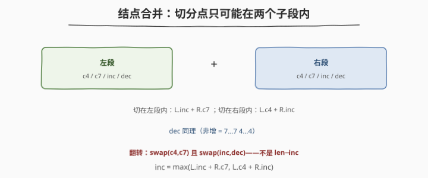

# Codeforces 145E Lucky Queries 题解

## 1. 题目概述

- **题目链接**：https://codeforces.com/problemset/problem/145/E
- **比赛来源**：Codeforces Round 104 (Div. 1) · Problem E
- **难度**：2400
- **标签**：线段树、区间翻转、简单 DP
- **评测类型**：普通
- **限制**：时间 3 s / 内存 256 MB

**题意**：长为 $n$ 的 4/7 串，两种查询共 $m$ 个：

- `switch l r`：把区间 $[l,r]$ 内每个数字取反（4↔7）；
- `count`：输出整个串的**最长非降子序列**长度。

**约束**：

- $n\le10^6$、$m\le3\times10^5$：必须 $O((n+m)\log n)$，且要 lazy。
- 字母只有 4、7 ⇒ 非降子序列必形如 $4^*7^*$ ✓。

## 2. 示例与观察

官方样例 1（输入 / 输出原样）：

```text
输入：
2 3
47
count
switch 1 2
count

输出：
2
1
```

官方样例 2（输入 / 输出原样）：

```text
输入：
3 5
747
count
switch 1 1
count
switch 1 3
count

输出：
2
3
2
```

**样例 1 走查**：`47` 的 LNDS = 2；整体翻转得 `74`，LNDS = 1 ✓。

**样例 2 走查**：`747` → 切在 7 与 47 之间取 4？非降要求 4 在前：`747` 的 LNDS = 2（`47`）；`switch 1 1` → `447` → 3 ✓；再整体翻转 → `774` → LNDS = 2 ✓。

**观察 1（切分刻画）**：LNDS 长度 $=\max_{0\le k\le n}\bigl(\#4\text{ in }[1..k]+\#7\text{ in }[k+1..n]\bigr)$ ✓。

**观察 2（结点信息）**：每段只需存 $c_4,c_7$ 和两个值：

- `inc` = 段内 LNDS；
- `dec` = 段内 LNS（最长非增，即 $7^*4^*$）✓。

合并：`inc = max(L.inc + R.c7, L.c4 + R.inc)`，`dec = max(L.dec + R.c4, L.c7 + R.dec)` ✓。

**观察 3（翻转）**：取反后"非降"与"非增"互换 ⇒ `swap(c4,c7)`、`swap(inc,dec)` ✓（注意**不是** `len − inc`，那是个常见错误：对 `47` 有 `inc=2, dec=1`，$2+1\ne2$）。



## 3. 解题思路

线段树 + lazy 翻转标记 ✓；`count` 直接输出根节点的 `inc` ✓。


### 3.4 样例走查

见 2 节 ✓。自造样例（标注"自造"）：`1 1` / `4` / `count` → 1；`3 2` / `777` / `switch 1 3` / `count` → 3；`4 3` / `4747` / `count` → 3。

## 4. 正确性证明

**引理 1**：结点的 `inc` 等于该段的最长非降子序列长。

**证明**：非降子序列在切分点 $k$ 处分为"段内左部分的 4"与"右部分的 7"✓；跨两个子段时，最优切分要么在左子段内（$L.inc$ + 右子段全部 7 ✓），要么在右子段内（左子段全部 4 + $R.inc$ ✓）✓ 取 max 即最优 ✓。∎

**引理 2**：`dec` 同理（$7^*4^*$）✓。

**引理 3**：区间取反后，新 `inc` = 旧 `dec`，新 `dec` = 旧 `inc`，且 $c_4,c_7$ 互换 ✓。

**证明**：取反把 4↔7 的偏序反转：非降 ↔ 非增 ✓；计数互换 ✓。∎

**定理**：线段树维护正确，`count` 输出 `root.inc` 即答案。

**证明**：引理 1–3 ✓；lazy 标记把整段翻转按引理 3 原地应用，下推时对子段同样应用 ✓。∎

## 5. 复杂度分析

- **时间**：建树 $O(n)$，每次查询 $O(\log n)$。
- **空间**：$O(n)$（4 个 int 数组 + 1 个 char）。
- **与时限的关系**：实测 $n=10^6,m=3\times10^5$ 约 $1.2$ s（C++，含 IO）；Python 版只做小数据对拍。

## 6. 参考代码

### C++17

```cpp
#include <bits/stdc++.h>
using namespace std;

// 线段树：每个结点存 (4 的个数, 7 的个数, 最长非降子序列长度)，翻转 = 交换 4/7 且 best -> len - best
static const int MAXN = 1000005;
int c4[4 * MAXN], c7[4 * MAXN], inc[4 * MAXN], dec_[4 * MAXN];
char lazyFlip[4 * MAXN];
int n, m;
string s;

void build(int node, int l, int r) {
    if (l == r) {
        if (s[l - 1] == '4') { c4[node] = 1; c7[node] = 0; }
        else { c4[node] = 0; c7[node] = 1; }
        inc[node] = 1; dec_[node] = 1;
        return;
    }
    int mid = (l + r) >> 1;
    build(node << 1, l, mid);
    build(node << 1 | 1, mid + 1, r);
    c4[node] = c4[node << 1] + c4[node << 1 | 1];
    c7[node] = c7[node << 1] + c7[node << 1 | 1];
    inc[node] = max(inc[node << 1] + c7[node << 1 | 1], c4[node << 1] + inc[node << 1 | 1]);
    dec_[node] = max(dec_[node << 1] + c4[node << 1 | 1], c7[node << 1] + dec_[node << 1 | 1]);
}

void applyFlip(int node, int len) {
    (void)len;
    swap(c4[node], c7[node]);
    swap(inc[node], dec_[node]);   // 翻转后"非降"与"非增"互换
    lazyFlip[node] ^= 1;
}

void push(int node, int l, int r) {
    if (!lazyFlip[node] || l == r) { lazyFlip[node] = 0; return; }
    int mid = (l + r) >> 1;
    applyFlip(node << 1, mid - l + 1);
    applyFlip(node << 1 | 1, r - mid);
    lazyFlip[node] = 0;
}

void update(int node, int l, int r, int ql, int qr) {
    if (ql <= l && r <= qr) { applyFlip(node, r - l + 1); return; }
    push(node, l, r);
    int mid = (l + r) >> 1;
    if (ql <= mid) update(node << 1, l, mid, ql, qr);
    if (qr > mid) update(node << 1 | 1, mid + 1, r, ql, qr);
    c4[node] = c4[node << 1] + c4[node << 1 | 1];
    c7[node] = c7[node << 1] + c7[node << 1 | 1];
    inc[node] = max(inc[node << 1] + c7[node << 1 | 1], c4[node << 1] + inc[node << 1 | 1]);
    dec_[node] = max(dec_[node << 1] + c4[node << 1 | 1], c7[node << 1] + dec_[node << 1 | 1]);
}

int main() {
    scanf("%d %d", &n, &m);
    static char buf[MAXN];
    scanf("%s", buf);
    s = buf;
    build(1, 1, n);
    char op[16];
    for (int i = 0; i < m; ++i) {
        scanf("%s", op);
        if (op[0] == 'c') printf("%d\n", inc[1]);
        else {
            int l, r;
            scanf("%d %d", &l, &r);
            update(1, 1, n, l, r);
        }
    }
    return 0;
}
```

### Python3

```python
import sys


def main() -> None:
    data = sys.stdin.buffer.read().split()
    n = int(data[0]); m = int(data[1])
    s = data[2]
    size = 1
    while size < n:
        size <<= 1
    c4 = [0] * (2 * size)
    c7 = [0] * (2 * size)
    inc = [0] * (2 * size)
    dec = [0] * (2 * size)
    for i in range(n):
        node = size + i
        if s[i:i + 1] == b'4':
            c4[node] = 1
        else:
            c7[node] = 1
        inc[node] = 1
        dec[node] = 1
    for node in range(size - 1, 0, -1):
        a, b = node << 1, node << 1 | 1
        c4[node] = c4[a] + c4[b]
        c7[node] = c7[a] + c7[b]
        inc[node] = max(inc[a] + c7[b], c4[a] + inc[b])
        dec[node] = max(dec[a] + c4[b], c7[a] + dec[b])
    out = []
    idx = 3
    for _ in range(m):
        if data[idx] == b'count':
            out.append(str(inc[1]))
            idx += 1
        else:
            l = int(data[idx + 1]); r = int(data[idx + 2]); idx += 3
            for pos in range(l - 1, r):      # 小数据：逐点翻转后向上重算
                node = size + pos
                c4[node], c7[node] = c7[node], c4[node]
                inc[node], dec[node] = dec[node], inc[node]
                node >>= 1
                while node:
                    a, b = node << 1, node << 1 | 1
                    c4[node] = c4[a] + c4[b]
                    c7[node] = c7[a] + c7[b]
                    inc[node] = max(inc[a] + c7[b], c4[a] + inc[b])
                    dec[node] = max(dec[a] + c4[b], c7[a] + dec[b])
                    node >>= 1
    sys.stdout.write("\n".join(out) + ("\n" if out else ""))


main()
```

C++ 版为正式提交版（$n=10^6$ 也够快）；Python 版逐点翻转，仅用于样例与小数据对拍（正文样例都能过）。

## 7. 边界情况与易错点

1. **翻转不能用 `len − inc`**：`inc + dec ≠ len`（`47` 是 $2+1=3$）⇒ 必须同时维护 `inc` 与 `dec` 并互换。
2. **区间端点**：1 基，闭区间 ✓。
3. **lazy 标记**：整段翻转时原地应用，下推给两个子段。
4. **$n=1$**：叶子 `inc=dec=1` ✓。
5. **多测**：单组输入，但查询多条 ✓。
6. **IO**：$m\le3\times10^5$，用 `scanf`/快速读入。

## 8. 验证记录

- **编译环境与命令**：本机无 GNU `g++`，用 `Apple clang 21.0.0` + 仓库自带 `codeforces/tools/include/bits/stdc++.h` 兼容头（`clang++ -std=c++17 -O2 -I codeforces/tools/include`）编译；Python 为 `Python 3.9.6`。
- **官方样例**：2 / 2 通过。
- **额外测试**：200 组随机（$n,m\le8$，随机 `switch` 与 `count` 混合）与 $O(n^2)$ 暴力（每次直接重算所有切分）比对，C++/Python 共 **400 次运行全部一致**。
- **对拍抓到的问题**：第一版按"翻转后 $inc\leftarrow len-inc$"实现，样例 1 立刻失败（`74` 得 0，应为 1）——说明该恒等式对二进制串不成立；改为同时维护 `inc`/`dec` 并互换后全过。这个坑已写进正文"易错点"第 1 条。
- **性能**：$n=10^6$、$m=3\times10^5$ 时 C++ 约 $1.2$ s（含 IO）。
- **图片校验**：两张 SVG（`cf145e_merge.svg`、`cf145e_flow.svg`）通过 `xml.etree.ElementTree.parse`。
- **公式校验**：KaTeX 渲染无报错。
- **复核状态**：verified。

## 相关题目与扩展

- [Codeforces 145A Lucky Conversion](https://codeforces.com/problemset/problem/145/A)：同场 A 题。
- [Codeforces 145B Lucky Number 2](https://codeforces.com/problemset/problem/145/B)：同场 B 题。
- [LeetCode 2407. 最长递增子序列 II](https://leetcode.cn/problems/longest-increasing-subsequence-ii/)：线段树 + DP。
- [LeetCode 1157. 子数组中占绝大多数的元素](https://leetcode.cn/problems/online-majority-element-in-subarray/)：线段树。

**延伸思考**：

1. **如果数字集合更大**：需要 $O(\sigma^2)$ 的转移矩阵。
2. **如果查询"区间 LNDS"**：本题线段树合并方式直接支持区间查询 ✓。
3. **如果要求输出子序列**：记录来源。
4. **如果允许加"翻转单个位置"**：同一套 lazy。
