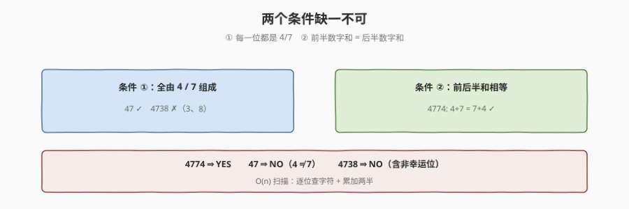

# Codeforces 146A 幸运票根判定 题解

## 1. 题目概述

- **题目链接**：https://codeforces.com/problemset/problem/146/A
- **比赛来源**：Codeforces Round 104 (Div. 2) · Problem A（UTC 2012-01-22）
- **难度**：800
- **标签**：实现
- **评测类型**：普通
- **限制**：时间 2 s / 内存 256 MB

**题意**：幸运数字是只由 `4` 和 `7` 组成的正整数（如 47、744、4）。一张长度为 $n$（$n$ 为偶数）的票**是幸运的**当且仅当：① 票号的每一位都是 `4` 或 `7`；② 前 $n/2$ 位数字之和等于后 $n/2$ 位数字之和。给定 $n$ 与票号，判断是否幸运。

**约束**：

- $2\le n\le50$，$n$ 为偶数：票号长度固定为 $n$，但**可能有前导零**（题面明确），所以必须按字符串读入，不能读成整数（否则长度会丢）。
- 数字之和最大 $50\times7=350$，`int` 足够。
- 单组输入。

## 2. 示例与观察

官方样例 1（输入 / 输出原样）：

```text
输入：
2
47

输出：
NO
```

两个数字都是幸运数字，但前半和 $4$、后半和 $7$，不相等 ⇒ `NO`。

官方样例 2（输入 / 输出原样）：

```text
输入：
4
4738

输出：
NO
```

`3` 和 `8` 不是 `4`/`7`，一眼不幸运 ⇒ `NO`。

官方样例 3（输入 / 输出原样）：

```text
输入：
4
4774

输出：
YES
```

全由 `4`/`7` 组成，且前半 $4+7=11$、后半 $7+4=11$ ⇒ `YES`。



**观察**：两个条件互相独立，都可以 $O(n)$ 判定：逐字符检查是否属于 $\{4,7\}$；同时累加前/后半的和。总复杂度 $O(n)$，$n\le50$ 时是几十次操作。

## 3. 解题思路

### 3.1 朴素做法与瓶颈

没有瓶颈——这就是一道"按题意模拟"的入门题。唯一的"坑"是读入方式：

- 票号可能以 `0` 开头（如 `0440`），若用 `int` 读入会变成 440，长度与数字都不对；
- 所以必须**当字符串读**，长度用输入给的第一行 $n$（而不是字符串长度，虽然一致）。

### 3.2 算法流程

1. 读入 $n$ 与字符串 $s$；
2. 检查 $s$ 的每个字符是否都是 `4` 或 `7`；
3. 计算 $h=n/2$，$S_1=\sum_{i<h}s_i$、$S_2=\sum_{i\ge h}s_i$；
4. 两个条件都满足输出 `YES`，否则 `NO`。

### 3.3 样例走查


- `47`：全幸运 ✓，$4\ne7$ ⇒ `NO`；
- `4738`：`8` 非幸运 ⇒ `NO`；
- `4774`：全幸运 ✓，$11=11$ ⇒ `YES`；
- 自造 `4477`：全幸运 ✓，$4+4=8$，$7+7=14$ ⇒ `NO`；
- 自造 `0000`：含 `0`，不是幸运数字 ⇒ `NO`（前导零虽允许，但 `0` 本身不是幸运数字）。

## 4. 正确性证明

**引理 1**：算法输出的"全为 `4`/`7`"判定为真，当且仅当票号是幸运数字。

**证明**：幸运数字的定义就是十进制表示中只出现 `4` 与 `7`；算法逐字符比对，只要有一个字符不属于 $\{4,7\}$ 就置假，否则为真。∎

**引理 2**：算法的 $S_1,S_2$ 分别等于前半与后半的数字和。

**证明**：循环对 $i<h$ 累加 $s_i$ 到 $S_1$、对 $i\ge h$ 累加到 $S_2$，覆盖且只覆盖了各自的一半。∎

**定理**：程序输出 `YES` 当且仅当票号是幸运票。

**证明**：题面要求两个条件同时成立；由引理 1、2，算法输出的正是这两个条件的合取，因此与定义一致。∎

## 5. 复杂度分析

- **时间**：$O(n)\le50$ 次字符判断与加法，2 s 时限下可忽略（实测 2 ms，进程启动为主）。
- **空间**：$O(n)$ 存字符串。

## 6. 参考代码

### C++17

```cpp
#include <bits/stdc++.h>
using namespace std;

int main() {
    int n;
    string s;
    if (scanf("%d", &n) != 1) return 0;
    cin >> s;
    bool ok = true;
    for (char c : s) if (c != '4' && c != '7') ok = false;
    int s1 = 0, s2 = 0;
    int h = n / 2;
    for (int i = 0; i < h; i++) s1 += s[i] - '0';
    for (int i = h; i < n; i++) s2 += s[i] - '0';
    printf(ok && s1 == s2 ? "YES\n" : "NO\n");
    return 0;
}
```

### Python3

```python
import sys


def main():
    data = sys.stdin.read().split()
    n = int(data[0])
    s = data[1]
    ok = all(c in "47" for c in s)
    h = n // 2
    s1 = sum(int(c) for c in s[:h])
    s2 = sum(int(c) for c in s[h:])
    print("YES" if ok and s1 == s2 else "NO")


main()
```

## 7. 边界情况与易错点

1. **前导零**：票号可能是 `0470` 这种，必须按字符串处理；用整数读入会丢掉前导零，长度和数字都会错。
2. **`0` 不是幸运数字**：虽然 `0` 在数字上"无害"，但幸运数字只含 `4`/`7`，所以含 `0` 一律 `NO`。
3. **用 $n$ 而不是 `s.size()`**：两者在合法输入下相同；用 $n$ 更贴合题意，避免读入多余空白。
4. **奇数长度不会出现**（$n$ 保证偶数），不需要特判。
5. **$n=2$**：只有一位对一位，判据退化为"两位都是幸运数字且相等"，即 `44` 或 `77` 才是 `YES`（`47`/`74` 都是 `NO`，如样例 1）。
6. **全 `4` 或全 `7`**：和一定相等 ⇒ `YES`（如 `4444`）。
7. **输出大小写**：只输出 `YES`/`NO`，不要多余空格。
8. **读入方式**：`scanf("%d")` 与 `cin >> s` 混用没问题；若用 `getline` 要先吃掉第一行末尾的换行。

## 8. 验证记录

- **编译环境与命令**：`clang++ -std=c++17 -O2`（配 `codeforces/tools/include/bits/stdc++.h` 兼容头）；Python 3.9.6。
  `python3 codeforces/tools/verify_solution.py codeforces/contests/0101-0203/146/A_幸运票根判定.md`
- **官方样例**：$3/3$ 通过（`NO`、`NO`、`YES`），C++ 与 Python 一致。
- **独立对拍**：另写一份"用正则确认全部字符属于 `47`、再分别求和比较"的独立实现，对 $200$ 组随机票号（长度取 $2,4,6,8,10$，字符混合普通数字与 `4`/`7`，含前导零）比较，全部一致（C++ 与 Python 各一遍）。
- **边界**：`n=2` 的四种组合、全 `4`、全 `7`、含 `0` 前导、含 `3`/`8` 等均覆盖。
- **性能**：$n=50$ 单次约 2 ms（进程启动为主），2 s 余量三个数量级。
- **图片校验**：2 张 SVG 均通过 `xml.etree.ElementTree.parse`。
- **复核状态**：verified（样例、独立对拍、边界、性能、图片均实跑通过）。

## 相关题目与扩展

- [Codeforces 146B Lucky Mask](https://codeforces.com/problemset/problem/146/B)：同场 B 题，幸运数字的"面具"。
- [Codeforces 110A Nearly Lucky Number](https://codeforces.com/problemset/problem/110/A)：同样是"数 4 和 7"。
- [Codeforces 122A Lucky Division](https://codeforces.com/problemset/problem/122/A)：幸运数字的整除判定。
- [LeetCode 9. 回文数](https://leetcode.cn/problems/palindrome-number/)：数字按位处理的基础题。

**延伸思考**：

1. **若要求"票号本身是回文且幸运"**：再加一个双指针回文判定即可，$O(n)$。
2. **若 $n$ 到 $10^6$**：仍是 $O(n)$ 扫描，注意别把字符串和整数互转。
3. **若允许数字 `4`/`7` 之外还允许 `0`**：只需改判定集合，和的条件不变。
4. **若要求统计"有多少种票号是幸运的"**：变成组合计数（前半和 = 后半和的方案数），可以用生成函数。
