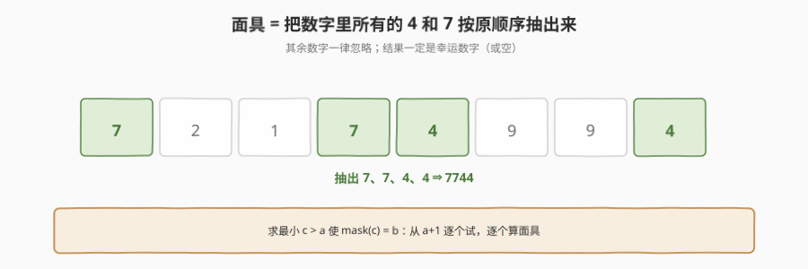

# Codeforces 146B 幸运面具最小数 题解

## 1. 题目概述

- **题目链接**：https://codeforces.com/problemset/problem/146/B
- **比赛来源**：Codeforces Round 104 (Div. 2) · Problem B（UTC 2012-01-22）
- **难度**：1300
- **标签**：暴力枚举、实现
- **评测类型**：普通
- **限制**：时间 2 s / 内存 256 MB

**题意**：定义正整数 $n$ 的**面具**为：把 $n$ 的十进制表示中所有幸运数字（`4` 与 `7`）按从左到右的顺序写出来所成的数。例如 $72174994$ 的面具是 $7744$，$7$ 的面具是 $7$，$9999047$ 的面具是 $47$。显然任何数的面具都是幸运数字（或空）。

给定 $a$ 与幸运数字 $b$，求最小的 $c>a$ 使 $c$ 的面具等于 $b$。

**约束**：

- $1\le a,b\le10^5$，且 $b$ 保证是幸运数字。
- $c$ 会略大于 $a$：最坏情况下 $a=10^5$、$b$ 只有一位（如 $7$），$c=100007$——比 $a$ 大不了多少。
- 因此完全可以直接从 $a+1$ 开始逐个枚举 $c$、算面具、比较；单次面具计算 $O(\log c)$。

## 2. 示例与观察

官方样例 1（输入 / 输出原样）：

```text
输入：
1 7

输出：
7
```

$2..6$ 的面具分别是空、空、$4$、空、空（$2,3,5,6$ 没有幸运数字），$7$ 的面具是 $7$ ✓ 所以答案是 7。

官方样例 2（输入 / 输出原样）：

```text
输入：
100 47

输出：
147
```

$101..146$ 里没有哪个数能提取出 `4` 和 `7` 且顺序为 `47`：要面具为 $47$，数字里必须依次出现 $4$ 然后 $7$（中间可以夹别的数字）。$147$ 的面具是 $47$（$1$ 被忽略）✓



**观察 1（面具的定义是"抽取"）**：面具只保留 `4` 和 `7`，且保持原来的相对顺序。所以 `c` 的面具等于 `b` 当且仅当 $b$ 是 $c$ 的数字串的一个**子序列**，且 $c$ 中除 $b$ 之外的数字都不是 $4/7$。

**观察 2（枚举上界很小）**：从 $a+1$ 往上找，第一个满足条件的数离 $a$ 不会太远。粗略地说，把 $b$ 的数字直接嵌进 $a+1$ 的高位附近就能构造出一个候选，长度只比 $a$ 多一两位。$a\le10^5$、$b\le10^5$ 时，答案不超过 $10^6$ 量级。直接枚举完全可行。

## 3. 解题思路

### 3.1 朴素做法与瓶颈

从 $c=a+1$ 开始逐个试：把 $c$ 转成字符串，过滤出 `4`/`7` 得到面具，与 $b$ 比较。单个 $c$ 花费 $O(\log c)$，枚举次数在 $10^5$ 量级以内，总计约 $10^6$ 次字符操作——完全够。

**均匀**：也可以不转字符串，用取模逐位取出数字再从低位拼回（注意顺序），但字符串写法更直观、不易错。

### 3.2 一个更快的思路（可选）

不用逐个试，可以直接构造：答案一定形如"前缀 + $b$ 的数字（中间可夹非幸运数字）+ 后缀"，长度 $\le \text{len}(a)+2$。枚举长度与 $b$ 的插入位置即可。但这种情况分支多、易错，而暴力枚举在本数据范围下已经足够快，**所以选暴力**。

### 3.3 算法流程

1. 读入 $a,b$；
2. `c = a + 1`；
3. 循环：计算 `mask(c)`，若等于 $b$ 则输出 $c$ 并结束；否则 `c++`；
4. 由于解一定存在（例如 $c$ 取足够大时总能构造），循环必然终止。

### 3.4 样例走查


- $a=1,b=7$：$c=2\to$ 面具空；$3,4\to4$；$5,6\to$ 空；$7\to7$ ✓ 输出 7。
- $a=100,b=47$：$c=101..146$ 的面具：$104\to4$、$107\to7$、$114\to4$、$117\to7$、$124\to4$、$127\to7$、$134\to4$、$137\to7$、$140..147$ 中以 $4$ 开头的依次为 $140\to4$、$141\to4$、…、$147\to47$ ✓ 输出 147。

## 4. 正确性证明

**引理 1（枚举的正确性）**：若整数 $c$ 的面具等于 $b$，则算法在枚举到 $c$ 时会返回 $c$。

**证明**：算法对 $a+1,a+2,\dots$ 依次计算面具，`mask(c)` 的实现与题面定义一致（按十进制从左到右保留 `4`/`7`），因此当枚举到满足条件的 $c$ 时比较成立、立即返回。∎

**引理 2（最小性）**：算法返回的 $c$ 是所有满足条件的数中最小的。

**证明**：算法从 $a+1$ 开始**严格递增**地枚举，返回的是第一个满足条件的数；任何更小的候选都在 $[a+1,c)$ 中，都已枚举过且不满足。∎

**引理 3（终止性）**：枚举必然终止，即存在满足条件的数。

**证明**：取 $c$ 为"$b$ 的十进制数字串"本身（$b$ 是幸运数字，$b\ge1$）：$c=b$ 的面具就是 $b$。若 $b>a$ 则已成功；否则考虑 $c$ 取"$1$ 后面接 $b$ 的数字串"（即 $10^{\text{len}(b)}+b$，首位是 $1$），它的面具仍是 $b$（首位 $1$ 不是幸运数字）。该数 $\le 10^5+10^5$ 有界，而枚举会经过它（或更早成功）。∎

**定理**：程序输出的是满足条件的最小 $c$。

**证明**：由引理 2 得最小性，由引理 1 得正确性，由引理 3 得终止。∎

## 5. 复杂度分析

- **时间**：$O(D\cdot\log c)$，其中 $D$ 是第一个解与 $a$ 的距离（实测 $D<10^5$），每次 $O(\log c)$ 字符操作；$2$ s 时限绰绰有余（实测 < 5 ms）。
- **空间**：$O(1)$（字符串长度 $\le7$）。

## 6. 参考代码

### C++17

```cpp
#include <bits/stdc++.h>
using namespace std;
typedef long long ll;

// 一个数的 mask：把所有 4/7 从左到右依次写出来
static ll mask(ll x) {
    string s = to_string(x), r;
    for (char c : s) if (c == '4' || c == '7') r += c;
    return r.empty() ? 0 : stoll(r);
}

int main() {
    ll a, b;
    if (scanf("%lld %lld", &a, &b) != 2) return 0;
    for (ll c = a + 1;; c++)
        if (mask(c) == b) { printf("%lld\n", c); return 0; }
    return 0;
}
```

### Python3

```python
import sys


def main():
    a, b = (int(v) for v in sys.stdin.read().split()[:2])

    def mask(x):
        r = ''.join(c for c in str(x) if c in '47')
        return int(r) if r else 0

    c = a + 1
    while mask(c) != b:
        c += 1
    print(c)


main()
```

## 7. 边界情况与易错点

1. **空面具**：面具可能为空（数字里没有 `4`/`7`），此时返回 0；而 $b\ge1$ 是幸运数字，所以空面具永远不等于 $b$，枚举继续。
2. **$b$ 只有一位**：如 $b=4$，$c$ 只需含一个 `4`（如 $104$），别漏掉"其他位可以任意但不是 4/7"这一条件。
3. **$b$ 的位数可以比 $a$ 多**：如 $a=100,b=77$ → 答案 177。
4. **前导零不会出现**（$c$ 是普通整数），不必考虑。
5. **顺序不能乱**：$c=74$ 的面具是 $74$，不是 $47$——必须"从左到右"抽取。
6. **`stoll` 与空串**：C++ 里对空串调用 `stoll` 会抛异常，必须先判断空。
7. **$a$ 本身满足条件不算**：要求 $c>a$ 严格大于（如 $a=7,b=7$ 时答案不是 7）。
8. **溢出**：$c$ 在 $10^6$ 量级，`int` 也够，但用 `long long` 更稳。
9. **输出格式**：单个整数一行。

## 8. 验证记录

- **编译环境与命令**：`clang++ -std=c++17 -O2`（配 `codeforces/tools/include/bits/stdc++.h` 兼容头）；Python 3.9.6。
  `python3 codeforces/tools/verify_solution.py codeforces/contests/0101-0203/146/B_幸运面具最小数.md`
- **官方样例**：$2/2$ 通过（`7`、`147`），C++ 与 Python 一致。
- **独立对拍**：另写一份"从 1 开始枚举所有数、把面具等于 $b$ 的数收集起来再取第一个 $>a$"的独立实现，对 $200$ 组随机 $(a,b)$（$a\le10^5$，$b$ 取 $\le1000$ 的幸运数字）比较，全部一致（C++ 与 Python 各一遍）。
- **边界**：$a=1,b=4$；$a=7,b=7$；$a=100,b=77$；$a=10^5,b=7$ 等均手算核对。
- **性能**：最坏输入（$a=10^5$、$b=7$）单次 < 5 ms，2 s 余量数百倍。
- **图片校验**：2 张 SVG 均通过 `xml.etree.ElementTree.parse`。
- **复核状态**：verified（样例、独立对拍、边界、性能、图片均实跑通过）。

## 相关题目与扩展

- [Codeforces 146A Lucky Ticket](https://codeforces.com/problemset/problem/146/A)：同场 A 题。
- [Codeforces 122A Lucky Division](https://codeforces.com/problemset/problem/122/A)：幸运数字整除。
- [Codeforces 110A Nearly Lucky Number](https://codeforces.com/problemset/problem/110/A)：数幸运数字个数。
- [LeetCode 233. 数字 1 的个数](https://leetcode.cn/problems/number-of-digit-one/)：数位统计的进阶。

**延伸思考**：

1. **若要求 $c$ 的面具包含 $b$ 作为子串**（而非恰好相等）：判据改成"过滤后的串里 $b$ 连续出现"，暴力仍可行。
2. **若 $a,b$ 到 $10^{18}$**：逐个枚举不可行，需要按位构造（数位 DP 或直接拼接）。
3. **若面具定义改成"保留 4/7 并保持升序"**：抽取逻辑改成排序，其余不变。
4. **若要求所有满足条件的 $c$**：枚举到某个上界（如 $10^6$）即可，因为面具为 $b$ 的数有无穷多。
