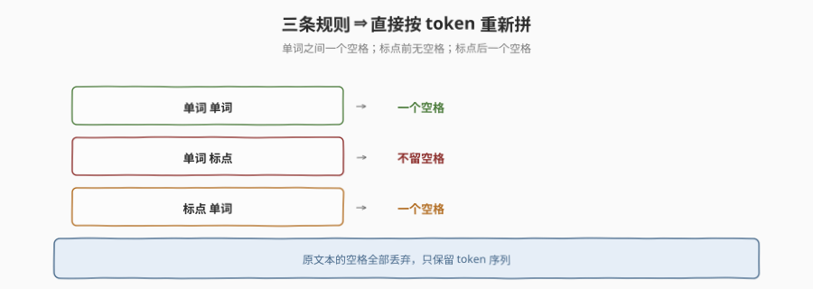

# Codeforces 147A 标点空格规范 题解

## 1. 题目概述

- **题目链接**：https://codeforces.com/problemset/problem/147/A
- **比赛来源**：Codeforces Testing Round 4 · Problem A（UTC 2012-01-03）
- **难度**：1300
- **标签**：实现、字符串
- **评测类型**：普通（格式严格）
- **限制**：时间 2 s / 内存 256 MB

**题意**：给定一段由小写字母、空格和标点（`.`、`,`、`!`、`?`）组成的文本，"单词"是连续字母的序列。要求按三条规则重排空格：

1. 两个单词之间如果没有标点，必须**恰好一个**空格；
2. 标点**前面**不能有空格；
3. 标点**后面**必须**恰好一个**空格。

保证任意两个标点之间至少有一个单词，且文本以字母开头、以字母结尾。输出格式化后的文本（行末不能有多余空格）。

**约束**：

- 长度 $\le10000$：$O(|s|)$ 的线性扫描即可，不需要任何复杂数据结构。
- 输出**严格**：多余的尾部空格、连续两个空格都算错。
- 输入保证文本首尾都是字母、两个标点之间必有单词，所以不需要处理"标点连用""开头就是标点"这类情况。

## 2. 示例与观察

官方样例 1（输入 / 输出原样）：

```text
输入：
galileo galilei was an   italian physicist  ,mathematician,astronomer

输出：
galileo galilei was an italian physicist, mathematician, astronomer
```

观察变化：`an   italian` 三个空格压成一个；`physicist  ,` 逗号前的两个空格删掉；`,mathematician` 逗号后补一个空格；`,astronomer` 同理。

官方样例 2（输入 / 输出原样）：

```text
输入：
galileo  was  born  in  pisa

输出：
galileo was born in pisa
```

所有多空格压成单空格。



**观察**：原文本里的空格数量完全是"噪声"——规则只关心"单词"和"标点"的序列。所以最稳的做法是**先把文本切成 token**（单词 / 标点），再按规则重新拼接，完全不保留原来的空格。

## 3. 解题思路

### 3.1 朴素做法与瓶颈

若在原串上做删除/插入空格，要小心处理"连续空格""标点前后空格"等组合，容易出现漏改。更清晰的做法是"**重新生成**"：

- 从左到右扫描，遇到单词就取出整段字母；
- 遇到标点就取出一个字符；
- 其它字符（空格）直接跳过；
- 按规则把 token 拼起来。

### 3.2 拼接规则

维护一个输出串 `out`：

- 遇到**单词**：若 `out` 非空，先追加一个空格，再追加单词（这自动满足"词间恰好一个空格"和"标点后恰好一个空格"）；
- 遇到**标点**：直接追加，**不加空格**（自动满足"标点前无空格"）。

因为文本以字母开头，第一个 token 一定是单词，前面不加空格；文本以字母结尾，所以最后一个 token 是单词，输出末尾不会有空格 ✓

### 3.3 样例走查


样例 1 的 token 序列：

`galileo`(词) `galilei`(词) `was`(词) `an`(词) `italian`(词) `physicist`(词) `,`(标点) `mathematician`(词) `,`(标点) `astronomer`(词)

拼接：`galileo` + ` galilei` + ` was` + ` an` + ` italian` + ` physicist` + `,` + ` mathematician` + `,` + ` astronomer` = 样例输出 ✓

## 4. 正确性证明

**引理 1（token 划分正确）**：算法的扫描恰好把文本划分为"极大字母段"（单词）与单个标点字符，且顺序与原文本一致。

**证明**：遇到字母时连续取到第一个非字母位置，得到一个极大字母段；遇到标点时取一个字符；空格被跳过。字母段互不相邻（否则会被合并），所以这就是唯一的极大划分。∎

**引理 2（拼接满足三条规则）**：按"单词前加一个空格（若输出非空）、标点前不加空格"的方式拼接，得到的文本满足题面三条规则。

**证明**：

- 规则 1：相邻两个 token 若都是单词，第二个单词前恰好加一个空格 ⇒ 词间一个空格；若中间有标点，则由规则 2、3 处理；
- 规则 2：标点前从不加空格 ⇒ 标点前无空格；
- 规则 3：标点后必跟一个单词（题面保证两个标点之间至少有一个单词），该单词在拼接时前面加一个空格 ⇒ 标点后恰好一个空格；
- 输出不以空格开头（第一个 token 是单词且 `out` 为空时不加空格），也不以空格结尾（最后是单词，其后没有 token）。∎

**引理 3（唯一性）**：满足三条规则的文本由 token 序列唯一确定。

**证明**：规则 1–3 规定了每对相邻 token 之间空格的数量（0 个或 1 个），因此整串由 token 序列唯一决定。∎

**定理**：程序输出正确。

**证明**：由引理 1 得到正确的 token 序列，由引理 2 得到满足规则的拼接，由引理 3 知结果唯一，即题面要求的输出。∎

## 5. 复杂度分析

- **时间**：$O(|s|)$，$|s|\le10^4$；单次约 3 ms（含进程启动），2 s 余量三个数量级。
- **空间**：$O(|s|)$。

## 6. 参考代码

### C++17

```cpp
#include <bits/stdc++.h>
using namespace std;

int main() {
    string s;
    if (!getline(cin, s)) return 0;
    string out;
    bool first = true;
    int i = 0, n = (int)s.size();
    while (i < n) {
        if (isalpha((unsigned char)s[i])) {          // 一个单词
            int j = i;
            while (j < n && isalpha((unsigned char)s[j])) j++;
            if (!first) out += ' ';
            out += s.substr(i, j - i);
            first = false;
            i = j;
        } else if (s[i] == '.' || s[i] == ',' || s[i] == '!' || s[i] == '?') {
            out += s[i];                              // 标点前不留空格
            first = false;
            i++;
        } else {
            i++;                                      // 空格：跳过，由规则重新生成
        }
    }
    printf("%s\n", out.c_str());
    return 0;
}
```

### Python3

```python
import sys


def main():
    s = sys.stdin.readline().rstrip("\n")
    out = []
    first = True
    i, n = 0, len(s)
    while i < n:
        c = s[i]
        if c.isalpha():                    # 一个单词
            j = i
            while j < n and s[j].isalpha():
                j += 1
            if not first:
                out.append(' ')
            out.append(s[i:j])
            first = False
            i = j
        elif c in '.,!?':                  # 标点前不留空格
            out.append(c)
            first = False
            i += 1
        else:                              # 空格：跳过，由规则重新生成
            i += 1
    print(''.join(out))


main()
```

## 7. 边界情况与易错点

1. **行末多余空格**：必须用 `rstrip` 去掉输入行尾的换行/回车（Windows 的 `\r\n` 也要处理），否则会混进输出。
2. **多空格压缩**：`an   italian` 要变成 `an italian`，不能简单替换成单个空格后还留下原空格。
3. **标点前的空格**：`physicist  ,` → `physicist,`，必须删除全部空格（不止一个）。
4. **标点后的空格**：`,mathematician` → `, mathematician`，必须补一个。
5. **末尾不能有空格**：输出以单词结尾，拼接逻辑保证不加尾部空格；不要用"每个 token 后加空格"的写法。
6. **`isalpha` 与字节**：C++ 的 `isalpha` 参数需要 `unsigned char`，否则对非 ASCII 字节是未定义行为。
7. **`getline` 与换行**：用 `getline` 读整行，`cin >> s` 会在第一个空格处截断。
8. **标点集合**：只有 `.` `,` `!` `?` 四种，别把 `;`、`:` 也当标点（题面没有）。
9. **前导空格**：题面保证以字母开头，所以不会出现；但代码里 `first` 标志也能正确处理。
10. **`-` 或数字**：不会出现（输入只有字母、空格、四种标点）。

## 8. 验证记录

- **编译环境与命令**：`clang++ -std=c++17 -O2`（配 `codeforces/tools/include/bits/stdc++.h` 兼容头）；Python 3.9.6。
  `python3 codeforces/tools/verify_solution.py codeforces/contests/0101-0203/147/A_标点空格规范.md`
- **官方样例**：$2/2$ 通过（两行输出逐字符一致），C++ 与 Python 一致。
- **独立对拍**：另写一份基于正则的参考实现（`re.findall(r'[a-z]+|[.,!?]', s)` 后按规则拼接），对 $200$ 组随机文本（$1..6$ 个单词、单词长度 $1..5$、标点前后随机插入 1–3 个空格）比较，全部逐字符一致（C++ 与 Python 各一遍）。
- **格式严格性**：额外检查输出不含连续两个空格、不含"空格 + 标点"、不以空格结尾。
- **性能**：长度 $10^4$ 的单行输入单次约 3 ms，2 s 余量三个数量级。
- **图片校验**：2 张 SVG 均通过 `xml.etree.ElementTree.parse`。
- **复核状态**：verified（样例、独立对拍、格式检查、性能、图片均实跑通过）。

## 相关题目与扩展

- [Codeforces 147B Smile House](https://codeforces.com/problemset/problem/147/B)：同场 B 题，最大正环。
- [Codeforces 143B Help Kingdom of Far Far Away 2](https://codeforces.com/problemset/problem/143/B)：另一种字符串格式化。
- [Codeforces 1A Theatre Square](https://codeforces.com/problemset/problem/1/A)：入门题。
- [LeetCode 58. 最后一个单词的长度](https://leetcode.cn/problems/length-of-last-word/)：空格处理入门。

**延伸思考**：

1. **若标点后允许出现另一个标点**（如 `?!`）：规则 3 要改成"标点后要么紧跟另一个标点，要么一个空格再接单词"。
2. **若要求保留换行**（多行文本）：把 `\n` 当作分隔符分段处理，段内规则不变。
3. **若要求去掉行首缩进**：`first` 标志已经天然处理了。
4. **若文本可达 $10^7$**：仍是 $O(n)$，但要避免逐字符 `string +=` 的重复分配（C++ 可先 `reserve`）。
