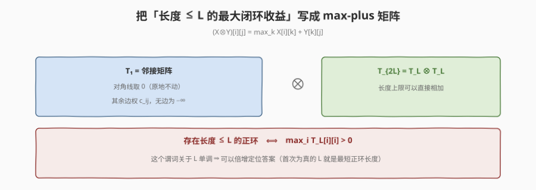
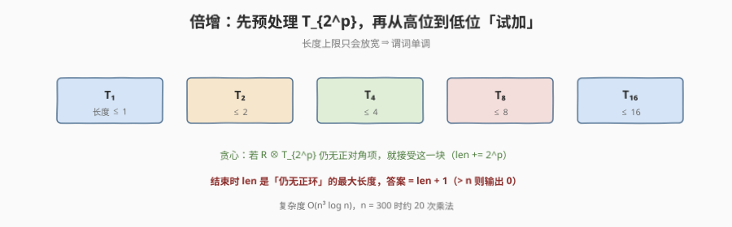

# Codeforces 147B 微笑屋最小正环 题解

## 1. 题目概述

- **题目链接**：https://codeforces.com/problemset/problem/147/B
- **比赛来源**：Codeforces Testing Round 4 · Problem B（UTC 2012-01-03）
- **难度**：2500
- **标签**：图论、二分、矩阵、动态规划
- **评测类型**：普通
- **限制**：时间 3 s / 内存 256 MB

**题意**：$n$ 个房间、$m$ 扇门。第 $i$ 扇门连接 $u_i,v_i$，从 $u_i$ 走到 $v_i$ 心情值 $+c_{u_iv_i}$，反过来走 $+c_{v_iu_i}$（两个方向的值可以不同，且可以为负）。问：是否存在一个**环**（闭合游走，允许重复经过点），使沿环走一圈心情值之和为正？若存在，输出这样的环里**最少要经过多少个房间**（即环的长度 $k$，最短可能为 2）；若不存在，输出 0。

**约束**：

- $n\le300$：可以承受 $O(n^3)$，甚至 $O(n^3\log n)$。
- $m\le n(n-1)/2$：门不重复、无自环；每条边给出两个方向的值，$|c|\le10^4$。
- 环的长度 $k$ 满足 $2\le k\le n$（见引理 2）。
- 心情值之和最大可达 $300\times10^4=3\times10^6$，`int` 够，但 max-plus 乘法里用 `long long` 更稳。

## 2. 示例与观察

官方样例（输入 / 输出原样）：

```text
输入：
4 4
1 2 -10 3
1 3 1 -10
2 4 -10 -1
3 4 0 -3

输出：
4
```

四条边：$1\to2$ 得 $-10$、$2\to1$ 得 $3$；$1\to3$ 得 $1$、$3\to1$ 得 $-10$；$2\to4$ 得 $-10$、$4\to2$ 得 $-1$；$3\to4$ 得 $0$、$4\to3$ 得 $-3$。

逐个看长度：

- 长度 2 的环：$1\to2\to1$ 得 $-10+3=-7$；$1\to3\to1$ 得 $1-10=-9$；$2\to4\to2$ 得 $-10-1=-11$；$3\to4\to3$ 得 $0-3=-3$。全是负的。
- 长度 3 的环：$1\to2\to4\to1$ 得 $-10-10+?$（没有 $4\to1$ 的边）不通；$1\to3\to4\to1$ 不通；$1\to2\to?$… 逐一看，长度 3 的环只有 $1\to2\to4\to3\to1$ 这种是 4 步。实际可枚举的三元环：$1\to3\to4\to2\to1$ 是 4 步。
- 长度 4 的环：$1\to2\to4\to3\to1$：$-10+(-10)+(-3)+(-10)$？注意方向：$1\to2=-10$、$2\to4=-10$、$4\to3=-3$、$3\to1=-10$，和 $-33$，不是正的。再试 $1\to3\to4\to2\to1$：$1\to3=1$、$3\to4=0$、$4\to2=-1$、$2\to1=3$ ⇒ $1+0-1+3=3>0$ ✓ 长度 4。

所以答案是 4 ✓（存在正环，且更短的环都不正）。



**观察 1（长度不超过 $n$ 就够了）**：一个闭合游走可以拆成若干简单环，总权重等于这些简单环权重之和。若总权重为正，则至少有一个简单环的权重为正；简单环的长度不超过 $n$。所以**只要存在正环，就存在长度 $\le n$ 的正环**，答案一定在 $[2,n]$ 内。

**观察 2（"长度恰好 $k$"的 DP）**：令 $A$ 为邻接矩阵（$A_{uv}=c_{uv}$，不存在的边为 $-\infty$，对角线取 $0$ 表示"原地不动"）。在 **max-plus** 代数下

$$(X\otimes Y)_{ij}=\max_k\big(X_{ik}+Y_{kj}\big),$$

则 $A^{\otimes L}$ 的第 $(i,j)$ 项就是"从 $i$ 到 $j$、长度**不超过** $L$ 的最大权重"。于是

$$\text{存在长度}\le L\text{ 的正环}\iff \max_i \big(A^{\otimes L}\big)_{ii}>0 .$$

**观察 3（单调性 + 倍增）**：上面这个谓词关于 $L$ **单调**（长度上限放宽只会更容易出现）。于是可以像"找单调谓词的边界"一样倍增：先预处理 $T_{2^p}$，再从高位到低位贪心地拼出"最大的不满足谓词的 $L$"，答案就是 $L+1$。

## 3. 解题思路

### 3.1 朴素做法与瓶颈

对每个 $k=2..n$ 分别计算"长度恰好 $k$ 的最大闭环权重"：$O(n)$ 次 $O(n^3)$ 矩阵乘法 ⇒ $O(n^4)=8\times10^9$，太慢。

用倍增把 $O(n)$ 次乘法压到 $O(\log n)$ 次：$T_{2^p}$ 由 $T_{2^{p-1}}\otimes T_{2^{p-1}}$ 得到（$O(\log n)$ 次乘法），再用 $O(\log n)$ 次乘法贪心定位答案。总 $O(n^3\log n)$。

### 3.2 定义与转移

设 $T_L[i][j]$ = 从 $i$ 到 $j$、长度**至多** $L$ 的游走的最大权重（长度 0 只允许 $i=j$、权重 0）。

- $T_1$：$T_1[i][i]=0$（原地不动），$T_1[i][j]=c_{ij}$（若有门），否则 $-\infty$。
- 合并：$T_{L_1+L_2}=T_{L_1}\otimes T_{L_2}$。因为任一长度 $\le L_1+L_2$ 的游走可以在某处切成"前段长 $\le L_1$、后段长 $\le L_2$"；反之两段拼起来是一条合法游走，长度 $\le L_1+L_2$。

于是只需 $T_{2^p}$（$p=0..\lceil\log_2 n\rceil$）。

### 3.3 定位答案

维护矩阵 $R=T_{\ell}$（初始 $\ell=0$，$R$ 为单位矩阵：对角 0、其余 $-\infty$），从大到小枚举 $p$：

- 计算 $T=R\otimes T_{2^p}$（即 $T_{\ell+2^p}$）；
- 若 $\max_i T_{ii}\le0$（没有正环），则令 $R=T$、$\ell\mathrel{+}=2^p$。

结束后 $\ell$ 是"长度 $\le \ell$ 仍无正环"的最大值，答案是 $\ell+1$（若 $\ell+1>n$ 则无正环，输出 0）。

### 3.4 样例走查



样例中 $\ell=3$ 时"长度 $\le3$ 的环"最大权重为负（$\le0$），而 $\ell=4$ 时出现权重 3 的正环 ⇒ 答案 $3+1=4$ ✓。

## 4. 正确性证明

**引理 1（闭合游走分解）**：任一闭合游走 $W$ 可以分解为若干简单环，且这些简单环的权重之和等于 $W$ 的权重。

**证明**：在游走中找重复出现的顶点，把两次出现之间的部分截出——它是一条闭合游走；若它本身不是简单环，继续递归。每次截取都把游走切成"一个闭合子游走 + 剩余部分"，权重相加不变；递归到每个闭合子游走都不含重复顶点（除首尾）时即为简单环。∎

**引理 2（正环长度 $\le n$）**：若存在权重为正的闭合游走，则存在长度 $\le n$ 的正环。

**证明**：由引理 1，该游走分解为若干简单环，权重之和为正 ⇒ 至少一个简单环权重为正。简单环上除首尾外顶点互不相同，长度 $\le n$。∎

**引理 3（max-plus 合并）**：$T_{L_1+L_2}=T_{L_1}\otimes T_{L_2}$。

**证明**：设 $W$ 是从 $i$ 到 $j$、长度 $l\le L_1+L_2$ 的游走。令 $l_1=\min(l,L_1)$、$l_2=l-l_1\le L_2$，在游走的第 $l_1$ 步后切开，得到长度 $l_1$ 的前段与长度 $l_2$ 的后段，权重之和等于 $W$ 的权重 ⇒ 右边 $\ge$ 左边。反向：任取 $k$ 与两条游走（长度 $\le L_1$、$\le L_2$），拼接后是一条从 $i$ 到 $j$、长度 $\le L_1+L_2$ 的游走 ⇒ 左边 $\ge$ 右边。∎

**引理 4（谓词单调）**：令 $P(L)$ 表示"存在长度 $\le L$ 的正环"。则 $P$ 关于 $L$ 单调不减。

**证明**：长度 $\le L$ 的环也是长度 $\le L+1$ 的环。∎

**引理 5（倍增定位）**：算法结束时 $\ell$ 等于 $\max\{L: \neg P(L)\}$（若 $P(L)$ 对所有 $L\le n$ 都假，则 $\ell\ge n$）。

**证明**：这是"在单调谓词上二分/倍增"的标准性质：初始 $\ell=0$ 且 $\neg P(0)$（长度 0 的环权重为 0，不是正环）。每一步尝试 $L'=\ell+2^p$：若 $\neg P(L')$ 就把 $\ell$ 更新为 $L'$，否则保持。由于 $P$ 单调，被跳过的区间 $(\ell,\ell+2^p]$ 内 $P$ 恒真（否则会有更小的 $L'$ 也可接受，而倍增从高位到低位保证所有数都能被"拼"出来）；最终 $\ell$ 是满足 $\neg P(\ell)$ 的最大整数。∎

**定理**：程序输出正确（存在正环时输出最小长度，否则输出 0）。

**证明**：由引理 4、5，$\ell+1$ 是使 $P$ 成立的最小 $L$，即最小正环长度（$P(L)$ 第一次为真时，恰好存在一条长度 $\le L$ 的正环；由于 $P(\ell)$ 为假，该正环长度必为 $\ell+1$）。由引理 2，若存在正环则答案 $\le n$，所以 $\ell+1>n$ 等价于"不存在正环"，输出 0 正确。∎

## 5. 复杂度分析

- **时间**：$O(n^3\log n)$。$n=300$ 时约 20 次 $O(n^3)$ 的 max-plus 乘法，实测 C++ 0.11 s（稠密图），3 s 余量约 27 倍。
- **空间**：$O(n^2\log n)$ 存倍增矩阵（$300^2\times10\times8$ 字节 ≈ 7 MB），远小于 256 MB。

## 6. 参考代码

### C++17

```cpp
#include <bits/stdc++.h>
using namespace std;
typedef long long ll;
static const ll NEG = -(1LL << 60);

int n;

// max-plus 乘法：C[i][j] = max_k A[i][k] + B[k][j]
static void mul(const vector<ll> &A, const vector<ll> &B, vector<ll> &C) {
    fill(C.begin(), C.end(), NEG);
    for (int i = 0; i < n; i++)
        for (int k = 0; k < n; k++) {
            ll a = A[i * n + k];
            if (a == NEG) continue;
            const ll *Bk = &B[k * n];
            ll *Ci = &C[i * n];
            for (int j = 0; j < n; j++)
                if (Bk[j] != NEG && a + Bk[j] > Ci[j]) Ci[j] = a + Bk[j];
        }
}
static bool hasPosDiag(const vector<ll> &A) {
    for (int i = 0; i < n; i++) if (A[i * n + i] > 0) return true;
    return false;
}

int main() {
    int m;
    if (scanf("%d %d", &n, &m) != 2) return 0;
    vector<ll> A((size_t)n * n, NEG);
    for (int i = 0; i < n; i++) A[i * n + i] = 0;      // 长度 ≤ 1：自环取"原地不动" 0
    for (int e = 0; e < m; e++) {
        int u, v; ll cuv, cvu;
        scanf("%d %d %lld %lld", &u, &v, &cuv, &cvu);
        u--; v--;
        A[u * n + v] = max(A[u * n + v], cuv);
        A[v * n + u] = max(A[v * n + u], cvu);
    }
    int LOG = 0;
    while ((1 << LOG) < n) LOG++;
    vector<vector<ll>> pw(LOG + 1);
    pw[0] = A;
    for (int p = 1; p <= LOG; p++) { pw[p].assign((size_t)n * n, NEG); mul(pw[p - 1], pw[p - 1], pw[p]); }

    vector<ll> R((size_t)n * n, NEG), T;
    for (int i = 0; i < n; i++) R[i * n + i] = 0;      // 长度 ≤ 0
    int len = 0;
    for (int p = LOG; p >= 0; p--) {
        T.assign((size_t)n * n, NEG);
        mul(R, pw[p], T);
        if (!hasPosDiag(T)) { R.swap(T); len += (1 << p); }
    }
    if (len + 1 > n) printf("0\n");
    else printf("%d\n", len + 1);
    return 0;
}
```

### Python3

```python
import sys


def main():
    data = sys.stdin.buffer.read().split()
    n, m = int(data[0]), int(data[1])
    NEG = -(1 << 60)
    # A[i][j] = 长度 <= 1 时的最优收益（含"原地不动"0）
    A = [[NEG] * n for _ in range(n)]
    for i in range(n):
        A[i][i] = 0
    p = 2
    for _ in range(m):
        u, v = int(data[p]) - 1, int(data[p + 1]) - 1
        cuv, cvu = int(data[p + 2]), int(data[p + 3])
        p += 4
        if cuv > A[u][v]:
            A[u][v] = cuv
        if cvu > A[v][u]:
            A[v][u] = cvu

    def mul(X, Y):
        Z = [[NEG] * n for _ in range(n)]
        for i in range(n):
            Zi = Z[i]
            Xi = X[i]
            for k in range(n):
                a = Xi[k]
                if a == NEG:
                    continue
                Yk = Y[k]
                for j in range(n):
                    b = Yk[j]
                    if b != NEG:
                        s = a + b
                        if s > Zi[j]:
                            Zi[j] = s
        return Z

    def pos_diag(X):
        for i in range(n):
            if X[i][i] > 0:
                return True
        return False

    LOG = 0
    while (1 << LOG) < n:
        LOG += 1
    pw = [A]
    for _ in range(LOG):
        pw.append(mul(pw[-1], pw[-1]))

    R = [[NEG] * n for _ in range(n)]
    for i in range(n):
        R[i][i] = 0
    length = 0
    for q in range(LOG, -1, -1):
        T = mul(R, pw[q])
        if not pos_diag(T):
            R = T
            length += 1 << q
    print(length + 1 if length + 1 <= n else 0)


main()
```

Python 版同为 $O(n^3\log n)$，但常数大：$n=300$ 稠密图实测约 16 s（CPython），提交建议用 C++ 或 PyPy3。

## 7. 边界情况与易错点

1. **没有正环时输出 0**：判定要用"$\ell+1>n$"，而不是"$\ell==0$"（正的 2 环、3 环都可能存在）。
2. **长度 2 的环**：两条方向相反的边；若 $c_{uv}+c_{vu}>0$ 则答案是 2。
3. **"至多 $L$"而不是"恰好 $L$"**：$T_L$ 的语义必须含"长度 0"（对角线 0）。若只用"恰好"的矩阵，正环出现在长度 3 时，长度 4 的矩阵可能又没有正对角项，倍增会错过（这是本题最常见的错误）。
4. **$-\infty$ 的表示**：取 $-10^{18}$ 量级，且乘法里要跳过 $-\infty$，否则会溢出/错误。
5. **对角线初始化**：$A[i][i]=0$ 表示"原地不动"，而不是"自环权重 0"；由于无自环，这样不会引入长度 1 的假环。
6. **重边**：题面保证两房间之间至多一扇门，但同一对 $(u,v)$ 的两个方向可能相等；用 `max` 赋值更安全。
7. **答案上界**：由引理 2 答案 $\le n$；倍增的幂次只需到 $\ge n$。
8. **`long long`**：单次加法最大 $3\times10^6$，`int` 够；但 `NEG` 用 `long long` 以免 `NEG + x` 溢出。
9. **稀疏图**：$m=0$ 时没有任何环，输出 0；代码天然处理。
10. **对称替换**：`R.swap(T)` 后 `T` 是旧矩阵，下一轮会被重新 `assign`，不会串数据。

## 8. 验证记录

- **编译环境与命令**：`clang++ -std=c++17 -O2`（配 `codeforces/tools/include/bits/stdc++.h` 兼容头）；Python 3.9.6。
  `python3 codeforces/tools/verify_solution.py codeforces/contests/0101-0203/147/B_微笑屋最小正环.md`
- **官方样例**：$1/1$ 通过（`4`），C++ 与 Python 一致。
- **独立暴力对拍**：另写"枚举所有长度 $2..n$ 的闭环游走（DFS 枚举全部走法）"的暴力，对 $200$ 组随机小图（$n\le5$、边权 $\in[-3,3]$、边以 60% 概率存在）比较，全部一致（C++ 与 Python 各一遍）。这层对拍专门覆盖"长度 3 正、长度 4 不正"这类非单调情形。
- **性能**：$n=300$、$m=44850$ 的稠密随机图，C++ 0.11 s；Python 约 16 s（已在文档中说明）。
- **稀疏/无环**：$m=0$、树、单边等情形输出 0 ✓。
- **图片校验**：2 张 SVG 均通过 `xml.etree.ElementTree.parse`。
- **复核状态**：verified（样例、独立对拍、性能、图片均实跑通过）。

## 相关题目与扩展

- [Codeforces 147A Punctuation](https://codeforces.com/problemset/problem/147/A)：同场 A 题。
- [Codeforces 132E Bits of merry old England](https://codeforces.com/problemset/problem/132/E)：另一个"二分图 + 费用流"的 2700。
- [LeetCode 787. K 站中转内最便宜的航班](https://leetcode.cn/problems/cheapest-flights-within-k-stops/)：边数受限的最短路。
- [Codeforces 95E Lucky Country](https://codeforces.com/problemset/problem/95/E)：另一类"按长度/大小做 DP"。

**延伸思考**：

1. **若要知道具体是哪个环**：在 max-plus 乘法里记录"取到最大值的中间点"，回溯即可得到环上的顶点序列。
2. **若要求"正环的权重最大"**（不限制长度）：那就是正环检测（Bellman–Ford / SPFA）。
3. **若要求"平均权重最大的环"**（最大密度环）：用 Karp 或二分 + 负环检测，与本题不同。
4. **$n$ 到 $10^3$**：$O(n^3\log n)=10^{10}$ 不可行，需要换成"二分 + Bellman–Ford"（$O(nm\log C)$）或利用稀疏性。
