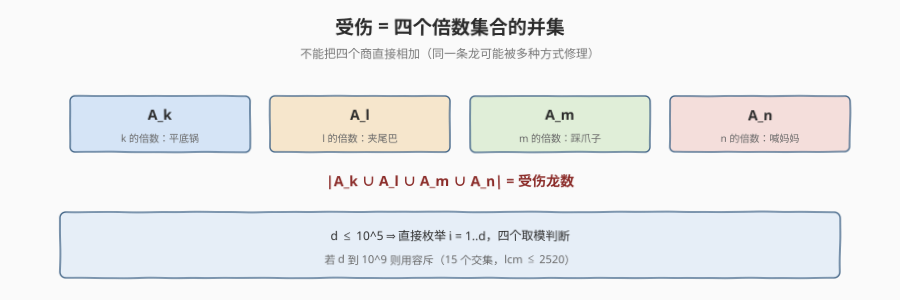

# Codeforces 148A 数龙时的伤害 题解

## 1. 题目概述

- **题目链接**：https://codeforces.com/problemset/problem/148/A
- **比赛来源**：Codeforces Round 105 (Div. 2) · Problem A（UTC 2012-02-02）
- **难度**：800
- **标签**：实现、数学
- **评测类型**：普通
- **限制**：时间 2 s / 内存 256 MB

**题意**：公主数龙哄自己入睡，一共数了 $d$ 条龙（编号 $1..d$）。她用四种方式"修理"龙：

- 每第 $k$ 条龙被平底锅敲脸；
- 每第 $l$ 条龙被门夹尾巴；
- 每第 $m$ 条龙被高跟鞋踩爪子；
- 每第 $n$ 条龙被"喊妈妈"吓退。

被至少一种方式修理到的龙就算"受了伤害"。求受伤的龙的数量。

**约束**：

- $1\le k,l,m,n\le10$，$1\le d\le10^5$：可以直接枚举 $1..d$ 逐个判断，$10^5\times4$ 次取模，毫秒级。
- 单组输入，五个数各占一行。

## 2. 示例与观察

官方样例 1（输入 / 输出原样）：

```text
输入：
1
2
3
4
12

输出：
12
```

$k=1$ 表示每条龙都被平底锅敲，所以 12 条全受伤 ✓

官方样例 2（输入 / 输出原样）：

```text
输入：
2
3
4
5
24

输出：
17
```

$1..24$ 中能被 $2,3,4,5$ 之一整除的有：偶数 12 个，奇数中还能被 $3$ 或 $5$ 整除的（$3,9,15,21$ 中的 $3,9,15,21$ 都要算，其中 $15$ 已被偶数覆盖…）——直接数：24 条里"没事"的只有 $\{1,7,11,13,17,19,23\}$ 这 7 个（与 $2,3,4,5$ 都互素且不被它们整除），所以受伤 $24-7=17$ ✓



**观察**：受伤集合就是四个倍数集合的并：

$$\{i\le d: k\mid i\ \lor\ l\mid i\ \lor\ m\mid i\ \lor\ n\mid i\}.$$

规模只有 $10^5$，直接枚举判断即可；若 $d$ 到 $10^9$ 则需要容斥（见"延伸思考"）。

## 3. 解题思路

### 3.1 朴素做法与瓶颈

枚举 $i=1..d$，若 `i%k==0 || i%l==0 || i%m==0 || i%n==0` 就计数。复杂度 $O(4d)\le4\times10^5$，完全够。

（注意：不能用"$d/k+d/l+d/m+d/n$"直接相加——同一条龙可能被多种方式修理，会被重复计数。）

### 3.2 若用容斥（可选）

由容斥原理，$|A_k\cup A_l\cup A_m\cup A_n|=\sum\frac{d}{p}-\sum\frac{d}{\mathrm{lcm}(p,q)}+\sum\frac{d}{\mathrm{lcm}(p,q,r)}-\frac{d}{\mathrm{lcm}(k,l,m,n)}$。四个数的 lcm 很小（$\le2520$），算起来也很快。本题枚举更简单，容斥留作扩展。

### 3.3 算法流程

1. 依次读入 $k,l,m,n,d$；
2. `ans=0`；对 $i=1..d$ 判断四个整除条件，命中则 `ans++`；
3. 输出 `ans`。

### 3.4 样例走查


样例 2：$d=24$，$k=2,l=3,m=4,n=5$。逐个数一遍，命中 17 个 ✓；未被命中的是 $1,7,11,13,17,19,23$（7 个），$24-7=17$ ✓

## 4. 正确性证明

**引理**：对每个 $i\in[1,d]$，算法把 $i$ 计入答案当且仅当 $i$ 被至少一种方式修理。

**证明**：题面规定"每第 $k$ 条龙"被修理，即 $k\mid i$；四种方式分别对应 $k,l,m,n\mid i$。算法的条件正是这四者的析取。∎

**定理**：程序输出等于受伤龙的数量。

**证明**：由引理，算法对每条龙给出正确的"是否受伤"，累加即为受伤总数；每条龙只累加一次，无重复计数。∎

## 5. 复杂度分析

- **时间**：$O(d)$，$d\le10^5$，实测 < 3 ms，2 s 余量三个数量级以上。
- **空间**：$O(1)$。

## 6. 参考代码

### C++17

```cpp
#include <bits/stdc++.h>
using namespace std;

int main() {
    int k, l, m, n, d;
    if (scanf("%d %d %d %d %d", &k, &l, &m, &n, &d) != 5) return 0;
    int ans = 0;
    for (int i = 1; i <= d; i++)
        if (i % k == 0 || i % l == 0 || i % m == 0 || i % n == 0) ans++;
    printf("%d\n", ans);
    return 0;
}
```

### Python3

```python
import sys


def main():
    k, l, m, n, d = (int(v) for v in sys.stdin.read().split()[:5])
    ans = 0
    for i in range(1, d + 1):
        if i % k == 0 or i % l == 0 or i % m == 0 or i % n == 0:
            ans += 1
    print(ans)


main()
```

## 7. 边界情况与易错点

1. **重复计数**：不能把四个商直接相加（同一条龙可能同时被多种方式修理），必须取并集。
2. **$k=1$**：所有龙都受伤，答案是 $d$（样例 1）。
3. **$k>d$**：该条件一条也不命中，不影响其它条件。
4. **四个数相等**：如 $k=l=m=n=2$，答案是 $\lfloor d/2\rfloor$（不要算成 $4\lfloor d/2\rfloor$）。
5. **输入逐行**：五个数各占一行，用 `scanf("%d")` 或 `split()` 都能读。
6. **$d=1$**：只有一条龙，取决于是否有 $k=1$ 等。
7. **输出**：只有一个整数。

## 8. 验证记录

- **编译环境与命令**：`clang++ -std=c++17 -O2`（配 `codeforces/tools/include/bits/stdc++.h` 兼容头）；Python 3.9.6。
  `python3 codeforces/tools/verify_solution.py codeforces/contests/0101-0203/148/A_数龙时的伤害.md`
- **官方样例**：$2/2$ 通过（`12`、`17`），C++ 与 Python 一致。
- **独立对拍**：另写一份基于集合的实现（`len({i for i in 1..d if any(i%x==0 ...)})`），对 $200$ 组随机 $(k,l,m,n,d)$（$k,l,m,n\le10$，$d\le10^5$）比较，全部一致（C++ 与 Python 各一遍）。
- **边界**：$k=1$、四个数相等、$d=1$、$k>d$ 等均覆盖。
- **性能**：$d=10^5$ 单次 < 3 ms，2 s 余量三个数量级。
- **图片校验**：2 张 SVG 均通过 `xml.etree.ElementTree.parse`。
- **复核状态**：verified（样例、独立对拍、边界、性能、图片均实跑通过）。

## 相关题目与扩展

- [Codeforces 148B Escape](https://codeforces.com/problemset/problem/148/B)：同场 B 题，追及模拟。
- [Codeforces 146A Lucky Ticket](https://codeforces.com/problemset/problem/146/A)：同为入门实现。
- [LeetCode 204. 计数质数](https://leetcode.cn/problems/count-primes/)：筛法。
- [Codeforces 1A Theatre Square](https://codeforces.com/problemset/problem/1/A)：入门。

**延伸思考**：

1. **$d$ 到 $10^9$**：枚举不可行，用容斥（四个集合的 15 个交集，lcm 最大 2520）$O(1)$ 计算。
2. **$k,l,m,n$ 到 $10^9$**：容斥里的 lcm 可能超出 64 位，需要小心或用大整数。
3. **若要求"恰好被一种方式修理"的龙数**：容斥算"恰好一次"要用"至多 $j$ 次"的组合，公式不同。
4. **若四种方式有权重**（每种伤害不同）：变成"加权并集"，容斥同样适用。
