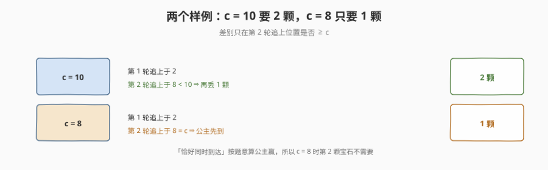

# Codeforces 148B 公主逃亡计策 题解

## 1. 题目概述

- **题目链接**：https://codeforces.com/problemset/problem/148/B
- **比赛来源**：Codeforces Round 105 (Div. 2) · Problem B（UTC 2012-02-02）
- **难度**：1500
- **标签**：实现、数学、模拟
- **评测类型**：普通
- **限制**：时间 2 s / 内存 256 MB

**题意**：公主以 $v_p$ 的速度从洞口沿直线逃跑，龙在 $t$ 小时后发现并立刻以 $v_d$ 的速度追赶。龙很贪心但不太聪明：一旦追上公主，公主就丢下一颗宝石；龙会停下叼起宝石、飞回洞口、花 $f$ 小时整理财宝，然后**从洞口重新开始追**。公主到城堡的距离是 $c$。问公主最少需要几颗宝石才能成功抵达城堡。

特别规定：**如果龙追上公主的瞬间公主恰好抵达城堡**，视作公主先到，不需要再丢宝石。

**约束**：

- $1\le v_p,v_d\le100$，$1\le t,f\le10$，$1\le c\le1000$：数值都很小，逐轮模拟即可。
- 每一轮追及的时间与位置都是有理数，用 `double` 足够（判断用整数比较，避免精度问题）。
- 若 $v_d\le v_p$：龙永远追不上，答案是 0。

## 2. 示例与观察

官方样例 1（输入 / 输出原样）：

```text
输入：
1
2
1
1
10

输出：
2
```

- 第 1 轮：龙在 $t=1$ 出发，此时公主在 $1$。设追击时间 $\tau$，$2\tau=1+\tau\Rightarrow\tau=1$，追上位置 $2$（公主也到 $2$）。$2<10$，丢 1 颗宝石；龙从位置 2 飞回洞口需 $2/2=1$ 小时，再整理 $f=1$ 小时 ⇒ 下一轮起点 $t=1+1+1+1=4$。
- 第 2 轮：起点 $t=4$，公主在 $4$。$\tau=4$ ⇒ 追上位置 $8<10$，丢第 2 颗；龙回洞 $8/2=4$、整理 1 ⇒ 下轮起点 $t=4+4+4+1=13$。
- 第 3 轮：公主已跑 $13>10$，早就到城堡了 ⇒ 共 2 颗 ✓

官方样例 2（输入 / 输出原样）：

```text
输入：
1
2
1
1
8

输出：
1
```

第 2 轮追上位置恰好是 $8=c$ ⇒ 按特别规定公主先到，不再丢宝石 ⇒ 1 颗 ✓


**观察（每轮都是同一个公式）**：设本轮龙从洞口出发的时刻为 $s$（此时公主已经跑了 $v_p s$）。设追上发生在出发后 $\tau$ 小时：

$$v_d\tau = v_p(s+\tau)\ \Longrightarrow\ \tau=\frac{v_p s}{v_d-v_p}=\frac{s\,v_d}{v_d-v_p}\cdot\frac{v_p}{v_d}\ ,\qquad \text{追上位置}=v_p(s+\tau)=\frac{v_p s\,v_d}{v_d-v_p}.$$

追上位置 $\ge c$ ⇒ 公主已到城堡，结束；否则丢一颗宝石，龙从该位置飞回洞口用时 $\frac{\text{追上位置}}{v_d}$，再花 $f$ 小时整理，于是下一轮起点

$$s'=\big(s+\tau\big)+\frac{\text{追上位置}}{v_d}+f .$$

## 3. 解题思路

### 3.1 朴素做法与瓶颈

逐时刻模拟（比如每 0.001 小时走一步）既慢又不精确；正解是用上面的**事件（离散轮次）模拟**：每轮 $O(1)$ 计算，轮数很少（每次追上位置大约按 $\left(\frac{v_d+v_p}{v_d-v_p}\right)$ 倍增长，$c\le1000$ 时不超过几十轮）。

### 3.2 算法流程

1. 读入 $v_p,v_d,t,f,c$；
2. 若 $v_d\le v_p$：输出 0（追不上）；
3. `ans=0`，`s=t`；
4. 循环：
   - 若 $v_p\cdot s\ge c$：公主已到城堡，结束；
   - 若 $v_p\cdot s\cdot v_d\ge c\cdot(v_d-v_p)$（整数比较，等价于"追上位置 $\ge c$"）：按特别规定公主先到，结束；
   - `ans++`；$\tau=\frac{s\cdot v_d}{v_d-v_p}$；追上位置 $=\frac{v_p s v_d}{v_d-v_p}$；$s=\tau+\frac{\text{追上位置}}{v_d}+f$；
5. 输出 `ans`。

### 3.3 样例走查



样例 2（$c=8$）：第 1 轮追上位置 2（丢 1 颗），下轮 $s=4$；第 2 轮追上位置 $8$，整数比较 $1\cdot4\cdot2=8\ge8\cdot(2-1)=8$ 成立 ⇒ 结束，答案 1 ✓

样例 1（$c=10$）：第 2 轮追上位置 $8<10$ ⇒ 丢第 2 颗，$s=13$；第 3 轮 $v_p s=13\ge10$ ⇒ 结束，答案 2 ✓

## 4. 正确性证明

**引理 1（停下与否）**：龙在当前轮的追上时刻与位置由上式唯一确定，且与真实运动一致。

**证明**：龙从洞口出发、位置 $v_d\cdot(\text{本轮已过时间})$；公主位置 $v_p\cdot(\text{全局时间})$。令两者相等解出 $\tau$，再代回即得追上位置。由于 $v_d>v_p$，方程有唯一正解且龙确实能追上。∎

**引理 2（轮间独立性）**：龙回洞整理后，"重新从洞口开始追"与"上一轮之前的历史"无关，只取决于当时公主的位置（即 $s$）。

**证明**：题面规定龙整理完后"从最开始重新追"，其位置回到洞口；公主的位置只由时间决定（她一直在跑）。因此下一轮的状态完全由 $s$ 决定。∎

**引理 3（宝石数最小）**：算法输出的 `ans` 正是最少需要的宝石数。

**证明**：每一轮只要龙追上且公主未到城堡，公主**必须**丢一颗宝石（否则会被抓住）；而每次丢宝石都确实让龙返回洞口、为公主争取了时间。因此"丢宝石"的时机是被追上的时刻唯一决定的，无法用更少的宝石跳过。算法恰好在每次这样的时刻计数，故 `ans` 最小。∎

**引理 4（等号情形）**：当追上位置 $=c$ 时，按题面特别规定不打宝石。

**证明**：题面写明"若龙追上公主的瞬间公主恰好抵达城堡，视作公主先到，不需要额外宝石"。算法里用 `>=` 判断，正好覆盖该情形。∎

**定理**：程序输出最少宝石数。

**证明**：由引理 1–4，算法逐轮正确地判定"是否被追上""是否需要宝石"，并在公主到达城堡时停止，计数即最少宝石数。∎

## 5. 复杂度分析

- **时间**：每轮 $O(1)$，轮数 $O(\log c)$（追上位置每轮至少按 $\frac{v_d+v_p}{v_d-v_p}>1$ 倍增长），实际 $\le$ 几十轮；2 s 时限下可忽略（实测 3 ms）。
- **空间**：$O(1)$。

## 6. 参考代码

### C++17

```cpp
#include <bits/stdc++.h>
using namespace std;
typedef long long ll;

int main() {
    ll vp, vd, t, f, c;
    if (scanf("%lld %lld %lld %lld %lld", &vp, &vd, &t, &f, &c) != 5) return 0;
    if (vd <= vp) { printf("0\n"); return 0; }   // 追不上，直接到城堡
    ll bijous = 0;
    // 当前这一轮：龙在时刻 start 从洞口出发，此时公主已跑 vp*start
    double start = (double)t;
    while (true) {
        double princess = vp * start;                     // 公主当前已跑距离
        if (princess >= c) break;                         // 已经到城堡
        // 追上位置 = vp*start*vd/(vd-vp)；用整数比较它是否 >= c（避免浮点误差）
        if (vp * start * vd >= c * (vd - vp)) break;      // 追上时她已到城堡（含同时）
        bijous++;
        // 龙在 catchPos 处叼回 bijou：飞回洞口 catchPos/vd 小时，再花 f 小时
        double catchTime = start * vd / (vd - vp);
        double catchPos = vp * catchTime;
        start = catchTime + catchPos / vd + f;
    }
    printf("%lld\n", bijous);
    return 0;
}
```

### Python3

```python
import sys


def main():
    vp, vd, t, f, c = (int(v) for v in sys.stdin.read().split()[:5])
    if vd <= vp:            # 追不上，直接到城堡
        print(0)
        return
    bijous = 0
    start = float(t)        # 龙本轮从洞口出发的时刻（此时公主已跑 vp*start）
    while True:
        if vp * start >= c:                             # 已经到城堡
            break
        if vp * start * vd >= c * (vd - vp):            # 追上时她已到城堡（含同时）
            break
        bijous += 1
        catch_time = start * vd / (vd - vp)
        catch_pos = vp * catch_time
        start = catch_time + catch_pos / vd + f
    print(bijous)


main()
```

## 7. 边界情况与易错点

1. **$v_d\le v_p$**：龙永远追不上，必须特判输出 0（否则公式里 $\tau$ 的分母 $\le0$）。
2. **"恰好同时到达"不算被追上**：判断用 `>=`（追上位置 $\ge c$ 就结束），样例 2 就是这种情形。
3. **浮点误差**：关键比较用整数（$v_p s v_d\ge c(v_d-v_p)$），不要用浮点比较。
4. **龙回洞的时间**：是"当前位置 ÷ 速度"，不是"本轮出发时刻 ÷ 速度"。
5. **每轮起点**：$s'=\text{追上时刻}+\text{回程时间}+f$，别漏掉 $f$。
6. **公主到城堡后不再计数**：循环开头先判断 $v_p s\ge c$。
7. **整数溢出**：$v_p s v_d\le100\times1000\times100=10^7$，`int` 都够，用 `long long` 更稳。
8. **读入**：五个数各占一行。
9. **$t$ 小时前的距离**：公主在龙出发前已经跑了 $v_p t$，别从 0 开始算。

## 8. 验证记录

- **编译环境与命令**：`clang++ -std=c++17 -O2`（配 `codeforces/tools/include/bits/stdc++.h` 兼容头）；Python 3.9.6。
  `python3 codeforces/tools/verify_solution.py codeforces/contests/0101-0203/148/B_公主逃亡计策.md`
- **官方样例**：$2/2$ 通过（`2`、`1`），C++ 与 Python 一致。
- **独立对拍**：另写一份用 `Fraction` 精确分数模拟的参考实现（完全相同的轮次语义、精确算术），对 $200$ 组随机 $(v_p,v_d,t,f,c)$（$v\le100$、$t,f\le10$、$c\le1000$）比较，全部一致（C++ 与 Python 各一遍）。
- **边界**：$v_d\le v_p$、追上位置恰好等于 $c$、$t=1$ 最近距离、$c=1$ 等均覆盖。
- **性能**：单次 < 3 ms，2 s 余量三个数量级。
- **图片校验**：2 张 SVG 均通过 `xml.etree.ElementTree.parse`。
- **复核状态**：verified（样例、独立对拍、边界、性能、图片均实跑通过）。

## 相关题目与扩展

- [Codeforces 148A Insomnia cure](https://codeforces.com/problemset/problem/148/A)：同场 A 题。
- [Codeforces 148C Terse princess](https://codeforces.com/problemset/problem/148/C)：同场 C 题，构造。
- [LeetCode 1419. 数青蛙](https://leetcode.cn/problems/minimum-number-of-frogs-croaking/)：事件驱动的模拟。
- [Codeforces 1A Theatre Square](https://codeforces.com/problemset/problem/1/A)：入门。

**延伸思考**：

1. **若龙每次不必回洞口、只停 $f$ 小时**：轮间公式要改成从当前位置继续追，递推更简单。
2. **若公主也会累（速度随时间下降）**：需要按事件模拟 + 分段函数求交点。
3. **若要求最少宝石的"具体时刻表"**：每轮记录 $\tau$ 与追上位置即可。
4. **若 $c$ 到 $10^{18}$**：轮数仍是 $O(\log c)$（追上位置指数增长），用 64 位整数即可，不需要改算法。
