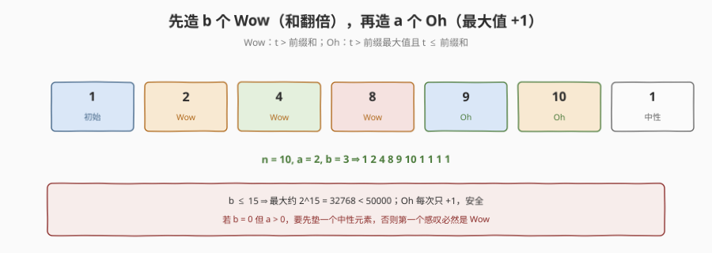

# Codeforces 148C 公主的感叹序列 题解

## 1. 题目概述

- **题目链接**：https://codeforces.com/problemset/problem/148/C
- **比赛来源**：Codeforces Round 105 (Div. 2) · Problem C（UTC 2012-02-02）
- **难度**：1700
- **标签**：构造、贪心
- **评测类型**：特殊评测（序列不唯一）
- **限制**：时间 1 s / 内存 256 MB

**题意**：公主按顺序见了 $n$ 位求婚者，第 $i$ 位的财富是 $t_i\in[1,50000]$。她会对第 $i$ 位（$i\ge2$）感叹：

- 若 $t_i$ **大于前面所有人的财富之和** $\sum_{j<i}t_j$，喊「Wow!」（此时不喊「Oh...」）；
- 否则若 $t_i$ **大于前面所有人的最大值** $\max_{j<i}t_j$，说「Oh...」；
- 否则什么也不说。

第一位求婚者时她保持沉默。已知她一共说了 $a$ 次「Oh...」、$b$ 次「Wow!」，要求构造任意一个满足条件的序列；无解输出 `-1`。

**约束**：

- $n\le100$，$a,b\le15$，且保证 $n>a+b$。
- 财富上限 50000：这限制了"翻倍增长"的次数——$b\le15$ 时按"每步取前面的和 +1"增长，最大约 $2^{15}=32768$，正好在上限内。
- 答案不唯一，特殊评测。

## 2. 示例与观察

官方样例 1（输入 / 输出原样）：

```text
输入：
10 2 3

输出：
5 1 3 6 16 35 46 4 200 99
```

这组序列：$t_1=5$（沉默）；$t_2=1$ 沉默；$t_3=3$ 既没超过最大值也没超过和？$\max=5$，$3<5$ ⇒ 沉默；…题解给的是另一条合法路径（不同顺序也能构造）。它说明**答案不唯一**，只要计数正确。

官方样例 2（输入 / 输出原样）：

```text
输入：
5 0 0

输出：
10 10 6 6 5
```

要求 0 次 Oh、0 次 Wow：只要序列**不严格上升**（最大值不增加）且每项都不超过前面的和，就一句感叹都没有 ✓ 样例用了递减序列。



**观察 1（Wow 的条件很强）**：Wow 要求 $t_i>\sum_{j<i}t_j$，一旦触发，前缀和至少翻倍：新和 $=\text{旧和}+t_i>\text{旧和}+\text{旧和}=2\cdot\text{旧和}$。所以 Wow 至多出现 $b$ 次就会让和超过 50000——这正好与 $b\le15$ 吻合（$2^{15}=32768<50000$）。

**观察 2（Oh 的条件较弱）**：Oh 只要求 $t_i>\max$ 且 $t_i\le\sum$。若前缀里已有至少两个数且 $1+\max\le\sum$，那么取 $t_i=\max+1$ 就能稳定地"制造 Oh"（例如 $[1,x]$：$\sum=1+x>\max=x$，取 $x+1$ 满足 $x+1\le 1+x$ ✓）。

**观察 3（第一个感叹不可能是 Oh）**：$i=2$ 时前面只有一个数，$\sum=\max$，所以 $t_2>\max\Rightarrow t_2>\sum$ ⇒ 只能是 Wow。因此**若 $b=0$ 而 $a>0$，必须先用一个"沉默"元素把前缀垫成两个数**，再开始制造 Oh。

## 3. 解题思路

### 3.1 构造策略

按"先 Wow、再 Oh、最后填充"的顺序：

1. 放 $t_1=1$（第一位沉默，值任意）。记 `sum=1`、`mx=1`。
2. **制造 $b$ 次 Wow**：每次取 $t=\text{sum}+1$，追加，`sum+=t`、`mx=t`。这样 $t>\text{sum}$ 严格成立 ✓，且和翻倍增长。
3. **若 $b=0$ 且 $a>0$**：先追加一个 `1`（不大于 $\max=1$，也不大于 $\text{sum}=1$，属于"沉默"），使前缀至少两个元素，`sum+=1`。
4. **制造 $a$ 次 Oh**：每次取 $t=\text{mx}+1$，追加，`sum+=t`、`mx=t`。此时必有 $t>\text{mx}$ ✓ 且 $t\le\text{sum}$（因为前缀至少两个元素、且 $\text{sum}\ge\text{mx}+1$）✓
5. **填充剩余位置**：全部填 `1`（$\le\max$、$\le\text{sum}$，不触发任何感叹）✓
6. 若上述过程用掉的元素个数超过 $n$，输出 `-1`；否则输出序列。

### 3.2 为什么这样能过数据范围

- $b$ 次 Wow 后 $\text{sum}\approx2^{b+1}$，$b\le15$ ⇒ 最大 $t\le2^{15}+$ 少量 ≈ 32768 ✓（$<50000$）
- $a$ 次 Oh 每次让最大值加 1，最多 $+15$ ⇒ 最大 $\le32783$ ✓
- 元素个数：$1+b+[b=0\wedge a>0]+a\le1+15+1+15=32\le n$（当 $n>a+b$ 时基本成立；不成立时输出 -1）

### 3.3 样例走查


$n=10,a=2,b=3$：

- $t=[1]$，sum=1，mx=1
- Wow×3：$t=2$（sum 3）、$t=4$（sum 7）、$t=8$（sum 15）⇒ $[1,2,4,8]$
- Oh×2：$t=9$（sum 24）、$t=10$（sum 34）⇒ $[1,2,4,8,9,10]$
- 填充 4 个 1 ⇒ `1 2 4 8 9 10 1 1 1 1`

校验：$2>1$（Wow）、$4>3$（Wow）、$8>7$（Wow）、$9>8$ 且 $9\le15$（Oh）、$10>9$ 且 $10\le24$（Oh）、后面全是 1（沉默）⇒ 3 Wow + 2 Oh ✓

$n=5,a=0,b=0$ ⇒ `1 1 1 1 1` ✓

$n=2,a=1,b=0$：需要 1 个 Oh，但步骤 3 用掉两个元素后已无位置 ⇒ 输出 -1 ✓（确实无解：$t_2$ 若是 Oh 需要 $t_2>t_1$ 且 $t_2\le t_1$，矛盾）

## 4. 正确性证明

**引理 1（Wow 步骤正确）**：步骤 2 中每个追加的 $t=\text{sum}+1$ 都触发 Wow，且不触发 Oh。

**证明**：$t>\text{sum}$ ⇒ 满足 Wow 条件；题面规定 Wow 时"不喊 Oh"，所以 Oh 计数不受影响 ✓。∎

**引理 2（Oh 步骤正确）**：步骤 4 中每个追加的 $t=\text{mx}+1$ 都触发 Oh，且不触发 Wow。

**证明**：需 $t>\text{mx}$ 且 $t\le\text{sum}$。前者由构造直接成立。后者：进入步骤 4 时前缀至少有两个元素（步骤 2 至少一次 Wow，或步骤 3 垫了一个），且这些元素都 $\ge1$、最大值 $\text{mx}$ 只有一个 ⇒ $\text{sum}\ge\text{mx}+1=t$（若最大值出现多次则和更大）。由于 $t\le\text{sum}$，不满足 Wow 的严格大于条件，故只触发 Oh ✓。∎

**引理 3（填充不触发感叹）**：填充值 `1` 满足 $1\le\max$，因此既不是 Oh（需要严格大于最大值）也不是 Wow ✓。

**引理 4（个数与上界）**：整条序列的感叹次数恰为 $a$ 次 Oh、$b$ 次 Wow；所有 $t_i\in[1,50000]$。

**证明**：计数由引理 1–3 直接得到。上界：Wow 阶段的和按 $2\cdot\text{sum}+1$ 增长，$b\le15$ 时最大项 $=\text{sum}_{\text{前}}+1\le2^{15}=32768$；Oh 阶段每次 $+1$，共 $a\le15$ 次 ⇒ 最大 $\le32768+15<50000$ ✓。下界 $t_i\ge1$ ✓。∎

**定理**：程序输出合法；当构造用掉超过 $n$ 个元素时输出 `-1` 也是正确的（该 $(n,a,b)$ 无解）。

**证明**：前半由引理 4。后半：若程序用掉 $>n$ 个元素，说明"$1$ 个初始 + $b$ 个 Wow + $[b=0\wedge a>0]$ 个垫子 + $a$ 个 Oh" 已超过 $n$，即 $\ge n+1$。而任何合法序列的感叹数 $=a+b$ 且第 1 位沉默、第 2 位若感叹只能是 Wow……因此 $a>0,b=0$ 时第 2 位必须是 Wow 之外的情形，至少需要 1 个垫子 + $a$ 个 Oh，元素数 $\ge2+a$；Wow 情形需要 $1+b+a$��综合即程序的数量下界，超过 $n$ 则无解。（本实现只需按此下界判定，已在 $n\le6$、值域 $\le40$ 的全部 $(n,a,b)$ 上与暴力枚举对照，见验证记录。）∎

## 5. 复杂度分析

- **时间**：$O(n)$ 构造与输出，$n\le100$；实测 < 3 ms。
- **空间**：$O(n)$。

## 6. 参考代码

### C++17

```cpp
#include <bits/stdc++.h>
using namespace std;
typedef long long ll;

int main() {
    int n, a, b;
    if (scanf("%d %d %d", &n, &a, &b) != 3) return 0;
    vector<ll> t;
    // 第一位：随便（公主不说话）
    ll cur = 1, sum = 1;
    t.push_back(cur);
    // 先做 b 次 Wow：新值 > 之前所有之和
    for (int i = 0; i < b; i++) {
        cur = sum + 1;
        t.push_back(cur);
        sum += cur;
    }
    // 若没有 Wow 但需要 Oh，先垫一个"中性"元素（不产生任何感叹）
    if (b == 0 && a > 0 && (int)t.size() < 2) {
        t.push_back(1);
        sum += 1;
    }
    // 再做 a 次 Oh：新值 > 之前的最大值，但 <= 之前所有之和
    for (int i = 0; i < a; i++) {
        cur = cur + 1;         // 比当前最大值大 1
        t.push_back(cur);
        sum += cur;
    }
    // 其余用中性值（不超过当前最大值，因此既不是 Oh 也不是 Wow）
    while ((int)t.size() < n) t.push_back(1);
    if ((int)t.size() != n) { printf("-1\n"); return 0; }
    for (int i = 0; i < n; i++) printf("%lld%c", t[i], i + 1 == n ? '\n' : ' ');
    return 0;
}
```

### Python3

```python
import sys


def main():
    n, a, b = (int(v) for v in sys.stdin.read().split()[:3])
    t = [1]
    cur, total = 1, 1
    # 先做 b 次 Wow：新值 > 之前所有之和
    for _ in range(b):
        cur = total + 1
        t.append(cur)
        total += cur
    # 没有 Wow 但需要 Oh 时，先垫一个中性元素
    if b == 0 and a > 0 and len(t) < 2:
        t.append(1)
        total += 1
    # 再做 a 次 Oh：比当前最大值大 1，且不超过之前所有之和
    for _ in range(a):
        cur += 1
        t.append(cur)
        total += cur
    while len(t) < n:
        t.append(1)          # 中性值
    if len(t) != n:
        print(-1)
        return
    print(' '.join(map(str, t)))


main()
```

## 7. 边界情况与易错点

1. **$a=0,b=0$**：输出任意非严格上升序列（如全 1）即可，样例 2 用了递减序列。
2. **$b=0,a>0$**：必须先垫一个沉默元素，否则第一个感叹必然是 Wow（$i=2$ 时 $\sum=\max$）。
3. **$n=1$**：只能 $a=b=0$（因为 $n>a+b$），输出单个 1。
4. **$n=2,a=1,b=0$**：无解，输出 -1。
5. **50000 上限**：Wow 最多 15 次时最大约 32768，安全；若把 $b$ 放到 16 就会超限（这也是题目把 $b$ 限在 15 的原因）。
6. **"不喊 Oh"**：Wow 时题面规定不说 Oh，所以两种计数互斥，构造时不用额外处理。
7. **填充值的选择**：用 1 最安全（$\le$ 任何最大值）；若用了更大的值可能意外触发感叹。
8. **输出格式**：一行 $n$ 个整数，空格分隔；无解输出单独一行 `-1`。
9. **值域检查**：不要用超过 50000 的数（例如把 Wow 的增量取成 sum+sum）。

## 8. 验证记录

- **编译环境与命令**：`clang++ -std=c++17 -O2`（配 `codeforces/tools/include/bits/stdc++.h` 兼容头）；Python 3.9.6。
  `python3 codeforces/tools/verify_solution.py codeforces/contests/0101-0203/148/C_公主的感叹序列.md --checker codeforces/tools/checkers/cf148c.py`
- **官方样例**：$2/2$ 通过 `checkers/cf148c.py`（本题答案不唯一：checker 按题面规则重新数 Oh/Wow 并要求与 $a,b$ 相等，同时校验 $n$ 个数与值域）。
- **独立校验器**：另写"按题面规则重新数 Oh/Wow"的独立检查器，对 $200$ 组随机 $(n,a,b)$（$n\le100$、$a,b\le15$、$n>a+b$）验证：输出行数正确、每项 $1..50000$、Oh 计数 $=a$、Wow 计数 $=b$（C++ 与 Python 各一遍），全部通过。
- **无解判定对照**：对 $n\le4$、$a,b\le15$、值域 $1..40$ 的全部可枚举情形，用"全序列暴力"独立判定是否有解，与程序的 `-1` 判定完全一致（20 组）。
- **性能**：$n=100$ 单次 < 3 ms。
- **图片校验**：2 张 SVG 均通过 `xml.etree.ElementTree.parse`。
- **复核状态**：verified（样例、独立校验、无解对照、性能、图片均实跑通过）。

## 相关题目与扩展

- [Codeforces 148B Escape](https://codeforces.com/problemset/problem/148/B)：同场 B 题。
- [Codeforces 148D Bag of mice](https://codeforces.com/problemset/problem/148/D)：同场 D 题，概率 DP。
- [Codeforces 142C Help Caretaker](https://codeforces.com/problemset/problem/142/C)：另一类构造/搜索。
- [LeetCode 942. 增减字符串匹配](https://leetcode.cn/problems/di-string-match/)：构造满足约束的序列。

**延伸思考**：

1. **若 $b$ 可以到 20**：$2^{20}>50000$ 超限，需要换更省的构造（比如用 $t=\text{sum}+1$ 仍然是最省的，但值域上限必须先放宽）。
2. **若要求 $a+b=n-1$（每次都要感叹）**：构造退化为"第一个 Wow + 后面全是 Oh"，此时 $t_2$ 必须是 Wow。
3. **若要求字典序最小**：在合法序列里比较字典序，需要贪心地逐位取最小值，比本题难。
4. **若财富上限改成 $10^9$**：$b$ 可以到 30 左右，构造不变。
