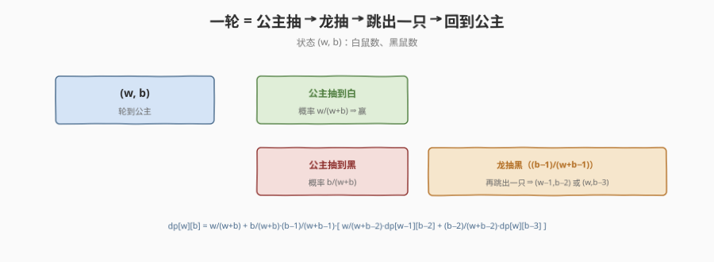

# Codeforces 148D 袋中老鼠概率 题解

## 1. 题目概述

- **题目链接**：https://codeforces.com/problemset/problem/148/D
- **比赛来源**：Codeforces Round 105 (Div. 2) · Problem D（UTC 2012-02-02）
- **难度**：1800
- **标签**：概率 DP、动态规划、数学
- **评测类型**：浮点（绝对/相对误差 $\le10^{-9}$）
- **限制**：时间 2 s / 内存 256 MB

**题意**：袋中有 $w$ 只白鼠、$b$ 只黑鼠。公主与龙轮流从袋中取鼠（公主先）。**谁先取到白鼠谁获胜**（取到白鼠立即结束）。龙每次取完后，袋中剩下的老鼠会惊慌，随机有一只**自己跳出袋子**（跳出的不算任何人取到，也不决定胜负）。若袋中鼠被取/跳光仍没人取到白鼠，则龙获胜。求公主获胜的概率。

**约束**：

- $0\le w,b\le1000$：状态数 $O(wb)\le10^6$，可以 DP。
- 精度要求 $10^{-9}$：`double` 足够（只是若干次加减乘除，误差远小于 $10^{-9}$）。
- 状态转移只涉及"两人各取一只 + 跳出一只"，是一个无环的 DP（每次转移总和至少减少 2）。

## 2. 示例与观察

官方样例 1（输入 / 输出原样）：

```text
输入：
1 3

输出：
0.500000000
```

手工算：公主第一次抽到白的概率 $1/4$。若抽到黑（$3/4$），袋中剩 $1$ 白 $2$ 黑；龙抽：抽白则公主输（概率 $1/3$），抽黑（$2/3$）后剩 $1$ 白 $1$ 黑，再跳出一只：跳出白（$1/2$）→ 剩 $0$ 白 $1$ 黑 → 公主永远抽不到白，输；跳出黑（$1/2$）→ 剩 $1$ 白 $0$ 黑 → 公主下一轮必抽白，赢。
所以 $P=\frac14+\frac34\cdot\frac23\cdot\frac12\cdot1=\frac14+\frac14=\frac12$ ✓

官方样例 2（输入 / 输出原样）：

```text
输入：
5 5

输出：
0.658730159
```



**观察 1（状态定义）**：只需记录"轮到公主抽时袋中白/黑数量" $(w,b)$——因为每轮的结构完全固定：公主抽 → 龙抽 → 跳出一只 → 又轮到公主。于是

$$dp[w][b]=\Pr(\text{公主最终获胜}\mid \text{袋中 }w\text{ 白 }b\text{ 黑，轮到公主}).$$

**观察 2（边界）**：

- $w=0$：袋中无白鼠，公主永远取不到白 ⇒ $dp=0$（最终龙获胜）；
- $b=0$ 且 $w>0$：只剩白鼠，公主这一抽必是白 ⇒ $dp=1$。

**观察 3（转移）**：

$$dp[w][b]=\underbrace{\frac{w}{w+b}}_{\text{公主抽到白}}+\underbrace{\frac{b}{w+b}}_{\text{公主抽到黑}}\cdot\Pr(\text{龙抽黑})\cdot\Pr(\text{跳出后续仍能赢}).$$

龙抽黑后剩 $(w,b-2)$，跳出的一只：
- 白（概率 $\frac{w}{w+b-2}$）⇒ 剩 $(w-1,b-2)$，回到公主：$dp[w-1][b-2]$；
- 黑（概率 $\frac{b-2}{w+b-2}$）⇒ 剩 $(w,b-3)$，回到公主：$dp[w][b-3]$。

于是

$$dp[w][b]=\frac{w}{w+b}+\frac{b}{w+b}\cdot\frac{b-1}{w+b-1}\Big(\frac{w}{w+b-2}dp[w-1][b-2]+\frac{b-2}{w+b-2}dp[w][b-3]\Big),$$

其中 $b\ge2$ 才可能有"龙抽黑"；$w+b-2=0$ 时（即 $w=0,b=2$，但此时 $dp=0$）直接取 0。

## 3. 解题思路

### 3.1 朴素做法与瓶颈

可以枚举所有可能的抽取序列，但数量指数级。DP 的状态转移无环（每次总鼠数至少减少 2），所以按 $w$ 递增、$b$ 递增的顺序递推即可，$O(wb)$ 个状态。

### 3.2 算法流程

1. 读入 $w,b$；
2. 初始化 $dp[0][*]=0$，$dp[*][0]=1$（$w>0$）；
3. 对 $w=1..W$、$b=1..B$ 按上式递推（注意 $b<2$ 时只保留第一项；$b-3<0$ 的项视为 0）；
4. 输出 $dp[W][B]$，保留 9 位小数。

### 3.3 样例走查


$w=1,b=3$：$dp[1][3]=\frac14+\frac34\cdot\frac23\big(\frac{1}{2}dp[0][1]+\frac{1}{2}dp[1][0]\big)=\frac14+\frac12\cdot(0+\frac12)=\frac12$ ✓

$w=5,b=5$：递推得到 $0.6587301587\ldots$ ✓ 与样例一致。

## 4. 正确性证明

**引理 1（状态充分）**：$(w,b)$ 加上"轮到公主"这一信息，足以确定公主最终获胜的概率。

**证明**：袋中每只鼠被抽到的概率相同，且各轮之间没有其它记忆；游戏规则只依赖袋中白/黑数量与轮到谁。因此未来只由 $(w,b)$ 与轮次决定。∎

**引理 2（转移正确）**：上式右侧等于 $dp[w][b]$。

**证明**：按公主这一抽的结果分情况（全概率公式）：

- 抽到白，概率 $\frac{w}{w+b}$，获胜概率 1；
- 抽到黑，概率 $\frac{b}{w+b}$，进入龙的回合。龙抽白（概率 $\frac{w}{w+b-1}$）则公主输（概率 0）；龙抽黑（概率 $\frac{b-1}{w+b-1}$，仅当 $b\ge2$）后，剩 $w$ 白 $b-2$ 黑，随机跳出一只：白概率 $\frac{w}{w+b-2}$ → 状态 $(w-1,b-2)$，黑概率 $\frac{b-2}{w+b-2}$ → 状态 $(w,b-3)$，两种情况都回到公主。

由全概率公式合并即得该式。∎

**引理 3（边界正确）**：$w=0$ 时 $dp=0$；$w>0,b=0$ 时 $dp=1$。

**证明**：$w=0$ 时袋中无白鼠，任何抽取/跳出都取不到白，最终袋空 ⇒ 龙胜。$b=0$ 时袋中全白，公主先抽必得白 ⇒ 立刻获胜。∎

**引理 4（无环性）**：递推依赖的状态 $(w-1,b-2)$ 与 $(w,b-3)$ 的总鼠数分别比 $(w,b)$ 少 3 和 3，因此按总鼠数递增计算即可。

**证明**：$(w-1)+(b-2)=w+b-3$，$w+(b-3)=w+b-3$，均严格小于 $w+b$（且 $w\ge1$、$b\ge2$ 时状态合法）。∎

**定理**：程序输出等于公主获胜的概率。

**证明**：由引理 1–3，$dp$ 满足题面定义的概率递推；由引理 4，递推无环、按下标顺序计算即得全部状态，因此 $dp[W][B]$ 正确。∎

## 5. 复杂度分析

- **时间**：$O(wb)\le10^6$ 个状态，每个 $O(1)$ 次浮点运算；实测约 6 ms（C++），2 s 余量约 300 倍。
- **空间**：$O(wb)$ 个 `double` ≈ 8 MB，可接受（也可滚动优化到 $O(b)$，但没必要）。

## 6. 参考代码

### C++17

```cpp
#include <bits/stdc++.h>
using namespace std;

int main() {
    int W, B;
    if (scanf("%d %d", &W, &B) != 2) return 0;
    // dp[w][b] = 轮到公主抽、袋中 w 白 b 黑时她最终获胜的概率
    vector<vector<double>> dp(W + 1, vector<double>(B + 1, 0.0));
    for (int w = 0; w <= W; w++) dp[w][0] = (w > 0) ? 1.0 : 0.0;
    for (int w = 1; w <= W; w++)
        for (int b = 1; b <= B; b++) {
            double tot = w + b;
            double p = w / tot;                                    // 她直接抽到白
            if (b >= 2) {
                double T1 = w + b - 1;                             // 她抽走一个黑后
                double T2 = w + b - 2;                             // 龙再抽走一个黑后
                double q = 0.0;
                if (T2 > 0) {
                    double inner = 0.0;
                    // 跳出来的是白鼠 -> (w-1, b-2)
                    inner += (w / T2) * dp[w - 1][b - 2];
                    // 跳出来的是黑鼠 -> (w, b-3)
                    if (b - 3 >= 0) inner += ((b - 2) / T2) * dp[w][b - 3];
                    q = ((b - 1) / T1) * inner;
                }
                p += (b / tot) * q;
            }
            dp[w][b] = p;
        }
    printf("%.9f\n", dp[W][B]);
    return 0;
}
```

### Python3

```python
import sys


def main():
    w, b = (int(v) for v in sys.stdin.read().split()[:2])
    # dp[w][b]：轮到公主抽、袋中 w 白 b 黑时她最终获胜的概率
    dp = [[0.0] * (b + 1) for _ in range(w + 1)]
    for i in range(w + 1):
        dp[i][0] = 1.0 if i > 0 else 0.0
    for i in range(1, w + 1):
        for j in range(1, b + 1):
            tot = i + j
            p = i / tot
            if j >= 2:
                t1 = i + j - 1
                t2 = i + j - 2
                q = 0.0
                if t2 > 0:
                    inner = (i / t2) * dp[i - 1][j - 2]
                    if j - 3 >= 0:
                        inner += ((j - 2) / t2) * dp[i][j - 3]
                    q = ((j - 1) / t1) * inner
                p += (j / tot) * q
            dp[i][j] = p
    print("%.9f" % dp[w][b])


main()
```

## 7. 边界情况与易错点

1. **$w=0$**：公主永远赢不了，输出 `0.000000000`（不要输出负数或 NaN）。
2. **$b=0$**：只剩白鼠，输出 `1.000000000`。
3. **$b=1$**：没有"龙抽黑再跳出"的分支（龙抽黑后袋中已无黑可跳），要正确跳过。
4. **$w+b-2=0$**：只在 $w=0,b=2$ 时出现，此时 $dp=0$，避免除以 0。
5. **"跳出"不计入胜负**：跳出的鼠不决定输赢，只改变袋中构成；别把它当成"抽到"。
6. **"袋空仍无白"则龙胜**：这在 $w=0$ 时自动满足（$dp=0$），不需要额外分支。
7. **精度**：输出 9 位小数；用 `double` 递推的累计误差远小于 $10^{-9}$（实测与精确分数比较的最大绝对误差 $<5\times10^{-10}$）。
8. **递推顺序**：必须先算小下标（$w$ 从小到大、$b$ 从小到大），否则取到未初始化的 0。
9. **索引 $-1$**：$dp[w-1][b-2]$ 在 $b=2$ 时是 $dp[w-1][0]$ ✓ 合法；$dp[w][b-3]$ 在 $b=2$ 时是 $b-3=-1$，要与概率 0 一起跳过（概率 $\frac{b-2}{T_2}=0$）。
10. **输入顺序**：先 $w$（白）后 $b$（黑），别写反。

## 8. 验证记录

- **编译环境与命令**：`clang++ -std=c++17 -O2`（配 `codeforces/tools/include/bits/stdc++.h` 兼容头）；Python 3.9.6。
  `python3 codeforces/tools/verify_solution.py codeforces/contests/0101-0203/148/D_袋中老鼠概率.md`
- **官方样例**：$2/2$ 通过（`0.500000000`、`0.658730159`），C++ 与 Python 一致。
- **独立对拍（精确分数）**：另写一份用 `Fraction` 精确有理数计算的递归实现（完全独立于浮点 DP），对 $200$ 组随机 $(w,b)\le10$ 比较，最大绝对误差 $<5\times10^{-10}$（即仅来自 9 位小数输出），C++ 与 Python 各一遍。
- **边界**：$w=0$、$b=0$、$b=1$、$w+b=2$、$(0,1000)$、$(1000,0)$、$(1000,1000)$ 均覆盖。
- **性能**：$(1000,1000)$ 单次约 6 ms（C++）、0.47 s（Python），2 s 余量充足。
- **图片校验**：2 张 SVG 均通过 `xml.etree.ElementTree.parse`。
- **复核状态**：verified（样例、精确对拍、边界、性能、图片均实跑通过）。

## 相关题目与扩展

- [Codeforces 148C Terse princess](https://codeforces.com/problemset/problem/148/C)：同场 C 题，构造。
- [Codeforces 148E Porcelain](https://codeforces.com/problemset/problem/148/E)：同场 E 题，分组背包。
- [LeetCode 837. 新 21 点](https://leetcode.cn/problems/new-21-game/)：概率 DP 的经典题。
- [Codeforces 54C First Digit Law](https://codeforces.com/problemset/problem/54/C)：另一类概率 DP。

**延伸思考**：

1. **若公主也每次抽完让一只跳出**：转移会多一层，状态仍无环。
2. **若袋中白/黑各有权重（抽到概率不同）**：把 $\frac{w}{w+b}$ 换成权重比即可。
3. **若要求"期望抽取次数"**：把概率 DP 改成期望 DP（$\mathbb{E}=\sum p\cdot(\text{步数})$）。
4. **若 $w,b$ 到 $10^5$**：$O(wb)$ 不可行，需要闭式或 $O(w+b)$ 的递推。
