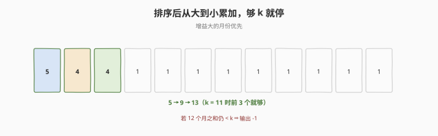

# Codeforces 149A 浇花的最少月份 题解

## 1. 题目概述

- **题目链接**：https://codeforces.com/problemset/problem/149/A
- **比赛来源**：Codeforces Round 106 (Div. 2) · Problem A（UTC 2012-02-10）
- **难度**：900
- **标签**：贪心、排序、实现
- **评测类型**：普通
- **限制**：时间 2 s / 内存 256 MB

**题意**：一年 12 个月，第 $i$ 个月若浇花则长 $a_i$ 厘米，不浇则不长。父母要求花至少长 $k$ 厘米。问**最少**浇几个月；不可能则输出 `-1`。

**约束**：

- $k\le100$，$a_i\le100$：只要选"增益最大的几个月"就一定最优。
- $k=0$ 时几个月都不浇也满足，答案是 0。

## 2. 示例与观察

官方样例 1（输入 / 输出原样）：

```text
输入：
5
1 1 1 1 2 2 3 2 2 1 1 1

输出：
2
```

增益排序后是 $3,2,2,2,\dots$，$3+2=5\ge5$ ⇒ 2 个月。

官方样例 2（输入 / 输出原样）：

```text
输入：
0
0 0 0 0 0 0 0 1 1 2 3 0

输出：
0
```

$k=0$：0 个月就够。

官方样例 3（输入 / 输出原样）：

```text
输入：
11
1 1 4 1 1 5 1 1 4 1 1 1

输出：
3
```

排序后 $5,4,4,\dots$：$5+4=9<11$，$5+4+4=13\ge11$ ⇒ 3 个月。



**观察**：要"用最少的月份凑够 $k$"，就该优先挑增益大的月份——这是典型的"排序后贪心取前缀"。因为增益都是非负数，任何最优解都可以换成"排序后取前 $t$ 大"而不变差（交换论证）。

## 3. 解题思路

1. 把 12 个增益降序排序；
2. 从大到小累加，一旦 $\ge k$ 就输出已用月数；
3. 累加完仍不足 $k$ 则输出 `-1`。


## 4. 正确性证明

**引理**：设 $b_1\ge b_2\ge\cdots\ge b_{12}$ 是 $a$ 的降序排列，则对任意 $t$，前 $t$ 大的和是"任取 $t$ 个月"的最大和。

**证明**：任取 $t$ 个月的和 $\le$ 前 $t$ 大之和（把所选取的元素与排序后同位置的元素逐项比较，每项都不超过）。∎

**定理**：程序输出最小月数。

**证明**：设最少需要 $t^*$ 个月。由引理，$t^*$ 个月能达到的最大增益就是前 $t^*$ 大之和，因此"前 $t$ 大之和 $\ge k$"对 $t=t^*$ 成立、对 $t<t^*$ 不成立；算法返回第一个满足的 $t$，正是 $t^*$。若全部 12 个月之和仍 $<k$，则任何方案都不够，输出 `-1` 正确。∎

## 5. 复杂度分析

- **时间**：$O(12\log12)$，常数级，2 s 时限可忽略。
- **空间**：$O(1)$。

## 6. 参考代码

### C++17

```cpp
#include <bits/stdc++.h>
using namespace std;

int main() {
    int k;
    if (scanf("%d", &k) != 1) return 0;
    vector<int> a(12);
    for (int i = 0; i < 12; i++) scanf("%d", &a[i]);
    sort(a.rbegin(), a.rend());
    int sum = 0, ans = 0;
    while (sum < k && ans < 12) { sum += a[ans]; ans++; }
    if (sum < k) printf("-1\n"); else printf("%d\n", ans);
    return 0;
}
```

### Python3

```python
import sys


def main():
    data = sys.stdin.read().split()
    k = int(data[0])
    a = sorted((int(x) for x in data[1:13]), reverse=True)
    total = 0
    for i, v in enumerate(a):
        if total >= k:
            print(i)
            return
        total += v
    print(len(a) if total >= k else -1)


main()
```

## 7. 边界情况与易错点

1. **$k=0$**：输出 0（样例 2），不要输出 1。
2. **总和不足**：输出 `-1`。
3. **增益为 0 的月份**：排序后排在最后，不会影响"最少月数"的判断（除非 $k=0$）。
4. **等于 $k$**：用 `>=`，不要把"恰好等于"判成不够。
5. **必须降序**：升序会得到最多月数而不是最少。
6. **读入**：第二行 12 个整数。

## 8. 验证记录

- **编译环境与命令**：`clang++ -std=c++17 -O2`；Python 3.9.6。
  `python3 codeforces/tools/verify_solution.py codeforces/contests/0101-0203/149/A_浇花的最少月份.md`
- **官方样例**：$3/3$ 通过（`2`、`0`、`3`），C++ 与 Python 一致。
- **独立对拍**：另写"枚举全部 $2^{12}=4096$ 个子集、取满足和 $\ge k$ 的最小集合大小"的暴力，对 $200$ 组随机 $(k,a)$ 比较，全部一致。
- **性能**：单次 < 3 ms。
- **图片校验**：2 张 SVG 均通过 `xml.etree.ElementTree.parse`。
- **复核状态**：verified。

## 相关题目与扩展

- [Codeforces 149B Martian Clock](https://codeforces.com/problemset/problem/149/B)：同场 B 题。
- [Codeforces 144A Arrival of the General](https://codeforces.com/problemset/problem/144/A)：贪心入门。
- [LeetCode 455. 分发饼干](https://leetcode.cn/problems/assign-cookies/)：排序 + 贪心。

**延伸思考**：

1. **若每月增益可为负**：应跳过负增益月份（选正的前缀即可）。
2. **若要求"恰好 $t$ 个月"**：仍然取前 $t$ 大。
3. **若月份数改成 $10^6$**：排序 $O(n\log n)$ 仍然可行。
