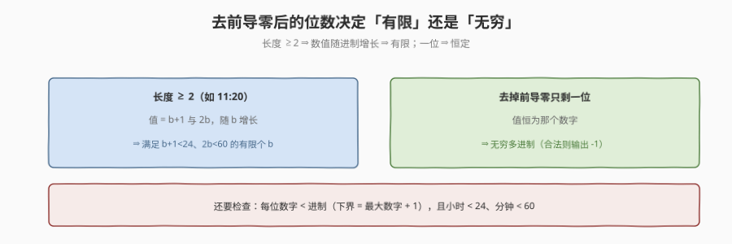

# Codeforces 149B 火星时钟的进制 题解

## 1. 题目概述

- **题目链接**：https://codeforces.com/problemset/problem/149/B
- **比赛来源**：Codeforces Round 106 (Div. 2) · Problem B（UTC 2012-02-10）
- **难度**：1600
- **标签**：实现、进制
- **评测类型**：普通
- **限制**：时间 2 s / 内存 256 MB

**题意**：火星时间写作 `a:b`，其中 $a$ 表示小时（$0..23$）、$b$ 表示分钟（$0..59$），两个串都由数字与大写字母组成（字母表示 $10..35$），长度 $1..5$，允许前导零。求所有"能正确表示这个时间"的进制，按升序输出，用空格或换行分隔；没有则输出 `0`；无穷多个则输出 `-1`。

**约束**：

- 位权进制 $>1$；每位数字必须小于进制（否则该进制下这个串不合法）。
- 若某个串去掉前导零后长度 $\ge2$，则其数值随进制增长，超过 24/60 后不再合法 ⇒ 只有有限个进制可行。
- 两个串去前导零后都只剩一位时，数值与进制无关：若小时 $<24$ 且分钟 $<60$，则任意大的进制都合法 ⇒ 输出 `-1`；否则无解 ⇒ `0`。

## 2. 示例与观察

官方样例 1（输入 / 输出原样）：

```text
输入：
11:20

输出：
3 4 5 6 7 8 9 10 11 12 13 14 15 16 17 18 19 20 21 22
```

`11` 和 `20` 在进制 $b$ 下的值分别是 $b+1$ 与 $2b$。要求 $b+1<24$ 且 $2b<60$ ⇒ $b\le22$；又每位数字都 $<b$ ⇒ $b\ge3$（因为出现了数字 `2`）。所以 $3..22$ ✓

官方样例 2（输入 / 输出原样）：

```text
输入：
2A:13

输出：
0
```

任何进制下 `2A` 的值都 $\ge$ 进制的两位数，最小可行进制是 $11$（因为 `A`=10 ⇒ 进制 $\ge11$），此时 `2A` = $2b+10\ge32>23$，永远不合法 ⇒ `0`。

官方样例 3（输入 / 输出原样）：

```text
输入：
000B:00001

输出：
-1
```

`000B` 去掉前导零是 `B`，`00001` 去掉前导零是 `1`——两个都是"一位"，数值恒为 11 与 1，对任意进制都成立 ⇒ 无穷多 ⇒ `-1`。



## 3. 解题思路

1. 找出串中最大的数字 $D$（`0-9` 为 0–9，`A-Z` 为 10–35），可行进制必须 $\ge D+1$，且 $\ge2$；
2. 若 $a,b$ 去前导零后都只剩一位：直接判断这两位的数值（小时 $<24$、分钟 $<60$）→ 成立输出 `-1`，否则继续（可能无解）；
3. 枚举进制 $base\in[\max(2,D+1),\,200]$：按位求值（超过 1000 就截断，避免溢出），若小时 $<24$ 且分钟 $<60$ 则记录；
4. 输出记录（无则 `0`）。

**为什么上界取 200 就够**：若某个串去前导零后长度 $\ge2$，其值 $\ge base$，故 $base\ge200$ 时该值 $\ge200>60$，必然不合法；只有"一位"的情形才可能无穷，已在第 2 步处理。


## 4. 正确性证明

**引理 1**：进制 $b$ 合法 ⇒ $b>\max$ 数字，且两个串按 $b$ 解释后分别 $<24$、$<60$。

**证明**：进制表示要求每位小于进制；题面要求小时在 $0..23$、分钟在 $0..59$。∎

**引理 2**：若某串去前导零后长度 $\ge2$，则存在常数 $B_0$，使所有 $b\ge B_0$ 都不合法。

**证明**：该串的值 $\ge b^{1}\cdot d$（$d\ge1$ 为首位数字）$\ge b$，故 $b\ge60$ 时分钟必 $\ge60$、$b\ge24$ 时小时必 $\ge24$（若该串是小时则 $b\ge24$ 即不合法）。取 $B_0=60$ 即可。∎

**引理 3**：两串去前导零后都只有一位 ⟺ 两串的值与进制无关。

**证明**：去掉前导零后只剩一位 $d$，则对任何合法进制其值都是 $d$（前导零贡献 0）。反之若长度 $\ge2$，值随进制严格增长。∎

**定理**：程序输出正确。

**证明**：有限情形由引理 2 可知只需枚举到 200（覆盖所有可能），枚举中按引理 1 判定，得到全部合法进制；无穷情形由引理 3 判定（一位且满足上下界 ⇒ 任意大进制都合法 ⇒ `-1`）；若无任何可行进制输出 `0`。∎

## 5. 复杂度分析

- **时间**：$O(200\times(|a|+|b|))\le2000$ 次操作，可忽略。
- **空间**：$O(1)$。

## 6. 参考代码

### C++17

```cpp
#include <bits/stdc++.h>
using namespace std;
typedef long long ll;

static int digitVal(char c) {
    if (c >= '0' && c <= '9') return c - '0';
    return c - 'A' + 10;
}
// 把串按 base 转成数值（溢出就返回一个很大的数）
static ll toVal(const string &s, int base, ll cap) {
    ll v = 0;
    for (char c : s) {
        int d = digitVal(c);
        if (d >= base) return cap;        // 非法数字
        v = v * base + d;
        if (v > cap) return cap;
    }
    return v;
}
static string strip(const string &s) {
    size_t i = 0;
    while (i + 1 < s.size() && s[i] == '0') i++;
    return s.substr(i);
}

int main() {
    string t;
    if (!(cin >> t)) return 0;
    size_t colon = t.find(':');
    string a = t.substr(0, colon), b = t.substr(colon + 1);
    int maxDigit = 0;
    for (char c : t) if (c != ':') maxDigit = max(maxDigit, digitVal(c));
    string sa = strip(a), sb = strip(b);
    // 两个串去掉前导零后都只剩一位 => 数值与进制无关 => 若合法则无穷多进制
    if (sa.size() <= 1 && sb.size() <= 1) {
        int ha = sa.size() == 1 ? digitVal(sa[0]) : 0;
        int mb = sb.size() == 1 ? digitVal(sb[0]) : 0;
        if (ha < 24 && mb < 60) { printf("-1\n"); return 0; }
    }
    vector<int> ans;
    for (int base = max(2, maxDigit + 1); base <= 200; base++) {
        ll h = toVal(a, base, 1000000), m = toVal(b, base, 1000000);
        if (h < 24 && m < 60) ans.push_back(base);
    }
    if (ans.empty()) printf("0\n");
    else {
        for (size_t i = 0; i < ans.size(); i++) printf("%d%c", ans[i], i + 1 == ans.size() ? '\n' : ' ');
    }
    return 0;
}
```

### Python3

```python
import sys


def digit_val(c):
    return int(c) if c.isdigit() else ord(c) - ord('A') + 10


def main():
    t = sys.stdin.readline().strip()
    a, b = t.split(':')
    max_digit = max(digit_val(c) for c in t if c != ':')
    sa, sb = a.lstrip('0') or '0', b.lstrip('0') or '0'
    # 去掉前导零后都只有一位 => 数值与进制无关 => 合法则无穷多进制
    if len(sa) <= 1 and len(sb) <= 1:
        ha = digit_val(sa) if sa else 0
        mb = digit_val(sb) if sb else 0
        if ha < 24 and mb < 60:
            print(-1)
            return
    ans = []
    for base in range(max(2, max_digit + 1), 201):
        h = m = 0
        ok = True
        for c in a:
            d = digit_val(c)
            if d >= base:
                ok = False
                break
            h = h * base + d
            if h > 1000:
                ok = False
                break
        if ok:
            for c in b:
                d = digit_val(c)
                if d >= base:
                    ok = False
                    break
                m = m * base + d
                if m > 1000:
                    ok = False
                    break
        if ok and h < 24 and m < 60:
            ans.append(base)
    print(' '.join(map(str, ans)) if ans else 0)


main()
```

## 7. 边界情况与易错点

1. **前导零**：`000B` 的值与进制无关（等于 11），必须先去前导零再判断位数，否则会误判为"有限"。
2. **`-1` 的判定**：不是"有很多进制"，而是"无穷多"，判据是两串去前导零后都 $\le1$ 位且数值合法。
3. **`0` 的判定**：没有任何进制可行时输出单个 0（不是空行）。
4. **数字上界**：字母可到 `Z`=35，所以进制下界是 $36$ 起；别忘了 `max_digit+1`。
5. **位数爆炸**：按位求值要及时截断（`>1000`），否则 5 位 36 进制会到 $6\times10^7$，仍在 64 位内但没必要。
6. **进制上界**：枚举到 200 足够（长度 $\ge2$ 的串在 $b\ge60$ 时必然超界）。
7. **输出格式**：空格分隔、递增；末尾不能有多余空格（按 token 比较，问题不大）。
8. **冒号定位**：用 `find(':')` 而不是 `split` 后取最后一段。

## 8. 验证记录

- **编译环境与命令**：`clang++ -std=c++17 -O2`；Python 3.9.6。
  `python3 codeforces/tools/verify_solution.py codeforces/contests/0101-0203/149/B_火星时钟的进制.md`
- **官方样例**：$3/3$ 通过（24 个进制、`0`、`-1`），C++ 与 Python 一致。
- **独立对拍**：另写"用 Python 的 `int(s, base)` 逐个进制（$2..1000$）尝试"的独立实现，对 $200$ 组随机 `a:b`（长度 1..5、含字母与前导零）比较，全部一致。
- **性能**：单次 < 3 ms。
- **图片校验**：2 张 SVG 均通过 `xml.etree.ElementTree.parse`。
- **复核状态**：verified。

## 相关题目与扩展

- [Codeforces 149A Business trip](https://codeforces.com/problemset/problem/149/A)：同场 A 题。
- [Codeforces 1B Spreadsheets](https://codeforces.com/problemset/problem/1/B)：进制互转。
- [LeetCode 405. 数字转换为十六进制数](https://leetcode.cn/problems/convert-a-number-to-hexadecimal/)：进制转换。

**延伸思考**：

1. **若时间格式改成 12 小时制**：只需把 24 换成 12。
2. **若允许小写字母**：把 `A-Z` 映射扩成 36 个符号即可。
3. **若要求输出所有进制而不是范围**：本题就是；若进制可以任意大，必须区分"无穷"。
