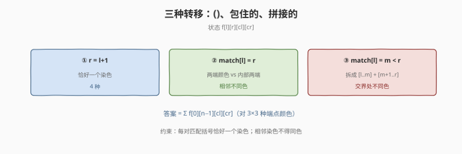

# Codeforces 149D 括号序列染色计数 题解

## 1. 题目概述

- **题目链接**：https://codeforces.com/problemset/problem/149/D
- **比赛来源**：Codeforces Round 106 (Div. 2) · Problem D（UTC 2012-02-10）
- **难度**：1900
- **标签**：区间 DP、记忆化搜索
- **评测类型**：普通
- **限制**：时间 2 s / 内存 256 MB

**题意**：给定一个正确的括号序列（长度 $\le700$）。给括号染色，每对括号可以"不染色 / 红色 / 蓝色"，满足：

1. 每个括号要么不染色，要么红色，要么蓝色；
2. **每一对匹配括号中恰好有一个被染色**；
3. 相邻的两个染色括号颜色不同（不能不染色就相邻任意）。

求方案数 $\bmod 10^9+7$。

**约束**：

- $|s|\le700$：区间 DP $O(n^2\cdot 3^2)$ 即可。
- 答案很大，必须取模。
- 序列保证是**正确**的括号序列（可以先用栈求出每对匹配括号）。

## 2. 示例与观察

官方样例 1（输入 / 输出原样）：

```text
输入：
(())

输出：
12
```

`(())` 有两对匹配括号，每对恰好染一个（$2\times2=4$ 种配对颜色选择），再乘上相邻不同色的约束过滤 ⇒ 12。

官方样例 2（输入 / 输出原样）：

```text
输入：
(()())

输出：
40
```

官方样例 3（输入 / 输出原样）：

```text
输入：
()

输出：
4
```

只有一个对：染左红/左蓝/右红/右蓝 ⇒ 4 ✓



## 3. 解题思路

**状态**：`f[l][r][cl][cr]` = 子串 $s[l..r]$（本身是一段正确的括号序列）在"左端点染 $cl$、右端点染 $cr$"下的方案数，颜色 $0$=不染、$1$=红、$2$=蓝。

**转移**分三种：

1. **$l,r$ 是匹配对且 $r=l+1$**（即 `()`）：合法当且仅当恰好一个染色，方案数 1。
2. **$l,r$ 是匹配对且 $r>l+1$**：中间 $[l+1,r-1]$ 是一段括号序列，其两端颜色 $x,y$ 必须与 $cl$、$cr$ 相邻不同色：
   $$f[l][r][cl][cr]=\sum_{x,y\ \text{兼容}} f[l+1][r-1][x][y],$$
   并要求 $cl,cr$ 恰好一个非零。
3. **$l$ 的匹配位置 $m<r$**：序列拆成 $[l..m]$ 与 $[m+1..r]$，交界处 $s[m],s[m+1]$ 的染色要不同：
   $$f[l][r][cl][cr]=\sum_{c,c'\ \text{兼容}} f[l][m][cl][c]\cdot f[m+1][r][c'][cr].$$

用记忆化 DFS 实现，答案 $=\sum_{cl,cr}f[0][n-1][cl][cr]$。


## 4. 正确性证明

**引理 1（区间结构）**：对任何正确的括号序列区间 $[l,r]$，要么 $r$ 是 $l$ 的匹配括号，要么 $l$ 的匹配位置 $m$ 满足 $l\le m<r$，且 $[l..m]$ 与 $[m+1..r]$ 都是正确的括号序列。

**证明**：$l$ 的匹配位置 $m\le r$（因为 $[l,r]$ 正确）。若 $m=r$ 是第一种情形；否则 $[l..m]$ 是一个完整的匹配对加上内部正确序列，$[m+1..r]$ 剩余部分也是正确的（括号序列的前缀拼接性质）。∎

**引理 2（子问题独立）**：在情形 3 中，$[l..m]$ 与 $[m+1..r]$ 的染色方案可以任意组合，唯一需要额外检查的是交界处 $s[m],s[m+1]$ 不能同为非零且颜色相同。

**证明**：两段内部的约束只涉及各自区间内的相邻对与匹配对；跨区间的相邻只有 $(m,m+1)$ 这一对。∎

**引理 3（递推完备）**：$f[l][r][cl][cr]$ 的三种转移覆盖且只覆盖所有合法染色。

**证明**：任一合法染色限制在 $[l,r]$ 上，按引理 1 的结构必落入三种情形之一：情形 1 由"恰好一个染色"直接判定；情形 2 中 $l,r$ 的颜色为 $cl,cr$，中间部分的颜色为 $x,y$，相邻约束正是 $cl$ 与 $x$、$cr$ 与 $y$ 不同色；情形 3 中交界约束正是 $c$ 与 $c'$ 不同色。反过来每个被计入的组合都满足所有相邻约束与匹配约束。∎

**定理**：程序输出正确答案。

**证明**：由引理 3，$f$ 的递推正确覆盖所有方案且无重复计数；答案对所有两端颜色求和，得到整个序列的方案数。取模保持正确性。∎

## 5. 复杂度分析

- **时间**：状态 $O(n^2\cdot9)$，每个状态合并时最多 $3\times3=9$ 次乘法 ⇒ $O(n^2\cdot81)$；$n=700$ 的两种极端（350 层深嵌套、350 个 `()` 拼接）实测 C++ 约 3 ms、Python 约 25 ms。
- **空间**：记忆化表 $O(n^2\cdot9)$ 个 `long long` ≈ 35 MB（C++），可接受；Python 用字典缓存约 200 MB 以内。

## 6. 参考代码

### C++17

```cpp
#include <bits/stdc++.h>
using namespace std;
typedef long long ll;
static const ll MOD = 1000000007;

int n, matchOf[705];
ll memo[705][705][3][3];       // -1 表示未算
bool done[705][705];

static void solve(int l, int r, ll res[3][3]) {
    if (done[l][r]) {
        for (int a = 0; a < 3; a++) for (int b = 0; b < 3; b++) res[a][b] = memo[l][r][a][b];
        return;
    }
    ll cur[3][3] = {{0}};
    if (matchOf[l] == r) {
        if (r == l + 1) {
            for (int a = 0; a < 3; a++)
                for (int b = 0; b < 3; b++)
                    cur[a][b] = ((a != 0) ^ (b != 0)) ? 1 : 0;   // 恰好一个染色
        } else {
            ll in[3][3];
            solve(l + 1, r - 1, in);
            for (int a = 0; a < 3; a++)
                for (int b = 0; b < 3; b++) {
                    if (!((a != 0) ^ (b != 0))) continue;        // 这对匹配括号恰好一个染色
                    ll sum = 0;
                    for (int x = 0; x < 3; x++) {
                        if (a != 0 && x != 0 && a == x) continue;  // 相邻不得同色
                        for (int y = 0; y < 3; y++) {
                            if (b != 0 && y != 0 && b == y) continue;
                            sum += in[x][y];
                        }
                    }
                    cur[a][b] = sum % MOD;
                }
        }
    } else {
        int m = matchOf[l];
        ll L[3][3], R[3][3];
        solve(l, m, L);
        solve(m + 1, r, R);
        for (int a = 0; a < 3; a++)
            for (int b = 0; b < 3; b++) {
                ll sum = 0;
                for (int c = 0; c < 3; c++) {
                    if (L[a][c] == 0) continue;
                    for (int c2 = 0; c2 < 3; c2++) {
                        if (R[c2][b] == 0) continue;
                        if (c != 0 && c2 != 0 && c == c2) continue;  // 交界处相邻同色
                        sum += L[a][c] * R[c2][b] % MOD;
                    }
                }
                cur[a][b] = sum % MOD;
            }
    }
    done[l][r] = true;
    for (int a = 0; a < 3; a++) for (int b = 0; b < 3; b++) memo[l][r][a][b] = cur[a][b], res[a][b] = cur[a][b];
}

int main() {
    string s;
    if (!(cin >> s)) return 0;
    n = (int)s.size();
    vector<int> st;
    for (int i = 0; i < n; i++) {
        if (s[i] == '(') st.push_back(i);
        else { int j = st.back(); st.pop_back(); matchOf[j] = i; matchOf[i] = j; }
    }
    ll res[3][3];
    solve(0, n - 1, res);
    ll ans = 0;
    for (int a = 0; a < 3; a++) for (int b = 0; b < 3; b++) ans = (ans + res[a][b]) % MOD;
    printf("%lld\n", ans);
    return 0;
}
```

### Python3

```python
import sys
from functools import lru_cache

sys.setrecursionlimit(3000)
MOD = 1000000007


def main():
    s = sys.stdin.read().split()[0]
    n = len(s)
    match = [-1] * n
    st = []
    for i, c in enumerate(s):
        if c == '(':
            st.append(i)
        else:
            j = st.pop()
            match[j] = i
            match[i] = j

    @lru_cache(maxsize=None)
    def solve(l, r):
        # 返回 3x3 元组：s[l] 染色 a、s[r] 染色 b 的方案数
        cur = [[0] * 3 for _ in range(3)]
        if match[l] == r:
            if r == l + 1:
                for a in range(3):
                    for b in range(3):
                        cur[a][b] = 1 if (a != 0) != (b != 0) else 0
            else:
                inn = solve(l + 1, r - 1)
                for a in range(3):
                    for b in range(3):
                        if not ((a != 0) != (b != 0)):
                            continue
                        ssum = 0
                        for x in range(3):
                            if a != 0 and x != 0 and a == x:
                                continue
                            for y in range(3):
                                if b != 0 and y != 0 and b == y:
                                    continue
                                ssum += inn[x][y]
                        cur[a][b] = ssum % MOD
        else:
            m = match[l]
            L = solve(l, m)
            R = solve(m + 1, r)
            for a in range(3):
                for b in range(3):
                    ssum = 0
                    for c in range(3):
                        if L[a][c] == 0:
                            continue
                        for c2 in range(3):
                            if R[c2][b] == 0:
                                continue
                            if c != 0 and c2 != 0 and c == c2:
                                continue
                            ssum += L[a][c] * R[c2][b]
                    cur[a][b] = ssum % MOD
        return tuple(tuple(row) for row in cur)

    res = solve(0, n - 1)
    print(sum(sum(row) for row in res) % MOD)


main()
```

## 7. 边界情况与易错点

1. **相邻同色**：只有"两个都染色且颜色相同"才违规；有一个不染色就合法。
2. **匹配对恰好一个染色**：写成"至少一个"或"恰好一个非零"要仔细；`(a != 0) ^ (b != 0)` 表示异或（恰好一个）。
3. **拆分的交界**：情形 3 里交界是 $(m, m+1)$，不是 $(l, r)$。
4. **情形 1 的相邻**：`()` 两个括号相邻，但恰好一个染色 ⇒ 不会同色，无需额外判断。
5. **取模**：乘法后要 `% MOD`，Python 天然支持大整数但也要取模以免变慢。
6. **递归深度**：$n=700$ 时递归深度可达 350，Python 要 `setrecursionlimit`。
7. **匹配括号预处理**：用栈；遇到 `)` 弹出栈顶作为匹配。
8. **答案**：对 $3\times3$ 种端点颜色求和（端点可以不染色）。

## 8. 验证记录

- **编译环境与命令**：`clang++ -std=c++17 -O2`；Python 3.9.6。
  `python3 codeforces/tools/verify_solution.py codeforces/contests/0101-0203/149/D_括号序列染色计数.md`
- **官方样例**：$3/3$ 通过（`12`、`40`、`4`），C++ 与 Python 一致。
- **独立对拍**：另写"枚举全部 $3^n$ 种染色、逐一检查两个条件"的暴力，对 $200$ 组随机正确括号序列（对数 1..4，即长度 2..8）比较，全部一致。
- **性能**：$n=700$ 的深嵌套与 `()()` 交替两种极端，C++ 均约 3 ms、Python 约 26 ms。
- **图片校验**：2 张 SVG 均通过 `xml.etree.ElementTree.parse`。
- **复核状态**：verified。

## 相关题目与扩展

- [Codeforces 149C Division into Teams](https://codeforces.com/problemset/problem/149/C)：同场 C 题。
- [Codeforces 5C Longest Regular Bracket Sequence](https://codeforces.com/problemset/problem/5/C)：括号序列 DP 入门。
- [LeetCode 678. 有效的括号字符串](https://leetcode.cn/problems/valid-parenthesis-string/)：括号匹配。

**延伸思考**：

1. **若颜色数改成 $c$**：状态仍为 $c^2$，复杂度乘 $c^4$。
2. **若允许一对括号都染色（不同色）**：把异或换成"至少一个"。
3. **若序列不保证正确**：需要先判定合法性，再 DP（本题保证正确）。
