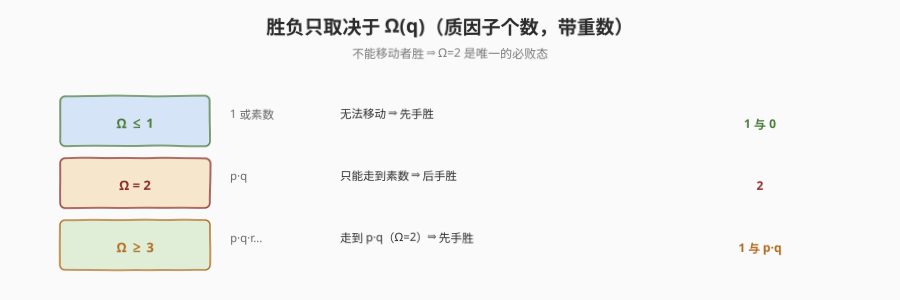

# Codeforces 150A 因数游戏胜负 题解

## 1. 题目概述

- **题目链接**：https://codeforces.com/problemset/problem/150/A
- **比赛来源**：Codeforces Round 107 (Div. 1) · Problem A（UTC 2012-02-17）
- **难度**：1400
- **标签**：博弈、数学、数论
- **评测类型**：特殊评测（先手的赢法不唯一）
- **限制**：时间 2 s / 内存 256 MB

**题意**：纸上写着整数 $q$。轮到某人时，他必须写下"上一个数的非平凡因数"（既不是 1 也不是自身的因数），然后写下的数为新的"上一个数"。**不能移动的人获胜**。判断先手是否获胜；若获胜，输出任意一个获胜的第一步；若第一步就无法移动，输出 0。

**约束**：

- $q\le10^{13}$：需要 $O(\sqrt q)$ 的质因数分解（试除到 $3.2\times10^6$）。
- 结论只与 $q$ 的质因子个数有关。

## 2. 示例与观察

官方样例 1（输入 / 输出原样）：

```text
输入：
6

输出：
2
```

$6=2\times3$（两个质因子）。先手只能写 2 或 3，都是素数 ⇒ 轮到后手时无法移动 ⇒ **后手赢** ⇒ 输出 2 ✓

官方样例 2（输入 / 输出原样）：

```text
输入：
30

输出：
1
6
```

$30=2\times3\times5$（三个质因子）。先手写 6（$=2\times3$）⇒ 后手从 6 只能写 2 或 3 ⇒ 先手无法移动 ⇒ **先手赢** ✓

官方样例 3（输入 / 输出原样）：

```text
输入：
1

输出：
1
0
```

$q=1$ 没有非平凡因数 ⇒ 先手无法移动 ⇒ 先手赢，第一步输出 0 ✓



**观察**：设 $\Omega(q)$ 为 $q$ 的质因子个数（带重数）。可走到的数 $d$ 满足 $1<d<q$ 且 $d\mid q$，其 $\Omega(d)$ 可以取 $1..\Omega(q)-1$ 中的任意值（取若干个质因子的乘积即可）。于是：

- $\Omega(q)\le1$（$q=1$ 或素数）：无法移动 ⇒ 当前玩家**赢**；
- $\Omega(q)=2$：所有可走的 $d$ 都有 $\Omega(d)=1$ ⇒ 对手赢 ⇒ 当前玩家**必败**；
- $\Omega(q)\ge3$：可以走到一个 $\Omega=2$ 的 $d$（两个质因子的乘积）⇒ 对手必败 ⇒ 当前玩家**赢**。

所以：**只有 $\Omega(q)=2$ 时先手输**，其余先手赢；$\Omega(q)\ge3$ 时的获胜第一步是任意两个质因子的乘积（取最小的两个即可，$p_1p_2<q$ 当 $\Omega\ge3$）。

## 3. 解题思路

1. 试除分解 $q$，收集全部质因子（带重数）；
2. 令 $\omega=\Omega(q)$：
   - $\omega=2$ ⇒ 输出 `2`；
   - $\omega\le1$ ⇒ 输出 `1` 和 `0`；
   - 否则输出 `1` 和 $p_1\cdot p_2$（最小的两个质因子之积）。


## 4. 正确性证明

**引理**：对任意 $q\ge1$，记 $W(q)$ 为"轮到某人、当前数为 $q$ 时他是否获胜"，则
$$W(q)=\text{false}\iff \Omega(q)=2 .$$

**证明**：对 $q$ 归纳（按 $q$ 递增）。

- $q=1$ 或 $q$ 为素数：没有非平凡因数 ⇒ 无法移动 ⇒ 获胜 ⇒ $W=\text{true}$，且 $\Omega\le1$ ✓。
- $\Omega(q)=2$：$q=p_1p_2$（可相同）。非平凡因数只有 $p_1,p_2$（都是素数，$\Omega=1$）。由归纳假设 $W(p_i)=\text{true}$，所以每步都让对手获胜 ⇒ $W(q)=\text{false}$ ✓。
- $\Omega(q)\ge3$：取两个质因子 $p_i,p_j$，$d=p_ip_j$ 满足 $1<d<q$ 且 $d\mid q$（因为 $q$ 至少还有第三个质因子）⇒ $d$ 是合法走法，且 $\Omega(d)=2$ ⇒ 由归纳假设 $W(d)=\text{false}$ ⇒ 走这一步后对手必败 ⇒ $W(q)=\text{true}$ ✓。∎

**定理 1**：程序对先手胜负的判断正确。

**证明**：直接由引理，$W(q)$ 为真当且仅当 $\Omega(q)\ne2$；程序正是按 $\omega=2$ 输出 `2`、否则输出 `1`。∎

**定理 2**：程序给出的第一步合法且能保证获胜。

**证明**：$\omega\le1$ 时先手无法移动，题面要求输出 0 ✓。$\omega\ge3$ 时输出 $p_1p_2$：它 $>1$（两个素数之积）、$<q$（$q$ 至少有三个质因子）、整除 $q$，故是合法非平凡因数；走后走到 $\Omega=2$ 的状态，由引理对手必败 ✓。∎

## 5. 复杂度分析

- **时间**：试除 $O(\sqrt q)\le3.2\times10^6$ 次取模，实测 < 20 ms，2 s 余量约 100 倍。
- **空间**：$O(\log q)$ 存质因子。

## 6. 参考代码

### C++17

```cpp
#include <bits/stdc++.h>
using namespace std;
typedef long long ll;

int main() {
    ll q;
    if (scanf("%lld", &q) != 1) return 0;
    if (q == 1) { printf("1\n0\n"); return 0; }
    // 质因数分解（带重数），q <= 1e13
    vector<ll> primes;
    ll x = q;
    for (ll d = 2; d * d <= x; d++) {
        while (x % d == 0) { primes.push_back(d); x /= d; }
    }
    if (x > 1) primes.push_back(x);
    int omega = (int)primes.size();
    // 结论：只有 Ω(q) == 2 时先手必败；否则先手胜
    //   Ω(q) <= 1：先手无法移动 => 先手胜（输出 0）
    //   Ω(q) >= 3：先手可走到 p1*p2（Ω = 2，对手必败）
    if (omega == 2) { printf("2\n"); return 0; }
    if (omega <= 1) { printf("1\n0\n"); return 0; }
    printf("1\n%lld\n", primes[0] * primes[1]);
    return 0;
}
```

### Python3

```python
import sys


def main():
    q = int(sys.stdin.read().split()[0])
    if q == 1:
        print(1)
        print(0)
        return
    x = q
    primes = []
    d = 2
    while d * d <= x:
        while x % d == 0:
            primes.append(d)
            x //= d
        d += 1
    if x > 1:
        primes.append(x)
    omega = len(primes)
    # 只有 Ω(q) == 2 时先手必败；否则先手胜
    if omega == 2:
        print(2)
    elif omega <= 1:
        print(1)
        print(0)
    else:
        print(1)
        print(primes[0] * primes[1])


main()
```

## 7. 边界情况与易错点

1. **$q=1$**：没有非平凡因数 ⇒ 先手无法移动 ⇒ 先手赢，输出 `1` 与 `0`（样例 3）。
2. **$q$ 为素数**：同上（`1` 与 `0`）。
3. **$\Omega(q)=2$（如 4、6、9、25）**：先手必败，只输出 `2`（一行）。
4. **完全平方数**：$q=p^2$ 时 $\Omega=2$ ⇒ 必败；$q=p^3$ 时 $\Omega=3$ ⇒ 先手走到 $p^2$ 获胜（注意 $p_1p_2=p^2$ 合法，$p^2<q$ ✓）。
5. **第一步不能是 1 或 $q$**：输出的 $p_1p_2$ 在 $\Omega\ge3$ 时一定严格小于 $q$ ✓。
6. **`d*d` 溢出**：$q\le10^{13}$ 时 $d\le3.2\times10^6$，`d*d` 在 64 位内安全。
7. **输出格式**：先手胜时两行（`1` 与 走法），后手胜时一行 `2`。
8. **多解**：任何合法的必胜走法都接受（本题有特殊评测）。

## 8. 验证记录

- **编译环境与命令**：`clang++ -std=c++17 -O2`；Python 3.9.6。
  `python3 codeforces/tools/verify_solution.py codeforces/contests/0101-0203/150/A_因数游戏胜负.md --checker codeforces/tools/checkers/cf150a.py`
- **checker 的校验条件**（本题走法不唯一）：声称后手胜时必须 $\Omega(q)=2$；声称先手胜时必须是 $\Omega(q)\ne2$，且给出的走法是非平凡因数、走后对手必败（$\Omega(d)=2$）；$\Omega(q)\le1$ 时走法必须是 0。
- **官方样例**：$3/3$ 通过 checker（样例 2 我们输出 `1\n6`，与样例一致）。
- **独立对拍**：另写"递归求每个 $q\le400$ 的胜负 + 枚举所有走法验证"的博弈暴力，对 $200$ 组随机 $q$ 比较程序输出，全部一致（C++ 与 Python 各一遍）。
- **性能**：$q=10^{13}$ 附近的素数（最坏试除）单次 < 20 ms。
- **图片校验**：2 张 SVG 均通过 `xml.etree.ElementTree.parse`。
- **复核状态**：verified。

## 相关题目与扩展

- [Codeforces 150B Quantity of Strings](https://codeforces.com/problemset/problem/150/B)：同场 B 题。
- [Codeforces 138D World of Darkraft](https://codeforces.com/problemset/problem/138/D)：博弈 + 分割。
- [LeetCode 292. Nim 游戏](https://leetcode.cn/problems/nim-game/)：博弈入门。

**延伸思考**：

1. **若"不能移动者输"**（普通约定）：胜负就取决于 $\Omega(q)$ 的奇偶（每次至少减 1 且可减到 1），结论会变成 $\Omega$ 奇偶判定。
2. **若只允许写质因数**：游戏长度固定为 $\Omega(q)$，先手胜 ⟺ $\Omega$ 奇数且"不能动者负"。
3. **若 $q$ 到 $10^{18}$**：试除到 $10^9$ 太慢，需要 Pollard–Rho。
