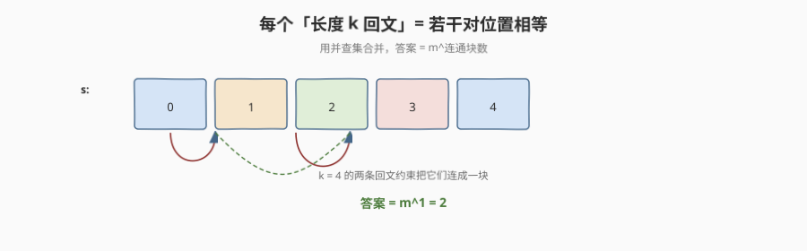

# Codeforces 150B 回文子串计数 题解

## 1. 题目概述

- **题目链接**：https://codeforces.com/problemset/problem/150/B
- **比赛来源**：Codeforces Round 107 (Div. 1) · Problem B（UTC 2012-02-17）
- **难度**：1600
- **标签**：组合计数、并查集、图论
- **评测类型**：普通
- **限制**：时间 2 s / 内存 256 MB

**题意**：字符表大小 $m$、长度 $n$ 的串中，要求**任意长度为 $k$ 的子串都是回文**，问这样的串有多少个（对 $10^9+7$ 取模）。

**约束**：

- $n,m,k\le2000$：并查集 + 快速幂即可。
- $k>n$ 时"长度 $k$ 的子串"不存在，条件为空——所有 $m^n$ 个串都合法。
- $k=1$：任何单字符都是回文，同样 $m^n$。

## 2. 示例与观察

官方样例 1（输入 / 输出原样）：

```text
输入：
1 1 1

输出：
1
```

长度 1、表大小 1：唯一串 ✓

官方样例 2（输入 / 输出原样）：

```text
输入：
5 2 4

输出：
2
```

`n=5, k=4`：长度 4 的子串有两个（$s[0..3]$、$s[1..4]$），都要是回文：

- $s[0..3]$ 回文 ⇒ $s_0=s_3,\ s_1=s_2$；
- $s[1..4]$ 回文 ⇒ $s_1=s_4,\ s_2=s_3$。

合并得 $s_0=s_3=s_2=s_1=s_4$，全部相等 ⇒ 只有 $m=2$ 种串 ✓



**观察**：把每个"长度 $k$ 的回文"要求翻译成若干"两位置相等"的约束，再用并查集合并；答案就是 $m^{\text{连通块数}}$。约束是

$$s_{i+j}=s_{i+k-1-j}\quad(0\le i\le n-k,\ 0\le j<k/2).$$

注意只需 $j<k/2$（回文的对称性覆盖另一半）。

## 3. 解题思路

1. 若 $k>n$：输出 $m^n \bmod (10^9+7)$（没有约束）；
2. 初始化并查集（$n$ 个位置）；
3. 对每个起点 $i\in[0,n-k]$、每个 $j<k/2$：合并 $i+j$ 与 $i+k-1-j$；
4. 统计根节点个数 $c$，输出 $m^c \bmod (10^9+7)$。


## 4. 正确性证明

**引理 1（约束等价）**：子串 $s[i..i+k-1]$ 是回文 ⟺ 对所有 $0\le j<k/2$ 有 $s_{i+j}=s_{i+k-1-j}$。

**证明**：回文定义即 $s_{i+j}=s_{i+k-1-j}$ 对所有 $0\le j<k$ 成立；当 $j\ge k/2$ 时该等式与 $j'=k-1-j<k/2$ 的等式重复，因此只需检查前一半。∎

**引理 2（并查集精确刻画）**：设并查集把所有被约束相等的位置合并。则串满足全部约束 ⟺ 每个连通块内字符全相同。

**证明**："⟹"：约束 $s_u=s_v$ 使 $u,v$ 连通，连通关系的传递性保证同块内字符相同。"⟸"：若同块内字符相同，则每条约束 $s_u=s_v$ 自然成立。∎

**定理**：程序输出正确。

**证明**：由引理 1、2，合法串的数量 = 给每个连通块独立选一个字符（$m$ 种）的方案数 = $m^{c}$。$k>n$ 时约束集合为空，$c=n$，公式也给出 $m^n$ ✓。取模保持正确性。∎

## 5. 复杂度分析

- **时间**：约束数 $O(n\cdot k/2)\le2000\times1000=2\times10^6$ 次并查集操作；实测 C++ 约 5 ms，Python 约 0.19 s（$n=2000,k=1000$ 的最坏情形）。
- **空间**：$O(n)$。

## 6. 参考代码

### C++17

```cpp
#include <bits/stdc++.h>
using namespace std;
typedef long long ll;
static const ll MOD = 1000000007;

int par[2005];
int find(int x) { return par[x] == x ? x : par[x] = find(par[x]); }

int main() {
    int n, m, k;
    if (scanf("%d %d %d", &n, &m, &k) != 3) return 0;
    if (k > n) {                       // 没有长度 k 的子串：无约束
        ll ans = 1;
        for (int i = 0; i < n; i++) ans = ans * m % MOD;
        printf("%lld\n", ans);
        return 0;
    }
    for (int i = 0; i < n; i++) par[i] = i;
    for (int i = 0; i + k <= n; i++)
        for (int j = 0; j < k / 2; j++) {
            int u = find(i + j), v = find(i + k - 1 - j);
            if (u != v) par[u] = v;
        }
    int groups = 0;
    for (int i = 0; i < n; i++) if (find(i) == i) groups++;
    ll ans = 1;
    for (int i = 0; i < groups; i++) ans = ans * m % MOD;
    printf("%lld\n", ans);
    return 0;
}
```

### Python3

```python
import sys

MOD = 1000000007


def main():
    n, m, k = (int(v) for v in sys.stdin.read().split()[:3])
    if k > n:                       # 没有长度 k 的子串：无约束
        print(pow(m, n, MOD))
        return
    par = list(range(n))

    def find(x):
        while par[x] != x:
            par[x] = par[par[x]]
            x = par[x]
        return x

    for i in range(0, n - k + 1):
        for j in range(k // 2):
            u, v = find(i + j), find(i + k - 1 - j)
            if u != v:
                par[u] = v
    groups = sum(1 for i in range(n) if find(i) == i)
    print(pow(m, groups, MOD))


main()
```

## 7. 边界情况与易错点

1. **$k>n$**：没有约束，答案 $m^n$（不要输出 0 或 1）。
2. **$k=1$**：`k/2=0`，无约束，答案 $m^n$ ✓
3. **$k=n$**：整个串必须是回文 ⇒ 块数 $\lceil n/2\rceil$，答案 $m^{\lceil n/2\rceil}$。
4. **$k$ 偶数且 $k<n$**：约束很强，可能出现"所有位置都相等"（如样例 2）。
5. **`k/2` 向下取整**：$k$ 为奇数时中间那个字符与自己配对，不产生约束。
6. **并查集路径压缩**：$2\times10^6$ 次操作，不压缩会慢。
7. **取模**：$m^n$ 必须快速幂或循环取模（$n\le2000$，循环也够）。
8. **读入**：一行三个整数。

## 8. 验证记录

- **编译环境与命令**：`clang++ -std=c++17 -O2`；Python 3.9.6。
  `python3 codeforces/tools/verify_solution.py codeforces/contests/0101-0203/150/B_回文子串计数.md`
- **官方样例**：$2/2$ 通过（`1`、`2`），C++ 与 Python 一致。
- **独立对拍**：另写"枚举全部 $m^n$ 个串、逐一检查每个长度 $k$ 的子串是否回文"的暴力（$n\le8$、$m\le3$），对 $200$ 组随机 $(n,m,k)$ 比较，全部一致。
- **性能**：$n=2000,k=1000$ 单次约 5 ms（C++）、0.19 s（Python）。
- **图片校验**：2 张 SVG 均通过 `xml.etree.ElementTree.parse`。
- **复核状态**：verified。

## 相关题目与扩展

- [Codeforces 150A Win or Freeze](https://codeforces.com/problemset/problem/150/A)：同场 A 题。
- [Codeforces 149D Coloring Brackets](https://codeforces.com/problemset/problem/149/D)：另一种"约束计数"。
- [LeetCode 990. 等式方程的可满足性](https://leetcode.cn/problems/satisfiability-of-equality-equations/)：并查集刻画等式约束。

**延伸思考**：

1. **若要求"恰好 $t$ 个长度 $k$ 的回文"**：条件变成不等约束，复杂得多。
2. **若要求所有长度 $\ge k$ 的子串都回文**：等价于周期条件 $s_i=s_{i+k-1}$，块数更少。
3. **若 $n$ 到 $10^5$**：可以用"区间合并 + 倍增"把 $O(nk)$ 优化到 $O(n\log n)$。
