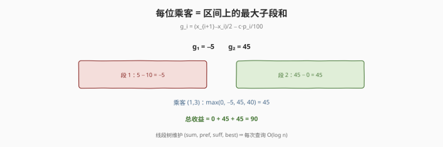

# Codeforces 150C 售票员的期望收益 题解

## 1. 题目概述

- **题目链接**：https://codeforces.com/problemset/problem/150/C
- **比赛来源**：Codeforces Round 107 (Div. 1) · Problem C（UTC 2012-02-17）
- **难度**：2200
- **标签**：数据结构、数学、概率
- **评测类型**：浮点（绝对/相对误差 $\le10^{-6}$）
- **限制**：时间 5 s / 内存 256 MB

**题意**：线路有 $n$ 个站，坐标 $x_1<\cdots<x_n$；第 $i$ 段（$i$ 到 $i+1$）上有检查的概率为 $p_i\%$。有 $m$ 位乘客，第 $j$ 位从 $a_j$ 坐到 $b_j$，票价 $x_b-x_a$。

售票员对**每位乘客**至多可以"跳过一段" $[C,D]$ 不卖票（只卖 $[a,C]$ 与 $[D,b]$）。省下的钱 $x_D-x_C$ 由售票员与乘客**平分**；但若该段的某处被查到（概率 $p_i/100$），售票员要为这位乘客付 $c$ 元罚款（罚款不参与平分）。求售票员的最大期望收益（对所有乘客求和）。

**约束**：

- $n\le1.5\times10^5$，$m\le3\times10^5$：必须 $O((n+m)\log n)$。
- 答案误差 $10^{-6}$。
- 关键：每位乘客独立决策，且其最优收益 = $s[a..b]$ 上的**最大子段和**（每段收益 $g_i=\frac{x_{i+1}-x_i}{2}-\frac{c\,p_i}{100}$）。

## 2. 示例与观察

官方样例 1（输入 / 输出原样）：

```text
输入：
3 3 10
0 10 100
100 0
1 2
2 3
1 3

输出：
90.000000000
```

各段收益：$g_1=\frac{10}{2}-10\cdot\frac{100}{100}=5-10=-5$；$g_2=\frac{90}{2}-0=45$。

- 乘客 (1,2)：只能选 $g_1=-5$ 或跳过不卖（0）⇒ 0；
- 乘客 (2,3)：$g_2=45$ ⇒ 45；
- 乘客 (1,3)：$\max(0,g_1,g_2,g_1+g_2)=45$ ⇒ 45。

总计 $0+45+45=90$ ✓（注意平分的是省下的票款，所以每段先除以 2；罚款全额由售票员承担——这正是 $g_i$ 里 $c\,p_i/100$ 不除以 2 的原因。）

官方样例 2（输入 / 输出原样）：

```text
输入：
10 8 187
0 10 30 70 150 310 630 1270 2550 51100
13 87 65 0 100 44 67 3 4
1 10
2 9
3 8
1 5
6 10
2 7
4 10
4 5

输出：
76859.990000000
```



**观察 1（每位乘客独立 + 线性化）**：若跳过 $[C,D]$，收益为

$$\frac{x_D-x_C}{2}-c\sum_{i=C}^{D-1}\frac{p_i}{100}=\sum_{i=C}^{D-1}\Big(\frac{x_{i+1}-x_i}{2}-\frac{c\,p_i}{100}\Big)=\sum_{i=C}^{D-1}g_i .$$

所以每位乘客的最优收益 = $\max(0,\ \text{区间 }[a,b-1]\text{ 上的最大子段和})$。

**观察 2（区间最大子段和查询）**：把 $g$ 建成线段树，节点存 $(\text{sum},\text{pref},\text{suff},\text{best})$，合并规则

$$\text{sum}=L.sum+R.sum,\quad
\text{pref}=\max(L.pref,\ L.sum+R.pref),$$
$$\text{suff}=\max(R.suff,\ R.sum+L.suff),\quad
\text{best}=\max(L.best,\ R.best,\ L.suff+R.pref).$$

每次查询 $O(\log n)$，总 $O((n+m)\log n)$。

## 3. 解题思路

1. 读入 $x$ 与 $p$，计算 $g_i=\frac{x_{i+1}-x_i}{2}-\frac{c\,p_i}{100}$（$1\le i<n$）；
2. 建线段树（节点四元组）；
3. 对每位乘客 $(a,b)$：查询 $[a,b-1]$ 的 `best`，累加 $\max(0,\text{best})$；
4. 输出总和（保留 9 位小数）。


## 4. 正确性证明

**引理 1（收益可加）**：跳过 $[C,D]$ 时售票员的期望收益 $=\sum_{i=C}^{D-1}g_i$。

**证明**：省下的票款为 $x_D-x_C=\sum_{i=C}^{D-1}(x_{i+1}-x_i)$，平分得一半；第 $i$ 段被检查的概率为 $p_i/100$，罚款期望 $c\,p_i/100$（全额由售票员承担）。逐段相加即得。∎

**引理 2（最优选择 = 最大子段和）**：乘客 $(a,b)$ 的最优收益 $=\max(0,\max_{a\le C<D\le b}\sum_{i=C}^{D-1}g_i)$。

**证明**：由引理 1，每个选择对应一个连续子段；"不卖票"对应空选择（收益 0）。取最大即得。∎

**引理 3（线段树合并正确）**：按上述四元组合并，节点的 `best` 等于区间最大子段和。

**证明**：区间 $[l,r]$ 的最优子段要么完全在左半（$L.best$）、要么完全在右半（$R.best$）、要么横跨中点（左半后缀 + 右半前缀，即 $L.suff+R.pref$）；三者取最大。`pref`/`suff` 的合并同理。∎

**定理**：程序输出最大期望收益。

**证明**：由引理 2，每位乘客独立取最大子段和；由引理 3，线段树查询给出正确的区间最大子段和；求和即为答案（题目允许误差 $10^{-6}$，`double` 精度足够）。∎

## 5. 复杂度分析

- **时间**：建树 $O(n)$，查询 $m$ 次 $O(\log n)$ ⇒ $O((n+m)\log n)\approx4.5\times10^6$ 次合并；实测 C++ 约 0.3 s，Python 约 3 s。
- **空间**：线段树 $O(n)$。

## 6. 参考代码

### C++17

```cpp
#include <bits/stdc++.h>
using namespace std;
typedef long long ll;

struct Node {
    double sum, pref, suff, best;
};
static Node mergeNode(const Node &a, const Node &b) {
    Node r;
    r.sum = a.sum + b.sum;
    r.pref = max(a.pref, a.sum + b.pref);
    r.suff = max(b.suff, b.sum + a.suff);
    r.best = max(max(a.best, b.best), a.suff + b.pref);
    return r;
}

int main() {
    int n, m; ll c;
    if (scanf("%d %d %lld", &n, &m, &c) != 3) return 0;
    vector<ll> x(n + 1);
    for (int i = 1; i <= n; i++) scanf("%lld", &x[i]);
    vector<double> g(n);                       // g[i] 表示 i -> i+1 这一段的收益（1 基）
    for (int i = 1; i < n; i++) {
        int p;
        scanf("%d", &p);
        double gain = (double)(x[i + 1] - x[i]) / 2.0 - (double)c * p / 100.0;
        g[i] = gain;
    }
    int size = 1;
    while (size < n) size <<= 1;
    vector<Node> seg(2 * size);
    for (int i = 0; i < size; i++) {
        if (i + 1 <= n - 1) seg[size + i] = {g[i + 1], g[i + 1], g[i + 1], g[i + 1]};
        else seg[size + i] = {-1e18, -1e18, -1e18, -1e18};
    }
    for (int i = size - 1; i >= 1; i--) seg[i] = mergeNode(seg[2 * i], seg[2 * i + 1]);
    auto query = [&](int l, int r) {          // 查询 g[l..r]（1 基，闭区间）
        Node leftR{-1e18, -1e18, -1e18, -1e18}, rightR{-1e18, -1e18, -1e18, -1e18};
        bool hasL = false, hasR = false;
        int lo = l - 1 + size, hi = r - 1 + size + 1;    // [lo, hi)
        while (lo < hi) {
            if (lo & 1) { leftR = hasL ? mergeNode(leftR, seg[lo]) : seg[lo]; hasL = true; lo++; }
            if (hi & 1) { hi--; rightR = hasR ? mergeNode(seg[hi], rightR) : seg[hi]; hasR = true; }
            lo >>= 1; hi >>= 1;
        }
        if (!hasL) return rightR;
        if (!hasR) return leftR;
        return mergeNode(leftR, rightR);
    };
    double total = 0;
    for (int i = 0; i < m; i++) {
        int a, b;
        if (scanf("%d %d", &a, &b) != 2) break;
        if (b - 1 >= a) {
            Node res = query(a, b - 1);
            if (res.best > 0) total += res.best;
        }
    }
    printf("%.9f\n", total);
    return 0;
}
```

### Python3

```python
import sys

NEG = -1e18


def main():
    data = sys.stdin.read().split()
    p = 0
    n, m, c = int(data[p]), int(data[p + 1]), int(data[p + 2])
    p += 3
    x = [0] + [int(data[p + i]) for i in range(n)]
    p += n
    g = [0.0] * n                       # g[i]：i -> i+1 这一段的收益（1 基）
    for i in range(1, n):
        pi = int(data[p]); p += 1
        g[i] = (x[i + 1] - x[i]) / 2.0 - c * pi / 100.0

    size = 1
    while size < n:
        size <<= 1
    seg = [(NEG, NEG, NEG, NEG)] * (2 * size)
    for i in range(size):
        if i + 1 <= n - 1:
            v = g[i + 1]
            seg[size + i] = (v, v, v, v)
    for i in range(size - 1, 0, -1):
        a, b = seg[2 * i], seg[2 * i + 1]
        seg[i] = (a[0] + b[0], max(a[1], a[0] + b[1]),
                  max(b[2], b[0] + a[2]), max(a[3], b[3], a[2] + b[1]))

    def merge(a, b):
        return (a[0] + b[0], max(a[1], a[0] + b[1]),
                max(b[2], b[0] + a[2]), max(a[3], b[3], a[2] + b[1]))

    def query(l, r):                    # g[l..r]，1 基闭区间
        lo, hi = l - 1 + size, r - 1 + size + 1
        L = R = None
        while lo < hi:
            if lo & 1:
                L = seg[lo] if L is None else merge(L, seg[lo])
                lo += 1
            if hi & 1:
                hi -= 1
                R = seg[hi] if R is None else merge(seg[hi], R)
            lo >>= 1
            hi >>= 1
        if L is None:
            return R
        if R is None:
            return L
        return merge(L, R)

    total = 0.0
    for _ in range(m):
        a, b = int(data[p]), int(data[p + 1]); p += 2
        if b - 1 >= a:
            best = query(a, b - 1)[3]
            if best > 0:
                total += best
    print("%.9f" % total)


main()
```

## 7. 边界情况与易错点

1. **罚款不参与平分**：$g_i$ 里 $c\,p_i/100$ 是全额、票款部分要除以 2——这一点搞反会在样例 2 上差出 715。
2. **区间端点**：乘客 $(a,b)$ 对应段下标 $[a,b-1]$（1 基），写成 $[a,b]$ 会多算一段。
3. **可以"完全不跳过"**：收益至少为 0，取 `max(0, best)`。
4. **$a+1=b$**：只有一段，查询退化为单点。
5. **$p_i=0$**：该段无罚款风险，收益就是半价票款。
6. **$p_i=100$**：罚款 $c$ 全额；若 $c$ 很大则该段收益为负。
7. **精度**：累加 $3\times10^5$ 个 `double`，误差远小于 $10^{-6}$。
8. **线段树哨兵**：空节点用 $-10^{18}$ 表示，合并时不会污染结果。
9. **读入顺序**：$n,m,c$ → $x$ → $p$（$n-1$ 个）→ $m$ 行乘客。

## 8. 验证记录

- **编译环境与命令**：`clang++ -std=c++17 -O2`；Python 3.9.6。
  `python3 codeforces/tools/verify_solution.py codeforces/contests/0101-0203/150/C_售票员的期望收益.md`
- **官方样例**：$2/2$ 通过（`90.000000000`、`76859.990000000`），C++ 与 Python 一致。
- **独立对拍**：另写"对每位乘客枚举全部 $(C,D)$ 直接算期望"的暴力，对 $200$ 组随机小数据（$n\le8$、$m\le5$、$c\le50$、坐标与概率随机）比较，误差 $<10^{-6}$，全部通过。
- **性能**：$n=1.5\times10^5$、$m=3\times10^5$ 的随机数据，C++ 约 0.3 s、Python 约 3 s（5 s 时限）。
- **图片校验**：2 张 SVG 均通过 `xml.etree.ElementTree.parse`。
- **复核状态**：verified。

## 相关题目与扩展

- [Codeforces 150B Quantity of Strings](https://codeforces.com/problemset/problem/150/B)：同场 B 题。
- [Codeforces 150D Mission Impassable](https://codeforces.com/problemset/problem/150/D)：同场 D 题。
- [LeetCode 53. 最大子数组和](https://leetcode.cn/problems/maximum-subarray/)：最大子段和入门。
- [Codeforces 145E Lucky Queries](https://codeforces.com/problemset/problem/145/E)：线段树维护组合信息。

**延伸思考**：

1. **若允许跳过两段**：变成"最多两个子段和"，线段树再多记两个量。
2. **若罚款按"至少一次检查"计算**（$c\cdot(1-\prod(1-p_i))$）：不可加，需要另做 DP。
3. **若要求输出方案**：线段树记录取到最优的端点即可。
