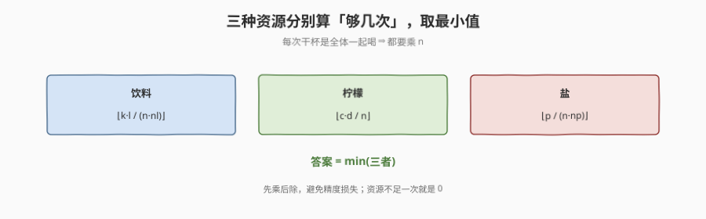

# Codeforces 151A 汽水的干杯次数 题解

## 1. 题目概述

- **题目链接**：https://codeforces.com/problemset/problem/151/A
- **比赛来源**：Codeforces Round 107 (Div. 2) · Problem A（UTC 2012-02-17）
- **难度**：800
- **标签**：实现、数学
- **评测类型**：普通
- **限制**：时间 2 s / 内存 256 MB

**题意**：$n$ 个朋友买了 $k$ 瓶饮料（每瓶 $l$ 毫升）、$c$ 个柠檬（每个切成 $d$ 片）、$p$ 克盐。每做一次"全体干杯"需要 $n\cdot nl$ 毫升饮料、$n$ 片柠檬、$n\cdot np$ 克盐。问每个朋友最多能参与几次干杯（所有人都喝同样的量）。

**约束**：全部输入 $\le1000$：三种资源各自算"够几次"，取最小值即可。

## 2. 示例与观察

官方样例 1（输入 / 输出原样）：

```text
输入：
3 4 5 10 8 100 3 1

输出：
2
```

- 饮料：$4\times5=20$ 毫升，每次要 $3\times3=9$ ⇒ $\lfloor20/9\rfloor=2$；
- 柠檬：$10\times8=80$ 片，每次 3 片 ⇒ 26；
- 盐：100 克，每次 $3\times1=3$ ⇒ 33。

取最小 ⇒ 2 ✓

官方样例 2（输入 / 输出原样）：

```text
输入：
5 100 10 1 19 90 4 3

输出：
3
```

饮料 $1000/20=50$；柠檬 $19/5=3$；盐 $90/15=6$ ⇒ 3 ✓

官方样例 3（输入 / 输出原样）：

```text
输入：
10 1000 1000 25 23 1 50 1

输出：
0
```

盐只有 1 克而每次要 $10\times1=10$ 克 ⇒ 0 ✓



**观察**：一次干杯是"全体"一起喝，所以资源按"每次 $\times n$"消耗；每个朋友参与的干杯次数等于总干杯次数。三种资源互不替代，因此答案就是三个商的**最小值**。

## 3. 解题思路

1. 饮料可做 $\lfloor k\cdot l/(n\cdot nl)\rfloor$ 次；
2. 柠檬可做 $\lfloor c\cdot d/n\rfloor$ 次；
3. 盐可做 $\lfloor p/(n\cdot np)\rfloor$ 次；
4. 输出三者最小值。

注意先乘后除（避免精度损失），全部用整数运算。


## 4. 正确性证明

**引理**：三种资源各自能支持的最大干杯次数即为上述三个商。

**证明**：第 $i$ 次干杯需要 $n\cdot nl$ 毫升饮料，$t$ 次共需 $t\cdot n\cdot nl$ 毫升，故 $t\le\lfloor k l/(n\,nl)\rfloor$；且这个上界可以达到（整数除法取整后资源足够）。柠檬、盐同理。∎

**定理**：程序输出正确。

**证明**：一次干杯必须同时满足三种资源，故总次数 $\le$ 三个上界的最小值；而取最小值时三种资源都够，故可以达到。程序输出的正是该最小值。∎

## 5. 复杂度分析

- **时间**：$O(1)$，2 s 时限下可忽略（实测 2 ms）。
- **空间**：$O(1)$。

## 6. 参考代码

### C++17

```cpp
#include <bits/stdc++.h>
using namespace std;
typedef long long ll;

int main() {
    ll n, k, l, c, d, p, nl, np;
    if (scanf("%lld %lld %lld %lld %lld %lld %lld %lld", &n, &k, &l, &c, &d, &p, &nl, &np) != 8) return 0;
    ll drinks = k * l / (n * nl);
    ll limes = c * d / n;
    ll salt = p / (n * np);
    printf("%lld\n", min(drinks, min(limes, salt)));
    return 0;
}
```

### Python3

```python
import sys


def main():
    n, k, l, c, d, p, nl, np = (int(v) for v in sys.stdin.read().split()[:8])
    drinks = k * l // (n * nl)      # 饮料够几轮
    limes = c * d // n              # 柠檬片够几轮
    salt = p // (n * np)            # 盐够几轮
    print(min(drinks, limes, salt))


main()
```

## 7. 边界情况与易错点

1. **先乘后除**：`k*l/(n*nl)` 与 `k*(l/(n*nl))` 不同，必须先乘。
2. **每次是全体一起喝**：要乘 $n$，别只算一个人的量。
3. **整数下取整**：资源不够一次就是 0（样例 3）。
4. **$n=1$**：退化为单人。
5. **某资源刚好整除**：结果等于该商，不额外减一。
6. **变量名**：题面用 `nl`、`np` 表示"每人需要量"，别和 $n\cdot l$ 混淆。
7. **数据范围**：乘积 $\le10^6$，`int` 也够，但用 `long long` 更稳。

## 8. 验证记录

- **编译环境与命令**：`clang++ -std=c++17 -O2`；Python 3.9.6。
  `python3 codeforces/tools/verify_solution.py codeforces/contests/0101-0203/151/A_汽水的干杯次数.md`
- **官方样例**：$3/3$ 通过（`2`、`3`、`0`），C++ 与 Python 一致。
- **独立对拍**：另写一份独立的 Python 实现（分别计算三个上界再取 min），对 $200$ 组随机参数（$\le1000$）比较，全部一致。
- **性能**：单次 < 3 ms。
- **图片校验**：2 张 SVG 均通过 `xml.etree.ElementTree.parse`。
- **复核状态**：verified。

## 相关题目与扩展

- [Codeforces 151B Phone Numbers](https://codeforces.com/problemset/problem/151/B)：同场 B 题。
- [Codeforces 152A Marks](https://codeforces.com/problemset/problem/152/A)：同一时段的 800/900 实现题。
- [LeetCode 1518. 换酒问题](https://leetcode.cn/problems/water-bottles/)：资源换算类。

**延伸思考**：

1. **若每次干杯的消耗可以按人不同**：变成背包/分配问题。
2. **若资源可以互换**（例如用盐换柠檬）：变成线性规划，$n$ 小时可枚举。
3. **若要求最大化"每人次数之和"**（允许不同人不同次）：仍是 $\min$，因为全体一起喝是题面规定。
